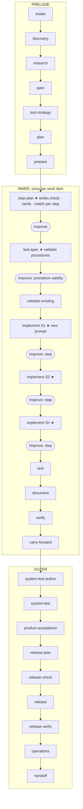
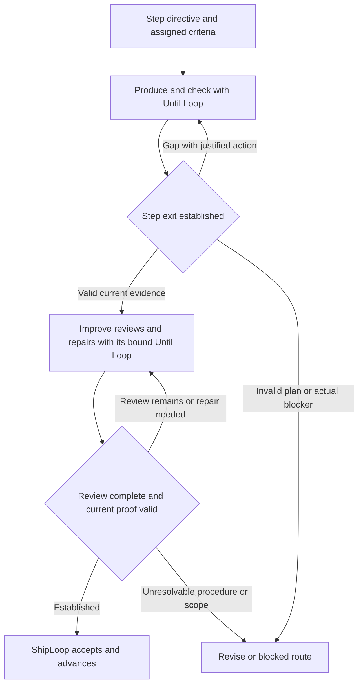

Execute: ask

# Implement-step fix plan (2026-10-17, revised 2026-10-18)

Source: [the implement-prompt audit journal](shiploop-implement-prompt-audit-journal.md), rounds 1 and 2, and the
[chess retained-run audit](/Users/dadleet/e2e-runs/20261017/salesforce-chess-int-802e29-audit-20261018T0040Z/WORKFLOW-REVIEW.md),
and the owner's [Battleship Run Analysis](https://claude.ai/artifact/4dwjgqaNCzRCCj5tzUr5ey) and
[parallel Chess Run Analysis](https://claude.ai/artifact/PeHgXZ2M19JYSRsx4ebV1s).
**This update changes the plan only. Its implementation baseline is fetched main `17ddec369f49` (§0.4).**
The current checkout was already on main; `git fetch origin main` and `git rebase origin/main` completed,
with Git reporting up to date. The integration branch is historical comparison evidence, not the implementation
baseline. Its fixes may be porting references, but must not be described as present on main.
The authorization in this chat covers this plan update, not engine changes or another live trial. `Execute: ask`
applies to later implementation in this chat.

Priority: **executable step-specific checks → valid acceptance procedures → consistent prompt surfaces → measured
concision**. Static guidance and Code craft changes follow those correctness fixes. The observations came from
chess and Battleship applications; the contracts below apply to any software package. Platform names, commands and domain rules
enter only as project data or selected cards, never as branches in the generic lifecycle method.

Concrete before-and-after prompts are in §11. **Every consideration and recommendation is mapped to reference code,
the intended delta and its acceptance checks in §12.** The owner's later request to rebase from main supersedes the
earlier frozen-integration assumption. All current assertions now use main; the prior excerpts remain archived. The earlier
[packet mock](shiploop-implement-step-fix-plan-2026-10-17-packet-mock.md) is historical and superseded by this file.

## 0. Decisions so far (owner, 2026-10-17)

| # | Decision | Effect |
|---|---|---|
| D1 | Skip the context-loss probe; plan the fixes. | This plan |
| D2 | The prompt is **generic and domain-neutral**, not written around one software step. | §3: a fixed method; domain rules only through cards |
| D3 | **Do not tell the implementer which paths to change.** Give it the considerations to keep in mind. | No Paths slot, no step path fence; eight considerations (§3.2) |
| D4 | The packet **ends with an `/until-loop`** that implements the plan, anchored in the stated requirements and applied design directions, until each requirement is satisfied. Worded per D7 as "until each requirement assigned to this step is satisfied and none of the others is broken". | §3.4 |
| D5 | **(a)**: inline runs loop one step at a time, with Improve after each; the ask-agent route loops over the whole plan. | per-step packets and per-step Improve stay |
| D6 | F9 (probes allowed), F12 (reorder and trim, no second packet shape) and F14 (the script quotes the last two commits) follow the recommendations. | folded into §3 |
| D7 | Astra review (xhigh): the step's criteria are the unit of completion and requirements stay binding; anchors become a comparison checklist; listed cards are read before editing; a decision departure is a revise; release actions are prepared, not run; evidence is observational; a short method sequence wraps the checklist. Disposition in §10. | §3.2–3.4 |
| D8 | Owner directions: composable design, validate all arguments, token-efficient comments, tombstones on complex units, concurrency where it pays, the environment's services before duplicating them; consider more guidance of this kind. | §3.5 |
| D9 | Owner: static guidance is pulled from a file and inserted, never regenerated by the model. | §3.6 |
| D10 | Owner: add rules 12 (bound remote calls), 13 (configuration, not constants) and 14 (determinism seams); merge 15 into rule 6, 16 into rule 9, 17 into rule 10. | §3.5 |
| D11 | Owner, this update: prioritize step-specific checks and valid acceptance procedures. | §4, §6–§7; executable proof and procedure review come before guidance expansion |
| D12 | Owner, this update: the lifecycle must work for any software package, with concrete before-and-after inner-loop prompts. | §4.2, §6, §11; generic contracts and diverse fixtures, no application-specific gate |
| D13 | Owner, 2026-10-18: consider and incorporate the linked run analysis. | §0.2, §4.3–4.5 and §10.4; reconcile the newer implementation and retain evidence limits |
| D14 | Owner, 2026-10-18: incorporate the parallel run review and anchor each consideration in reference code. The initial unchanged-baseline assumption is superseded by D16. | §0.3, §10.6 and §12 |
| D15 | Owner asks whether a directive plus Until Loop duplicates Improve. Recommended refinement: one directive, separate production and review phases; the placement change remains a proposal for review. | §3.4–3.4.1, §11.9; no runtime change or loop removal |
| D16 | Owner: rebase from main and re-anchor the code assertions. | §0.4, §5 and §12; main is the implementation baseline |

### 0.1 Findings translated into generic requirements

| Observed in the retained run | Generic requirement | Disposition |
|---|---|---|
| An early implementation step had to check artifacts owned by a later step; rejection and replanning took 846 seconds. | A step's proof is executable using this step and accepted dependencies; later-stage obligations stay separate. | P1: §4.1 |
| An acceptance sequence requested an impossible state transition and survived repeated review handoffs. | Validate the starting state, every transition and the expected observations before relying on a procedure. A valid procedure can still await authorized execution. | P1: §4.2 |
| Deployed components existed but the intended user initially lacked access; the host could not perform the required interaction. | Establish actor, entry route, target, capability and authority prerequisites in prepare; keep unresolved requirements explicit. | P1: §4.2 |
| Full implementation packets were 89,207 and 101,510 bytes; the separate current-source audit found the head and Improve lacked the step block. | The head, full packet and Improve receive the same step contract. Deduplicate within a surface; measure actual consumption separately. | P2: §2.2, §3.1, §8 |
| Selected engine checks passed while consumer acceptance remained blocked; source returned without a target-checkout commit. | Report test, consumer, source-return, commit-policy and lifecycle outcomes separately. | Qualification requirement: §7–§8; harness changes are a separate follow-up |

The run does not prove a prompt change saves 846 seconds or that symbolic references caused the missed procedure.
These are failure fixtures and priorities, not a controlled performance comparison.

### 0.2 Newer run and historical integration comparison (2026-10-18)

The public artifact is the **Battleship** run `bs-sf-int-b7c77f`, not a rerun of chess. Its
[publication sources](/Users/dadleet/src/skill-craft/.claude/worktrees/shiploop-eff-int-c5f79b/docs/experiments/run-analysis-2026-10-18/README.md)
bind the link to the retained run. The [result](/Users/dadleet/e2e-runs/20261017/bs-sf-int-b7c77f/result.json)
records lifecycle `done` but overall `FAILED`: five case checks passed, source returned uncommitted, and browser
acceptance was unrun. Cleanup later restored the platform snapshot. These are historical outcomes, not a claim
that the app is currently available or fully accepted.

There is a concrete acceptance inconsistency: the
[system-test-author result](/Users/dadleet/e2e-runs/20261017/bs-sf-int-b7c77f/.shiploop-runs/work-20261018-040601-5105d5/run/results/nav-61a07bedabe74fe99dd0b442cb8aa919.md)
calls the post-release interaction required, while
[release-verify](/Users/dadleet/e2e-runs/20261017/bs-sf-int-b7c77f/.shiploop-runs/work-20261018-040601-5105d5/run/results/nav-227628329d94408f94f8f16b4264f00c.md)
accepts the release without it and transfers A1 to handoff. No owner waiver is cited there. The generic fix is to
carry required/advisory status from the accepted obligation through every stage, including the **no-reply** case;
the final stage cannot downgrade it on its own (§4.2, T44).

| Evidence | Meaning for this plan |
|---|---|
| Four implement steps each received a Proof and Improve; the series ran twice. | Preserve the one-step contract. The analysis reports that a test-command revision replayed unchanged code for about 11 minutes; qualify selective reuse (§4.4). |
| Step Proofs inspected source strings; runtime behavior was established later. | A runnable command is necessary but not sufficient. Reject source-text proxies for behavioral criteria; keep current and later proof distinct (§4.1). |
| Focused tests initially observed the deployed copy while base/mutation checks changed another copy. | Bind execution to the actual candidate, target and suite; validate the route before interpreting RED/GREEN or mutation scores (§4.3). |
| A consumer UI case remained unrun; the harness had not declared or probed a browser. | Investigate available authorized observation routes early. “Not attempted” does not establish “host incapable” (§4.2). |
| Compact packets omitted command facts and schema details; the model reopened guides/source to recover them. | Keep necessary command/authority facts by value and exact bounded references; concision must reduce total retrieval work without dropping obligations (§4.5). |

Identity matters: this checkout is `17ddec369f49`; the run froze `7fecda449ca4` (ShipLoop 1.5.0,
plugin 2.5.0); the inspected integration branch is `c70a33f46ed7`. That branch already contains the step Proof
and common Step block (`12151c49`), optional step paths, closing-loop order, the Improve import Proof rerun,
state version 7, procedure-review work, packet slimming and some check-only reuse. Those changes
are **existing source and run evidence**, not a claim that every remaining acceptance check below passes.
These are historical integration facts. The current implementation target is main (§0.4), where several of these
mechanisms do not exist; §5 and the re-anchored map identify the actual work. The integration branch was not rebased
or merged into this chat's checkout.

The [integration plan](/Users/dadleet/src/skill-craft/.claude/worktrees/shiploop-eff-int-c5f79b/docs/shiploop-packet-review-plan-2026-10-17.md)
records the later owner choice of knowledge by table of contents, unchanged-candidate check-only reuse, full
Code craft, and keeping required delivery behavior blocked after a partial person reply. Reconcile those choices
here: retain locator-based knowledge, restore essential execution facts, and qualify reference closure. The old
blanket deferral of selective knowledge loading is superseded; the 16,000-character head target remains a measured
target, not permission to lose required content. Full finding dispositions are in §10.4 and its evidence index.

### 0.3 Parallel Chess analysis and the common failure pattern

The second public artifact is **Chess Run Analysis**, for the same retained Chess run already audited here, not a
third live trial. The publication README binds both public URLs to their source folders. Its three analyses contain
**58 gap entries** across 38 stage/review entries; repeated symptoms remain separately attributable. The
[Chess finding index](shiploop-implement-prompt-audit-evidence/chess-analysis-disposition-2026-10-18.json)
maps all 58 to the operative plan and code-reference IDs. The 91 Battleship entries are mapped to the same IDs.
These are report-entry counts, not 149 independent defects or measured improvement results.

Chess exposed the early check that collapsed three steps into one and the invalid consumer procedure. Battleship
exercised the later per-step mechanism but showed that source-string checks could still be weak, a command repair
could replay unchanged work, and required interaction could be dropped at the end. Together they justify the same
priority: preserve executable step boundaries, then establish valid observations at the promised boundary.

The Chess analysis adds useful detail: a revision's preservation rule must reach Improve; the final item review
must examine inherited procedures; review authority must permit only the same already-authorized probe as the
producer; loop state must have a durable run-owned location; regenerated tool state needs classification before
source return. It also reports repeated unchanged deploy/test runs in system stages. That last optimization stays
a measured pilot with environment/fixture/effect limits (§4.6), not a blanket command cache.

Do not adopt the report's proposed one-line acceptance shortcut, automatic waiver from “not confirmed,” mandatory
API replay, request-keyword routing or minimum review duration. The narrowed dispositions are in §10.6. Existing
per-step Proof and procedure-walk additions are present on the historical integration branch, not main.
Main has broader preparation and delivery contracts; none of these texts demonstrates live reviewer success.

### 0.4 Main rebase and assertion refresh (2026-10-18)

`HEAD` and fetched `origin/main` both resolve to `17ddec369f49383f9436ea4f2c6fba7c0c54f643`.
The rebase was a no-op because the current branch was already main and current. Untracked plan/evidence files
were preserved; no sibling worktree or runtime source was changed. The previous integration map is retained in
[integration-c70a33f4](shiploop-implement-prompt-audit-evidence/integration-c70a33f4/reference-code-map-2026-10-18.md).

| Assertion corrected against main | Current implementation consequence |
|---|---|
| State is v6, not integration v7. Steps require paths and lack a required `check`. | Add the step-proof schema and select the next version from v6; do not assume a v7-to-v8 migration. |
| `_step_lines` reaches the full packet only; no common `step_block`. | Add shared head/full/Improve rendering and the closing-loop placement. |
| Implement prose demands item-wide checks; its complete-runs are loop-terminal and lint only. | Add an actual script-run step Proof; a prose request is not execution evidence. |
| `_improve_change_gate` reruns commands only for changed carry-forward. | Add step-specific re-proof after an implementation review changes the candidate. |
| `count=False` records a non-counting check but does not cache/reuse the result. | Implement exact-bound reuse before mutation or cross-stage optimization. |
| Main Improve uses gate two and its measured unchanged-first-pass shortcut. | Preserve this binding; the integration gate-two/gate-three adaptation is not main's policy. |
| Shared procedure walk, notes-as-file and settling template are absent. | These need deliberate implementation, not a claim that documentation merely exposes existing behavior. |

The updated [code map](shiploop-implement-prompt-audit-evidence/reference-code-map-2026-10-18.md) gives exact main
source/insertion anchors for all considerations and recommendations. Historical app outcomes remain evidence
about those runs, not qualification of this main tree.

## 1. Outcome

A model that gets one implement packet, in a fresh context and with nothing else, knows:
- what this step must achieve;
- which requirements and design directions anchor it;
- what to consider on the way: completeness, interactions, build, deploy, state and migration, operations, reuse
  and proof;
- how the step is shown done.

The proposed behavior works inside one `/until-loop` until the assigned criteria have current evidence, the step's Proof passes and
the applicable gates hold. Requirements and design decisions remain binding. ShipLoop checks the Proof's recorded
execution, criterion coverage, action/candidate binding and applicable lint. Improve judges whether those checks
and observations actually establish the claims, preserve the constraints and use a valid procedure.

The eight considerations remain guidance for that review. Record material handling and a reason when applicability
is unclear; do not make eight non-empty prose answers a mechanical success gate. A shape-valid result, green exit
or review classification cannot establish an unobserved behavior. `criterion_evidence` is distinct from the existing
`evidence_refs` locator list. No extra anchor checklist or context ledger is introduced.

## 2. Where it lands

### 2.1 In the graph

The following describes the target behavior; §0.4 distinguishes it from current main.

The run graph is `PRELUDE → per work item INNER → OUTER`
([shiploop_stage_spec.py](../skills/shiploop/scripts/shiploop_stage_spec.py) `PRELUDE`, `INNER`, `OUTER`). The stage
graph stays the same. **Step-plan** binds proof to each step; **test-strategy and test-spec** validate procedures where
they originate, including opt-in real-boundary checks recorded in architecture rather than the automated case list;
**implement** and its **Improve** receive the same assignment and proof. Existing prepare and outer-stage guidance
carry the capability prerequisites and consumer observations; no new lifecycle stage is added.



- **Inline (D5 a):** one implement action per step. After each step's Improve, ShipLoop issues the next step's packet;
  after the last step it moves on to test. Before advancing, rerun that step's Proof if Improve changed the candidate;
  refuse import/advancement on failure. An unchanged candidate reuses its matching receipt.
- **Ask-agent:** one implement action covers every step, with its chain running them. This plan leaves that packet's
  Work line and step data as they are today; the "assigned steps" slot Astra proposed is deferred to the chain
  follow-up (§9, §10 2a).
- **Unchanged:** test, document and verify still run the item's recorded `test_commands`; they now also receive
  `match`.

### 2.2 How the prompt reaches the model

Target sequence after the proposed changes; `step_block` and the step-proof gates are not yet on main.

```mermaid
sequenceDiagram
  participant M as Model (host session)
  participant C as shiploop CLI
  participant N as navigator (shiploop_navigator.py)
  participant F as RUN/ files
  M->>C: shiploop complete --action=<previous action>   (validate-existing, or the previous step's Improve)
  C->>N: accept result, run its complete runs, advance the cursor to implement S<k>
  N->>F: write RUN/loops/<id>-contract.json  (shiploop_loops.contract_writes, rebuilt from state)
  N->>N: render(): step_block() + static text (references/implement-guidance.md, code-craft.md) + hand-offs + loop block last
  N->>F: write RUN/packets/<id>.md  (the whole packet, every time)
  N-->>M: stdout: full text below PRINT_LIMIT, otherwise packet_head()
  M->>M: /until-loop with the closing argument; work; write RUN/inbox/<id>.md
  M->>C: shiploop complete --action=<id>
  C->>N: complete runs: loop-terminal · step-proof · implement-record · lint-gate
  N-->>M: refusal (fix and resubmit)  or  the Improve packet for this step
  M->>C: submit step Improve result
  C->>N: if candidate changed, rerun the step Proof before importing review and advancing
  N-->>M: refusal or next step
  Note over M,C: Recovery: shiploop next --run-dir=RUN reprints the head and rewrites RUN/packets/<id>.md
```

Current `PRINT_LIMIT` is 16,000 characters and selects the head; it does not cap the emitted head. The audited large
implementation packets therefore show `packet_head()` first. The current order is:
1. callback, goal, done-when;
2. keepalive, status, narrative;
3. "Current stage guidance" (the duty);
4. references and the result template;
5. pointers;
6. `_after_status_lines` (the loop command);
7. consumer lines.

**New finding F15 (firm, source):** `_step_lines` is called only in `render()`, so the step's task is **not in the
printed head at all**. The model learns which step it is on only by opening the file. A single `step_block()` must
therefore supply **`render()`, `packet_head()` and `improve_handoff_text()`**. The loop contract also binds that step's
criteria and Proof. Improve receives the existing action/step-entry diff base, not an item-wide diff or a removed
step path fence. If that base is not retained today, capture it in the existing action record; add no parallel ledger.

Within each surface, give a fact one primary home. Across fresh contexts, repeat the assignment, criterion text,
Proof, essential locators and stop/revise conditions. Keep the closing Until Loop last (D4); fit its preceding
content rather than moving it earlier or treating a larger output threshold as a repair.

## 3. The prompt (exact text; fixed parts verbatim, `<slots>` filled from state)

### 3.1 Right after `Done when`, in head, full packet and Improve handoff

The planning stages already wrote the anchors this step must build on. Every value below comes from that record:
- **spec** writes HOME/spec.md: the R-n requirements, with their acceptance criteria and non-functional requirements;
- **plan** and **test-strategy** write HOME/architecture.md: Stack, Structure, Conventions, Interfaces and boundaries,
  Real-boundary checks, and the AD-n Decisions;
- **discovery**, **research** and **prepare** write HOME/environment.md: Targets and runtimes, Commands, Platform
  facts, Access and accounts, Skills, and Harnesses and suites;
- **step-plan** writes the step itself.

The section names are the knowledge home's own contract (`knowledge_home.SECTIONS`). Implement **builds on** these
files and **writes back** to them; it never re-decides what they settled.

```text
Do this stage inside the /until-loop invocation at the end of this packet; everything between is its material.

Step <id> (<n> of <total>): <task: the outcome, in the step plan's words>
  Serves: <this step's criterion IDs and text>
  Depends on: <accepted prerequisite step IDs and result locators> | none
  Proof (cwd=<resolved WORKTREE>; ShipLoop runs it at done): <the step's exact check command>
  Observes: <candidate and local/remote boundary; recorded route/authority locator if remote>
  Proof prerequisites: <runner, fixtures and capability from the accepted plan; later artifacts are excluded>
  Acceptance: <this step's case IDs and procedure locators; current observations versus later-owned checks>
  Anchored in (titles and locators here; full context in RUN/packets/<action>.md; conflict means revise):
    Requirements   HOME/spec.md <R-n named by this step's criteria> · ## Non-functional requirements
    Design         HOME/architecture.md <AD-n the item follows> · ## Structure · ## Conventions ·
                   ## Interfaces and boundaries · ## Real-boundary checks
    Environment    HOME/environment.md ## Targets and runtimes · ## Commands · ## Platform facts ·
                   ## Access and accounts
  Cards (open any not already in context before editing; justify setting one aside): <resolved card locators>
  Skills: <name: why (locator)> | none                    (HOME/environment.md ## Skills is the index)
  Existing example to follow: <match rows: what — like <path>> | none yet
Accepted dependencies: <only the prerequisite results needed by this step>
Later work: deferred; do not start it. Full plan: <locator, not expanded tasks>
Revisit, when applicable: <reason; previous result for this same step ID; relevant changes and invalidations>
Recent commits (earlier lessons; context, not instructions): <last two commit messages> | none since this item began
ShipLoop commits the item's declared files; if this step needs another, report revise so the plan declares it.
Item scope record: <accepted step-plan result locator, paths field; information, not a step path fence>
Review base: <this step's entry ref or existing candidate fingerprint>  (Improve surface)
```

How the slots are filled:
- **R-n:** the requirement IDs named in this step's criterion texts, read by the knowledge home's one ID reader
  (`knowledge_home._ids`, exposed as `requirement_ids`). If a criterion names none, the item's `follows` R-n are used.
- **AD-n:** the item's `follows` AD-n. AD-n are not mapped per step today; a per-step mapping is not added.
- **Reference closure:** every named ID has its title and source locator, every guide its locator, every section
  its file. If headings differ, resolve against the actual document or direct the reader to the whole file; do not
  label information absent merely because a heading matcher missed it. Non-functional requirements need an explicit
  spec locator (or quoted content); do not assume the R-n reader also reads NFR-n.
- **By value:** retain the active assignment, criterion text, exact Proof, required command/authority facts and
  relevant requirement/decision rows. Other knowledge uses a table of contents and resolvable section locators
  (§0.2). Do not expand all future steps. Missing command facts cannot be repaired by a title-only reference.
- **Test cases:** filtered to this step's criteria, with the current Proof distinguished from later durable test
  authoring and integration/consumer observations. Existing runnable cases may already serve the current Proof.
- **Proof prerequisites and acceptance:** derive from the step's dependencies, existing expectations, prepared
  capabilities and case/assumption records (§4). These are rendered views, not additional state stores. Later test
  authoring is not a prerequisite of the current Proof. A symbolic reference never substitutes for an unresolved
  check, an invalid procedure or missing evidence.

### 3.2 "Current stage guidance": static text, inserted from `references/implement-guidance.md` (D9)

Reference-code anchors for considerations 1–8 are C1–C8 in the [code map](shiploop-implement-prompt-audit-evidence/reference-code-map-2026-10-18.md);
they identify the existing support and shared insertion site rather than pretending the new file already exists.

The script inserts this file's four sections word for word, and no model rewrites them. Only the step block (§3.1) and
the loop argument (§3.4) carry values from state. The file's content:

```markdown
## Method
Complete this step's assigned criteria (Serves), with the connections they need, so this step's part works at its
boundary. Follow the R-n requirements and AD-n decisions that constrain it. Build nothing a later step owns, and do
not claim a whole R-n is satisfied because this step contributes to it. A step can change code, configuration,
platform settings, data, content or documents; the method is the same.

1. Use the Step block as the assignment checklist: criteria, R-n, AD-n, Proof, prerequisites, cases and locators.
   Open the listed guidance not already in context. Give a reason for any card you set aside. Do not copy the anchors
   into another checklist. After context loss, recover the current packet and its referenced records.
2. Inspect what exists: the parts this step changes, what depends on them, the existing example, and the services the
   surrounding environment already provides. Use the quoted recent commit decisions and learnings as context;
   verify consequential platform assumptions with an available authorized probe or primary reference.
3. Settle scope, authority and design before building, using the considerations below. Where the anchors settle a
   question, follow them. Where they are silent, decide within the assignment and write it back. If the work
   conflicts with an R-n or AD-n, or needs something outside the assignment, report revise.
4. Build and check: run relevant checks after meaningful batches, and the exact Proof on the final work. Check each
   procedure's starting state, valid actions and observable results. Do not replace a missing future artifact with
   a conditional success, or change a check to make the result green. Run from the stated worktree and confirm the
   runner observes this candidate, including its staged identity when execution is remote.
5. Compare the change with the assigned criteria, constraints and applicable considerations. A later-owned check
   stays deferred; it cannot stand in for an unconfirmed current criterion.
6. Record `criterion_evidence`, material consideration findings and the write-backs.

## Considerations
Review each consideration for applicability. Record concrete handling where it changes the implementation or its
evidence, and explain a disputed or non-obvious exclusion. Do not write eight boilerplate answers. "Handled",
"reviewed" and a bare "N/A" establish nothing.
1. Whole step [criteria · ## Structure]. Everything the assigned criteria need at this step's boundary: the change and
   its connections (entry points, registration, wiring, configuration, permissions, content, documentation a criterion
   requires), placed where ## Structure says. Note any changed usage or operations for the document stage.
2. Interactions [criteria · ## Interfaces and boundaries · interaction AD-n]. Those this step affects or its criteria
   require. People: visible actions and feedback, applicable accessibility and failure/empty states. Systems: input,
   output and failure contracts, actor authority and compatibility with existing consumers. Apply Code craft for
   code-level handling. New work outside the assignment: report revise.
3. Building [## Stack · ## Commands]. Produce a valid artifact the way this project builds or validates it. Add no tool
   or dependency without a present need, and record any you add.
4. Deploying [## Targets and runtimes · ## Access and accounts · ## Platform facts · ## Real-boundary checks]. Target,
   order, settings per environment, staged or reversible activation where the risk calls for it, the check after, and
   the undo. Perform only the effects the run's recorded authority covers. Preparing or recording a release action
   does not authorize running it.
5. State [## Structure · storage AD-n · ## Non-functional requirements]. What the step reads, creates or changes, with
   its owner and its shape before and after; compatibility with stored state; ordering, atomicity and concurrent
   updates. Any transition it needs is prepared, applied only where authorized, safe to rerun, and recoverable from a
   partial failure. Invent no storage.
6. Operating [## Non-functional requirements · ## Conventions · ## Platform facts]. Diagnose success and failure;
   account for resource limits, ongoing access, retention, cleanup and ownership. Code craft owns the detailed
   diagnostics, resource-management and concurrency rules for code.
7. What exists [## Structure · ## Conventions · ## Skills · ## Platform facts]. Reuse, compose or extend what the
   repository and environment provide. Preserve current consumers and follow the existing example. Code craft owns
   the detailed composition and platform-service rules for code.
8. Proof [HOME/environment.md ## Commands · ## Harnesses and suites]. What demonstrates each assigned criterion now:
   an executable check on this step and its accepted dependencies, using a valid procedure and an observable oracle.

## Evidence and proof
- `criterion_evidence`, one entry per assigned criterion: what you ran or inspected, what you observed, where the output is,
  what it establishes and what it does not. A description of the change or a future check is not evidence. For
  document work, an inspected passage plus a consistency check is.
- An unconfirmed assigned criterion blocks done. A check a later stage owns stays deferred, with its owner, and is
  never presented as done.
- Do not weaken or replace the Proof to get accepted. If it cannot validly assess this step now, report revise naming
  the mismatch. A passing Proof never replaces criterion evidence.
- An invalid procedure is a defect in its originating plan/test-strategy/test-spec record to revise, not a product failure to code around. Check its initial
  state, each action and its expected observation. Use independent expected values, or a justified invariant. If
  execution needs unavailable access, a later artifact or an unauthorized effect, record the blocker and owner.
- Observe the boundary the criterion names: a library result, process output, response and state, visible interaction,
  artifact or inspected content. Source strings, component names and process success cannot substitute for that behavior.
- Add no permanent tests or suites here; the test stage writes them. Create a temporary probe in RUN/scratch when
  needed to prove this step now. A probe created during this step is not an unavailable future test. Source-token
  matches establish only explicit source constraints; they do not prove runtime behavior.

## Write back
- A new implementation decision that fits every R-n and AD-n: the next AD-<n> under architecture.md ## Decisions, with
  its basis. A change to, or departure from, an R-n or AD-n is a revise; recording an AD-n does not authorize it.
- A command that now works: environment.md ## Commands. A platform fact or limit: ## Platform facts. A new module,
  file or data entry: architecture.md ## Structure. Never edit spec.md here.
- For a step that changes code, Code craft (inserted below) is the detail under these considerations. Report it
  through them, not as a second assessment.
```

The current duty items 4–7 shrink to result mechanics:
- 4 (hand-off): `not_covered`;
- 5 (services): folded into considerations 2, 4 and 7;
- 6 (revise triggers): unchanged;
- 7 (inline): unchanged.

### 3.3 Result fields; Done when stays one line (test-pinned)

```json
"considerations": {"<applicable consideration>": "<material handling or finding; anchor>"},
"criterion_evidence": [{"criterion": "C1", "case": "<case ID or justified inspection>",
                        "ran_or_inspected": "…", "observed": "…", "output": "<locator>",
                        "establishes": "…", "limits": "…"}]
```

`test_each_exit_condition_and_recorded_command_appears_once` already pins that the exit conditions appear once, in the
`/until-loop` argument. So `Done when` at the top stays the existing pointer line ("every exit condition in the
/until-loop argument below holds"), and the list lives in the loop argument (§3.4). The stage row's `done_when` becomes:
1. each assigned criterion is shown satisfied at its named boundary by current, relevant `criterion_evidence`;
   none of the other requirements is broken, and no later step's work is in the change; unresolved constraints
   remain explicit rather than being asserted away
2. the exact step Proof exited 0 on the accepted candidate and its record belongs to this action and step; if
   Improve changes the candidate, the import gate reruns that Proof before advancing
3. each acceptance procedure used is valid for its stated setup and observation boundary; an unconfirmed current
   criterion or an invalid procedure is not done; later-owned checks remain explicitly deferred
4. the lint gate reports no unwaived new finding on a changed line (code steps only)
5. the result lists what no later check covers (or none), and whether each of the step's skills was used

The script enforces coverage, binding and recorded execution, not the semantic truth of exits 1 and 3. Improve
reviews those claims against the actual candidate and procedure. Shape validity never certifies reachability or
independent observation. Keep existing `evidence_refs` for supporting files; do not rename that field.

### 3.4 Recommended closing invocation: one directive, separate conditions (D4/D15)

```text
Until Loop: do this stage's work inside it (no iteration limit; the loop script counts the iterations).
INVOKE /until-loop NOW with the argument below, verbatim.
Argument:
    Work: Implement step <id>'s assigned criteria (<C-n>), within <R-n> and <AD-n>, following the Method in
    <absolute RUN>/packets/<action>.md. Write no permanent tests; start no later step.
    Exit when ALL of these hold:
    1. … 5.  (the five done_when lines above, numbered)
    Repeat while an exit condition is unmet and a justified investigation or fix remains; there is no iteration
    limit. Stop blocked and report revise, with the blocker and the attempts made, when no justified next action
    remains, when the step is proven unachievable as planned (it contradicts a requirement, a decision, the item or
    a protected file; it needs a tool, access or authority that is absent; or it would exceed the item), or when the
    same underlying failure persists after 7 genuine fix attempts. Never stop cancelled: a user's stop is the
    packet's pause command.
    Contract: RUN/loops/<action>-contract.json
    Receipt: RUN/loops/<action>-terminal.json
How to invoke: …                                                                     (unchanged)
```

This is a proposed placement refinement of D4: the directional work lives in Work and the completion condition
lives once in Exit. D4's behavioral-preservation and current-step-only obligations remain in §3.3 condition 1.
No condition moves to an informal “above” reference. Main already has a compact duty reference; this amendment
avoids expanding it into the repetitive Work paragraph in the earlier plan. It does not claim main currently
contains the integration `WORK_STEP` symbol or its tests.

The Repeat paragraph is a separate, intentional policy change already proposed by D7: main currently requires a
check/lint failure and a fixing edit in the latest iteration, with a seven-attempt same-check stop. D7 permits
justified investigation of any unmet exit and uses the same-underlying-failure stop. Moving Work's duplicated
completion text does not authorize or implement that policy change. Qualify it separately in T12/T52, including
a verification-only final action, an unobserved criterion and the genuine-attempt stop; preserve the ask-agent rule.

### 3.4.1 Why Until Loop and Improve both remain

Recommend the directive-plus-condition structure, with production followed by review. Until Loop supplies the
execution/continuation mechanism; Improve supplies review and repair policy using that mechanism. Do not add
another Until Loop around Improve or inside each Improve pass. A meaningful bounded producer action may create
or repair the result, run checks and record evidence; its callback must not conceal a private convergence loop.



The producer establishes the step; Improve challenges its candidate and evidence; ShipLoop owns acceptance.
The flow does not create a third loop. An invalid acceptance procedure is revised at its owner, never silently
weakened inside a review. Required later delivery stays with its recorded owner.

| Choice | Recommendation and evidence |
|---|---|
| One directive, thin producer wrapper, then Improve | **Recommend.** Main already has separate work/exit/repeat fields. Implement's review gate is zero; it can finish on its first satisfied action. Improve owns a different review cycle. |
| Add “until all delivery items are anchored” to each step and every Improve pass | **Reject.** It duplicates completion ownership, can pull later work into this step, and can mistake code locations for observed behavior. |
| Remove the producer loop or merge it into Improve | **Defer.** It changes lifecycle, receipts and recovery. The two retained runs do not show this preserves quality or saves time. A paired pilot would need equal acceptance criteria and real usage/latency evidence. |

Use this human-facing phrase: **“Execute this step's directive until every assigned criterion is demonstrated by
current evidence at its required boundary.”** In the actual runtime contract, keep the imperative in Work and the
full conjunction of acceptance conditions in Exit. The Step block is the one assignment; a short Work line
repeats only the frozen step/C-/R-/AD- identity and exclusions needed to recover it. Generate both from accepted
state, with the accepted plan result in `context.resources`. The regenerated packet is a Method locator, not a
second authority that can change the assignment. No new state store or directive schema is needed.

The intended evidence chain is `criterion → current observation → output/receipt → relevant artifact or code`.
A code location is useful traceability. A source-text check is sufficient only for an explicitly source-level
criterion. Behavior needs the valid observation its criterion names; docs/config/data steps can use an appropriate
inspection and consistency check. Keep these in the existing proposed evidence fields, not a new anchor form.

Main's Improve contract uses **two qualifying trivial review passes, or a first full trivial/satisfied pass with
a runtime-measured unchanged Git tree**. Preserve its actual exit, classifications and callback ownership;
this refinement does not adopt integration's different unchanged-content gates. The default is inline self-review,
not an independent reviewer. After any accepted review change, the proposed step-Proof import gate must establish
the new candidate before advancing (T33).

Source anchors are R22 in the [code map](shiploop-implement-prompt-audit-evidence/reference-code-map-2026-10-18.md).
This fits the stable distinction between generation and evaluation described in Anthropic's
[workflow guidance](https://www.anthropic.com/engineering/building-effective-agents); that guidance also argues
for adding complexity only when measured benefit justifies it. It is background support, not evidence that our
two loops are optimal. T11/T12/T22 qualify frozen identity, exclusions, one exit list and resolvable Method;
T31 preserves the whole-plan route; T25/T33 cover validity and changed-candidate proof; T52 covers phase ownership.

### 3.5 Code craft, from `references/code-craft.md` (D8, D9)

Each rule has its own current source or explicit new-rule insertion anchor (CC1–CC14 in the
[code map](shiploop-implement-prompt-audit-evidence/reference-code-map-2026-10-18.md)).
Code craft moves out of the `CODE_CRAFT` constant into `references/code-craft.md`. `CODE_CRAFT` becomes
`static_text("code-craft.md")`, so all five consumers read the one file:
- the implement packet (code steps);
- `IMPLEMENT_STEP_REVIEW_FOCUS`;
- `END_REVIEW_FOCUS`;
- the chain worker instructions in `shiploop_chain.py`;
- `quality/code-craft.md` in `shiploop_quality.py`.

It prints in the implement packet when the step's cards include a code card, or, failing that, when
`item_scope.behavioural(item paths)` is true. That fallback is conservative: it can include Code craft for a step that
turns out not to touch code.

**Decided (owner, 2026-10-17, D10):** add the owner's six directions, plus candidates 12, 13 and 14 as rules. Merge
15 into rule 6, 16 into rule 9 and 17 into rule 10. The file below is the full text that `references/code-craft.md`
will hold. Rules 1, 2, 5, 7 and 8 are today's text unchanged. Rules 3, 4, 6 and 9 gain text, and rules 10–14 are new.

```markdown
Code craft. Write for the next maintainer, a person or a model, who opens one
file cold with no run history. Every rule serves that reader.
1. Match the house. The repository's error types, validation helpers, docstring
   style and logging come first; record any justified departure. Add no
   dependency, option or fallback without a present need. An argument that
   lets an existing unit serve this change instead of a copy is a present need.
2. Fail at the door. A function reachable from outside its module (exported
   API, CLI handler, request or event handler, callback) checks its arguments
   before any effect: required values present, type and shape, range or allowed
   set, and consistency between arguments. Reject with the house error type,
   naming the argument, the constraint and the received value (redacted when
   sensitive). Code called only by validated code may trust its caller; say so
   once where that is not obvious. Never swallow an error or substitute a
   success default; keep the original cause when rethrowing.
3. State the contract where it lives. A new file opens with one or two lines on
   its purpose. A public function's docstring gives purpose, argument
   constraints, return, errors raised and side effects. In a body, comment only
   what the code cannot say: why this approach, an invariant, a workaround and
   its trigger. On a function or class whose logic is particularly complex, add
   a tombstone: a short `Tombstone:` comment naming an approach tried or
   considered and rejected, and why, so it is not reintroduced.
4. Spend tokens on information. Comments are read by people and by models:
   each one carries what the code cannot say, in the fewest tokens. Delete
   comments that restate a name, signature or the next line. No banners,
   change history or commented-out code. Prefer a precise name to a comment
   and one authoritative explanation to several.
5. Small, not thin. KISS and YAGNI limit features and speculative
   abstractions. They never remove an argument check, an error path, a
   contract docstring, or the rich UI interaction the plan calls for.
6. Make failure diagnosable, and leave nothing behind. Check a response's
   contract, not only transport success. Before mutation or cleanup, keep the
   context that explains a failure: operation, relevant IDs, expected versus
   observed. Errors name the operation and that mismatch. Reuse the existing
   debug switch for short, redacted state summaries at major actions, with no
   diagnostic work while it is off. Keep secrets and duplicate stack traces out
   of user-facing messages. Release what you acquire on every path, failure
   included: handles, connections, temporary files, listeners, locks.
7. Write text that can be translated. User-facing messages go through the
   repository's message catalog or i18n helper when one exists; otherwise keep
   each message one whole sentence with named placeholders, never assembled
   from fragments, so it can be externalized later. Format numbers, dates,
   currency and plurals through locale-aware APIs. Keep log text, error codes
   and machine identifiers stable and untranslated.
8. Put it where it belongs. New code lives in the namespace the step plan
   chose, with the narrowest visibility a present consumer needs. A new name
   must not collide with or shadow one in the shared space of any runtime it
   runs in (such as globals, an import path, a shell or a platform org) or in a
   library the code uses. No new generic bucket such as `utils`. Stored data
   follows the planned schema and storage policy.
9. Compose before you build, and build to compose. Before writing a new unit,
   evaluate reusing an existing one unchanged, composing existing ones, or
   augmenting one (a new argument, an extension point, or a shared piece
   extracted from existing code) while its current callers keep working.
   Augment only when the units share one meaning, not merely similar code: a
   near-copy of existing logic is a defect, and so is a parameter that fuses
   two different rules. A new unit does one job behind a narrow interface, with
   its side effects at the edges and a pure core, so others can combine and
   check it. State the option chosen and why in one line.
10. Run independent work concurrently where it pays. Show the gain first (I/O
    waits, large independent batches); add no concurrency or caching without
    that reason. Use what the runtime provides: threads, async I/O, worker
    processes, batch or bulk APIs. Keep it correct: no shared mutable state
    without its guard, bounded workers, ordered results where order matters,
    and errors surfaced from every worker. Where the platform forbids it (a
    single-threaded runtime, governor limits), use its batch or async facility.
11. Use the platform first. Before writing infrastructure (authentication,
    scheduling, queues, caching, retries, logging, storage, search,
    notification), check what the runtime, the platform or an existing service
    provides (HOME/environment.md ## Platform facts, Service discovery
    guidance). Use it, and write only the glue.
12. Bound every remote call. Give it a timeout. Retry only idempotent
    operations, with backoff and a limit. Page or limit every list it fetches,
    and check the response's contract (rule 6).
13. Configuration, not constants. No hard-coded URLs, IDs, credentials,
    limits or environment names in code. Read them from the project's
    configuration or the platform's settings, and secrets from its secret store.
14. Seams for determinism. Inject the clock, randomness and I/O into the units
    that use them, so behaviour can be replayed in a check and in diagnosis.
```

The domain-neutral considerations (§3.2) stay above this, in the packet. The new rules fit under them:
- rule 10 under Operating (6);
- rule 11 under What exists (7);
- rule 12 under Interactions (2);
- rule 13 under Building and Deploying (3, 4);
- rule 14 under Proof (8).

Code craft owns the detailed code rules; the considerations point at them without restating each list. A step
records material findings once. Preserve the owner's rubric choices, but measure their expanded packet cost (§8)
and deliver them after the proof and procedure fixes (§7).

**The per-step Improve review covers the new rules.** First replace its whole-R-n wording with a check of this
step's assigned criteria under the binding R-/AD- constraints. Explicitly examine the current observation's
adequacy and the acceptance procedure's valid setup/actions/oracle; a source locator cannot certify behavior.
Integrate this into the existing criterion bullet, not a second checklist. The new Code craft rules add one bullet:

```text
- a complex function or class without its tombstone (rule 3); a resource left
  unreleased on a failure path (6); concurrency without a shown gain, or with
  unguarded shared state, unbounded workers or swallowed worker errors (10);
  infrastructure built where the platform or an existing service provides it
  (11); a remote call with no timeout, a retried non-idempotent operation or an
  unbounded fetch (12); a hard-coded environment value or secret (13); a clock,
  randomness or I/O wired in where a check or diagnosis needs replay (14);
```

The focus also appends the full rubric, as today, read from the same file.

### 3.6 Static guidance from files (D9)

- **The rule.** Fixed prompt text lives in reference files under `skills/shiploop/references/`. Scripts insert it
  word for word, and no model regenerates it. Only state-derived values, such as the step, its criteria and its
  anchors, are rendered.
- **Loader.** A new function, `static_text(name, section=None)`, lives in
  [shiploop_reference.py](../skills/shiploop/scripts/shiploop_reference.py). It reads
  `references/<name>` next to the scripts, the same way `item_scope` loads `references/path-classes.json`. It returns
  the whole file, or the text from `## <section>` to the next `## `. A missing file or heading raises with both named.
  There is no fallback, which keeps one supported version.
- **Files.**
  - `references/implement-guidance.md`: Method, Considerations, Evidence and proof, Write back (§3.2);
  - `references/code-craft.md`: the rubric (§3.5).
- **Packaging.** Both ship inside the plugin, because `scripts/build-packages.py` copies the skill tree.
- **Editing.** The owner can change the guidance by editing markdown. Pinned tests then show every packet that
  changed; no Python edit is needed.
- **Other candidates for the same move, later:** `PLANNING_REVIEW_FOCUS`, `IMPLEMENT_STEP_REVIEW_FOCUS` and the
  shared `RULES`. They are out of scope here.

## 4. Step-specific checks and valid acceptance procedures

### 4.1 What step-plan must write (§2.1 ★)

`DUTIES["step-plan"]` item 4 replaces the per-step `paths` bullet with:

```text
   - `check`: the exact verification command for this step, run from the repository root. It checks this step's
     assigned criteria using this step and declared, accepted dependencies. Its runner and fixtures are available when the
     step is checked; it needs no later step, future permanent test file or unavailable release artifact. Exit 0 means its assertions
     ran and passed. Preserve source/index; disposable build/test outputs use existing ignored scratch/test paths.
     A remote-only target may use the exact development/test route already covered by recorded authority and the
     item's test commands, including a test deployment when that effect and target are explicitly covered. This
     permits no wider release, publication, visibility, access or data action. A dry-run label proves no authority
     or absence of remote effects. No authorized execution route: revise the prerequisites/step boundary or block.
   - `cards`: the Conditional-index cards this kind of change needs, as locators. When no card applies, write
     `cards: []` and `cards_na: "<reason>"`.
   - `match` (item level): [{"what": "<kind of thing and what to follow>", "like": "<existing example>" | null}];
     null only when nothing like it exists yet, and then `what` names the house rule to follow.
```

The other changes to step-plan:
- **Plan record (item 9):** loses the two bullets that are now fields, the match contract and the coding-guide
  selection.
- **Item paths stay** (item `paths`), for the commit scope and the test- and document-stage skipping.
- **Per-step `paths`** become optional. They are kept only for the ask-agent execution graph's write-conflict
  detection, never printed to an implementer, and never gated at implement.
- **Step-plan Done-when line:** "each step declares deps, assigned criteria, an executable and non-vacuous check
  using only this step and accepted dependencies, and its cards; every criterion is assigned; …".
- **Step-plan Improve** checks prerequisite readiness, assertion coverage and negative behavior. Flag a check that
  requires later work, succeeds by skipping a missing artifact, asserts only presence when behavior is required,
  matches implementation tokens instead of behavior, or needs absent authority. A card or exemplar must fit the step. Do not require a new probe when an existing test
  already establishes the criterion and runs at this point.

**Required commands in inline implement and its step Improve are the step's Proof plus existing applicable gates.**
The ask-agent whole-plan route retains its existing item-command contract (§2.1/§9). The
item's check rows remain for test and verify (and stages already assigned them); they are not required after every
implementation step. Optional diagnostic checks are allowed, but must not become implicit later-step gates.

The command may also occur in `test_commands`. Equality with a focused/regression command is not a defect; dependence
on future artifacts is. This replaces the old T2 string-equality refusal. Existing tests can be reused; a new inline
or temporary probe created as part of this step can exercise the candidate without relying on permanent tests the
test stage has yet to author. Compilation or validation proves only the corresponding build/validation claim. If no valid
check can establish the assigned criterion now, revise the step boundary or prerequisite plan. Do not silently
reduce the criterion to parsing, compilation or file existence. Reallocation is an explicit plan revision: preserve
the item's requirement and assign its runtime criterion to a step/stage that can execute it; never mark it satisfied
or leave it ambiguously attached to an already accepted step.

Validation has two owners. The script checks field shape, criterion/dependency references, recorded execution and
freshness at `complete` and changed-candidate Improve import. The reviewer checks the command's meaning, assertions
and actual dependencies, including that it fails when the promised behavior is absent. A generic
shell parser cannot prove what an arbitrary command depends on; do not invent one. The completion gate reuses the
existing runner/record format, retains command, exit, output locator and action/candidate binding, and reruns after
relevant edits. A previous action's receipt needs an explicit, validated carry-forward (§4.4); a model-written
success sentence cannot satisfy it. Local source/index
comparisons do not observe remote effects; evaluate route/authority scope from the recorded plan and platform
guidance and retain that limitation. Use the test-loop runner's existing time budget and capture, not the shorter
expectation-probe budget. An untracked non-ignored tool output is a surfaced hygiene issue, not silently allowed scope.

### 4.2 A valid acceptance procedure, for any software package

Review procedures **where they originate**, including test-strategy's architecture `Real-boundary checks`, not only
the later automated case list. The existing `test_cases` IDs must exactly match focused-command IDs; an opt-in
consumer check must not be forced into that list or made a default command merely to get reviewed.

For command-backed cases, keep the six existing fields (`id`, `criterion`, `requirement`, `oracle`, `red`, `green`).
Their strings can name a procedure in an existing case/notes artifact. For other consumer observations, keep the
procedure in the architecture/assumption/delivery records already owning it, and carry its locator forward. Do not
add a `procedure` object key, parallel case registry, global `surface` field or completion ledger.

Every relevant procedure, whether automated or opt-in, must make these facts explicit:

| Fact | Required content | Prevents |
|---|---|---|
| Start | Actor/consumer, candidate/target, initial state or fixture, required capability and authority | A procedure that starts in an unavailable or contradictory state |
| Actions | Ordered calls, commands, interactions or inspections; relevant state after each transition | An impossible later action hidden inside a plausible final expectation |
| Oracle | Observable expected values, error, invariant or comparison, with an independent basis | Treating the candidate's own unchecked output as its expected answer |
| Observation | The actual boundary to inspect and how to obtain evidence there | Replacing behavior with source text, names, transport success or invisible internal state |
| Ownership | Execute now, or later stage/owner with explicit prerequisites; reset/cleanup where needed | Future observations being counted as current proof |
| Evidence | After execution: actual observations, candidate/target, retained output and limits | A valid plan or an owner summary being silently promoted to full verification |

There are two different questions: **can this procedure validly test the requirement?** and **was the behavior
observed on this candidate?** The originating stage and its Improve answer the first using an independent reference,
a bounded simulation or a justified trace of transitions. A stand-in runner/browser probe proves capability, not
the validity of the proposed procedure. Execute in the intended environment only when that environment
and authority are available. A later-owned procedure can be accepted as planned with an explicit unresolved execution
prerequisite; it cannot satisfy an assigned current criterion or close a required delivery observation.

The procedure must be capable of exposing the relevant defect. A positive example alone may be insufficient;
include the required failure/boundary case or explain the independent invariant that discriminates it. A correct
product rejecting an impossible action is evidence that the procedure is wrong, not a reason to weaken the product.
Fix the procedure through the existing revision path and preserve the original observation.

Add this once to the existing shared `_REVIEW_FOCUS_ITEMS`, so its spec/test-strategy duty and planning-review
consumers inherit it; test-spec also applies it to the cases it owns:

```text
An ordered procedure can name repeatable actions yet be impossible. Walk it from its stated start: can the actor
reach that start under recorded authority, can each action occur in the state the preceding actions leave, and can
the chosen observer see the expected result? Use an existing local check where one fits. Record an unreachable
start as an open prerequisite, and revise an invalid transition or oracle; do not claim execution from a plan.
```

| Lifecycle owner | Change within its existing job |
|---|---|
| test-strategy + Improve / prepare | Validate procedures written into architecture as well as test plans. Identify the consumer, observer, entry route, fixtures and target/access prerequisites early; record unresolved prerequisites without creating grants. |
| step-plan | Bind each step's present proof and prerequisites; separate later integration or delivery obligations. |
| test-spec + Improve | Trace start → action → observation; challenge unreachable states, invalid inputs used as positive cases, missing setup and non-discriminating oracles. Reuse the existing case records. |
| implement + Improve | Use the current step contract and entry diff base. Compare actual observations with criteria; send a procedure defect back for revision. |
| test / verify | Execute the authored cases at their promised boundary; retain failure/blocked/unrun states and check that reported cases really executed. |
| carry-forward + Improve / system-test-author / release-plan / release-verify | Consume the same procedure locator. The final item review includes inherited real-boundary procedures. Revalidate if setup, candidate or consumer changes; perform the required consumer observation instead of substituting lower-level passes. |

Examples of observation boundaries: a library's return or exception; a CLI's exit, stdout/stderr and files; an API's
response plus resulting state; a UI's visible controls and transitions; a data pipeline's output and invariants;
configuration or documentation inspected with its relevant validator. A package needs only its applicable
boundaries. Neither a browser nor a remote deployment is a universal prerequisite.

**Make the review observable.** At the procedure's origin, retain a short trace or evidence locator showing the
start, relevant intermediate states, independent oracle and observer. Put it in the existing summary/notes; do not
add a `walked: true` success flag. Test-strategy also maps new regression behaviors to their cases and observations
in the existing architecture/catalog, even when their IDs are outside focused `test_cases`. No new six-field case
schema key is needed. Distinguish planned coverage, authored cases, executed IDs, assertions and retained results.
Where an existing API can replay the same inputs with equivalent relevant state, use an authorized isolated probe
to check the transition sequence. This can refute an impossible procedure; it cannot establish rendering, focus,
authorization or an interaction that the API bypasses. No suitable API or grant means retain a reasoned walk and
the unresolved execution boundary, not invent an adapter or perform an unauthorized effect. Before asking a person,
check what their actual interface exposes; never ask for internal state the interface cannot display.

**Probe the intended entry.** Discovery/test-strategy/prepare inspect the available authorized tools for each
applicable boundary, including browser automation for an interactive client. Where possible, probe the actual
entry and authentication route with the intended actor. Record separately: available, attempted, succeeded,
blocked, or not attempted, with a reason and owner. A local sample page proves browser startup only; metadata
visibility proves entry configuration only. Neither demonstrates the consumer's interaction. Missing declarations
in a harness do not establish that the host cannot use a browser. Give an outcome-blocking prerequisite an owner
and the earliest feasible check stage; inspect available access at prepare, and retain setup-dependent checks at
the stage where the candidate exists. A prerequisite cannot disappear merely by being deferred. Prefer evidence
from a valid authorized probe over a general documentation inference; preserve conflicting evidence for diagnosis.
A missing probe is not a reason to certify a current runtime criterion from documentation.

**Make person checks answerable.** Generate the person-facing form from the same procedure: entry URL/path and
access-failure response first, then one expected observation per case with pass/fail/not-run and an evidence/reply
route. Carry partial replies by case; ask only for the unanswered required observations. Required delivery behavior
remains blocked/unverified. An advisory later-owned case may transfer under the existing delivery contract, with
its owner; unattended operation never silently changes a required criterion into an advisory one.
Required/advisory status comes from the accepted requirement/delivery record and any explicit owner change, not
the final model's judgment. A missing reply follows the same required-obligation rule as a partial reply. If an
engine can reach `done` with such an obligation open, the report must still say required acceptance is unverified;
the acceptance gate and transfer route need a regression fixture.
A short reply can pass the exact observable outcome it confirms; its length is irrelevant. Split a compound
obligation into traceable outcomes without dropping any requirement. “Record the rest as not confirmed” records
unconfirmed outcomes; it is not automatically an acceptance waiver. If the owner explicitly changes acceptance,
record that decision and the affected obligation IDs using the existing correction mechanism; never fabricate
passed observations. If the owner declines further checks, honor that instruction, retain the unresolved status
and stop re-asking. Do not bypass a person-only route with session credentials or a new access grant. Existing
authorized signed-in tools remain usable within their recorded scope; no provider-specific login ban is added.

### 4.3 Prove the tested candidate and restore the test environment

Planning must explain what the runner reads, not just print a command that exits zero. The selected platform card
reaches test-strategy, plan, step-plan, their Improve reviews and prepare. Quote the command, reporter and target
facts needed for that stage; use locators for the rest. Keep platform commands and path classifications in the
existing cards/classifier, with a generic execution contract in the lifecycle.

| Execution | Required evidence before interpreting its result |
|---|---|
| Step/candidate check | Actual cwd, candidate identity, inputs/fixture, observed boundary, asserted expectations and output locator. Remote execution also binds the staged/deployed identity and target. |
| Base/RED check | The runner observed the base version under comparable setup. A missing class, build failure or old remote deployment is not automatically the intended behavioral RED. If the base cannot execute, use the existing justified exemption/revise route and retain that limit. |
| Mutation check | The changed product artifact was actually observed by the selected suite. Exclude tests, generated/tool state and unrelated product surfaces from that suite's sample; disclose untested surfaces. A build rejection is distinct from a behavioral assertion kill. |
| Consumer check | Candidate and consumer entry/actor match the procedure; observe the promised behavior, not only deployment success, component names or source sync. |

The harness must retain readable case IDs/counts and raw output. Validate reporter compatibility against the
actual parser; do not copy a stale platform-card claim. Preserve a user-mandated acceptance command/format. An
additional machine-readable verification route must observe the same candidate and cases; it does not replace
the requested acceptance command or license an extra remote effect.

A producer may need to write its completion request before the script runs a gate. That request is not an observed
pass. The accepted execution receipt supplies the actual status; do not publish a predicted pass as test evidence.
Correct the platform card's command and reporter claims against captured outputs **before** propagating them to
more stages. Check a reported per-case failure even when its ID is present and the process exits zero. Add one
shared review question: “Does each command run on a base or mutant copy build or deliver that copy to what it tests?”
Represent candidate/target observations in existing evidence and authority locators; add no global target schema.
On main, the Salesforce card already distinguishes local, org and browser observations, but does not contain the
integration card's reporter/base-exemption claims. Add verified missing execution facts to main; do not describe
those integration claims as current main text or copy them without checking the parser.

For mutation, establish candidate-to-runner binding before scoring assertions. A controlled sentinel can expose
a disconnected runner, but a generic engine must not blindly deploy a build-breaking mutant to a shared target.
Use an existing isolated execution route or a small adapter-specific observation test within recorded authority.
No valid route means unsupported/blocked or revise, with the precise cause; do not demand stronger assertions
against an unobserved tree or reduce the mutation floor to obtain green.

Remote mutation requires a prepared isolation/exclusive-use arrangement, a known restore baseline, permission
for the exact effects, and a verified restoration route. These are recorded preconditions, not properties the
generic engine can infer from a command or a claim of exclusivity. Use declared suite/boundary mappings to scope
mutations, with reviewer qualification; do not add a universal dynamic-coverage or “observed paths” detector.

The runner owns restoration on success, failure and cancellation. Write `in_progress` in the existing mutation
record before effects. In `finally`, rerun the accepted candidate's unmutated focused commands from its repository
directory; retain the separate restoration status/output. Pin base → candidate → mutation → candidate restore.
After an uncatchable interruption, the next completion attempt recovers the pending restore before more work.
A failed or unverified restore blocks advancement with “target may still hold a mutant,” not an assertion-quality
failure. A cached mutation verdict does not bypass that restoration check. “Deploy the clean source again” is insufficient
when tests changed persistent data/configuration or the platform leaves deleted resources behind. Use the
platform's established reset/snapshot mechanism; if restoration cannot be established, do not start that campaign.
Keep failure and retry outputs separately. A later harness cleanup does not retroactively make a mutation run safe.

### 4.4 Revisit only invalidated work; reuse only matching evidence

A test-command repair should not automatically dispatch every implementation step again. Compare normalized
records exactly, by stable step ID: the step row, criterion texts, associated cases, followed R-/AD- text,
dependencies, Proof and recorded execution prerequisites. Do not ask the model to judge “semantic equivalence.”
Also require unchanged product-classified content since acceptance; newly authored tests may differ. Correct test/
tool-state classification first. Because D3 removes per-step path fences, preserve only the longest unchanged
prefix; reopen the first changed step and all following steps. Any intervening product change prevents reuse.
Unchanged paths or an empty diff alone are insufficient. Use existing action/evidence records and change detection;
do not add a parallel state ledger or a second cache service.

When only test commands change, revalidate that execution contract and any affected case/coverage mapping. Preserve
unaffected implementation and review receipts explicitly. Rerun every retained step's Proof by script on the current
tree, without an implementation agent; a failed Proof reopens that step onward. A revision reporting unresolved
product work must not be consumed as a test-only repair merely because the normalized plan is unchanged. Test this
case through the existing revise route. If the record cannot establish equivalence, rerun the affected check/review.
This is a pilot until tests demonstrate invalidation as well as reuse.

Main has no matching-result reuse: `count=False` still runs the commands. First implement exact-bound command
reuse using existing records, then extend it to the mutation verdict using exact candidate/base tree, focused command list, mutation
schema and sample/operator policy, plus any effective seed/configuration the existing runner uses. Keep restoration
as a separate required gate, not a second cache key. Complete imports the matching verdict and successful restore;
it must not silently execute the same remote mutation campaign again. Preserve the intended reuse policy for a route that stages the
tested copy. An observation-only remote command cannot establish fresh state merely from local tree equality:
review that limit in the card/plan and cite the observation time. Additional remote-freshness invalidation is a
separately qualified adapter pilot, not a new generic state model or silent change to the owner's reuse policy.

Every revisited packet, including the stage that requested revision, names its own prior result, the reason and
changed obligations. S1 must never point at S4's result. Distinguish a changed command with the same case IDs from
added/removed cases. Preserve the actionable revise request once rather than truncating it and printing it again.
The producer and its Improve both receive: keep steps and case rows the revise evidence does not touch; a merge,
split or removed boundary cites the evidence requiring it. The schema must permit legitimate whole-item,
uncounted inspection checks at their existing later owner. Do not collapse steps to work around a scheduling
misunderstanding, and do not prohibit a justified split or merge.

### 4.5 Complete compact contracts and accurate lifecycle handoffs

- Derive schema examples, accepted enum values and loop stop semantics from their current authoritative validators
  or shared definitions. Test examples through the real gate. Print the actual result-file-before-completion order,
  valid open-item consumers, case IDs versus runner IDs, supported callback flags and the active step's cwd.
  Resolve misleading `required_trivial_reviews` wording across the runtime and consumer text without changing the
  established stop behavior merely to match a label. Include stopped-blocked receipt → revise/blocked, the
  conditional final-result/work-items rule in the parent-return file, notes-as-file, stage-valid consumers and
  the existing place for a justified not-applicable case. Use host-appropriate invocation examples. Put Until
  Loop state under the run-owned directory via `start_command`; recovery resolves that same directory and receipt.
  Main's `--notes` accepts inline text: notes-as-file needs an explicit parser/consumer change with compatibility
  coverage, or examples must keep the current inline contract. A filename passed to main's current flag is not read.
- A guide reference includes the actual heading and a bounded line range at the recorded source revision/hash.
  If the file changed, resolve its heading again. Keep executed command/target/authority facts in the current packet;
  a table of contents alone is insufficient for them. Deduplicate open items by ID, label “due here” separately
  from “open later,” and show only the current narrative. An empty repository still needs discovery of its target
  and external services; do not infer that no services exist because no source files exist.
- Improve gets the step-entry diff, current evidence, preserved full Code craft and relevant recent commit messages.
  Record material findings/fixes or the reason a noticed issue does not warrant a change. Recovery distinguishes
  a written-but-unsubmitted review from an accepted pass. Resolve probe/import responsibilities against the same
  authority record. Render that authority from one shared source in the producer, head and Improve handoff; name
  the same authorized test route on each. Neither “run it once” nor “dry run” overrides it. File-open telemetry and a blanket
  ban on reading ShipLoop source are not new acceptance gates. A review classification follows its actual
  inspection and observations; a self-check records useful checks or a precise inspection finding. Do not require
  one shell call per prose condition or infer validity from elapsed time or a file-open count.
- Release checks observe the actual prior/current target state. If authorized testing already staged the candidate,
  do not require a new absence observation or delete resources to manufacture one. Historical absence remains
  historical; establish current identity and the actual authorized release delta. Consumer-entry configuration and
  consumer behavior stay separate observations.
- Classify generated/tool state before mutation sampling and before leftover-file commits; review undecided paths
  before committing them. Use explicit approved product paths, retain local commit decisions/learnings and report
  returned versus committed source separately. Harness keep-policy and process shutdown are separate follow-ups:
  preserve an explicit keep request under its documented contract, and end a host only on run-bound terminal
  evidence plus host completion, not arbitrary text containing “done.” Cleanup/return failure remains visible.

On the inspected main revision the path classifier has no `generated` class. Prefer the existing project
ignore rules and accurate test classification; do not invent a new classifier category or treat all declarative
metadata as disposable. Cleanup/ignore rules must preserve product-owned configuration and metadata.

### 4.6 Qualify additional concision without weakening the method

Main has UI-specific guidance, but its plan duty 13 names CommonJS/ESM for every item. Qualify that clause by the
accepted runtime; retain existing UI applicability. The more qualified integration wording is a porting reference.
Qualify any further specialized discovery/planning rendering against the accepted stack, requested surface and known capabilities:
UI guidance for an interactive surface, module-format guidance for an applicable runtime, service discovery where
an existing platform or external dependency matters. Missing facts trigger discovery, not omission. Do not decide
applicability from request keywords or an empty checkout. Keep the generic authority, prerequisite and proof rules
on every applicable surface (T50).

For system-test-author/system-test, first expose the existing script-run command and receipt so the model need
not repeat it merely to fill a predicted-success result. A producer may run diagnostics when useful. **Pilot**
reuse of an earlier verify result only for identical commands, candidate inputs, cases, fixture/setup and relevant
runtime/target identity with sufficient freshness and authority. Equal command text and product diff alone do not
prove remote state, clean fixtures or that a repeated deployment is harmless. If those conditions cannot be
established, retain the required run. Preserve at least the required script-owned execution and report the actual
receipt. This depends on the proposed exact-bound reuse in §4.4; main has no such cache today (T51).

## 5. Engine changes, by file

Implementation status at main `17ddec369f49` (all source assertions re-anchored in §12):

| Capability | Status for this amendment |
|---|---|
| v6, required step paths, no per-step check/proof | **Missing mechanism.** Add the schema, candidate-bound proof and actual inline execution gate. Integration has a candidate implementation, not main delivery. |
| Shared Step block, loop-last placement, step-entry review base and Improve step re-proof | **Absent on main.** Build or port, then qualify against the current contract. |
| Knowledge readers, revisit lines, non-counting test records | **Existing primitives.** Bounded lookup and exact-result reuse remain work; `count=False` is not a cache. |
| Producer Until Loop and standalone Improve using the bound runtime | **Present.** Keep main's distinct phase/stop policies; simplify the proposed directive without a runtime migration. |
| Remote restoration, unchanged-prefix reuse, static guidance and new evidence fields | **Proposed.** Implement and qualify; do not turn a code pointer into proof of behavior. |

| File | Change |
|---|---|
| [shiploop_prompts.py](../skills/shiploop/scripts/shiploop_prompts.py) | Step-plan and implement use §4.1 and §3.2. Shared `_REVIEW_FOCUS_ITEMS` validates all procedures, including test-strategy real-boundary checks (§4.2); test-spec applies it to its focused cases. Preparation and outer duties preserve prerequisites and procedure locators. Step Improve replaces both its item-wide rerun sentence and path fence with exact step Proof, candidate evidence and entry diff. Static guidance/Code craft extraction follows. |
| [shiploop_stage_spec.py](../skills/shiploop/scripts/shiploop_stage_spec.py) | Implement goal, done_when (§3.3) and test text use the step Proof, not every item check. Register `step-proof` and `implement-record`; dispatch them for inline step actions while preserving the whole-plan route. The step-plan Done-when line changes. |
| [shiploop_navigator.py](../skills/shiploop/scripts/shiploop_navigator.py) | Add a common `step_block()` (absent on main) across **`render()`, `packet_head()` and `improve_handoff_text()`**, with step-entry review base. Keep the loop last; filter criteria/cases by active step. Remaining result fields include `match`, `cards_na`, `considerations`, `criterion_evidence`; preserve `evidence_refs`. Validate locators and exemplar records; make per-step paths optional. Main is v6; required fields need a deliberate v6 → next-version change, without silently adopting integration v7 state. Preserve old evidence and never synthesize missing proof. Add prefix-based revisit reconciliation (§4.4), stage-specific contract examples and accurate open-item counts (§4.5). |
| [shiploop_knowledge_home.py](../skills/shiploop/scripts/shiploop_knowledge_home.py) | Reuse the existing ID/heading reader for titles and bounded locators. Add bounded locator-based knowledge while retaining required command/target facts and avoid false missing-content claims. Recent context quotes at most two relevant commits since the item base, excluding knowledge-only bookkeeping commits. |
| [shiploop_expectations.py](../skills/shiploop/scripts/shiploop_expectations.py) | Keep the six-field test-case schema. Reuse case normalization, criterion/ID coverage and locator checks. Semantic procedure validity belongs to the review and its concrete evidence, not a purported universal script test. |
| [shiploop_loops.py](../skills/shiploop/scripts/shiploop_loops.py) | `WORK["implement"]` and `REPEAT["implement"]` per §3.4. Bind step criteria, requirements, design and the exact Proof; rebuilding the contract must preserve the assignment. Drop the step path fence. Keep the ask-agent Work branch unchanged (§9); do not apply an inline single-step gate to a whole-plan action. |
| [shiploop_reference.py](../skills/shiploop/scripts/shiploop_reference.py) | New `static_text(name, section=None)` (§3.6). |
| `skills/shiploop/references/implement-guidance.md`, `references/code-craft.md` (new) | The static texts of §3.2 and §3.5. `CODE_CRAFT` and the implement guidance read them. |
| [shiploop_quality.py](../skills/shiploop/scripts/shiploop_quality.py), [shiploop_chain.py](../skills/shiploop/scripts/shiploop_chain.py) | Unchanged call sites; `CODE_CRAFT` now comes from the file. |
| [shiploop_test_loop.py](../skills/shiploop/scripts/shiploop_test_loop.py) | `step-proof` reuses `judge`, existing test-loop budget/capture and evidence conventions. `stage_commands` selects only the step Proof at inline implement/Improve; item commands remain with their existing test/verify owners. Record execution and action/step/candidate binding in `RUN/tests/<action>-step-proof<n>.md`. Preserve source/index; allow existing ignored scratch outputs, and only the recorded remote test route. Remote effects are not proven by local Git status. |
| [shiploop_improve_changes.py](../skills/shiploop/scripts/shiploop_improve_changes.py) and navigator Improve import | Extend `_improve_change_gate`: main reruns only changed carry-forward commands. Add the new `step_proof` import path for implement Improve and changed/unchanged candidate coverage. No extra state copy or per-step path fence. |
| [shiploop_mutation.py](../skills/shiploop/scripts/shiploop_mutation.py), test-loop base/reuse paths | Establish which candidate each run observes; preserve valid behavioral RED distinctions, mutation scope, cleanup and matching check-only evidence (§4.3–4.4). Unsupported remote isolation/restore is explicit; no generic destructive probe or silent score relaxation. |
| [path-classes.json](../skills/shiploop/references/path-classes.json), [platform cards](../skills/shiploop/references/platforms), stage guidance references | Classify tests/generated tool state correctly, expose relevant runtime/reporter facts to planning, and retain the requested acceptance command. Apply platform-specific facts here, not in the generic lifecycle algorithm. |
| [shiploop_workspace.py](../skills/shiploop/scripts/shiploop_workspace.py), E2E runner | Separately scoped return/keep/shutdown follow-ups: review generated and undecided paths before committing, preserve return semantics, and bind cleanup/termination to actual run status (§4.5). No new implementation success gate. |
| [house-style.md](../skills/shiploop/references/house-style.md) | *Write the match contract* and *Match while building* name the `match` field. |

The item-wide instruction has six consumers on main. Change and qualify them consistently, adding the missing execution gate: implement duty 3; implement `done_when`;
the stage's test text; `REPEAT["implement"]`; the step Improve focus's closing rerun instruction; and test-loop
`stage_commands`. Leaving any one of them as "every recorded check" can reintroduce the original failure. Preserve
the item-level check suite itself for its legitimate owners.

## 6. Fail-first tests

For implementation, first reproduce the relevant failure on the preserved baseline, then make the focused case
pass. Record both outcomes. Use existing suites and add only tests of observable contracts, not prose mirrors.
The final column now describes main `17ddec369f49`. Existing mechanisms need regression coverage; missing
mechanisms need fail-first cases. No integration-only test is presented as already present on main (§12).
T25 and T32 also need explicitly authorized reviewer/live qualification; offline fixtures alone cannot establish
semantic reviewer quality. This plan update runs neither implementation suites nor a live trial. Existing test definitions are linked as
extension sites in §12, not reported as newly executed evidence.

| # | Suite | Asserts | Baseline defect or qualification gap |
|---|---|---|---|
| T1 | `shiploop-callback-contract` | a step without `check` is refused, naming the step | main has no required per-step check |
| T2 | same + step-proof fixture | reuse an existing focused/regression command when available; missing future artifacts fail the step Proof; separately retain the existence-guarded false positive for semantic review (T25), without claiming a script detects arbitrary skips | main lacks step Proof; dependencies and semantic vacuity need qualification |
| T3 | same | an unresolvable card is refused, listing the index rows; `cards: []` without `cards_na` is refused | no field |
| T4 | same | a code item without `match` is refused; a `like` that does not exist at the item base is refused | no field |
| T5 | same | a step plan without per-step `paths` is accepted | main requires step paths; change the validator without creating an implicit path fence |
| T6 | `shiploop-test-loop` (real CLI) | implement `complete` is refused while the Proof fails (exit code and tail quoted), and accepted once it passes; the record file exists | main has no script-run step Proof or receipt |
| T7 | same (real CLI) | `complete` refuses missing C4 `criterion_evidence`, stale candidate evidence or another step's receipt; presence of eight consideration keys does not rescue it | no `implement-record` run |
| T8 | `shiploop-delegation` | full packet, `packet_head()` and Improve handoff agree on step, criteria, Proof and locators; Improve names the step-entry review base; no Paths/Where fence | main full-only summary is not shared with head/Improve |
| T9 | same | the S1 packet quotes C1's text and C1's cases, and neither C3's text nor its cases | item-wide quotes |
| T10 | same | the last non-blank block of both full packet and emitted head is the `/until-loop` invocation; mandatory assignment and locators survive head shortening | main places the loop near status, not last |
| T11 | same | Work names exactly the step's criteria, their R-n and the item's AD-n; exit 1 lists the step's criteria | static text |
| T12 | `shiploop-loops` | the contract rebuilt at `complete` equals the one written at entry; the ask-agent Work sentence is unchanged from today | new tokens |
| T13 | `shiploop-delegation` | a docs-only item's implement packet has no `Code craft.` block and no lint lines; a code item's has both | Code craft always prints |
| T14 | `shiploop-delegation` | two relevant non-bookkeeping commits since the item base are quoted; knowledge-only commits are filtered; none eligible prints "none since this item began" | not printed |
| T15 | `shiploop-delegation` | library, CLI, service/API, interactive-client and data/config/docs fixtures use the same lifecycle template; boundary-specific commands and expectations come from their records/cards | existing examples do not establish generic coverage; word bans do not test behavior |
| T16 | `shiploop-step-packets` | capture actual `emit()` output, including multibyte text and long criteria; measure characters and bytes separately; required fields and the closing loop remain intact within the retained 16,000-character target | PRINT_LIMIT is a switch, not a cap; full render size is not emitted-head size |
| T17 | navigator state tests | a state lacking newly required proof fields is refused with the correct version message; select versions from the implementation baseline | main is v6; plan the next schema version explicitly |
| T18 | `shiploop-delegation` | every head ID, guide and section has a title/locator; the NFR locator resolves; differently headed content is not falsely reported missing | head omits definitions and guide locators |
| T19 | same | anchors have one source per surface; whole-file architecture plus follows does not duplicate each AD entry; no generated anchor checklist is required | duplicate quotes/checklist proposal |
| T20 | `shiploop-delegation` | the implement packet contains the four sections of `references/implement-guidance.md` byte for byte; with the loader pointed at a temporary edited copy, the packet changes and no Python does | the text is a Python constant |
| T21 | `shiploop-stage-spec` or a new case in an existing suite | `CODE_CRAFT == static_text("code-craft.md")`, and the five consumers each contain it | constant |
| T22 | same | `static_text` on a missing file or heading raises, naming both | no loader |
| T23 | the package-build test (`test/package_build.py` consumers) | the built plugin contains both reference files | new files |
| T24 | `shiploop-delegation` | owner-decided Code craft directions remain available to applicable consumers after extraction; no rule disappears or gains a second assessment form | rubric expansion/extraction pending |
| T25 | generic oracle fixtures + focused review pilot | impossible transitions, invisible observations and existence-guarded false positives are present in both automated and opt-in architecture procedures; fixture checks identify the fault and the reviewer pilot must request revision | current reviews missed a comparable sequence; offline fixtures alone do not prove reviewer detection |
| T26 | existing case/consumer contract suites | a valid later-owned procedure can stay planned with an unresolved observer; an unobserved current criterion cannot be accepted as satisfied | validity and execution evidence need separate qualification |
| T27 | `shiploop-test-loop` / action records | completion executes the exact declared check on the final candidate; nonzero, skipped assertions and mismatched action/candidate receipts fail their respective execution/semantic checks | main has no step execution gate; semantic false positives also need review |
| T28 | preparation/delivery fixtures | missing actor access, runner or entry route remains blocked/open with its owner; no adapter assumes a dry-run authorizes remote effects | late discovery and substituted observation observed |
| T29 | `shiploop-delegation` / case fixtures | a procedure locator carries through test-spec, implement, Improve and applicable outer stages; a changed setup invalidates the previous observation rather than copying success | carried text alone does not establish current evidence |
| T30 | source-return/metrics qualification | distinguish returned working-tree files from target commits, and enumerate actual Improve receipts/reports when summary counters disagree | harness follow-up, not a new ShipLoop done gate |
| T31 | `shiploop-loops` / delegation | whole-plan ask-agent actions keep their existing Work and acceptance behavior; no new single-step gate is accidentally applied to them | route regression risk from shared schema changes |
| T32 | authorized paired pilot | correct step outcomes and valid consumer acceptance hold across more than one package type, with actual read/token/timing accounting and explicit unknowns | no controlled comparison yet |
| T33 | `shiploop-test-loop` / Improve import | an Improve edit/commit that breaks the step Proof refuses import/advancement; an unchanged candidate reuses its matching receipt without an extra run | main reruns only changed carry-forward, not implementation steps |
| T34 | procedure consumers / case schema | the procedure condition reaches origin, planning and carry-forward review, then the person ask; an authorized API replay can refute invalid inputs but cannot certify UI behavior; six-field cases still reject an extra `procedure` key and opt-in cases stay separate | prevents the wrong review surface or accidental schema expansion |
| T35 | execution fixture / packet rendering | ignored scratch output is allowed, non-ignored output is surfaced/refused, and the same authorized test route/authority renders in producer, head and Improve; no blanket refusal merely for remote command text | distinguishes local cleanliness from remote effects and conflicting authority |
| T36 | proof fixtures + semantic review pilot | a behavioral stub that preserves all source tokens is rejected as behavioral proof; a genuinely source-only criterion can still pass its validator | source matching shaped code without proving behavior |
| T37 | test-loop/base/mutation adapter fixtures | a runner pinned to an old deployment cannot claim candidate/base/mutant proof; distinguish behavioral RED/kill from build/setup failure; captured reporters expose per-ID failure even with a zero exit and named IDs | old remote copy and weak reporter interpretation |
| T38 | isolated remote adapter fixture | last started run is the accepted candidate from its repository; restore verified after success, failure, cancellation and interrupted recovery; pending/failed restore prevents acceptance; missing recorded route/authority refuses before effects | mutation was last, with no runner-owned restore |
| T39 | check-only/mutation reuse | matching candidate/base, commands, mutation schema/sample and effective configuration reuse once, with restore checked separately; changed input invalidates; observation-only target drift is a separately qualified adapter case | mutation not reused; source equality cannot claim fresh remote observations |
| T40 | revise routing | exact normalized record equality and unchanged product content preserve only the unchanged prefix; rerun kept Proofs by script; changed record or failed Proof reopens from that step, product edits prevent reuse, unresolved product-work revise cannot be skipped | blanket replay and over-broad reuse are both wrong |
| T41 | revisit/recovery rendering | each revisited S-id points to its own accepted result; requesting stage gets the delta; pending review files differ from recorded passes; actionable revise text and the preservation rule reach producer and Improve once; unsupported merge/split is challenged | S1 pointed to S4; source reads reconstructed progress |
| T42 | schema/gate route tests | every displayed example is accepted by its real validator; missing/invalid fields are refused with the rendered rule, correct enum/ID meanings and stage-specific stop/callback semantics | hidden rules and ambiguous loop counts |
| T43 | locator/packet qualification | platform command facts reach planning; referenced headings/ranges resolve at the bound revision; changed files re-resolve; no future task expansion or lost required content; measure total reads as well as packet bytes | table-of-contents-only commands and slug-only guides |
| T44 | capability/procedure fixtures | browser-startup success with target-auth failure remains not observed; person form includes entry and each case; neither partial nor absent reply closes a required obligation; no final-stage downgrade without an explicit owner change; a declined check remains unconfirmed without repeated asks or session-route bypass | “browser works” differs from consumer acceptance; required status was lost |
| T45 | coverage/results fixtures | newly introduced regression behaviors have cases/oracles in existing records; mappings distinguish catalog/runner IDs; no pass is published before its accepted execution receipt | focused-ID-only cases and anticipatory pass claims |
| T46 | release-state fixture | prior authorized staging is reported as present with current identity; historical absence cannot stand for current state; no reset is performed merely to meet an absence gate | release assumed untouched target |
| T47 | classifier/return fixtures | generated/tool state and tests are excluded from relevant mutation samples; undecided paths are reviewed before leftover commit; declared product return and commit status remain distinct | tool state entered samples and commits |
| T48 | separately scoped E2E lifecycle fixtures | done-but-uncommitted keeps the documented keep policy; run-bound engine/host terminal evidence ends the session; incidental “done” text does not; cleanup failure remains failed/unverified | keep-policy and host-idle defects |
| T49 | loop start/recovery contract | the emitted start command places loop state in the run-owned directory; a fresh context resolves the same contract/receipt; complete and stopped-blocked receipt routes stay distinct | stage-loop start omitted an explicit durable directory |
| T50 | generic applicability fixtures | library/CLI, interactive, remote-service and empty-repo-with-platform cases receive their relevant instructions from accepted facts; absent request keywords never suppress required discovery | retain UI applicability and qualify main module-format wording without keyword suppression |
| T51 | measured outer-command reuse pilot | reuse requires matching candidate, commands, cases, fixture, target and freshness; changed setup invalidates, side effects do not silently replay, and each claimed pass cites an actual accepted receipt | main has no result-reuse path; command equality alone is insufficient |
| T52 | loop/Improve ownership fixture | producer may finish a first non-trivial but satisfied action without a clean-review quota; Improve performs its separate bound review; receipt resumes once and stopped/invalid evidence cannot advance. Separately qualify D7's continuation on an unobserved criterion, verification-only final action and seven genuine same-failure attempts, preserving whole-plan behavior | preserve main gate zero versus gate two; D7 Repeat is an explicit policy delta, not a consequence of prompt shortening |

The existing pins are edited in place: `shiploop-stage-spec` (prose copies), `shiploop-navigator-contract` (the Work
line) and the two step-line asserts in `shiploop-delegation`. Offline fixtures (`packets.offline_packets`,
`test/shiploop_e2e/step_cases.json`) gain `check`, `cards`, `match` and `criterion_evidence`; material consideration
findings are optional. Add generic cases alongside retained failures rather than embedding application-specific
logic in production validators. T30 and T48, plus T47's source-return portion, are separately scoped follow-ups and
do not block the first proof fix. These are proposed checks, not new test files or evidence that they have run.

## 7. Order of work

1. **Baseline and proof contract.** Start from main (§0.4), preserve historical evidence and evaluate any integration patch before porting; run
   the relevant existing baseline suites, then T1–T7, T17, T27, T33/T35 and T36: bind `steps[].check`,
   `criterion_evidence`, execution and freshness through Improve. Verify proposed ports against main before treating them as fixes.
   Qualify all six command consumers and repair only remaining mismatches. Include the engine /
   later-adapter mismatch as a generic fixture. Keep required-field/state-version work together. No code-craft
   expansion or packet-size target is a prerequisite for this correctness fix.
2. **Candidate-aware execution and valid procedures.** T37–T39 and T45 first qualify the runner's candidate/base/
   mutant binding, reporter and cleanup; no score or reuse claim precedes that evidence. T25–T29, T34 and T44
   review both test-strategy's architecture procedures and focused
   test-spec cases using their existing records (§4.2), make prerequisites visible early, and preserve deferred/unrun observations. Distinguish the
   deterministic fixture's result from whether a model reviewer detects the defect; qualify the latter separately.
3. **One assignment and a complete contract.** T8–T12, T18–T19, T31, T41–T43, T49 and T52: bind head, file, loop and Improve
   to the same step, Proof and criteria; give Improve the step-entry base. Make symbols resolvable, render valid
   schemas/stop rules, and keep the loop last. Pilot T40 selective revisit only after its invalidation checks pass.
4. **Generic coverage and concision.** T13–T16 and T50: replay library, CLI, service, UI and data/config/docs fixtures. Remove
   duplicated values before trimming context. Measure `emit()`, full files and reference reads separately. Do not
   claim the deferred chain route is qualified by inline results.
5. **Static guidance and owner's Code craft additions.** T20–T24: extract approved text verbatim, retain applicable
   rules and packaging, then measure the expanded head again. Keep one source for each rule and no duplicate
   assessment. If the required content does not fit, report the measured conflict; do not silently raise the limit,
   drop a required contract field, abbreviate the owner's rubric or move the closing loop.
6. **Repository validation and delivery preparation.** Qualify actual target-state handling (T46). Add a change note for the actual scope (suggested
   `changes/shiploop/step-proof-and-acceptance.md`, minor if new required fields/state version remain). Run the
   touched suites and `test/run-all.sh --group quick --changed-from origin/main`; preserve failures and baseline
   differences. Commit/release only within the later implementation authorization and repository release rules.
7. **Separate return/harness follow-ups.** T30, T47 and T48 repair generated-path handling, keep-policy and host
   termination against the same retained failures. Classifier fixes needed for mutation belong to step 2; commit/
   cleanup policy changes stay separately reviewed. Do not make harness score or target commit a substitute for
   consumer evidence, or make these follow-ups prerequisites of the initial proof fix.
8. **Qualification after authorization.** Use the same case, input, runner/model settings and authority on each arm
   of a paired prompt trial. Include at least two materially different package boundaries, with the offline matrix
   supplying broader coverage. Historical game runs remain regression evidence, not universal qualification. Record
   the experiment in the audit journal and `test/shiploop_e2e/LEARNINGS.md`. T51 separately measures redundant
   outer-command execution and tests invalidation before adopting cross-stage reuse. A qualifying result requires:
   - exact step proofs pass at acceptance, without future artifacts or vacuous skips;
   - each current criterion has relevant candidate-bound evidence; procedures are valid for their stated setup;
   - base/candidate/mutant runs observe their declared versions, restore any authorized remote effects, and reuse
     only matching evidence; a targeted revise preserves unaffected work while invalidating affected dependents;
   - required consumer observations are actually performed, or the outcome remains blocked/unverified;
   - symbols/cards resolve, the current assignment survives every surface, and intended behavior is preserved;
   - product behavior, source return, commit policy, lifecycle completion and access/candidate limits are reported
     separately; actual consumed tokens and elapsed time are compared only where measured.

## 8. Measured impact and remaining questions

- **Correctness first.** Success means runnable step proofs, valid procedures and evidence at the required boundary.
  Shorter prompts that preserve an impossible oracle fail this goal. The historical rejection/replan duration is
  a baseline observation, not a predicted saving.
- **Head size remains unresolved.** The current synthetic implement `emit()` capture was 16,019 characters, and
  step-plan was 19,076; these are fixture measurements, not this proposed renderer. `PRINT_LIMIT=16,000` is a switch,
  not an output cap. Keep the 16,000-character head target and measure bytes as well. Any relevant host limit must
  also be satisfied; a host's roughly 20,000-character truncation is not permission to raise the target.
- **Protect required content.** The callback, current assignment, criterion text, exact Proof, locators and closing
  loop must survive. Deduplicate first, and shorten optional presentation without changing status/recovery behavior.
  Full-file quotes are not a substitute for a missing assignment in the head. Keep the loop last and the owner-
  required Code craft available. If the expanded guidance still cannot fit, record the actual conflicting sizes as
  an unresolved design choice; do not silently omit required fields or claim concision.
- **Static extraction does not compress text.** Moving a constant into Markdown preserves its inserted size. The
  new rubric and proof guidance can increase the head. Measure the revised static text and actual rendered packets;
  no net reduction or per-step token-cost estimate is promised here.
- **Count consumption separately.** Retained file bytes, emitted head characters, reference reads, input/cache/output
  tokens, elapsed time, compactions and truncations are different measures. Report missing attribution as unknown.
  Preserve useful repeated binding after a fresh context. Qualify the later locator-based implementation against
  differently structured homes, command-fact retention and total retrieval cost. The two game runs are different
  cases with different prompts/authority; their time or refusal counts are not a controlled causal comparison.
- **Remote-only validation.** If the assigned boundary cannot be exercised without a remote effect, use existing
  authority and the project's established validation route, or revise/block the plan. A source inspection may
  establish a deliberately scoped source criterion; it cannot silently replace a required runtime observation.
  Resolve platform details through the relevant card; the generic method mandates no provider, command or new grant.
  Measure staging cost per step and after Improve edits. Partial products need the prepared test route; where that
  is unsuitable, explicitly assign runtime proof to a later runnable boundary and keep the obligation open.
- **Return scope.** Item-level declared files still control source return/commit handling. A needed additional file
  is a revise. The audit distinguishes successful working-tree return from a target-checkout commit; changing
  persistence authority, commit scope or the harness's grading policy is outside this plan's first fixes.

## 9. Not in scope

- Implementing this plan in this turn, repairing the audited application, resuming it, or launching/deploying a trial.
- Replacing `state.md` authority, adding a context ledger, a symbol language or a universal semantic proof engine.
- The scripted Improve review/callback wrapper redesign (F13, group d). Review focus and evidence scope do change.
- Chain-worker packets adopting `step_block()` or per-step gates. New inline gates must not break the existing
  whole-plan route; its qualification remains separate.
- Replacing the later owner-approved locator-based knowledge design; this revision qualifies it and restores
  required execution facts (§0.2), without reinstating blanket whole-file quotes.
- Harness counter/return-grading fixes, new integrations or model selection. Retain these as follow-ups, not extra
  implementation completion gates.

## 10. Review dispositions

### 10.1 Astra review (2026-10-17), reconciled with this update

The [question](shiploop-implement-prompt-audit-evidence/astra-question-2026-10-17.md) and the
[answer](shiploop-implement-prompt-audit-evidence/astra-review-2026-10-17.md) are kept as evidence. The answer came
from model gpt-6-astra at effort xhigh, with no fallback.

| Astra point | Verdict | Where |
|---|---|---|
| 1. The step's criteria are the completion unit; requirements stay binding constraints | **Adopted.** The owner's D4 phrase is kept as "until each requirement assigned to this step is satisfied and none of the others is broken". | §3.2 Method, §3.3, §3.4 |
| 2a. Ask-agent: an "assigned steps" slot, with per-step criteria, Proof and result | **Deferred.** Behaviour D5 is unchanged. The chain worker packets are a separate surface, already a named follow-up in §9. | §9 |
| 2b. The repeat wording: continue while a justified investigation or fix remains, and report revise when none remains | **Adopted**, without "an iteration without an edit never establishes completion": a final verify-only iteration must still be able to complete. | §3.4 |
| 3. Anchors as a comparison task; quote the step's R-n; read the listed cards before editing | **Adopted with one authoritative checklist:** use the Step block, do not regenerate an anchor checklist. Open cards not already in context. | §3.1, §3.2 Method 1 |
| 4. A departure is a revise, not an AD-n; state transitions are prepared, not executed | **Adopted.** This settles the open question on AD conflicts. | §3.2 Write back, consideration 5 |
| 5. Observational evidence; no "handled" answers; Improve verifies the content | **Adopted.** `criterion_evidence` carries observations; scripts gate coverage/binding/execution, Improve judges meaning. Eight prose answers are not a success gate. | §3.2, §3.3 |
| 6. Run checks after meaningful batches, not after every edit | **Adopted** | Method 4 |
| 7. A Proof that cannot assess this step is a revise; a passing Proof never replaces evidence | **Adopted** | Evidence and proof |
| 8. An unconfirmed current criterion blocks done; a later stage's check stays deferred | **Adopted** | Evidence and proof |
| 9. Interactions are scoped to the step | **Adopted** | consideration 2 |
| 10. "Permanent tests" versus probes | **Adopted** | Evidence and proof |
| 11. Code applicability is the step's, with the item as a conservative fallback | **Adopted** | §3.5 |
| Senior-engineer table (security, compatibility, concurrency, performance, flags, docs, accessibility) | **Adopted** inside the eight; none added at top level | §3.2 |
| A short sequence around the checklist | **Adopted** | Method |
| Define completion once | **Already true:** the step-packets test pins it; §3.3 now relies on it | §3.3 |
| Code craft beneath the considerations, with no second self-assessment | **Adopted** | Write back, last bullet |

### 10.2 Prior Opus audit, applied to this revision

The retained [read-only advice](/tmp/shiploop-concision-review-20261017/opus-review.txt) was returned by verified
`claude-opus-5-5`, xhigh, without fallback. Adopted here: bind all three prompt surfaces; resolve every named symbol;
remove duplicate AD quotes and the regenerated checklist; distinguish `criterion_evidence` from `evidence_refs`;
review the step-entry diff; and keep eight considerations out of the structural success gate. Its earlier deferral
of selective knowledge is superseded by the later recorded owner choice (§0.2); heading-resolution risks still
need qualification.

The suggestions to raise the head bound to 20,000 and move the loop earlier are **not adopted**: preserve the current
16,000-character target and the owner's closing-loop decision. Any unresolved size conflict stays visible in §8.
### 10.3 Opus review of this update (2026-10-17)

The [read-only review](shiploop-implement-prompt-audit-evidence/opus-plan-update-2026-10-17.md) returned successfully
from verified `claude-opus-5-5`, xhigh, with no fallback. It reviewed the immutable earlier plan plus the proposed
delta and retained-run evidence; this section records the corrections adopted afterward.

| Finding | Disposition |
|---|---|
| The invalid consumer procedure lived in architecture/test-strategy, outside focused `test_cases`. | Adopted: review every procedure at its originating stage through shared `_REVIEW_FOCUS_ITEMS`; preserve the six-field schema and opt-in separation (§4.2, T34). |
| The item-wide check requirement has six consumers. | Adopted: enumerate and replace all six; implement and step Improve require the step Proof, not future item checks (§5). |
| A blanket prohibition on remote effects can make remote-only packages impossible to verify. | Adopted with explicit scope: use only the already-authorized development/test route and target, never infer broader release/access authority; surface unavailable routes. Local status checks do not certify remote effects (§4.1, T35). |
| A conditional skip can turn a future dependency into a false pass. | Adopted as semantic review plus a negative fixture; no claim that a generic script can detect arbitrary vacuity. A new automatic pre-step probe is deferred; reuse existing baseline evidence where useful. |
| Improve can change the candidate after the producer's proof passed. | Adopted: rerun the step Proof before importing a changed candidate; reuse only unchanged matching evidence (T33). |
| A trailing loop can be lost when an oversized head is cut. | Retained as a hard qualification requirement (T16). Do not raise the target to 20,000 or abbreviate owner-required guidance without a measured, explicit resolution (§8). |

This advice strengthens the plan; it is not evidence that the implementation, prompts or hosted behavior are fixed.

### 10.4 Public run analysis (2026-10-18): adopted, narrowed and deferred

Read the [public artifact](https://claude.ai/artifact/4dwjgqaNCzRCCj5tzUr5ey) and its linked local publication
sources (§0.2). The [finding index](shiploop-implement-prompt-audit-evidence/battleship-analysis-disposition-2026-10-18.json)
maps all **91 reported gap entries** across four analyses to nine plan groups, with source hashes and JSON
pointers. Preparation/build overlap is retained for attribution; 91 is not a count of independent defects.
It contains no model reasoning transcript. Report estimates such as 11 minutes of replay remain attributed
observations, not predicted savings or a controlled comparison.

| Group | Disposition and change to this plan | Acceptance |
|---|---|---|
| G1: Weak step Proofs | **Adopt.** Preserve current step boundaries; temporary behavioral probes are allowed now. Do not mark runtime criteria done from source strings or compilation. | §4.1, T36 |
| G2: Execution route and coverage | **Adopt.** Planning sees platform command facts; tests bind candidate/base/target, readable IDs and actual execution. New regression behaviors get oracles in existing records. | §4.2–4.3, T37/T43/T45 |
| G3: Mutation validity, restoration and reuse | **Adopt with safeguards; pilot adapters.** Classify product/test/tool state, establish observation before scoring, restore affected remote state and reuse only matching evidence. A blind destructive sentinel is not generic. | §4.3–4.4, T37–T39/T47 |
| G4: Replayed steps and wrong revisit pointers | **Pilot guarded carry-forward.** Exact normalized-record equality, unchanged product content and freshly rerun Proofs preserve only an unchanged prefix. Empty diff or matching paths alone cannot. | §4.4, T40–T41 |
| G5: Hidden schema, guide and loop rules | **Adopt.** Render examples/values from actual contracts, bounded revision-aware references, command facts, current-stage open-item labels and recovery state. | §4.5, T41–T43 |
| G6: Procedures and consumer checks | **Adopt.** Retain a walk trace, probe the real entry where authorized, and build answerable per-case forms. Preserve required unobserved behavior. | §4.2, T25/T34/T44 |
| G7: Improve/history gaps | **Adopt existing-contract repairs.** Preserve Code craft and two relevant commits, clarify authority/import roles, retain substantive review evidence. **Defer** file-open telemetry as a new gate and reject a universal seven-commit quota. | §3, §4.5, T14/T24/T33/T41 |
| G8: Release and source return | **Adopt with limits.** Observe current target state and actual release delta; keep failure outputs; review generated/undecided paths before commit. **Reject** “every dry run is harmless” and historical absence as current proof. | §4.5, T35/T46/T47 |
| G9: Keep-policy and host idle | **Separate follow-up.** Preserve documented keep intent and terminate on run-bound engine/host completion, not arbitrary printed text. | §7, T30/T48 |

Do not turn every report suggestion into a new mechanism. Source reads diagnose missing prompt information;
forbidding them conceals the gap. A file-open log is not a review, a `Walked:` checkbox is not a valid procedure,
and an early stopped host is not successful delivery. Current source, retained outcomes and future qualification
remain separate claims.

### 10.5 Opus review of the new delta (2026-10-18)

The [read-only review](shiploop-implement-prompt-audit-evidence/opus-battleship-plan-review-2026-10-18.md) completed
with process/JSON exit 0, verified `claude-opus-5-5`, xhigh and no fallback. It inspected the integration source,
retained result and proposed delta. The coordinator applied these dispositions after the review:

| Review point | Disposition |
|---|---|
| Start from integration v7 and landed mechanisms, not canonical v6. | Historical recommendation, superseded by the owner's D16 request. Current target is main v6; the next version follows that target. |
| Mutation runs last and only restores a local file. | Adopted: candidate run last, runner-owned `finally` restoration, `in_progress` recovery and a separate restore gate (T38). Keep the stronger requirement to restore non-source state when effects require it; a clean redeploy alone cannot prove that. |
| Wrong card data would spread faster if merely linked earlier. | Adopted: correct copy-delivery and reporter claims from actual parser/output evidence, then expose the card to planning (T37/T43). |
| Model-judged semantic reuse and arbitrary affected-step skipping are unsafe without path fences. | Adopted: exact normalized records, unchanged product content, longest unchanged prefix and fresh scripted Proofs; failed Proof or unresolved product work reopens work (T40). |
| Reuse keys, cleanup and general remote freshness were conflated. | Narrowed: match existing mutation inputs, gate restoration separately, preserve D5; observation-only remote freshness is an explicit limit/adapter pilot, not a generic new state model (T39). |
| Producer and Improve authority contradict each other. | Adopted: render one authority source on all surfaces, naming the same authorized test route (T35). |
| Determine whether the missing UI observation was required. | Resolved from retained results: system-test-author called it required, release-verify accepted without it. Add obligation continuity and the no-reply case; no model-owned downgrade (T44). |
| Remote behavioral step Proofs add deploy cost and can expose partial products. | Adopted as a tradeoff to measure. Use a prepared isolated route; an explicit source/compile criterion may finish early while a separately assigned runtime criterion remains open. Never weaken it silently. |
| Avoid a generic observed-path detector, exclusivity verifier, new target fields or read telemetry. | Adopted: use existing scope/cards/authority/evidence, correct classification, and document unproven preconditions. Product configuration/metadata is not automatically generated waste. |

The review is not evidence of live correctness. The plan's semantic reviewer pilots and local/remote qualification
remain required before claiming the revised lifecycle works across package types.

### 10.6 Parallel Chess report: what this amendment adopts

The [public Chess analysis](https://claude.ai/artifact/PeHgXZ2M19JYSRsx4ebV1s) and its three publication JSON files
are the sources for the [58-entry disposition index](shiploop-implement-prompt-audit-evidence/chess-analysis-disposition-2026-10-18.json).
The index also maps the report's eight ranked fixes. It retains reported observations separately from source
verification, and maps every entry to the code references in §12. No additional live run is implied.

| Report proposal | Disposition in the generic plan | Checks |
|---|---|---|
| Step Proof, guide paths, entry access, delivery template and revisit locators are fixed | **Integration-only claim rechecked against main.** Main lacks step Proof/common block and specific prompt additions; reuse actual primitives and qualify any ports. | T1/T6/T8/T28/T41–T44 |
| Preserve step boundaries during revision, including Improve | **Adopt.** Carry the amend rule with the evidence; require justification for a merge/split. Permit legitimate later uncounted checks. | T40–T42 |
| Walk inherited procedures at carry-forward and before the person ask; replay inputs through an API | **Adopt; narrow replay.** Use an existing authorized route when it reproduces the relevant state. API proof does not certify a different consumer boundary. | T25/T29/T34/T44 |
| Prefer a runtime probe when review contradicts platform behavior | **Adopt within existing authority.** The same route/target is visible to producer and Improve; a blocked current criterion cannot be discharged into `not_covered`. | T33/T35/T36 |
| Put each person-only obligation into a one-line outcome; infer correction from unconfirmed detail | **Narrow/reject the shortcut.** Make outcomes answerable and traceable; preserve every required behavior and accept only observations actually confirmed. Owner changes need explicit scope. Honor a declined check without repeatedly asking or inventing a pass. | T44 |
| Forbid all session/front-door entry | **Reject as a generic ban.** Enforce the recorded access route and host capability policy. Do not bypass a person-only or denied route; ordinary authorized signed-in tools remain valid. | T28/T35/T44 |
| Render consumer enums, not-applicable placement, parent-return flags, host example and loop state location | **Adopt.** Draw from actual validators/runtime, including stopped-blocked receipts; keep mutable loop state in the run. | T42/T49 |
| Classify CLI state before leftover commits; check whether later commands invalidate the return plan | **Adopt as the existing source-return follow-up.** Product configuration remains protected; use the platform card and generic undecided-path handling. | T47 |
| Skip repeated unchanged deploy/test commands in system stages | **Pilot.** Count actual executions first; remove redundant producer work and reuse only proven-equivalent evidence with boundary/freshness limits. | T51 |
| Gate specialized duties by request words; enforce one check per self-review condition or minimum review time | **Reject those mechanisms.** Use accepted project facts for applicability and relevant observation evidence for review; no keyword, duration or read-count success gate. | T24/T43/T50 |

The previous reviews inform the recommendations; their integration-specific implementation claims are superseded by §0.4. This amendment does not claim a
new advisor review or measured improvement; it adds source traceability and reconciles the parallel report.

## 11. Concrete before-and-after inner-loop prompts

These are **normalized illustrative excerpts**, not captured output of an implemented revision. The before side
shows the observed contract problem; the after side shows the proposed instructions with concrete hypothetical
package data. Common callback, status, pause and result-envelope text is omitted on both sides. The actual renderer
must include it and insert approved static guidance verbatim. Commands and file locators belong to the fixture,
not to the fixed lifecycle text. None of the examples below was run against a user application.

### 11.1 Step-plan and implement: prove a library step before its CLI exists

Example package: a configuration parser, followed by a CLI adapter. C1 requires valid positive worker counts to be
preserved; C2 requires zero to return the specified validation error. S2 later owns CLI behavior. R-1 defines those
values and the error contract; AD-1 keeps parsing independent of process I/O.

**Before — item-wide checking leaks a later artifact into S1:**

```text
S1: Implement the configuration parser. Serves C1, C2.
S2: Add the CLI adapter. Serves C3.
Recorded item check: python3 -m unittest tests.test_cli

Implement S1. After the last edit, every recorded check command must exit 0.
```

`tests.test_cli` is not available until the later test stage and exercises S2. Expanding S1 to include the adapter,
or skipping this check when the module is missing, would hide the dependency error.

**Wrong repair — an existence guard creates a false pass:**

```sh
test ! -e package/cli.py || python3 -m unittest tests.test_cli
```

When the future CLI file is absent, this exits successfully without testing the parser. The step-plan review must
reject that meaning; a generic exit-code runner cannot infer it from success alone.

**After — the step-plan records an available probe, and implement receives that exact contract:**

```text
Step S1 (1 of 2): Implement configuration parsing independently of process I/O.
Depends on: none.
Serves:
  C1: Preserve a valid positive jobs value.
  C2: jobs=0 returns {"error":"jobs must be positive"}.
Anchors: R-1 Configuration input (HOME/spec.md); AD-1 Pure parsing (HOME/architecture.md).
Proof: python3 -B -c 'from package.config import parse; assert parse("jobs=2")=={"jobs":2}; assert parse("jobs=5")=={"jobs":5}; assert parse("jobs=0")=={"error":"jobs must be positive"}'
Prerequisites: prepared Python interpreter; package import from repository root.
Cases: TC-valid and TC-zero in the accepted test-spec result; expected values come from R-1.
Later: S2 CLI adapter and C3 process behavior; its tests remain later-owned.
Guidance: use the resolved validation and house-style cards listed by the plan.

Implement this assignment, run the Proof after meaningful changes, and record actual
observations for C1 and C2. A missing runner is blocked; a Proof needing S2 is a revise.

Until Loop:
  Work: complete S1's C1 and C2 under R-1 and AD-1; use the Method above.
  Exit: the exact Proof passes on this candidate, C1/C2 have observed evidence,
        the procedure is valid, and applicable lint/coverage handoff conditions hold.
  Repeat or stop using the existing contract's revise, blocked and pause rules.
```

The probe is present in the command itself; no future permanent test file is needed. It exercises both positive
and invalid input. The existing test stage still authors durable tests, and verify still runs the full item suite.
`HOME` is the existing knowledge-home symbol, resolved in the packet preamble. Other guide and case labels must
carry their actual locators in the complete packet (§3.1); this excerpt abbreviates only that common reference list.

### 11.2 Test-spec: make the state sequence executable before asking for acceptance

Example package: a small key/value API. Its contract says updating a missing key raises `NotFound`. The same
reasoning applies to a library call, CLI command or UI action; only the adapter and observation change.

**Before — a plausible final expectation hides an impossible transition:**

```text
Case TC-update: create key "sample" with value 1; delete it; update it to 2.
Expected: reading "sample" returns 2.
```

**After — reuse the existing case fields and inspect every relevant transition:**

```text
id: TC-update
criterion: C4
requirement: R-2
oracle:
  Basis: R-2 key lifecycle; independent of the candidate's current output.
  Start: isolated empty store, client with existing test authority, known candidate.
  Procedure:
    create("sample", 1); get("sample") -> 1
    update("sample", 2); get("sample") -> 2
    delete("sample"); get("sample") -> NotFound
  Observe: API results and resulting store state, not log strings or source matches.
  Owner: test executes the API case; a required deployed-consumer check stays with
         its named later owner and target. Reset the disposable store after the case.
red: A candidate that ignores update yields 1 on the second get; one that ignores
     delete yields a value on the final get. Record the actual baseline separately.
green: Each observation above matches R-2 on the selected candidate.

Before accepting this case, trace the state after each action and confirm the
runner, fixture and authority. Validate the procedure independently; a valid plan
is not evidence that the candidate has passed it.
```

If updating a deleted key is intentionally the negative case, its expected result is `NotFound`, with a separate
case ID. Keep that negative case instead of teaching the implementation to make an invalid positive case pass.
For an interface that exposes only status and controls, ask for those observations; internal state is checked
through a separately authorized observer only when the requirement actually needs it.

### 11.3 Improve: review the exact step and the quality of its proof

**Before — reduced item-level handoff, with a weak possible completion summary:**

```text
Review the implementation of the package and its criteria. Checks passed.
Possible summary: "Reviewed; no material issue; trivial."
```

This is a description of the failure mode, not a claim that the shipped prompt instructs reviewers to rubber-stamp.

**After — a reviewer can challenge both the candidate and the procedure:**

```text
Review S1: configuration parsing. Criteria C1 and C2; R-1 and AD-1 remain binding.
Diff base: the recorded S1 entry candidate. Review the change since that base.
Proof: python3 -B -c 'from package.config import parse; assert parse("jobs=2")=={"jobs":2}; assert parse("jobs=5")=={"jobs":5}; assert parse("jobs=0")=={"error":"jobs must be positive"}'
Evidence: this action's step-proof receipt and C1/C2 criterion_evidence locators.
Deferred: S2's CLI observations, which cannot close C1/C2 or be claimed complete here.

Check the actual change and evidence:
- Does the Proof execute its assertions on this candidate without future artifacts?
- Do the setup, action sequence and expected values describe valid cases?
- Do the observations establish C1/C2 at their stated boundary, including failure?
- Does the diff preserve R-1 and AD-1 and avoid starting S2?

Return a material finding with its smallest reproducer, or a reasoned no-change
review naming the evidence inspected. A bad procedure requires revision; a missing
current observation remains unresolved. A green exit or filled form is not the conclusion.
```

The fixed review questions work for every package type. The current step, criteria, Proof, base and evidence
locators are script-supplied values. There is no application-specific reviewer, new symbol grammar or second
bookkeeping system.

### 11.4 Remote step Proof: source presence versus observed behavior

These are hypothetical package prompts, not commands run in this audit. In this example the project already has
an authorized `tools/check-candidate` adapter that stages the supplied tree in its isolated test slot, records the
deployed identity, runs the named probe, and verifies restoration. Its implementation and authority must exist;
printing the command does not establish those properties.

**Before — source strings are mistaken for behavior:**

```text
S1 implements idempotent counter updates. Proof: grep -q request_id src/counter.py
Run the remote test suite. If it passes, mark C7 complete.
```

**After — one step, one declared observation route:**

```text
Step S1: increment once per request ID. Serves C7; follows R-3, AD-2.
C7: starting at 4, two increment calls with ID k leave the stored counter at 5.
Cwd: WORKTREE. Accepted dependencies: storage fixture F1. Later work: deferred.
Proof: ./tools/check-candidate --tree . --target test-slot --case increment-once
Route and authority: HOME/environment.md, Commands / test-slot entry.
Observe: both responses and the stored value; bind output to the staged identity.
Retain: C7 observations, candidate/target IDs, proof output and verified restore.
No route or fixture: revise/block. A source match or old remote pass cannot close C7.
```

The full packet still supplies the common guidance and ends with its bound Until Loop. Provider-specific staging,
reporter and reset details live in the selected card and project command; the lifecycle template is unchanged.

### 11.5 Test-command revision: preserve accepted work without preserving stale proof

**Before:**

```text
Test sent W1 back to step-plan. Submit the amended plan, then implement S1–S4 again.
Previous accepted implement result: S4-result.md
```

**After — script supplies the delta and prior result for the same step:**

```text
Revisit: focused tests observed the old remote copy. Repair the execution route.
Changed: test command; case IDs and step criteria unchanged.
Previous plan: RUN/results/plan-1.md. Previous S1: RUN/results/S1-1.md.
Retained: S1–S4 implementation/review evidence whose contracts still match.
Invalidated: the old test execution evidence. Revalidate candidate binding and cases.
Next: test, after the required route/proof checks; no implementation edit is assigned.
If criteria, dependencies, Proof or observed target changed, invalidate affected
evidence and dispatch only the work needed to establish it again.
```

“Retained” is printed only after exact normalized records and unchanged product content establish an unchanged
prefix, and its scripted Proofs pass on the current tree. This is an example of the proposed routing,
not permission for the model to skip a packet or self-certify equivalence.

### 11.6 Consumer acceptance: obtain answers at the promised boundary

**Before:**

```text
The browser starts and the deployment succeeded. Check the settings page and
confirm that the preferences work.
```

**After — a hypothetical UI case, using the same procedure a browser test would run:**

```text
Case UI-1, C8. Actor: acceptance-user. Candidate: recorded release identity.
Open https://test.example.net/settings using the existing authorized account.
If entry/access fails: report the visible error; mark the remaining actions not-run.
Fixture: compact view is off; changing this test preference is authorized.
1. Turn compact view on and save. Expected: saved confirmation and compact layout.
2. Reload. Expected: compact view remains on.
3. Restore the preference to off and reload. Expected: normal layout.
Reply per line: pass / fail / not-run, with the observed result and evidence locator.
Unanswered required observations stay open; deployment or API tests do not fill them.
```

For a CLI/library/data package, replace the entry, actor and observations with that package's applicable interface.
Keep the same prerequisite, transition, oracle, evidence and cleanup rules. Browser use is conditional on the
product boundary, available capability and existing authority.


### 11.7 Revise review: keep a local repair local

**Before:**

```text
Review the amended plan. All recorded checks must pass after every step.
```

**After (illustrative contract):**

```text
Revisit: test command changed; prior S1 result: RUN/results/S1-accepted.md.
Keep steps and cases the revise evidence does not touch. A merge or split cites that evidence.
S1 Proof still checks the parser. The whole-package inspection remains with test/verify.
Judge the corrected command's candidate binding. Do not expand S1 to make a later check pass.
The script decides reuse from matching records and reruns retained Proofs on this candidate.
```

### 11.8 Improve: a scoped probe and an observable person check

**Before:**

```text
No deploy. Check platform behavior from documentation. Ask the person to confirm internal state.
```

**After (illustrative contract; the named route must already exist):**

```text
Authority: the recorded test route only, target/actor/limits at HOME/environment.md#test-route.
If permitted, probe the current candidate through that route and cite actual output.
If no permitted probe can establish a current criterion, report revise/blocked; do not claim it passed.
Validate the person's sequence from its starting state and inspect what their interface shows.
An API replay can check transitions; only the consumer observation can establish visible behavior.
```

### 11.9 One directive, then completion and review

**Before (the earlier proposed Work paragraph, abridged):**

```text
Work: Implement all of step S1, anchored in C1/C2, R-1, AD-1 and the named design sections,
until each requirement assigned to this step is satisfied and none of the others is broken.
Follow the Method. ...
Exit: [a second completion list]
```

**After (illustrative inline contract; placeholders resolve from accepted state):**

```text
Step S1: implement the configured-value parser. Serves: C1, C2. Constraints: R-1, AD-1.
C1: valid configured values produce the specified normalized result.
C2: invalid values return the specified error without changing the input.
Proof: <exact accepted step check; this parser and its accepted dependencies only>

Work: Implement S1's assigned criteria (C1, C2), within R-1 and AD-1, following
the Method in /absolute/run/packets/A17.md. Write no permanent tests; start no later step.
Exit: [the exact five conditions in §3.3, generated once, with this step's bindings]
Repeat: [the full selected continuation, stop and revise conditions in §3.4]
Contract: /absolute/run/loops/A17-contract.json
Receipt: /absolute/run/loops/A17-terminal.json
```

The two bracketed condition lines are explanatory placeholders, never executable packet text. Actual rendering
prints the full conditions verbatim; the existing script-generated callback and receipt instructions remain.
The parent later supplies Improve with the same assignment, candidate, step-entry base and evidence:

```text
Review S1's candidate against C1/C2 and its R-1/AD-1 constraints. Check that the observations
demonstrate each criterion and that their procedure is valid. Repair warranted in-scope defects
and refresh affected evidence. Follow the selected Improve card's bound convergence and return route.
```

No third loop is created. A file/symbol for the parser identifies the implementation; actual normalized outputs,
error results and preserved inputs establish C1/C2. A later CLI, service or UI criterion remains later-owned.

## 12. Reference-code traceability

The [reference-code map](shiploop-implement-prompt-audit-evidence/reference-code-map-2026-10-18.md) covers all eight
considerations, all 14 Code craft rules and 22 recommendation groups (R22 is the later loop-direction refinement). Each row identifies the existing producer,
consumer or enforcing function, what it currently does, the exact remaining change, and the corresponding T-tests.
When behavior is absent, the map says **proposed** and identifies the insertion point; it never presents a nearby
function as an implementation of that behavior. Deferred/rejected suggestions name the contract to preserve.

The [machine-readable map](shiploop-implement-prompt-audit-evidence/reference-code-map-2026-10-18.json) binds those
rows to source paths, revision, line spans and hashes. Its companion
[reference excerpts](shiploop-implement-prompt-audit-evidence/reference-code-excerpts-2026-10-18.md) preserves the
actual code at main `17ddec369f49383f9436ea4f2c6fba7c0c54f643`; links point there so subsequent checkout edits cannot move
the evidence. Original source paths are retained for implementation. This is source verification of the proposed
change sites, not execution of the proposed fixes or proof that the T-tests already exist/pass.


### 12.1 Review and verification of this refresh

The [Opus review](shiploop-implement-prompt-audit-evidence/opus-loop-direction-2026-10-18.md) returned successfully
as verified `claude-opus-5-5`, xhigh, without fallback. It began before D16 and used the historical integration
baseline. Adopted after main-source verification: separate Work from Exit, retain frozen IDs/exclusions,
preserve the regression clause, use the real `-terminal.json` receipt name, and qualify proof/procedure evidence.
Its integration-specific tests/gate-three policy are not asserted for main. The suggestion to raise a rendering
budget is not adopted: measure the current surfaces and preserve the owner's existing content/limit decisions.
This remains a plan recommendation; no runtime placement, stop policy, schema or test was changed.

Source/excerpt hashes, anchor locations, recommendation/test references, report mappings and example syntax are
checked by the retained validation artifact. No behavioral suite or live run was needed for this no-op rebase and
document-only refresh. Visual rendering remains uninspected because the earlier local-file browser policy denial
was not bypassed.
