Execute: ask

# Implement-step fix plan (2026-10-17, consolidated)

Source: [the implement-prompt audit journal](shiploop-implement-prompt-audit-journal.md), rounds 1 and 2. An
illustrative instance (Battleship S1) is in the [packet mock](shiploop-implement-step-fix-plan-2026-10-17-packet-mock.md).
**This file is the current proposal.** The mock predates D7–D10 (Astra's review, the Code craft additions and the
static files). Where the two differ, this file wins.

## 0. Decisions so far (owner, 2026-10-17)

| # | Decision | Effect |
|---|---|---|
| D1 | Skip the context-loss probe; plan the fixes. | This plan |
| D2 | The prompt is **generic and domain-neutral**, not written around one software step. | §3: a fixed method; domain rules only through cards |
| D3 | **Do not tell the implementer which paths to change.** Give it the considerations to keep in mind. | No Paths slot, no step path fence; eight considerations (§3.2) |
| D4 | The packet **ends with an `/until-loop`** that implements the plan, anchored in the stated requirements and applied design directions, until each requirement is satisfied. Worded per D7 as "until each requirement assigned to this step is satisfied and none of the others is broken". | §3.4 |
| D5 | **(a)**: inline runs loop one step at a time, with Improve after each; the ask-agent route loops over the whole plan. | per-step packets and per-step Improve stay |
| D6 | F9 (probes allowed), F12 (reorder and trim, no second packet shape) and F14 (the script quotes the last two commits) follow the recommendations. | folded into §3 |
| D7 | Astra review (xhigh): the step's criteria are the unit of completion and requirements stay binding; anchors become a comparison checklist; listed cards are read before editing; a decision departure is a revise; release actions are prepared, not run; evidence is observational; a short method sequence wraps the checklist. Disposition in §10. | §3.2–3.4 |
| D8 | Owner directions: composable design, validate all arguments, token-efficient comments, tombstones on complex units, concurrency where it pays, the environment's services before duplicating them; consider more guidance of this kind. | §3.5 |
| D9 | Owner: static guidance is pulled from a file and inserted, never regenerated by the model. | §3.6 |
| D10 | Owner: add rules 12 (bound remote calls), 13 (configuration, not constants) and 14 (determinism seams); merge 15 into rule 6, 16 into rule 9, 17 into rule 10. | §3.5 |

## 1. Outcome

A model that gets one implement packet, in a fresh context and with nothing else, knows:
- what this step must achieve;
- which requirements and design directions anchor it;
- what to consider on the way: completeness, interactions, build, deploy, state and migration, operations, reuse
  and proof;
- how the step is shown done.

It works inside one `/until-loop` that ends when each criterion assigned to this step has evidence and no R-n or AD-n
is broken. ShipLoop accepts `done` only on script-checked facts:
- the step's Proof exits 0;
- all eight considerations are answered;
- every assigned criterion has an evidence entry;
- lint is clean when the step changed code.

The content of those answers is judged by the per-step Improve review, not by a script.

## 2. Where it lands

### 2.1 In the graph

The run graph is `PRELUDE → per work item INNER → OUTER`
([shiploop_stage_spec.py](../skills/shiploop/scripts/shiploop_stage_spec.py) `PRELUDE`, `INNER`, `OUTER`). Only two
INNER stages change: **step-plan**, which writes the new fields, and **implement**, which receives the new prompt.

```mermaid
flowchart LR
  subgraph PRELUDE
    intake --> discovery --> research --> spec --> ts[test-strategy] --> plan --> prepare
  end
  subgraph INNER["INNER, once per work item"]
    sp["step-plan ★ writes check · cards · match per step"] --> I1([Improve])
    I1 --> tsp[test-spec] --> I2([Improve]) --> ve[validate-existing]
    ve --> im1["implement S1 ★ new prompt"] --> IS1([Improve: step])
    IS1 --> im2["implement S2 ★"] --> IS2([Improve: step])
    IS2 --> imN["implement Sn ★"] --> ISN([Improve: step])
    ISN --> test --> document --> verify --> cf[carry-forward]
  end
  subgraph OUTER
    sta[system-test-author] --> st[system-test] --> pa[product-acceptance] --> rp[release-plan] --> rc[release-check] --> rel[release] --> rv[release-verify] --> ops[operations] --> ho[handoff]
  end
  prepare --> sp
  cf --> sta
```



- **Inline (D5 a):** one implement action per step. After each step's Improve, ShipLoop issues the next step's packet;
  after the last step it moves on to test.
- **Ask-agent:** one implement action covers every step, with its chain running them. This plan leaves that packet's
  Work line and step data as they are today; the "assigned steps" slot Astra proposed is deferred to the chain
  follow-up (§9, §10 2a).
- **Unchanged:** test, document and verify still run the item's recorded `test_commands`; they now also receive
  `match`.

### 2.2 How the prompt reaches the model

```mermaid
sequenceDiagram
  participant M as Model (host session)
  participant C as shiploop CLI
  participant N as navigator (shiploop_navigator.py)
  participant F as RUN/ files
  M->>C: shiploop complete --action=<previous action>   (validate-existing, or the previous step's Improve)
  C->>N: accept result, run its complete runs, advance the cursor to implement S<k>
  N->>F: write RUN/loops/<id>-contract.json  (shiploop_loops.contract_writes, rebuilt from state)
  N->>N: render(): step_block() + static text (references/implement-guidance.md, code-craft.md) + hand-offs + loop block last
  N->>F: write RUN/packets/<id>.md  (the whole packet, every time)
  N-->>M: stdout: the packet whole if ≤ 16,000 bytes, else packet_head()  (implement packets are 53–87 KB → head)
  M->>M: /until-loop with the closing argument; work; write RUN/inbox/<id>.md
  M->>C: shiploop complete --action=<id>
  C->>N: complete runs: loop-terminal · step-proof · implement-record · lint-gate
  N-->>M: refusal (fix and resubmit)  or  the Improve packet for this step
  Note over M,C: Recovery: shiploop next --run-dir=RUN reprints the head and rewrites RUN/packets/<id>.md
```

The fact that decides placement: an implement packet is far over `PRINT_LIMIT` (16,000), so **what the model is shown
is `packet_head()`, not the file**. Its order is:
1. callback, goal, done-when;
2. keepalive, status, narrative;
3. "Current stage guidance" (the duty);
4. references and the result template;
5. pointers;
6. `_after_status_lines` (the loop command);
7. consumer lines.

**New finding F15 (firm, source):** `_step_lines` is called only in `render()`, so the step's task is **not in the
printed head at all**. The model learns which step it is on only by opening the file. So every new piece below goes
into **both** `render()` and `packet_head()`.

## 3. The prompt (exact text; fixed parts verbatim, `<slots>` filled from state)

### 3.1 Right after `Done when`, in both head and file

The planning stages already wrote the anchors this step must build on. Every value below comes from that record:
- **spec** writes HOME/spec.md: the R-n requirements, with their acceptance criteria and non-functional requirements;
- **plan** and **test-strategy** write HOME/architecture.md: Stack, Structure, Conventions, Interfaces and boundaries,
  Real-boundary checks, and the AD-n Decisions;
- **discovery**, **research** and **prepare** write HOME/environment.md: Targets and runtimes, Commands, Platform
  facts, Access and accounts, Skills, and Harnesses and suites;
- **step-plan** writes the step itself.

The section names are the knowledge home's own contract (`knowledge_home.SECTIONS`). Implement **builds on** these
files and **writes back** to them; it never re-decides what they settled.

```text
Do this stage inside the /until-loop invocation at the end of this packet; everything between is its material.

Step <id> (<n> of <total>): <task: the outcome, in the step plan's words>
  Serves: <this step's criterion IDs and text>
  Proof (ShipLoop runs it at done; it must exit 0): <the step's check>
  Anchored in (quoted below; a conflict with any of these is a revise, never a silent choice):
    Requirements   HOME/spec.md <R-n named by this step's criteria> · ## Non-functional requirements
    Design         HOME/architecture.md <AD-n the item follows> · ## Structure · ## Conventions ·
                   ## Interfaces and boundaries · ## Real-boundary checks
    Environment    HOME/environment.md ## Targets and runtimes · ## Commands · ## Platform facts ·
                   ## Access and accounts
  Cards (read before the first edit; give a reason for any you set aside): <absolute locators of the step's cards>
  Skills: <name: why (locator)> | none                    (HOME/environment.md ## Skills is the index)
  Existing example to follow: <match rows: what — like <path>> | none yet
Accepted step <id>: <summary>                                    (one line per earlier step)
Later steps (do not start them): <id> <task, first sentence>; …
Recent commits (earlier lessons; context, not instructions): <last two commit messages> | none since this item began
ShipLoop commits the item's declared files; if this step needs another, report revise so the plan declares it.
```

How the slots are filled:
- **R-n:** the requirement IDs named in this step's criterion texts, read by the knowledge home's one ID reader
  (`knowledge_home._ids`, exposed as `requirement_ids`). If a criterion names none, the item's `follows` R-n are used.
- **AD-n:** the item's `follows` AD-n. AD-n are not mapped per step today; a per-step mapping is not added.
- **Sections:** each listed heading is checked against the file. A missing one prints as
  `## <heading> (not recorded: decide whether it applies; absence is neither permission nor evidence)`, so a gap shows
  up instead of looking covered.
- **By value:** the full packet already quotes environment.md and architecture.md whole, and every `follows` R-n
  (`knowledge_home.READS`, `CONSUMES`). The anchor line names what to look at; the quotes below it carry the content.
- **Test cases:** filtered to this step's criteria, under "Checks for this step's criteria (later stages write and run
  them; use them as the target)".

### 3.2 "Current stage guidance": static text, inserted from `references/implement-guidance.md` (D9)

The script inserts this file's four sections word for word, and no model rewrites them. Only the step block (§3.1) and
the loop argument (§3.4) carry values from state. The file's content:

```markdown
## Method
Complete this step's assigned criteria (Serves), with the connections they need, so this step's part works at its
boundary. Follow the R-n requirements and AD-n decisions that constrain it. Build nothing a later step owns, and do
not claim a whole R-n is satisfied because this step contributes to it. A step can change code, configuration,
platform settings, data, content or documents; the method is the same.

1. Read the assignment and its anchors: the criteria, their quoted R-n, the item's AD-n, the HOME sections under
   Anchored in, and the listed cards. Give a reason for any card you set aside. Write a short checklist of the
   constraints they put on this step in RUN/notes/<action>.md. Reuse it each iteration, refresh an entry when its
   anchor changes, and rebuild it from this packet after context loss.
2. Inspect what exists: the parts this step changes, what depends on them, the existing example, and the services the
   surrounding environment already provides.
3. Settle scope, authority and design before building, using the considerations below. Where the anchors settle a
   question, follow them. Where they are silent, decide within the assignment and write it back. If the work
   conflicts with an R-n or AD-n, or needs something outside the assignment, report revise.
4. Build and check: run the relevant checks after each meaningful batch of changes, and run the Proof on the final work.
5. Compare the final change with every checklist entry and each consideration.
6. Record `considerations`, `evidence` and the write-backs.

## Considerations
Answer each in `considerations`: the concrete handling and the anchor that governs it, or why this step does not
affect it. "Handled", "reviewed" and a bare "N/A" are not answers.
1. Whole step [criteria · ## Structure]. Everything the assigned criteria need at this step's boundary: the change and
   its connections (entry points, registration, wiring, configuration, permissions, content, documentation a criterion
   requires), placed where ## Structure says. Note any changed usage or operations for the document stage.
2. Interactions [criteria · ## Interfaces and boundaries · interaction AD-n]. Those this step affects or its criteria
   require. People: what they see and do; waiting, error and empty states; accessible use. Systems: contracts,
   untrusted input and its validation, which actors may do what, sensitive output, slow, failed or repeated messages,
   compatibility with existing consumers. New work outside the assignment: report revise.
3. Building [## Stack · ## Commands]. Produce a valid artifact the way this project builds or validates it. Add no tool
   or dependency without a present need, and record any you add.
4. Deploying [## Targets and runtimes · ## Access and accounts · ## Platform facts · ## Real-boundary checks]. Target,
   order, settings per environment, staged or reversible activation where the risk calls for it, the check after, and
   the undo. Perform only the effects the run's recorded authority covers. Preparing or recording a release action
   does not authorize running it.
5. State [## Structure · storage AD-n · ## Non-functional requirements]. What the step reads, creates or changes, with
   its owner and its shape before and after; compatibility with stored state; ordering, atomicity and concurrent
   updates. Any transition it needs is prepared, applied only where authorized, safe to rerun, and recoverable from a
   partial failure. Invent no storage.
6. Operating [## Non-functional requirements · ## Conventions · ## Platform facts]. What an operator can see and
   diagnose; cost, limits and capacity; independent work run in parallel where the platform supports it and the gain
   is real; secrets and permissions over time; retention, cleanup and owner.
7. What exists [## Structure · ## Conventions · ## Skills · ## Platform facts]. Before creating anything, reuse it
   unchanged, combine existing pieces, or extend one. That applies in the repository and to the services the
   environment already provides (identity, storage, queues, scheduling, caching, logging, search, notification).
   Duplicate none. Keep current behaviour working, and follow the example.
8. Proof [## Commands · ## Harnesses and suites]. What demonstrates each assigned criterion now.

## Evidence and proof
- `evidence`, one entry per assigned criterion: what you ran or inspected, what you observed, where the output is,
  what it establishes and what it does not. A description of the change or a future check is not evidence. For
  document work, an inspected passage plus a consistency check is.
- An unconfirmed assigned criterion blocks done. A check a later stage owns stays deferred, with its owner, and is
  never presented as done.
- Do not weaken or replace the Proof to get accepted. If it cannot validly assess this step now, report revise naming
  the mismatch. A passing Proof never replaces criterion evidence.
- Add no permanent tests or suites here; the test stage writes them. Temporary probes in RUN/scratch are allowed.

## Write back
- A new implementation decision that fits every R-n and AD-n: the next AD-<n> under architecture.md ## Decisions, with
  its basis. A change to, or departure from, an R-n or AD-n is a revise; recording an AD-n does not authorize it.
- A command that now works: environment.md ## Commands. A platform fact or limit: ## Platform facts. A new module,
  file or data entry: architecture.md ## Structure. Never edit spec.md here.
- For a step that changes code, Code craft (inserted below) is the detail under these considerations. Report it
  through them, not as a second assessment.
```

The current duty items 4–7 shrink to result mechanics:
- 4 (hand-off): `not_covered`;
- 5 (services): folded into considerations 2, 4 and 7;
- 6 (revise triggers): unchanged;
- 7 (inline): unchanged.

### 3.3 Result fields; Done when stays one line (test-pinned)

```json
"considerations": {"whole_step": "<concrete handling; anchor>", "interactions": "…", "build": "…", "deploy": "…",
                   "state": "…", "operations": "…", "existing": "…", "proof": "…"},
"evidence": [{"criterion": "C1", "ran_or_inspected": "…", "observed": "…", "output": "<locator>",
              "establishes": "…", "limits": "…"}]
```

`test_each_exit_condition_and_recorded_command_appears_once` already pins that the exit conditions appear once, in the
`/until-loop` argument. So `Done when` at the top stays the existing pointer line ("every exit condition in the
/until-loop argument below holds"), and the list lives in the loop argument (§3.4). The stage row's `done_when` becomes:
1. each criterion assigned to this step has evidence observed after the last change, and no R-n or AD-n constraint on
   it is broken
2. the step's Proof exited 0 on the final work
3. `considerations` answers all eight with the concrete handling and its anchor
4. the lint gate reports no unwaived new finding on a changed line (code steps only)
5. the result lists what no later check covers (or none), and whether each of the step's skills was used

### 3.4 The last block of the packet, in both head and file (D4, adjusted per Astra 1)

```text
Until Loop: do this stage's work inside it (no iteration limit; the loop script counts the iterations).
INVOKE /until-loop NOW with the argument below, verbatim.
Argument:
    Work: Implement all of step <id> of this item's plan, anchored in the requirements that have been stated
    (<C-n>, serving <R-n> in HOME/spec.md) and the design directions that have been applied (<AD-n> and the
    Anchored-in sections of HOME/architecture.md and HOME/environment.md, the step's cards and existing example),
    until each requirement assigned to this step is satisfied and none of the others is broken. Follow the Method
    in RUN/packets/<action>.md. Write no permanent tests and start no later step.
    Exit when ALL of these hold:
    1. … 5.  (the five done_when lines above, numbered)
    Repeat while an exit condition is unmet and a justified investigation or fix remains; there is no iteration
    limit. Stop blocked and report revise, with the blocker and the attempts made, when no justified next action
    remains, when the step is proven unachievable as planned (it contradicts a requirement, a decision, the item or
    a protected file; it needs a tool, access or authority that is absent; or it would exceed the item), or when the
    same underlying failure persists after 7 genuine fix attempts. Never stop cancelled: a user's stop is the
    packet's pause command.
    Contract: RUN/loops/<action>-contract.json
    Receipt: RUN/loops/<action>-receipt.json
How to invoke: …                                                                     (unchanged)
```

The phrase "until each requirement assigned to this step is satisfied and none of the others is broken" keeps the
owner's D4 wording. It makes requirements binding, and it makes the step's criteria the unit of completion. That
closes the defect Astra ranked first: a step can no longer be required to finish a requirement that a later step
completes.

### 3.5 Code craft, from `references/code-craft.md` (D8, D9)

Code craft moves out of the `CODE_CRAFT` constant into `references/code-craft.md`. `CODE_CRAFT` becomes
`static_text("code-craft.md")`, so all five consumers read the one file:
- the implement packet (code steps);
- `IMPLEMENT_STEP_REVIEW_FOCUS`;
- `END_REVIEW_FOCUS`;
- the chain worker instructions in `shiploop_chain.py`;
- `quality/code-craft.md` in `shiploop_quality.py`.

It prints in the implement packet when the step's cards include a code card, or, failing that, when
`item_scope.behavioural(item paths)` is true. That fallback is conservative: it can include Code craft for a step that
turns out not to touch code.

**Decided (owner, 2026-10-17, D10):** add the owner's six directions, plus candidates 12, 13 and 14 as rules. Merge
15 into rule 6, 16 into rule 9 and 17 into rule 10. The file below is the full text that `references/code-craft.md`
will hold. Rules 1, 2, 5, 7 and 8 are today's text unchanged. Rules 3, 4, 6 and 9 gain text, and rules 10–14 are new.

```markdown
Code craft. Write for the next maintainer, a person or a model, who opens one
file cold with no run history. Every rule serves that reader.
1. Match the house. The repository's error types, validation helpers, docstring
   style and logging come first; record any justified departure. Add no
   dependency, option or fallback without a present need. An argument that
   lets an existing unit serve this change instead of a copy is a present need.
2. Fail at the door. A function reachable from outside its module (exported
   API, CLI handler, request or event handler, callback) checks its arguments
   before any effect: required values present, type and shape, range or allowed
   set, and consistency between arguments. Reject with the house error type,
   naming the argument, the constraint and the received value (redacted when
   sensitive). Code called only by validated code may trust its caller; say so
   once where that is not obvious. Never swallow an error or substitute a
   success default; keep the original cause when rethrowing.
3. State the contract where it lives. A new file opens with one or two lines on
   its purpose. A public function's docstring gives purpose, argument
   constraints, return, errors raised and side effects. In a body, comment only
   what the code cannot say: why this approach, an invariant, a workaround and
   its trigger. On a function or class whose logic is particularly complex, add
   a tombstone: a short `Tombstone:` comment naming an approach tried or
   considered and rejected, and why, so it is not reintroduced.
4. Spend tokens on information. Comments are read by people and by models:
   each one carries what the code cannot say, in the fewest tokens. Delete
   comments that restate a name, signature or the next line. No banners,
   change history or commented-out code. Prefer a precise name to a comment
   and one authoritative explanation to several.
5. Small, not thin. KISS and YAGNI limit features and speculative
   abstractions. They never remove an argument check, an error path, a
   contract docstring, or the rich UI interaction the plan calls for.
6. Make failure diagnosable, and leave nothing behind. Check a response's
   contract, not only transport success. Before mutation or cleanup, keep the
   context that explains a failure: operation, relevant IDs, expected versus
   observed. Errors name the operation and that mismatch. Reuse the existing
   debug switch for short, redacted state summaries at major actions, with no
   diagnostic work while it is off. Keep secrets and duplicate stack traces out
   of user-facing messages. Release what you acquire on every path, failure
   included: handles, connections, temporary files, listeners, locks.
7. Write text that can be translated. User-facing messages go through the
   repository's message catalog or i18n helper when one exists; otherwise keep
   each message one whole sentence with named placeholders, never assembled
   from fragments, so it can be externalized later. Format numbers, dates,
   currency and plurals through locale-aware APIs. Keep log text, error codes
   and machine identifiers stable and untranslated.
8. Put it where it belongs. New code lives in the namespace the step plan
   chose, with the narrowest visibility a present consumer needs. A new name
   must not collide with or shadow one in the shared space of any runtime it
   runs in (such as globals, an import path, a shell or a platform org) or in a
   library the code uses. No new generic bucket such as `utils`. Stored data
   follows the planned schema and storage policy.
9. Compose before you build, and build to compose. Before writing a new unit,
   evaluate reusing an existing one unchanged, composing existing ones, or
   augmenting one (a new argument, an extension point, or a shared piece
   extracted from existing code) while its current callers keep working.
   Augment only when the units share one meaning, not merely similar code: a
   near-copy of existing logic is a defect, and so is a parameter that fuses
   two different rules. A new unit does one job behind a narrow interface, with
   its side effects at the edges and a pure core, so others can combine and
   check it. State the option chosen and why in one line.
10. Run independent work concurrently where it pays. Show the gain first (I/O
    waits, large independent batches); add no concurrency or caching without
    that reason. Use what the runtime provides: threads, async I/O, worker
    processes, batch or bulk APIs. Keep it correct: no shared mutable state
    without its guard, bounded workers, ordered results where order matters,
    and errors surfaced from every worker. Where the platform forbids it (a
    single-threaded runtime, governor limits), use its batch or async facility.
11. Use the platform first. Before writing infrastructure (authentication,
    scheduling, queues, caching, retries, logging, storage, search,
    notification), check what the runtime, the platform or an existing service
    provides (HOME/environment.md ## Platform facts, Service discovery
    guidance). Use it, and write only the glue.
12. Bound every remote call. Give it a timeout. Retry only idempotent
    operations, with backoff and a limit. Page or limit every list it fetches,
    and check the response's contract (rule 6).
13. Configuration, not constants. No hard-coded URLs, IDs, credentials,
    limits or environment names in code. Read them from the project's
    configuration or the platform's settings, and secrets from its secret store.
14. Seams for determinism. Inject the clock, randomness and I/O into the units
    that use them, so behaviour can be replayed in a check and in diagnosis.
```

The domain-neutral considerations (§3.2) stay above this, in the packet. The new rules fit under them:
- rule 10 under Operating (6);
- rule 11 under What exists (7);
- rule 12 under Interactions (2);
- rule 13 under Building and Deploying (3, 4);
- rule 14 under Proof (8).

That means a code step answers the considerations, and Code craft gives the code-level detail, as in Write back's last
bullet.

**The per-step Improve review covers the new rules.** `IMPLEMENT_STEP_REVIEW_FOCUS` keeps its list and adds one
bullet, so the only review of a step's code before the tests checks them:

```text
- a complex function or class without its tombstone (rule 3); a resource left
  unreleased on a failure path (6); concurrency without a shown gain, or with
  unguarded shared state, unbounded workers or swallowed worker errors (10);
  infrastructure built where the platform or an existing service provides it
  (11); a remote call with no timeout, a retried non-idempotent operation or an
  unbounded fetch (12); a hard-coded environment value or secret (13); a clock,
  randomness or I/O wired in where a check or diagnosis needs replay (14);
```

The focus also appends the full rubric, as today, read from the same file.

### 3.6 Static guidance from files (D9)

- **The rule.** Fixed prompt text lives in reference files under `skills/shiploop/references/`. Scripts insert it
  word for word, and no model regenerates it. Only state-derived values, such as the step, its criteria and its
  anchors, are rendered.
- **Loader.** A new function, `static_text(name, section=None)`, lives in
  [shiploop_reference.py](../skills/shiploop/scripts/shiploop_reference.py). It reads
  `references/<name>` next to the scripts, the same way `item_scope` loads `references/path-classes.json`. It returns
  the whole file, or the text from `## <section>` to the next `## `. A missing file or heading raises with both named.
  There is no fallback, which keeps one supported version.
- **Files.**
  - `references/implement-guidance.md`: Method, Considerations, Evidence and proof, Write back (§3.2);
  - `references/code-craft.md`: the rubric (§3.5).
- **Packaging.** Both ship inside the plugin, because `scripts/build-packages.py` copies the skill tree.
- **Editing.** The owner can change the guidance by editing markdown. Pinned tests then show every packet that
  changed; no Python edit is needed.
- **Other candidates for the same move, later:** `PLANNING_REVIEW_FOCUS`, `IMPLEMENT_STEP_REVIEW_FOCUS` and the
  shared `RULES`. They are out of scope here.

## 4. What step-plan must write (§2.1 ★)

`DUTIES["step-plan"]` item 4 replaces the per-step `paths` bullet with:

```text
   - `check`: the one command that proves this step, run from the repository root: read-only, exits 0 once this
     step and its deps are done, names nothing a later step or a later stage creates, and changes no remote
     system (a deploy or publish is not a step check; a dry-run validation can be).
   - `cards`: the Conditional-index cards this kind of change needs, as locators. When no card applies, write
     `cards: []` and `cards_na: "<reason>"`.
   - `match` (item level): [{"what": "<kind of thing and what to follow>", "like": "<existing example>" | null}];
     null only when nothing like it exists yet, and then `what` names the house rule to follow.
```

The other changes to step-plan:
- **Plan record (item 9):** loses the two bullets that are now fields, the match contract and the coding-guide
  selection.
- **Item paths stay** (item `paths`), for the commit scope and the test- and document-stage skipping.
- **Per-step `paths`** become optional. They are kept only for the ask-agent execution graph's write-conflict
  detection, never printed to an implementer, and never gated at implement.
- **Step-plan Done-when line:** "each step declares deps, the criteria it satisfies, the check that proves it and its
  cards; every criterion is satisfied by a step; …".
- **Step-plan Improve list** (`_REVIEW_FOCUS_STEPS`) adds: "a step check that cannot pass when its step ends, or a card
  or exemplar that does not fit the step".

## 5. Engine changes, by file

| File | Change |
|---|---|
| [shiploop_prompts.py](../skills/shiploop/scripts/shiploop_prompts.py) | `DUTIES["implement"]` items 1–3 come from `static_text("implement-guidance.md", …)` (§3.2); items 4–7 shrink as listed there. `DUTIES["step-plan"]` item 4 and item 9 per §4. `IMPLEMENT_STEP_REVIEW_FOCUS`: the path line goes; "the step's Proof failing" replaces "a recorded check command that fails"; the considerations and evidence entries become review items; the rules 3, 6 and 10–14 bullet is added (§3.5). `prompt()` appends `CODE_CRAFT` only for code steps (§3.5). The stale `CODE_CRAFT` comments go (F8). |
| [shiploop_stage_spec.py](../skills/shiploop/scripts/shiploop_stage_spec.py) | The implement row's goal, done_when (§3.3) and test text. `COMPLETE_RUNS` += `step-proof`, `implement-record`. Implement `complete_runs = ("loop-terminal", "step-proof", "implement-record", "lint-gate")`. The step-plan Done-when line. |
| [shiploop_navigator.py](../skills/shiploop/scripts/shiploop_navigator.py) | `_step_lines` becomes `step_block()` (§3.1), called from **both** `render()` and `packet_head()` (F15). The loop block moves last in `render()`. `CONSUMES["implement"] = ("follows", "test_cases")`, with `handoff_sources` filtering `test_cases` to the step's criteria. `HANDOFF_FIELDS["match"] = "step-plan"`. `CONSUMES` test and verify += `match`. `_RESULT_KEYS` += `match`, `considerations`, `evidence`. `_check_step_sizing`: require `check` and `cards`, resolve `cards`, make per-step `paths` optional. A new `match` check (non-null `like` exists at the item base). `STATE_VERSION` 6 → 7. Recent commits via `knowledge_home.recent_commits(worktree, 2)`. |
| [shiploop_knowledge_home.py](../skills/shiploop/scripts/shiploop_knowledge_home.py) | Expose `_ids` as `requirement_ids`. New `anchor_sections(repo, file, names)` returns each named heading, or the heading with the `(not recorded: …)` note, read from the file the same way `section_notices` reads headings. |
| [shiploop_loops.py](../skills/shiploop/scripts/shiploop_loops.py) | `WORK["implement"]` and `REPEAT["implement"]` per §3.4. `_build` fills `{requirements}`, `{design}` and `{step_criteria}`. `exit_condition("implement")` is templated. The implement `scope` drops "only its paths: …". The ask-agent branch keeps today's Work sentence (deferred, §10 2a). `_RESULT_KEYS` += `cards_na`. |
| [shiploop_reference.py](../skills/shiploop/scripts/shiploop_reference.py) | New `static_text(name, section=None)` (§3.6). |
| `skills/shiploop/references/implement-guidance.md`, `references/code-craft.md` (new) | The static texts of §3.2 and §3.5. `CODE_CRAFT` and the implement guidance read them. |
| [shiploop_quality.py](../skills/shiploop/scripts/shiploop_quality.py), [shiploop_chain.py](../skills/shiploop/scripts/shiploop_chain.py) | Unchanged call sites; `CODE_CRAFT` now comes from the file. |
| [shiploop_test_loop.py](../skills/shiploop/scripts/shiploop_test_loop.py) | `step-proof` reuses `judge`. Its record is `RUN/tests/<action>-step-proof<n>.md`. |
| [house-style.md](../skills/shiploop/references/house-style.md) | *Write the match contract* and *Match while building* name the `match` field. |

## 6. Fail-first tests

Each is written first, run red on `main`, with the red output recorded in its commit, and then turned green. All of
them go into existing suites, so `test/suite_catalog.py` needs no change.

| # | Suite | Asserts | Red today because |
|---|---|---|---|
| T1 | `shiploop-callback-contract` | a step without `check` is refused, naming the step | no field |
| T2 | same | a step `check` equal to a focused or regression row is refused | no check |
| T3 | same | an unresolvable card is refused, listing the index rows; `cards: []` without `cards_na` is refused | no field |
| T4 | same | a code item without `match` is refused; a `like` that does not exist at the item base is refused | no field |
| T5 | same | a step plan without per-step `paths` is accepted | `paths` are required today |
| T6 | `shiploop-test-loop` (real CLI) | implement `complete` is refused while the Proof fails (exit code and tail quoted), and accepted once it passes; the record file exists | no `step-proof` run |
| T7 | same (real CLI) | `complete` is refused naming a missing consideration key, and naming C4 when `evidence` lacks it; accepted when complete | no `implement-record` run |
| T8 | `shiploop-delegation` | the step block (§3.1) appears in the full packet **and in `packet_head()`**, has no Paths/Where line, and the later steps line carries a first sentence only | step not in the head (F15); one line in the file |
| T9 | same | the S1 packet quotes C1's text and C1's cases, and neither C3's text nor its cases | item-wide quotes |
| T10 | same | the last non-blank block of the file is the `/until-loop` invocation; in the head, it is the last block before the droppable knowledge and hand-off lines (U3 c); the pointer line sits above `Result template:` | the loop sits mid-packet in the file |
| T11 | same | Work names exactly the step's criteria, their R-n and the item's AD-n; exit 1 lists the step's criteria | static text |
| T12 | `shiploop-loops` | the contract rebuilt at `complete` equals the one written at entry; the ask-agent Work sentence is unchanged from today | new tokens |
| T13 | `shiploop-delegation` | a docs-only item's implement packet has no `Code craft.` block and no lint lines; a code item's has both | Code craft always prints |
| T14 | `shiploop-delegation` | two commits in the worktree: both quoted under "Recent commits"; none since base: "none since this item began" | not printed |
| T15 | `shiploop-delegation` | `references/implement-guidance.md` contains none of `require`, `npm`, `module`, `function`, `test file`, `.js`, `.py` (stack words belong in `code-craft.md` and the cards) | new file; guards D2 against drift |
| T16 | `shiploop-step-packets` | the offline walk renders every step case's implement head within `PRINT_LIMIT`, with the step block and the closing loop in it | head layout changes |
| T17 | navigator state tests | a v6 state is refused with the version message | version is 6 |
| T18 | `shiploop-delegation` | the Anchored-in lines name the R-n read from the step's criterion texts (fallback: the item's `follows` R-n), the item's AD-n, and each listed HOME section; a heading missing from the file prints the `(not recorded: …)` note | no anchors line |
| T19 | `shiploop-delegation` | each of the eight considerations carries its `[…]` anchor tag, and the Write-back block names `## Decisions`, `## Commands`, `## Platform facts` and `## Structure`, exactly as `knowledge_home.SECTIONS` spells them | new text; pins the duty to the section contract so a renamed heading fails the test |
| T20 | `shiploop-delegation` | the implement packet contains the four sections of `references/implement-guidance.md` byte for byte; with the loader pointed at a temporary edited copy, the packet changes and no Python does | the text is a Python constant |
| T21 | `shiploop-stage-spec` or a new case in an existing suite | `CODE_CRAFT == static_text("code-craft.md")`, and the five consumers each contain it | constant |
| T22 | same | `static_text` on a missing file or heading raises, naming both | no loader |
| T23 | the package-build test (`test/package_build.py` consumers) | the built plugin contains both reference files | new files |
| T24 | `shiploop-delegation` | `code-craft.md` holds rules 1–14 in order (10 concurrency, 11 the platform first, 12 bound remote calls, 13 configuration, 14 determinism seams), with the merged text in 6 and 9; `IMPLEMENT_STEP_REVIEW_FOCUS` names rules 3, 6 and 10–14; the implement guidance holds no stack word (T15 now targets the file) | new text |

The existing pins are edited in place: `shiploop-stage-spec` (prose copies), `shiploop-navigator-contract` (the Work
line) and the two step-line asserts in `shiploop-delegation`. Offline fixtures (`packets.offline_packets`,
`test/shiploop_e2e/step_cases.json`) gain `check`, `cards`, `match`, `considerations` and `evidence` in their synthetic
results.

## 7. Order of work

1. T20–T23 red, then `static_text`, `references/implement-guidance.md` and `references/code-craft.md`, with
   `CODE_CRAFT` read from the file (§3.5, §3.6). T24 red, then the rubric's new text.
2. T1–T5 and T17 red, then the step-plan schema, gates and version (§4, §5 navigator).
3. T6–T7 red, then `step-proof` and `implement-record`.
4. T8–T11, T13–T15 and T18–T19 red, then the renderer (§3.1–3.5) in both `render()` and `packet_head()`. Measure the
   head with `test/shiploop_e2e/packet_anatomy.py --walk` (U3).
5. T12 red, then the loop texts and tokens. T16, then the pin edits.
6. Change note `changes/shiploop/implement-considerations.md` (`bump: minor`: new required fields and a state
   version). Commit messages give the key learning, the evidence and the audit journal commit.
7. `test/run-all.sh --group quick --changed-from origin/main`, plus the touched suites in full.
8. One live Battleship run, claude-sonnet-5-5, as the 2026-10-16 baseline. Round 3 in the audit journal and an entry
   in `test/shiploop_e2e/LEARNINGS.md`. The run passes when:
   - every step's `step-proof` record exits 0 at acceptance;
   - every implement result carries the eight considerations and an evidence entry per criterion;
   - the step-plan `cards` resolve;
   - no implement note says a check "cannot pass yet".

## 8. Predicted impact and unknowns

- **Packet size:** the file shrinks, because the criteria and cases are filtered and the later steps trimmed. The
  head grows:
  - the step block, about 1–2 KB;
  - the implement guidance, about 5 KB, replacing about 2 KB of duty;
  - Code craft, about 5 KB, up from 3.7 KB.
- **U3 (head size; the biggest open risk, measured at order step 4):** some hosts cut shell output near 20,000
  characters. `test_the_printed_head_fits_the_host_output_limit` pins the head at 20,000 or less, and step-plan's head
  is already about 19,400. An implement head on a code step adds about 10 KB (guidance plus Code craft) on top of
  today's duty, so it will likely pass 20,000. Above `PRINT_LIMIT`, `packet_head` drops only the knowledge and hand-off
  lines, so the end of the head, where the closing `/until-loop` now sits, is what a host would cut.
  - The bound cannot simply be raised, because it is the host's cut, not ShipLoop's.
  - The options, for the owner once measured:
    - (a) the head carries Code craft as the 14 rule titles plus its locator, and the full text stays in the file.
      This reverses part of 7cdae9a0, which deleted an untested one-line form.
    - (b) the implement head leaves out the status block and narrative, about 1.5 KB; the hook reads them from the
      file instead.
    - (c) the closing `/until-loop` moves just above the knowledge lines, inside the head's protected part. It stays the
      last block of the file.
  - Recommendation, pending the measurement: (c) in any case, because a cut must never remove the loop; then (b), and
    (a) only if still over.
- **Model effort:** eight short answers and one evidence line per criterion, per step. Two live runs show that
  questions 4 and 5 were never answered before. The cost is a few hundred tokens per step.
- **U1 (Salesforce):** where the only build is a remote deploy, the step Proof must be a dry-run validation
  (`sf project deploy start --dry-run`). Name it in `platforms/salesforce.md` and confirm with the owner before the
  next Salesforce run, because it touches the real org.
- **U2:** the item commit still takes only declared files. A model that needs another file must report revise (the
  fact line in §3.1). If live runs show many such revises, widen the commit scope instead. That is an engine decision
  for later.

## 9. Not in scope

- The scripted Improve review and callback wrappers (F13, group d).
- Chain-worker packets adopting `step_block()`.
- F7's question of which knowledge to quote (D1 of 2026-10-11 stands).

## 10. Disposition of Astra's review (2026-10-17)

The [question](shiploop-implement-prompt-audit-evidence/astra-question-2026-10-17.md) and the
[answer](shiploop-implement-prompt-audit-evidence/astra-review-2026-10-17.md) are kept as evidence. The answer came
from model gpt-6-astra at effort xhigh, with no fallback.

| Astra point | Verdict | Where |
|---|---|---|
| 1. The step's criteria are the completion unit; requirements stay binding constraints | **Adopted.** The owner's D4 phrase is kept as "until each requirement assigned to this step is satisfied and none of the others is broken". | §3.2 Method, §3.3, §3.4 |
| 2a. Ask-agent: an "assigned steps" slot, with per-step criteria, Proof and result | **Deferred.** Behaviour D5 is unchanged. The chain worker packets are a separate surface, already a named follow-up in §9. | §9 |
| 2b. The repeat wording: continue while a justified investigation or fix remains, and report revise when none remains | **Adopted**, without "an iteration without an edit never establishes completion": a final verify-only iteration must still be able to complete. | §3.4 |
| 3. Anchors as a comparison task, with a working checklist; quote the step's R-n; read the listed cards before editing | **Adopted.** The audit's F4 shows cards were never opened. | §3.1, §3.2 Method 1 |
| 4. A departure is a revise, not an AD-n; state transitions are prepared, not executed | **Adopted.** This settles the open question on AD conflicts. | §3.2 Write back, consideration 5 |
| 5. Observational evidence; no "handled" answers; Improve verifies the content | **Adopted.** The evidence fields are structured; no gate is added. | §3.2, §3.3 |
| 6. Run checks after meaningful batches, not after every edit | **Adopted** | Method 4 |
| 7. A Proof that cannot assess this step is a revise; a passing Proof never replaces evidence | **Adopted** | Evidence and proof |
| 8. An unconfirmed current criterion blocks done; a later stage's check stays deferred | **Adopted** | Evidence and proof |
| 9. Interactions are scoped to the step | **Adopted** | consideration 2 |
| 10. "Permanent tests" versus probes | **Adopted** | Evidence and proof |
| 11. Code applicability is the step's, with the item as a conservative fallback | **Adopted** | §3.5 |
| Senior-engineer table (security, compatibility, concurrency, performance, flags, docs, accessibility) | **Adopted** inside the eight; none added at top level | §3.2 |
| A short sequence around the checklist | **Adopted** | Method |
| Define completion once | **Already true:** the step-packets test pins it; §3.3 now relies on it | §3.3 |
| Code craft beneath the considerations, with no second self-assessment | **Adopted** | Write back, last bullet |
