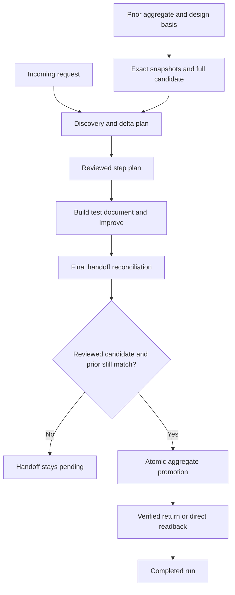

# ShipLoop intent continuity

The incoming request and reviewed step plan define the work to achieve. Prior accepted requirements and design decisions constrain that work; achieved behavior is reused and approved deferred work remains deferred. A `follows` reference supplies a requirement or decision to respect. It does not assign its implementation again.

This implements the owner's [intent-continuity plan](shiploop-intent-continuity-plan-2026-11-02.md). New runs use state version 12. Qualification is being completed; the retained checks below distinguish mechanical evidence from live semantic evidence.

## One full candidate, with a separate accepted aggregate

`docs/shiploop/spec.md` is the accepted long-running aggregate. The first saved run copies its exact UTF-8 bytes into `RUN/current-spec.md`, or creates an empty candidate when no prior spec exists. The run also preserves exact prior spec, architecture and environment snapshots, with explicit absence and hashes in `RUN/spec/binding.md`. Dirty starting content is preserved rather than replaced with Git HEAD.

The candidate is a full spec. Spec and planning stages reconcile the incoming request with prior intent there. Script-derived differences identify the current changes; there is no second model-maintained change-ID list. At final handoff the script replaces or creates the aggregate with the reviewed full candidate. This avoids both losing prior clauses and appending duplicate specifications.

**An earlier release return leaves the aggregate unchanged; final handoff promotes the reviewed candidate.** A changed candidate requires restoration or corrective work and review. An independently changed aggregate blocks promotion. A pending promotion journal supports retry after interruption; the same bound candidate and reconciliation must still match.

An early return is still an incomplete ShipLoop run. Its code and live architecture/environment changes may already have returned while its spec remains a candidate. Continuing that work requires the retained run and recovery context; returned code alone cannot supply newly accepted intent. This timing follows the owner's final-handoff boundary.

## What each artifact supplies

| Artifact | Producer and maintenance | Consumers and packet transport |
|---|---|---|
| Original request and `RUN/request.md` | The script retains the verbatim request and sentence index. | Intake, spec and plan quote it; other packets give its locator when exact wording is needed. |
| `RUN/current-spec.md` | Spec/planning stages reconcile the request; implement/document may add only marked evidence inside accepted requirement entries. | Requirement parsers, primary outcomes, queue checks, test cases, `follows`, diffs, review and handoff use this candidate. Contents outlines are supplied where relevant; selected followed entries are quoted by value. |
| `RUN/spec/` | The script owns immutable prior snapshots, accepted-intent content, per-step baselines, accepted review digest and promotion record. | Cold recovery, derived diffs, ID retention, protected step writeback, stale-review checks and final promotion. Missing or mismatched binding evidence is refused rather than reseeded. |
| `docs/shiploop/spec.md` | Existing accepted intent stays untouched until final promotion. | The prior run basis during this run; the next run's accepted starting contract after completion. Durable product documentation and generated skills link here. |
| `docs/shiploop/architecture.md` | Boundary investigation, planning, build, document and carry-forward maintain standing structure and stable `AD-<n>` decisions. | Planning and affected implementation/test stages reuse applicable decisions. Selected followed decisions are quoted; other relevant sections are retrieved through locators. Preserve rationale, alternatives, ownership and revalidation conditions. |
| `docs/shiploop/environment.md` | Discovery/research, test strategy, preparation, build/test/document and applicable outer stages maintain commands, facilities and observed platform facts. | Planning, execution and verification reuse recorded commands and facilities after checking freshness. It remains a live repo file; the initial snapshot records what the run inherited. |
| Accepted results, queue and step plans | The script saves canonical accepted results/history in `state.md` and per-action files under `RUN/results/`. | Packets name the accepted results they build on and quote selected handoff fields, criteria, cases and commands. The reviewed step plan assigns the actual change and its proof. |
| Git history, lessons and evidence | Commit messages retain learning; result evidence refs locate observations and supporting artifacts. | Intake/discovery supply recent full messages and latest lessons as leads. Consequential choices require affected older full messages and referenced decisions, including rejected alternatives. Evidence locators remain untrusted until inspected. |

The owning contracts are [knowledge writers/readers](../skills/shiploop/scripts/shiploop_knowledge_home.py), [stage consumers and packet rendering](../skills/shiploop/scripts/shiploop_navigator.py), [durable current-spec storage](../skills/shiploop/scripts/shiploop_current_spec.py), and [promotion](../skills/shiploop/scripts/shiploop_spec_promotion.py). The [project-knowledge guide](../skills/shiploop/references/project-knowledge.md) gives stage duties and the [state-file catalog](../skills/shiploop/references/state-files.md) describes the records.

## Preserve intent while allowing deliberate change

The current request can intentionally replace a conflicting prior clause without requiring the owner to repeat its identifier or approve the same instruction again. The spec records the replacement's basis and history, leaves the old clause inactive, and retains unrelated and sibling acceptance lines. Dropped requirements retain their stable IDs under `Retired` with reasons. Deferred requirements are not promoted into the current backlog merely because they remain in the full candidate.

The overall plan and each reviewed step plan identify requested changes, necessary evidenced prerequisites, reused foundations, affected preservation checks and remaining gaps. Current code and tests establish implementation evidence; they do not establish what the owner intended. Environment observations may become stale, while architecture decisions retain their rationale until an intentional change or contrary evidence warrants reopening them.

Inside a step, the script protects the exact candidate accepted at entry. A new requirement cannot grant itself permission to rewrite a protected span. A genuine intent change returns to planning; the existing narrow status-repair route does not grant ordinary step planning general spec authority.

## Review, recovery and completion boundaries

Improve pass identity includes the external candidate's exact bytes, including spec-only changes. Import reads the actual active child's latest pass digest, requires that it still match the candidate when recording acceptance, and saves that reviewed identity with the state. Final handoff requires the same reviewed bytes and exact current/prior hashes plus a semantic reconciliation summary. Supplying a fresh handoff hash cannot bless an unreviewed edit.

Promotion journals the bound pending operation before writing the aggregate, checks the exact prior bytes or recorded absence, atomically writes and reads back the candidate, and records promotion. A worktree run still needs a current verified return, including the final knowledge commit. Direct/in-place/non-Git runs use the local promotion record and readback rather than a workspace receipt.

Retired saved states, copied or moved bindings, missing candidates, damaged snapshots and mismatched pending transactions are refused before recovery writes. Retain older run files and use their original ShipLoop package to resume, or start a fresh run. The new package does not reconstruct missing prior intent from code.

Hashes, IDs and journals establish identity and sequencing. Preserving meaning and deciding whether an override is intentional remain explicit model and review duties. Packet references establish availability, not proof that every locator or all relevant history was read.

## Retained qualification

Implementation evidence is retained under `/Users/dadleet/shiploop-audits/2026-11-02/intent-implementation-ee0f6bv4`. Every test snapshot records HEAD, a content fingerprint, pre/post status and raw logs. Failed attempts remain separate from subsequent reruns.

The focused storage/recovery/promotion/identity/lifecycle suites and real terminal CLI fixtures cover exact dirty-start bytes, absent prior files, interrupted initialization and promotion, tampering, post-review edits, early release, final workspace return and direct non-Git promotion. These fixtures do not constitute live model review. The synthetic DAG replay separately reports graph coverage and explicitly does not claim terminal promotion or Improve evidence.

The independent prompt review identified clause preservation, backlog expansion, durable link, override and historical-decision risks. Warranted wording changes were adopted. One native review also found and prompted a fix for an edit between the Improve import gate and review-record creation. The required Opus consultation failed at the subscription quota and supplied no advice; it is not counted as approval.

Final full-regression, registered live semantic campaign, publication and installed-host results will be recorded here when complete. No statistical accuracy or cost improvement is claimed from static checks or a successful previously published control.
