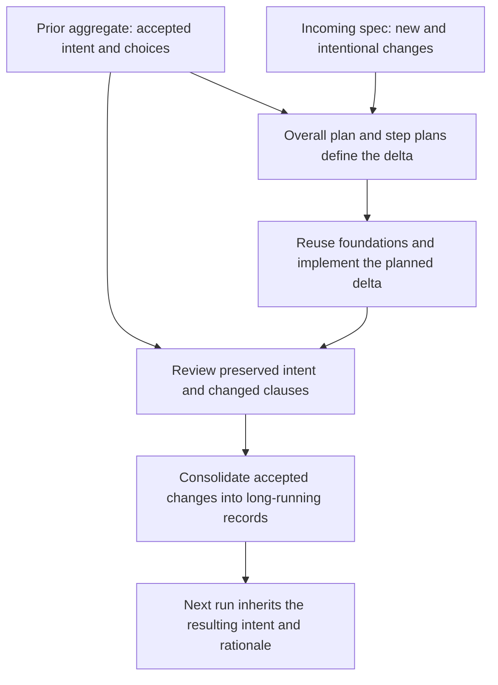

# Plan: new work against retained product intent

**The incoming spec defines what this run must achieve. The prior aggregate defines the intent and choices this run must respect.** The overall plan and each step plan turn the incoming change into work; retaining an old requirement in the contract must not turn it into a new implementation assignment.

Owner clarification, 2026-11-02: keep prior-runs aggregate intent independent of code inference, distinguish it from the current spec, and deliberately consolidate current accepted changes into the long-running records at completion. Preserve prior design choices unless a current instruction or an intentional, justified in-scope decision changes them. The owner identified the step plan as the boundary where new work becomes concrete. This supersedes the earlier plan's recommendation to retain the lifecycle without an explicit final intent-reconciliation obligation.

**Status: revised design and implementation plan; no runtime changes.** Inspection is on `826c5c1a8ce09c850165e2724a98d67951bf2d6a`, whose ShipLoop source is unchanged from `c0bcf83dedc759a15ed924d3966bb8392422eeca`. The preceding audit's 342 passing hermetic tests remain evidence of that implementation, not proof of this proposed behavior.

## The plan defines the change; the aggregate constrains it

| Classification | How planning uses it |
| --- | --- |
| New or intentionally changed outcome | Implementation scope, linked to the incoming request or an actual durable clarification. An explicit new rule can supersede its conflicting old clause without naming its ID or asking again. |
| Achieved prior requirement | Reuse the existing implementation. Confirm the foundation and regression-check affected behavior; do not schedule rebuilding it merely because its ID appears in the aggregate or `follows`. |
| Preserved prior constraint | Apply it to the touched surface and carry its source into the step's criteria/cases/review. This is a condition on new work, not another implementation assignment. |
| Accepted but deferred prior work | Keep its intent and deferred status. Do not activate it unless requested or demonstrated to be a necessary in-scope prerequisite. |
| Necessary prerequisite or foundation repair | Evidence must show the dependency, its current failure/absence and its consumer. Use existing authority and impact rules; unrelated old failures do not silently expand scope. |
| Observation, inference or proposal | Label its status. Code shows what exists; it does not establish what the user approved. An old inferred choice does not become an immutable user requirement. |

The existence of a step-plan file is insufficient. Its existing review/acceptance must establish the **change basis, observed before-state, reused foundation, affected preserved constraints, and proving checks**. Use the existing summary, task, criteria, `follows`, expectations, test cases, work-item context and evidence references. A requirement ID in `follows` says the item serves or depends on it; it does not order its implementation from scratch.

Hypothetical acceptance case: the aggregate has five implemented requirements and one accepted deferred feature. The incoming request adds a capability and changes one clause of an old requirement. The work queue contains that addition, that clause change and any evidenced necessary prerequisite. It does not rebuild the five achieved outcomes or activate the deferred feature. The spec result's `primary` list names this request's direct outcomes, and step criteria describe the assigned change; regression tests still protect relevant old conditions.

Current plan/step-plan duties and the primary gate already provide much of this structure. The narrow addition is an explicit distinction between **change to implement** and **constraint to preserve**, checked using actual baseline evidence. See [plan and step-plan duties](../skills/shiploop/scripts/shiploop_prompts.py#L1095), [step-plan duties](../skills/shiploop/scripts/shiploop_prompts.py#L1238), [primary coverage at the overall plan](../skills/shiploop/scripts/shiploop_primary.py#L179), and [requirements reconciliation](../skills/shiploop/references/requirements-definition.md#L127).

*Prior intent constrains each run; only the planned current change becomes new work.*

## Make prior and current artifact roles explicit

| Role | Proposed binding and lifetime |
| --- | --- |
| Prior aggregate | The long-running `docs/shiploop/spec.md` remains the prior aggregate until final handoff. Retain an immutable, exact run-start snapshot of it and the relevant architecture/environment, with repository/path/revision identity, including tracked dirty content. Never silently substitute an earlier `HEAD` for different starting content. |
| Incoming change | The verbatim `RUN/request.md` plus actual user clarifications recorded through existing routes. This owns current scope. A current-run spec result describes the requested change and its basis; it must not copy all prior obligations into the work queue. |
| Current candidate | One full run-local `RUN/current-spec.md`, initialized from the exact prior aggregate and then maintained as the combined target contract. It holds retained conditions plus authorized current changes; the incoming request and reviewed plans identify which parts become new work. It is distinct from the still-unmodified aggregate. |
| Long-running aggregate after completion | The reviewed current candidate consolidated with prior intent and returned to the original repo. Preserve IDs, rationale, deferred obligations and history; first-run creation follows the same review, with no fabricated prior intent. |

The current source already isolates the original repo from the working candidate, but an early release return can publish that candidate before the run ends. The selected design therefore uses a distinct run-local current spec and holds the aggregate unchanged until final handoff. It preserves the earlier decisions against a model-maintained changed-ID list, permanent feature folders and whole-spec prompt dumps. Derive the delta from prior/current content; the host/review judges whether meanings and authority are correct.

There is one accepted aggregate and one current-run candidate, with explicit roles and lifetimes. All spec `entries`, `primary`, read/write paths, packet diffs, queue validation and review inputs need one role-aware accessor. Merely adding the file would leave existing gates reading stale aggregate text. Architecture/environment keep their existing homes and separate update rules. Direct/in-place and non-Git runs also need an exact prior snapshot and the run-local candidate; do not claim parity until their tests pass. Existing active runs need an explicit transition policy before this contract ships.

Because the current spec is outside product Git history, inline writeback must compare it against a script-owned accepted snapshot bound to the step-plan action and candidate digest. Preserve the restriction against unauthorized existing-clause rewrites and self-authorizing new IDs. Review identity must include current-spec content as well as the code tree. Initialization is atomic and idempotent; recovery must not reseed the candidate from a newer aggregate.

The existing data seams are [run baseline and diff](../skills/shiploop/scripts/shiploop_knowledge_home.py#L938), [current entry reads](../skills/shiploop/scripts/shiploop_knowledge_home.py#L626), [inline committed-entry protection](../skills/shiploop/scripts/shiploop_knowledge_home.py#L640), and [guarded workspace return](../skills/shiploop/references/workspace-lifecycle.md#L154). Preserve the writeback protection while changing any binding.

## File ownership and packet consumers

This table summarizes the **inspected current ownership**; the implementation should make the prior/current role explicit at those same handoffs.

| Record | Produced and maintained by | Consumers and continuity obligation |
| --- | --- | --- |
| Spec | Spec defines intent; document adds permitted acceptance/evidence detail. Current CLI spec completion requires primary IDs to exist. | Intake, spec, test strategy, overall/step plans, test authors, selected build/test entries, Improve and acceptance. Select current work from incoming intent; apply relevant aggregate constraints. |
| Architecture | Test strategy records real-boundary checks; overall plan, step-plan, implement, document and carry-forward record structural decisions and refinements. | Intake, planning, test-spec, validate-existing, implement, test, document and system-test stages. Reuse applicable `AD-<n>` choices and their rationale/alternatives/status. A new or superseding choice needs an intentional basis, not just a newer code pattern. |
| Environment | Discovery/research record facts; test strategy records suites/ID conventions; prepare records readiness; build/test/document stages refine commands/facts; outer stages maintain standing release and operations knowledge. | Planning, preparation, build/test, acceptance and applicable release/operations packets. Retain stable procedures; revalidate volatile runtime, access and target observations. An old observation supplies context, not fresh readiness or permission. |
| Lessons and older decisions | Release-verify records learned/considerations/open-next in a knowledge commit; earlier full Git messages and linked decision records retain wider rationale. | Intake/discovery currently quote the last three commits and the newest matching lessons commit. For a consequential choice, inspect relevant older history and rejected alternatives; this small quote window is not a complete decision history. |
| Run results and checks | Current stages, the host and script-owned recorders retain planning and execution evidence. | Their actual downstream stages and review contracts. Promote enduring intent/rationale to maintained records; keep activity reports and raw receipts in run evidence. |

The exact declared writer/reader sets are retained in [artifact-matrix.json](experiments/intent-continuity-20261102/artifact-matrix.json), derived from [STAGE_FILES and READS](../skills/shiploop/scripts/shiploop_knowledge_home.py#L85). File availability differs from packet quoting: paths/outlines invite a read; selected `R-<n>`/`AD-<n>` entries are quoted by value. Spec explicitly reads its file whole. Discovery/research have empty `READS` rows but duties to inspect existing knowledge, so their evidence and actual review handoff must show the selected sources. No locator alone proves that a model used the source. See [packet rendering](../skills/shiploop/scripts/shiploop_navigator.py#L6789) and [review input handoff](../skills/shiploop/scripts/shiploop_navigator.py#L7914).

For each consequential discovery/build choice, retain the selected prior clause or `AD` entry, its rationale/status, the current evidence, and whether it is **reused, deliberately revised, or unresolved**. Record a revision's current instruction or in-scope evidence and effects on consumers. Preserve the superseded account. A new constraint can intentionally change an old decision; the absence of an old condition from the prompt cannot retire it. Do not infer approved intent solely from code or tests, and do not freeze every earlier agent assumption into policy.

## Final intent consolidation is an explicit review obligation

Compare the prior aggregate, incoming/current-run scope, current candidate, and actual evidence. Confirm that additions and intentional clause/decision changes have a basis; untouched requirements and rationale survive; old deferred work remains deferred; implementation and verification status are accurate. Integrate narrowly rather than rewriting the full record from code.

Require this reconciliation and promotion as a **final handoff precondition**, using the existing review/result machinery. In isolated worktree runs, an earlier release-time return may carry code and other accepted work while retaining the prior aggregate; the run-local current spec does not enter product return. At handoff, bind the reviewed current-spec digest to the promoted aggregate content, then require the original repo's current return receipt to cover that promoted tree. Use the existing eligible knowledge-only follow-up route after an early return; if it cannot succeed, handoff remains pending for guarded recovery. Current return paths and stage order are visible in [navigator return handling](../skills/shiploop/scripts/shiploop_navigator.py#L6075) and [stage order](../skills/shiploop/scripts/shiploop_stage_spec.py#L559).

Direct/in-place and non-Git runs have no workspace return receipt. Their final promotion instead needs a script-owned record binding the source path, prior/current identities, accepted review and read-back aggregate digest. Check source drift before atomic replacement, verify the resulting content, and recover duplicate/interrupted promotion by its actual outcome. Do not fabricate a workspace receipt or claim the isolated follow-up mechanism exists in those modes. A stale or ambiguous outcome keeps handoff pending in every mode.

Do not put the only review at `release-verify`, and do not redefine “end of run” as the first release return. Later current-spec edits invalidate an earlier review digest and need renewed scoped review. Concurrent aggregate/source changes require explicit reconciliation against the prior base; neither a clean textual merge nor the newest file proves intent compatibility. An interrupted/failed run retains its current intent and evidence durably without falsely labeling it completed aggregate history. Existing accepted pending obligations are never dropped merely because this run does not implement them.

## Bounded implementation sequence and evidence

1. **Finalize the contract and compatibility boundary.** Record prior aggregate, run-local current spec, terminal consolidation, step-plan scope and allowed override basis. Resolve the treatment of already-active runs before changing their artifact contract. Preserve this clarification as the owner decision that supersedes the former no-consolidation recommendation.
2. **Prepare discriminating fixtures and oracles.** Include achieved, deferred and preserved prior requirements; one new outcome; one intentional clause override; prior `AD` rationale; stale environment facts; missing aggregate; interrupted run; source drift; release/handoff/follow-up routes. Correct and defective variants must differ in the behavior being judged.
3. **Bind artifact identities and recovery.** Capture exact prior content, initialize `RUN/current-spec.md` once, and use the shared current-spec resolver across entry readers, spec/primary guards, packet rendering and review inputs. Replace the current spec's Git-only inline baseline with an equivalent accepted snapshot/action binding. Prove direct/non-Git handling and review digest invalidation before relying on parity. Keep durable bookkeeping script-owned and prompts small.
4. **Make overall/step-plan scope explicit.** Use current fields to name the implemented delta and reused/preserved obligations. Reject or revise a plan that merely replans old achieved/deferred requirements. Name relevant old constraints in the step's task/criteria/cases so narrowing retains them. Use observed baseline checks; do not add another scheduler, blanket old-feature workload or second review counter.
5. **Carry prior decisions and file ownership through existing packets/reviews.** Check selected source paths, section/IDs, status, supersession basis and freshness at discovery, planning and build. Maintain environment/architecture records in their assigned homes; keep current-run activity out of standing facts.
6. **Bind semantic consolidation to final handoff.** Hold the aggregate unchanged through early release returns; require scoped intent reconciliation before terminal promotion, bind the exact reviewed digest to promoted content and its final/follow-up return, and handle retry/drift/failure explicitly. Preserve the original aggregate when consolidation has not been accepted.
7. **Qualify the exact candidate before release.** Run focused fail-first CLI/packet/recovery tests, independent adversarial review and calibrated incremental/cold-context evaluation. Prove both no accidental rebuilding and no lost constraints. Retain original failures and costs; a source or fixture pass is not live semantic proof. Follow normal change-note, post-change E2E learning and release-script/CI boundaries.

Implementation is not started here. The [machine-readable dependency plan](experiments/intent-continuity-20261102/plan.json) accompanies this document. Initial dependency review repaired a missing shared campaign supplier; independent source review then corrected mode-specific promotion evidence. The corrected candidate completed a fresh Backchain binding without further changes, with structural and retained-evidence checks passing. That result certifies the planning artifact, not future runtime behavior. The first contract step still has to settle compatibility for already-active runs, and the later model campaign must establish actual transport/readiness and artifact identity. Its [result record](experiments/intent-continuity-20261102/result.json) points to the full external review evidence. The existing [packet audit](shiploop-prior-artifact-packet-audit-2026-11-01.md) remains a description of the old implementation, including the reproduced narrowing boundary.

## Evidence and review limits

Full histories used include `589bc03ebe4bb31759a371e10bbc261bb071aab3` (feature-spec removal), `49c502ea75d41c7541f7e4cedce770b0a04d4ecd` (script-owned diff), `ab5158692257927a6cafd3e7b867c7b714d37665` (measured prompt economy), `b75963f8e8b310ac13d69fc03659fdec0085e92a` (committed-entry protection), and `fdec0f6ed642165effd33be640974c9ee25c1561` (coverage relative to step intention). The new owner direction changes the consolidation policy; the other lessons still constrain the implementation.

[OpenSpec's primary concepts](https://raw.githubusercontent.com/Fission-AI/OpenSpec/main/docs/concepts.md) provide a relevant comparison for distinct enduring intent and proposed changes. Its [troubleshooting guide](https://raw.githubusercontent.com/Fission-AI/OpenSpec/main/docs/troubleshooting.md) documents loss of still-valid scenarios when a modified requirement replaces its whole block. Those support the preservation cases, not adoption of another tool or artifact hierarchy.

A native independent review initially favored reusing the isolated product candidate. Applying the owner's literal end-of-run boundary exposed early release publication, so the reviewed recommendation changed to the distinct run-local candidate, shared accessors, accepted writeback snapshots and terminal promotion described above. Direct-mode and active-run compatibility remain explicit implementation obligations. The materially changed design received a new read-only Opus attempt; it again failed at the subscription weekly limit with no usable advice, no fallback and no verified served model. The response is retained in [opus-result.json](experiments/intent-continuity-20261102/opus-result.json); the transcript directory reported by the runner is `/Users/dadleet/.grok/skills/ask-opus/runs/20261102T120909Z-59415` and rejected-envelope evidence is `/Users/dadleet/.grok/skills/ask-opus/runs/20261102T120913Z-ask-opus-59406.floor-rejected`. No Opus approval is claimed. Rendered Markdown/Mermaid has not been visually verified; source links and artifact integrity are checked separately.
