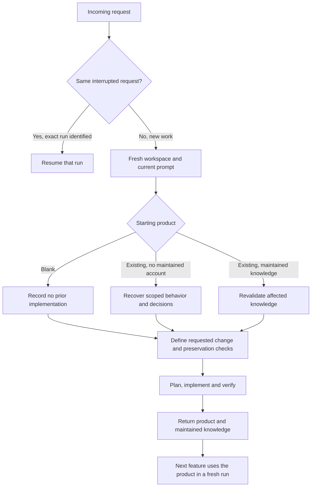

# ShipLoop across three repository starting points

Assessment date: 13 November 2026. Source inspected: `4990932ee4a0e8f3e2c55bb8a16e4364ba24849e`, containing published skill-craft 2.37.2 / ShipLoop 1.34.2. The new additive trial has completed. Functional delivery and reuse pass for this case; maintained-knowledge quality has a supported gap. This is an assessment, not a generic improvement or promotion claim.

## Assessment

**Keep the shared stages. Improve the final knowledge reconciliation and the audit, rather than adding another stage.** The new run completed bulk reassignment and escalation on a prior ShipLoop product while preserving assignment. It passed all nine catalog checks and fourteen independent held-out checks. However, its final specification still calls completed requirements pending. That is a real handoff defect even though no downstream repeated implementation was observed.

| Question | Conclusion |
| --- | --- |
| Can this run add features without rebuilding the earlier feature? | **Supported for this case.** Existing assignment is reused; old and new behavior pass. |
| Are all three starting points supported equally by current evidence? | **No.** Blank and unfamiliar-repo evidence is historical; the new current-release trial covers the additive case. |
| Is the returned knowledge fully ready for the next run? | **Supported gap.** Current completion status is contradictory; actual next-reader behavior is untested. |
| Is workflow qualification clean? | **No.** Completion/recovery are supported, but the frozen audit inventory has a known UNKNOWN and inline reviews are not independent. |

ShipLoop already has the right structural distinction: a new feature starts a new run against the existing product, while an interrupted request resumes its original run. The same stage graph can serve all three starting points. What must vary is the baseline Discovery establishes, the scope of the requested change, and the checks that prove preservation. Adding another mandatory stage is not supported by this assessment.

The earlier repairs addressed real handoff defects: preserving exact starting spec and architecture bytes in dirty repositories, carrying the selected baseline to consumers, limiting narrowed test receipts to their actual criteria, and retaining regression provenance and timeout diagnostics. They do not by themselves establish that a model understands the repository, avoids redundant implementation, or completes an additive delivery.

*The repository carries product knowledge between runs. A previous run's cursor and completion receipts do not become a new feature's instructions.*

## What changes with the starting point

| Stage group | Blank repository | Unfamiliar existing repository | New feature after ShipLoop ran before |
| --- | --- | --- | --- |
| Intake and workspace | Preserve the incoming request; bootstrap an empty Git source through `workspace start`. | Inspect current status and instructions; isolate the actual starting content. | Preserve the prior run and use a fresh external workspace with the new prompt. |
| Discovery | Establish available tools and constraints; explicitly record absent prior behavior and missing test coverage. | Read README, relevant code, tests and decisions; run the unchanged suite; recover a bounded account of the affected system. | Recheck current behavior and the applicability of maintained requirements, decisions and commands. Prior successful receipts remain historical. |
| Research and spec | Resolve decisions needed to build the requested product. | Distinguish accepted intent from observed implementation; resolve consequential conflicts before dependent work. | Express additions and requested changes without reassigning completed requirements as new work. Preserve unaffected conditions and rationale. |
| Test strategy and plan | Establish the required harness and behavioral checks. | Combine new-feature checks with regression coverage for affected boundaries and existing suites. | Demonstrate new behavior failing before and passing after, while existing behavior continues to pass. Reuse existing seams and tools. |
| Inner loop | Build the necessary foundations and feature steps. | Add only requested behavior and necessary integration changes. | Preserve completed steps during an in-run send-back; document new knowledge and its effect on remaining work. This is separate from starting the next run. |
| System testing, acceptance and delivery | Verify the assembled product and return a usable repository. | Check integration behavior, delivery boundaries and knowledge accuracy. | Return a clean committed product whose old and new behaviors pass, with current knowledge usable without the old run directory. |

The current graph has 23 named stages, from intake through handoff. Improve runs at configured review boundaries within that graph. These groups summarize responsibilities; they are not proposed replacement stages.

The review schedule already reuses an established pattern: a step plan is reviewed for the first work item and for an item sent back, while a later item can proceed directly. Changed implementation steps still receive their code, test and documentation review. Preserving that distinction matters when assessing whether every missing review receipt is a defect. [Runtime review conditions](https://github.com/whichguy/skill-craft/blob/4990932ee4a0e8f3e2c55bb8a16e4364ba24849e/skills/shiploop/scripts/shiploop_navigator.py#L478).

## The key files have different jobs

| Home | What belongs there | What must not be inferred |
| --- | --- | --- |
| README and existing repository guidance | How the product works and where authoritative documents live. | Missing ShipLoop files do not mean the product is blank. |
| Root `SHIPLOOP.md` | A small index to useful existing knowledge and prior evidence. Preserve unrelated content if the filename already has another purpose. | Printing its locator does not prove it exists or was read. |
| `docs/shiploop/spec.md`, `environment.md`, `architecture.md`, linked to existing authoritative product documents | Requirements tracked by ShipLoop, runnable environment facts, structure, decisions and rationale. | The runtime checks IDs in its conventional files; linked team documents are read, not mechanically checked. Avoid competing copies of accepted intent. |
| External run directory | Immutable/as-of baseline, current action state, receipts, planning records and scratch evidence. | Its cursor and earlier approvals do not authorize the next feature. |

Keep three logical accounts separate even if they share an existing documentation home: what was true before this run, what this request changes, and what is true in the returned product. Preserve historical evidence while explicitly reconciling obsolete current-status claims. A completed requirement still labeled pending can cause the next planner to repeat work even when all tests pass.

The starting-byte snapshot fixes attribution of pre-existing dirty changes in the two diffed knowledge files, spec and architecture. It does not replace behavioral baseline checks or prove the remaining knowledge is accurate. Older HEAD-only baselines remain a distinct historical path; this assessment does not remove them.

## What the scripts guarantee and what still needs judgment

The runtime owns run identity, legal stage transitions, callback validation, snapshot bookkeeping, test-command accounting, workspace return checks and the preserved-step rules. Those mechanisms reduce accidental replay and inaccurate receipts. A model still judges whether its repository investigation is sufficient, whether an earlier decision remains applicable, whether a test exercises the promised boundary, and whether an old feature genuinely needs an integration change.

Therefore neither unchanged requirement IDs nor a matching baseline locator is enough to claim reuse. The additive audit must read the actual plan and diff, connect decisions to existing code, compare old and new behavior, and check the final knowledge for contradictions. Editing an existing source file can be necessary integration; counting every such edit as reimplementation would be misleading. Conversely, retaining every filename while replacing its internals is not preservation.

## Existing evidence and its limits

| Scenario | Strongest retained evidence | What it does not establish |
| --- | --- | --- |
| Blank repository | Historical first-command routing probes plus a completed `hello` run on skill-craft 2.31.0 / ShipLoop 1.30.0. Later `csv-report` and `shared-expenses` smoke deliveries passed 5/5 and 6/6 hidden checks on `601f4913`. | The routing probes are not complete builds. These results do not qualify every greenfield project or the current release on every host. |
| Existing repository | D7, R1 and R2 exercised `user-listing` and the larger `ticket-assignment` fixture. R1/R2 used Codex Terra 6.1 xhigh and passed 11/11 and 18/18 hidden checks. | The builds and model differ from the new trial. Small local services do not establish large-monorepo or remote-only discovery quality. |
| Successive features | A four-link `user-listing` → `user-roles` → `user-team-listing` → `user-page-size` chain passed 72 hidden checks in total on skill-craft 2.32.1 / ShipLoop 1.30.2. | One small-repository chain, with no control, cannot establish reliability or causal efficiency gains. |
| Cold additive attempt | The 11 November Grok pilot retained old requirements and passed partial preservation checks. It stopped after 7,201.3 seconds before completing reassignment and escalation. | There was no final delivery, complete feature acceptance or supported speed comparison. The original stopped result remains unchanged. |

The later fix-forward replay accepted all eight samples from two reconstructed late send-backs. It supports keeping a completed step intact during replanning. It does not establish cross-run product reuse, and its longer-prefix and forward-impact questions remain outside the measured result.

The brownfield distinction is real: neither `node-base` nor `node-tickets` starts with `SHIPLOOP.md` or `docs/shiploop/`. Both have existing product code and tests. The ticket fixture also has substantial API documentation, contributor guidance and eight decision records, so its result supports learning an unfamiliar, documented product without ShipLoop-maintained knowledge. It does not establish reconstruction quality for an undocumented legacy system. [User-listing fixture selection](https://github.com/whichguy/skill-craft/blob/4990932ee4a0e8f3e2c55bb8a16e4364ba24849e/test/shiploop_e2e/cases.json#L403), [ticket fixture and request](https://github.com/whichguy/skill-craft/blob/4990932ee4a0e8f3e2c55bb8a16e4364ba24849e/test/shiploop_e2e/cases.json#L915).

## Fresh additive validation

The registered trial uses the earlier passed ticket-assignment product at `42180cb17bf98f5d527a214c98f3a2b5896766f1` and the catalog's literal reassignment/escalation request. It starts from intake in a fresh copied product and run, with current marketplace ShipLoop, Grok 4.6/xhigh and the existing planning-review default. No operator supplies callbacks, edits the builder's product or coaches its plan.

Before launch, the established calibration suite passed all 35 tests, and package bytes and executable modes matched the pinned source and release output. On a disposable predecessor copy, all seven held-out existing-behavior checks passed and all seven new-behavior checks failed as expected; the three old catalog commands also passed and the two new catalog commands failed as expected. The original predecessor and its receipt remained unchanged. Completion requires the returned product, all nine catalog/regression/retention checks, all fourteen held-out checks, unchanged predecessor evidence, and an independent review of scope, knowledge and execution receipts.

The new trial uses the harness's current defaults without adding a wall-clock, turn or resume ceiling. It is a separately identified completion validation; its elapsed time cannot be compared causally with the earlier capped trial. Product pass, workflow quality, and efficiency are separate conclusions.

**Result: functional PASS, semantic knowledge gap.** The returned product is clean at `730b8b8a17d618e8aa90d8068777423c95783aa3`, tree `20960c26f3bf0bdabee18f1777bd1410f49d7544`. The original predecessor, its receipt, registration and frozen source remained unchanged. No retained process or listener was reported. The harness finished once, with six sessions and five managed resumes; there was no operator retry or product repair.

| Observation | Result |
| --- | --- |
| Catalog behavior and retention checks | 9/9 pass |
| Held-out old behavior | 7/7 pass before and after |
| Held-out added behavior | 7/7 fail before, 7/7 pass after |
| Delivered own suite | 133/133, up from predecessor 122 |
| Pristine base suite | 117/117 across 18 original files |
| Source scope | 17 changed files; +1132/−71; no dependency additions or old-test edits |
| Execution | 38 accepted actions, two completed work items; 4h15m43s elapsed |
| Review work | 11 inline Improve children,17 passes,100.34 minutes |
| Initial planning | 102.4 engine minutes, including56.6 Improve minutes |
| Context activity | 822 recorded calls,26 compactions |

The suite totals and acceptance checks overlap; they must not be summed into an invented independent test count. Planning Improve time is nested within the planning window. These are descriptive measurements from one run, with no speed, cost-effectiveness or reliability comparison.

The implementation reused the existing structure: bulk reassignment selects active tickets, orders them and calls the existing unchanged assignment method; escalation adds a worker job and template using the existing outbox and notifier. Its durable marker is store-level snapshot state, preserving public ticket JSON and data-file compatibility. This supports bounded reuse, not the stronger claim that every edit was minimal or optimal.

One test-command defect exercised recovery. An unquoted pipe in the planned W2/S1 command produced exit127 and a recorded send-back. The amended plan used a whole-file command; the reissued implementation made no source changes, W1 stayed complete, and the revised test passed four focused cases and the 130-test suite with four red baseline cases. Later S2 option placement ran the full six-case file rather than filtering it; the environment document accurately records that broader execution. Earlier exact-command readiness could prevent this kind of replan, but that benefit has not been measured.

### What the final knowledge still gets wrong

The returned `spec.md` has unqualified pending statements in R5 and R6–R8 at lines 38, 47, 72 and 99 alongside later completion annotations. The heading is simply Requirements; it does not resolve the earlier status as historical. In contrast, entries explicitly marked W1/S1 or W2/S1 are legitimate as-of observations and should remain. The first-return commit `906a3a19…` in `environment.md` is also a valid checkpoint that needs a clearer historical label: release-verify checked that tree; final 730b8b8 differs only in environment documentation. Final catalog and held-out checks use the final delivery.

The step document contract permits additions only, and `step_spec_refusal` enforces that restriction. This protects accepted intent but plausibly contributes to accumulating stale status. It is not the entire explanation: carry-forward and handoff already require final reconciliation. The smallest candidate is to make that existing duty explicit—identify current implemented, deferred and unverified status while preserving the requirement and its history. Keep the step guard; do not replace historical receipts or turn code into approval. [Document reflection rule](https://github.com/whichguy/skill-craft/blob/4990932ee4a0e8f3e2c55bb8a16e4364ba24849e/skills/shiploop/scripts/shiploop_prompts.py#L1532), [write-back guard](https://github.com/whichguy/skill-craft/blob/4990932ee4a0e8f3e2c55bb8a16e4364ba24849e/skills/shiploop/scripts/shiploop_knowledge_home.py#L645), [final reconciliation policy](https://github.com/whichguy/skill-craft/blob/4990932ee4a0e8f3e2c55bb8a16e4364ba24849e/skills/shiploop/references/project-knowledge.md#L371).

The product also inherits a discovery omission: no `SHIPLOOP.md`, and no README link to the maintained knowledge. A short existing-index link is sufficient; no second knowledge store is warranted. ShipLoop's conventional paths made discovery possible here, so this is not evidence that a future run necessarily fails.

A fresh read-only Astra consultation requested `gpt-6-astra`, high effort, with fallback disabled and exited0. It independently confirmed functional reuse and the knowledge gap, checked all 327 terminal snapshot hashes, and distinguished historical statements from misleading current ones. It ran no product tests. Its requested model/effort are recorded; provider-served identity is not attested. It is not a calibrated discovery judge, and does not retroactively make the eleven inline reviews independent.

An audit-only probe during the run reproduced a validator mismatch. The accepted W2 step plan correctly has no Improve receipt under the first-item rule, but `workflow_review._observed_improve_actions` treats every accepted planning-stage action as requiring one. It returns `comparable: false` and an unknown-inventory warning for this valid sequence. The runtime and the separate DAG replay oracle both encode the first-item exception. The frozen validator remains unchanged; this is an apparatus finding, not a product failure or evidence that the builder skipped a required stage. Terminal reconciliation and fresh Astra review confirmed the mismatch. The final workflow schema validation has zero errors and reports supported-gap, retaining the explicit inventory UNKNOWN. [Validator inventory logic](https://github.com/whichguy/skill-craft/blob/4990932ee4a0e8f3e2c55bb8a16e4364ba24849e/skills/shiploop-e2e-audit/harness/workflow_review.py#L96), [independent replay rule](https://github.com/whichguy/skill-craft/blob/4990932ee4a0e8f3e2c55bb8a16e4364ba24849e/skills/shiploop-e2e-audit/harness/dag_replay.py#L685).

Two additional raw fidelity flags were false matches: the unread verification record was a prose release note matched by a broad filename glob, and the single script-owned-edit hit was an explicitly editable planning notebook. All ten actual verification records parsed. The five distinct refusals/check failures remain real recovered events. Original counters were preserved, with source-backed interpretations in the analyst record.

The automatic Run Review export intentionally precedes held-out grading. Its original bytes remain unchanged; a separately named post-quality export now includes 14/14 acceptance. Unknown host measurements remain unknown: context window, Grok memory writes and tool-use counters. `held_out_seen: 0` is not proof that the builder could not access held-out scripts.

## Research cross-check

Anthropic's November 2025 harness report supports leaving durable progress artifacts and a clean repository for the next context, with incremental feature work rather than trying to rebuild an entire application each session. ShipLoop already has equivalent homes for those responsibilities; this is supporting rationale, not a reason to import another initializer stage. [Effective harnesses for long-running agents](https://www.anthropic.com/research/effective-harnesses-for-long-running-agents)

Its March 2026 follow-up also shows the tradeoff: structured handoffs and independent evaluation help, but context-reset orchestration adds complexity and latency. These are model- and workload-dependent observations. They support measuring review yield before changing ShipLoop's stage count or review defaults. [Harness design for long-running application development](https://www.anthropic.com/research/harness-design-long-running-apps)

SWE-bench's grading separates tests that must change from failing to passing from tests that must remain passing. That distinction fits the additive question better than total test counts or marker retention. ShipLoop's existing held-out acceptance already uses it; the new trial applies it to the actual predecessor and returned candidate. [SWE-bench grading implementation](https://github.com/SWE-bench/SWE-bench/blob/main/swebench/harness/grading.py)

## Decisions to carry forward

| Disposition | Next step | Evidence needed before claiming improvement |
| --- | --- | --- |
| **Retain** | Shared graph; new feature gets a fresh run against the existing product; interrupted request resumes its own run. | Keep scenario and build identities explicit. |
| **Pilot first** | Reconcile current knowledge at carry-forward/handoff and link its authoritative home. | Completed, genuinely deferred and historical statements remain distinguishable; a fresh next-reader check confirms interpretation. |
| **Repair separately** | Align audit Improve inventory with the runtime's first-item, outcome and send-back rules. | Tests for W1, initial W2, sent-back W2, non-done outcomes, missing required receipts and unknown protocols; separately pinned corrected replay. |
| **Pilot next** | Check exact invocation and test selection within Test Spec. | Distinguish shell/option mistakes, absent planned files and legitimate expected failures; shell syntax alone is insufficient. |
| **Defer** | Stage additions/removals, review-default changes, new baseline schemas and broader context machinery. | A registered comparison showing useful gains without semantic regressions. |

These are proposed follow-ups, not runtime changes adopted by this assessment. The first pilot must preserve accepted intent and deferred clauses, not merely remove every occurrence of “pending.” Do not insert a document's own final commit hash into itself; retain final identity in the external return receipt. No new loop limit or default is introduced.

Contrary evidence matters. The earlier continuity comparison had a control CSV delivery that explicitly marked old pending statements historical and retained deferred intent correctly; the accepted runtime can perform reconciliation. General Run Review finding `o79` also accepted planned status in a clearly planning-time test strategy because later discovery reobserved it and no misleading outcome had occurred. This trial's unqualified current requirement statements are a narrower, independently confirmed problem. It does not justify rewriting every historical statement or treating the append-only guard as inherently defective.

The broader cumulative-intent candidate previously ended with no qualified winner: it passed mechanical checks but left a final requirement incorrectly pending and another verification claim unsupported. This is a reason to inspect the truth of maintained knowledge, not to add another snapshot or mandatory schema. That rejected candidate remains rejected. [Recorded decision](https://github.com/whichguy/skill-craft/commit/300ae9b0c5db8fcdded102d0ad7622f31be509bd)

The present validation does not test remote deployment, large monorepositories, concurrent overlapping feature runs, or arbitrary recovery from incompatible historical protocols. Cursor refresh is an operational follow-up and is not part of the additive trial.

## Pinned repository evidence

The links below resolve to the inspected source revision, so later releases cannot silently change the contract being assessed.

- [ShipLoop entry and new-request rules](https://github.com/whichguy/skill-craft/blob/4990932ee4a0e8f3e2c55bb8a16e4364ba24849e/skills/shiploop/SKILL.md#L112): fresh workspaces, same-request recovery, empty-directory bootstrap and selected package binding.
- [Project knowledge policy](https://github.com/whichguy/skill-craft/blob/4990932ee4a0e8f3e2c55bb8a16e4364ba24849e/skills/shiploop/references/project-knowledge.md#L13): run identity, safe index updates and revalidation of retained knowledge.
- [Current-system baseline](https://github.com/whichguy/skill-craft/blob/4990932ee4a0e8f3e2c55bb8a16e4364ba24849e/skills/shiploop/references/current-system-baseline.md#L19): starting-point classification, the three logical accounts, and the difference between locator plumbing and comprehension.
- [Discovery stage contract](https://github.com/whichguy/skill-craft/blob/4990932ee4a0e8f3e2c55bb8a16e4364ba24849e/skills/shiploop/scripts/shiploop_stage_spec.py#L228): unchanged-suite baseline and explicit unknowns.
- [Carry-forward contract](https://github.com/whichguy/skill-craft/blob/4990932ee4a0e8f3e2c55bb8a16e4364ba24849e/skills/shiploop/references/carry-forward.md#L85): queue ownership and the limit of syntactic validation.
- [Historical brownfield rounds](https://github.com/whichguy/skill-craft/blob/4990932ee4a0e8f3e2c55bb8a16e4364ba24849e/test/shiploop_e2e/LEARNINGS.md#L4232), [four-run additive chain](https://github.com/whichguy/skill-craft/blob/4990932ee4a0e8f3e2c55bb8a16e4364ba24849e/docs/shiploop-multipass-journal.md#L686), [entry-route experiments](https://github.com/whichguy/skill-craft/blob/4990932ee4a0e8f3e2c55bb8a16e4364ba24849e/test/shiploop_e2e/LEARNINGS.md#L6013), and [stopped cold-additive pilot](https://github.com/whichguy/skill-craft/blob/4990932ee4a0e8f3e2c55bb8a16e4364ba24849e/test/shiploop_e2e/LEARNINGS.md#L8645): outcomes belong to their named builds and models.
- [Fix-forward smoke and replay](https://github.com/whichguy/skill-craft/blob/4990932ee4a0e8f3e2c55bb8a16e4364ba24849e/test/shiploop_e2e/LEARNINGS.md#L8846): completed-step preservation within a run, with its stated limits.

## Reproducible evidence

Raw evidence is retained at `/Users/dadleet/Documents/Codex/experiments/shiploop-lifecycle-validation-20261113`. The frozen subject is under `ticket-escalation-grok/`; `live-worker/manifest.json` and `collection.json` bind completion, cleanup and identities. `ticket-escalation-grok/audit-terminal/evidence-manifest.json` pins the original327-file snapshot. The separate `workflow-review/` contains all 23 selected checks, all 11 Improve scopes, its digest-bound adapter and literal validator assessment. `astra-review.json` retains the independent consultation.

The committed compact Run Review export and advice are [measured run](../test/shiploop_e2e/evidence/grok-grok-4.6-2.37.2-ticket-escalation-20261113.json) and [findings and options](../test/shiploop_e2e/evidence/grok-grok-4.6-2.37.2-ticket-escalation-20261113.review.json). The latter passes the selected exporter checker:15 documents, zero failures, zero warnings. [Workflow audit](experiments/lifecycle-validation-20261113/workflow-review.json) retains supported gaps and UNKNOWN; its checker validates declarations and pins, not semantic truth.

The shared Run Review page was not updated because Artifact/ArtifactData tools were unavailable. Existing page content and earlier review files were not overwritten. Local measured export, static HTML and advice are retained.

## Artifact verification

The report was converted to a standalone HTML preview with Pandoc. Browser security rejected the local-file URL, so rendered layout has not been visually inspected. The Markdown, editable Mermaid source and SVG preview are retained; this limitation concerns presentation, not the behavioral checks.
