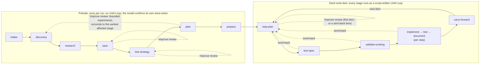

# Planning and step creation in ShipLoop: what each stage does, and a question-driven design (2026-10-30)

The owner asked (2026-10-30) how ShipLoop's prompt planning and step creation work, and whether to improve the
prompts, the use of Until Loop, or the phases, stages and graph relationships; to compare with planning frameworks on
GitHub such as BMAD; whether asking key questions about the prompt itself could drive discovery, experiments,
elaboration and step planning; which state files beyond the incoming request and the living spec, architecture and
environment deserve thought; and for an illustration. First: document every stage up to step planning, what prompt
it gets, what it achieves and outputs, and where artifacts are added or updated. Then: analysis and experiments.

## 0. The answer in brief

**What ShipLoop does today.** Planning is seven prelude stages run once (`intake`, `discovery`, `research`, `spec`,
`test-strategy`, `plan`, `prepare`) and two stages per work item (`step-plan`, `test-spec`). The script prints one
packet per stage; the model does that stage and calls back. Prelude stages are single passes the model confirms
itself; the iteration in planning comes from the Improve reviews after spec, test-strategy, plan and the first item's
step-plan, which took 53-58% of the DeepSeek flash planning windows. Only the per-item stages run as script-written Until Loops.
Knowledge lands in three living files under `docs/shiploop/`, committed after each stage that changes them and at the
`prepare` close; everything else is run state. §2-§4 document each stage: its prompt, what it reads and writes, and
what the script checks.

**What the analysis found.**
- A question about the request has no record until `plan`: intake, discovery and research carry it as prose, and the
  first structured, checked form is plan's assumption list (§4, F2).
- On a strong subject, surfacing questions is not the gap. In pilot X1 the shipped intake raised 93% of the decisions a
  vague request leaves open; asking for a key-question ledger raised that to 99-100% at 1.5-2x the intake time, and a
  category catalog added cost and wrong guesses, not coverage (F4).
- The papers and the frameworks put the value elsewhere: route each question to whoever can answer it, keep one
  numbered record every stage answers by ID, and make the guesses an unattended run must take explicit and testable
  (F5, F6, §6.3).
- The owner has already accepted this mechanism for brownfield conflicts (D9: `Q-<n>` quoted by value, answered by ID;
  build held), and it is the "key questions anchored" step of the owner's 2026-10-11 TODO (F3).
- Plan-time experiments are built, but no live run has used them; research's written allowance contradicts the
  2026-10-28 no-caps rule (F7).

**Recommendation.** One question record from intake to step-plan, settled by route (inspect, run, research, decide,
requester), quoted by value and checked by ID; research as a script-written Until Loop over the open questions; each
requester guess becomes an acceptance line with a check, and the defaulted ones go to `spec.md ## Open questions` for
the owner to confirm later. No new stage, no questions to the user, no caps, no catalog. Build each phase only behind
its experiment: X2 (does a numbered record beat prose downstream) and X5 (a live A/B). §10 lists the decisions.

## 1. The planning path at a glance

Sources: the stage table `_ROWS` in `skills/shiploop/scripts/shiploop_stage_spec.py` (goal, done-when, reads, blocks,
Improve rule per stage); the duty texts `DUTIES` and guide locators `STAGE_REFERENCES` in
`skills/shiploop/scripts/shiploop_prompts.py`; the knowledge-file tables `STAGE_FILES`, `READS` and `CLOSES` in
`skills/shiploop/scripts/shiploop_knowledge_home.py`; the inner-stage loop texts `WORK` and `REPEAT` in
`skills/shiploop/scripts/shiploop_loops.py`. The packets quoted below were rendered on main `d47d69d4` with
`python3 skills/shiploop/scripts/shiploop graph-dry-run --scenario delivery --format markdown` (synthetic results, so
hand-offs and knowledge files are empty: the packet sizes in §2 are lower bounds). The planning code these sections
read is unchanged through `f280ee84` (2026-10-31), after the skill-craft 2.25.0 / ShipLoop 1.24.0 release.

Planning is the prelude (`intake` → `prepare`, once per run) plus the first two inner stages of each work item
(`step-plan`, `test-spec`). The script picks every stage; the model does one stage per packet and calls back.



| Phase | Stage | What it settles | Improve review | Until Loop |
|---|---|---|---|---|
| Prelude | `intake` | the request mapped, sentence by sentence (S1..Sn), to outcomes, boundaries and open questions | — | — |
| | `discovery` | the repository, a baseline test run, conventions, the current-system account | — | — |
| | `research` | the consequential unknowns resolved with evidence; the assumption notes | — | — |
| | `spec` | requirements `R-<n>` with acceptance lines in the living spec | always | — |
| | `test-strategy` | which checks prove each requirement; harnesses, commands, ID convention, real-boundary checks | always | — |
| | `plan` | the ordered work items, the assumption list, the concern rows, structure decisions `AD-<n>` | always (hosts the planning experiments) | — |
| | `prepare` | a ready environment; the planning knowledge commit (the close) | — | — |
| Item | `step-plan` | criteria, steps with deps and a Proof each, test commands, expectations, paths | first item, or a sent-back item | yes |
| | `test-spec` | one test case per focused-command ID: oracle, RED, GREEN | none (owner, 2026-10-26) | yes |

## 2. Stage by stage

Every packet has the same anatomy (`shiploop_prompts.packet_pointer`, `recovery_pointer`; navigator `_checked_line`):
a header and recovery command; the callback; **Goal**; **Done when**; **Checked by** (what the script refuses at
`complete`); at an inner stage, the **Until Loop** start command and its contract; the narrative to show the user;
**Current stage guidance** (the stage's duty, numbered); **RULES**; the last accepted Improve lessons; the **Result
template**; **References** (guide sections, knowledge files listed by outline, "Results this stage builds on", and
hand-offs quoted by value); the original request (quoted whole at intake, spec and plan; a pointer elsewhere); and the
knowledge-home lines (which living files this stage keeps up to date, and that ShipLoop commits `docs/shiploop/` on
accept). Context may be cleared between any two stages, so each packet restates how its stage works and is checked
(SPEC S-6; owner tenet 2026-10-07).

The "Prompt" rows paraphrase each numbered duty item; the exact text is `DUTIES[<stage>]`. Sizes are the rendered
dry-run packet (characters, about four per token).

### 2.1 `intake` — map the request

| | |
|---|---|
| Goal | Map the request to outcomes, boundaries and open questions in this result's `summary`. |
| Done when | every sentence of the request maps to an outcome, a boundary or an open question; each open question names who answers it (discovery, or a recorded default) and what it blocks; the result says where the outcome will be visible, and when |
| Prompt (8 items, 1,575 chars; packet 9,610) | 1 one clause per request sentence, cited S<n>; boundaries (scope, constraints, authority, consumers, risks), each marked fact or assumption · 2 each open question: who answers it, what it blocks, what discovery must establish first · 3 discovery's source hints; "Ask no questionnaire for what evidence can resolve" · 4 where the result must become usable (a named target is the grant) · 5 where and when the outcome is visible · 6 for an interactive product: actors, shared state, lifetime, what stays hidden from whom, what the runtime provides; else record the default · 7 a continuing request follows prior-run guidance · 8 implement nothing, add no scope |
| Reads | the request (quoted whole) and `RUN/request.md` (S1..Sn); the three living files listed by outline; the lessons in the last `docs(shiploop): record <run> knowledge at release-verify` commit |
| Writes | result `summary` (prose) and `headline` |
| Checked by | the script refuses a done intake whose summary leaves a sentence uncited (IN1, `shiploop_request.check`), and the usual faults. The packet's own Checked-by line names only the usual faults (§6, finding F11) |
| Achievement | every sentence of the request is accounted for; open questions exist only as prose in `summary` |

### 2.2 `discovery` — the repository and its baseline

| | |
|---|---|
| Goal | Inspect the repository and baseline tests; write the facts to KNOWLEDGE/environment.md and the baseline run to `evidence_refs`. |
| Done when | the existing suite (full, or smoke) ran on the unchanged checkout with command, exit code and output recorded, or missing coverage is recorded; every open question from intake is answered with a source or kept as an unknown with an owner; conventions, runtimes, reusable code and delivery boundaries are recorded with source locators |
| Prompt (15 items, 5,683 chars; packet 14,747) | 1–2 run and classify the baseline (passed, failed, missing coverage, setup block, expected repair RED); change nothing to turn it green · 3 environment.md: `## Targets and runtimes`, `## Commands`, `## Platform facts` · 4 how a change reaches its consumer (CI, deploy, return) · 5 existing specs and non-functional screens · 6 repository-local skills under `## Skills` · 7 the investigation triggers (`research-loop.md#plan-the-investigation`) · 8 the shared discovery-and-research allowance · 9 connected knowledge (MCP readers, internal docs) · 10 the current-system account in `RUN/notes/current-system-baseline.md` · 11 service discovery (observability, boundaries, cache, async, schema) · 12 target identity and `## Access and accounts` · 13 the interaction baseline · 14 answer each intake question with a source, or keep it unknown with an owner · 15 the evidence hand-off |
| Reads | the intake result |
| Writes | `KNOWLEDGE/environment.md` (created here); `RUN/notes/discovery.md`; `RUN/notes/current-system-baseline.md`; result `summary` (the answers to intake's questions, in prose) |
| Checked by | the usual faults only |
| Achievement | the environment facts become committed knowledge; the answers to intake's questions stay prose |

### 2.3 `research` — the consequential unknowns

| | |
|---|---|
| Goal | Resolve the consequential unknowns with evidence in RUN/notes/research.md; durable facts go to KNOWLEDGE/environment.md. |
| Done when | every consequential unknown is resolved with evidence, or recorded with an owner and the gate it blocks; each proven access need is recorded as an open item with who can grant it and the gate it blocks |
| Prompt (12 items, 3,469 chars; packet 12,047) | 1 start from the open unknowns of intake, discovery and `notes/discovery.md`; check the investigation triggers · 2 repository and platform guides first, then the web one question at a time, writing each answer down before the next search · 3 bounded experiments under the shared allowance · 4 probe access to each delivery target safely · 5 reuse, compose, augment, then build new · 6 internal vocabulary · 7 quality targets and feasibility · 8 reopen the current-system baseline, append corrections · 9 service choices · 10 interaction and state answers · 11 `## Assumptions`: each load-bearing assumption marked evidenced, probed or open (plan builds its `assumptions` from it) · 12 evidence hand-off |
| Reads | the intake and discovery results |
| Writes | `RUN/notes/research.md` (with `## Assumptions`); `KNOWLEDGE/environment.md` (`## Access and accounts`, `## Platform facts`); result `summary` |
| Checked by | the usual faults only |
| Allowance | `research-loop.md#budget-stopping-and-convergence`: by default 15 active minutes, 64 host actions, two capability candidates and three experiments, shared with discovery; host-accounted guidance, not enforced |
| Achievement | the first place unknowns become an assumption list, still prose in a run note |

### 2.4 `spec` — requirements in the living spec

| | |
|---|---|
| Goal | Define each requirement and its acceptance lines as R-<n> in KNOWLEDGE/spec.md; ShipLoop derives this run's ID changes from the spec diff. |
| Done when | every request outcome maps to at least one acceptance line; each acceptance line is independently verifiable and says how it will be confirmed; non-functional requirements are assessed, or excluded with a reason; unaffected existing requirements are preserved |
| Prompt (12 items, 7,137 chars; packet 16,843) | 1 start from the committed spec, keep every R-<n>, retire under `## Retired` · 2 each requirement with acceptance lines: positive, failure, boundary, consumer surface, how confirmed · 3 R-<n> only; structure choices are AD-<n> in architecture.md · 4 map every request outcome; open gaps under their R-<n>; `primary` lists what the user asked for directly · 5 basis, preserved and changed behaviour, locators per changed R-<n> · 6 non-functional requirements (a UI gets a polished-interface requirement) · 7 state and data assessment · 8 service contracts · 9 state and information lifecycle · 10 the planning review focus applied to its own file (replayable examples, procedure walk, weak oracles, unrun commands, dropped IDs, unsourced runtime claims) · 11 an optional one-pass Backchain review · 12 a spec establishes acceptance lines, not success |
| Reads | intake, discovery and research results; `notes/current-system-baseline.md`; the committed spec |
| Writes | `KNOWLEDGE/spec.md` (`## Requirements`, `## Non-functional requirements`, `## Retired`); result `primary` |
| Checked by | a missing `primary` list or a primary ID with no entry in spec.md; a knowledge change that loses an R-<n> or AD-<n> |
| Review | Improve after accept (planning review focus); spec diff since the run baseline is derived by the script (`shiploop_knowledge_home.spec_diff`) |
| Achievement | the request becomes numbered, verifiable requirements that survive into later runs |

### 2.5 `test-strategy` — which checks prove each requirement

| | |
|---|---|
| Goal | Map each requirement to the checks that prove it: harnesses and commands in KNOWLEDGE/environment.md, boundaries in KNOWLEDGE/architecture.md. |
| Done when | every acceptance line the spec changes add or change, and each preserved behaviour they touch, maps to a check, its surface and its due stage; the harness is selected or revalidated; planned checks are marked planned; each case needing a host tool cites a probe of its first step |
| Prompt (14 items, 7,881 chars; packet 18,310) | risk-based strategy for the spec changes and their preservation set; non-functional checks; harness selection and `test_layers` (one row per code part and layer); reusable facilities; `## Real-boundary checks` with `targets`; service contracts; the discovery baseline's limits; focused, smoke and full commands in fenced blocks; the ID convention; probe each host tool now; a UI case driven through its interface; the review focus |
| Reads | spec and research results; spec.md; the spec changes since the run began |
| Writes | `KNOWLEDGE/environment.md` (`## Harnesses and suites`, `## Commands`, `## ID convention`); `KNOWLEDGE/architecture.md` (created here: `## Real-boundary checks`); result `test_layers`, `targets` |
| Checked by | `test_layers` (or `_na`) or `targets` missing; code with no unit or component row; a unit or component row neither available nor prerequisite |
| Review | Improve after accept |

### 2.6 `plan` — the work-item queue

| | |
|---|---|
| Goal | Plan dependencies and the queue: ordered `work_items`, `assumptions`, and structure decisions in KNOWLEDGE/architecture.md. |
| Done when | every criterion is owned by a work item; work items are in dependency order with readiness and completion conditions; the assumption list is complete: each assumption evidenced, probed, or open with the item that settles it |
| Prompt (19 items, 13,635 chars; packet 27,510, the largest) | 1 reopen every planning result and Git history; sort gaps · 2 plan backward from outcomes to producers · 3 reconcile every acceptance line and obligation to an item; `concerns`: 15 concern rows per item (ui, api, messaging, state, migrations, switchover, concurrency, platform services, scale, security, observability, config, performance, accessibility), each applies or not with a reason · 4 carry the baseline's evidence · 5 reuse test facilities · 6 environment and delivery work as items · 7 namespaces, placement, storage, AD-<n> · 8 interaction structure and a design basis (UI ambition) · 9 architecture.md sections · 10 a compact `context` per item a fresh reader can act on · 11 before/after preservation checks · 12 service mapping · 13 a loadable seam per item · 14 item sizing (split, merge; no item for review or test alone) · 15 dependencies name supplier and output · 16 `assumptions` from research's list, one disposition each · 17 complete ordered `work_items` with `follows` · 18 summary is reference · 19 the Backchain dependency audit; an optional Backchain `plan`/`draft` child |
| Reads | intake through test-strategy results; the three notes; spec changes; all three living files; Git history |
| Writes | result `work_items`, `assumptions`, `concerns`; `KNOWLEDGE/architecture.md` (`## Decisions` AD-<n>, `## Stack`, `## Structure`, `## Conventions`, `## Interfaces and boundaries`, `## Superseded`) |
| Checked by | a malformed assumption list, missing evidence files, an open assumption without a `due_item` naming a work item; a primary requirement in no item's `follows`; a lost R-<n> or AD-<n> |
| Review | Improve after accept. It screens the plan's assumptions and may run bounded experiments (`references/planning-experiments.md`); a finding that invalidates discovery, research, spec or test-strategy returns the run to the earliest affected stage through `improve-reconcile` |
| Achievement | the first structured, gated record of what the plan assumes |

### 2.7 `prepare` — the environment, and the planning close

| | |
|---|---|
| Goal | Ready the development and test environment; record readiness in KNOWLEDGE/environment.md and runner output in `evidence_refs`. |
| Done when | each planned check's runner starts in the prepared environment; readiness is recorded, or a justified not-applicable |
| Prompt (8 items, 2,691 chars) | prepare what the repository declares; confirm isolation, runtime, data safety; start each runner in no-op form; set up each `prerequisite` harness and run one test (`harness_runs`); keep a blocked baseline honest; recheck the return route; the consumer's access; readiness under `## Targets and runtimes`; `.gitignore` for tool state |
| Writes | `KNOWLEDGE/environment.md`; `.gitignore`; result `harness_runs` |
| Checked by | a prerequisite Test layers row without a `harness_runs` entry and saved output; any of spec.md, environment.md, architecture.md missing or empty (the close, `CLOSES["prepare"]`) |
| Achievement | the planning knowledge is committed to `docs/shiploop/` in the execution checkout |

### 2.8 `step-plan` — the steps of one work item

| | |
|---|---|
| Goal | Plan this item's change: `criteria`, `steps`, `test_commands`; `expectations`, `paths`, `follows` in the result. |
| Done when (also the Until Loop's exit) | the result opens with one sentence naming the change and its checks; steps in order; each step declares deps, criteria and one Proof command that proves them with only this step and earlier ones, every criterion is satisfied by a step, no step only changes tests; concerns mapped to steps; focused, regression and check commands (or `check_na`); a works, broken or absent expectation with a read-only check for every path; each step's skills named with a use; paths declared |
| Prompt (12 items, 8,977 chars; packet 22,197) | 1 recheck the item (blocked if the plan no longer needs it) · 2 test decisions · 3 `criteria`: "condition. Confirm by: …; pass when …", confirm executed, searched or inspected · 4 `steps`: at most 4 criteria and 3 product files each (E6, released 2.11.0); `deps`; one `proof`; `skills` · 5 `test_commands` · 6 `expectations` (from open plan assumptions too) · 7 `paths` · 8 `follows` · 9 concerns and the plan record · 10 knowledge (AD-<n>, commands) · 11 no execution graph · 12 evidence |
| Reads | spec, test-strategy, plan and prepare results; all three living files; this item's open items |
| Writes | result `criteria`, `steps`, `test_commands`, `expectations`, `paths`, `follows` (and `test_layers` additions); `KNOWLEDGE/architecture.md` (AD-<n>), `KNOWLEDGE/environment.md` (`## Commands`) |
| Checked by | the Until Loop receipt against the contract; `follows` IDs that exist; criteria with `confirm`; commands that fit criteria; deps on earlier steps only; every criterion satisfied; a check command or `check_na`; expectations for every path; skill locators that exist; lost IDs |
| Iteration | Until Loop: Work "Do duty items 1-12 … then run the callback with `check` … until the check says yes"; Repeat "while the check says no or an exit condition above does not hold" (`shiploop_loops.WORK`, `REPEAT`) |
| Review | Improve for the first work item and any sent-back item (rule `first-item`) |
| Achievement | an executable plan: every criterion has a command that will show it |

### 2.9 `test-spec` — the cases, before code

| | |
|---|---|
| Goal | Specify this item's tests: one `test_cases` row per focused-command ID, with oracle, RED and GREEN. Write no test code. |
| Done when | every completion criterion has at least one test case, or a justified not-applicable; each case has an independent oracle, a RED and a GREEN, and an ID a focused command lists; each case's procedure can happen as written from its start, or its unreachable start is an open item |
| Prompt (8 items, 3,648 chars; packet 14,850) | one row per focused ID; criterion, requirement, oracle, red, green, surface, setup, teardown; oracle from the requirement, never the code; walk each procedure; positive, failure and boundary cases (one rejection case per constraint of a public entry point); isolation and named mocks; later-stage cases as open items |
| Writes | result `test_cases`, `assumptions` (open items due at an outer stage or carry-forward) |
| Checked by | the Until Loop receipt; case IDs equal to the focused command IDs; criteria and requirements that exist; open items due at a later stage |
| Outcomes | done, blocked, send-back (to step-plan) |

## 3. Where artifacts are added or updated

`C` creates it (if missing), `U` updates it, `R` reads it, `G` the script's gate checks it at `complete`, `✓` ShipLoop
commits it on accept. Run records live in `RUN/` (outside the product checkout for a workspace run); the knowledge
home `KNOWLEDGE/` is `docs/shiploop/` in the product repository and is inherited by later runs.

| Artifact | Lifetime | intake | discovery | research | spec | test-strategy | plan | prepare | step-plan | test-spec |
|---|---|---|---|---|---|---|---|---|---|---|
| `RUN/request.md` (verbatim request, S1..Sn) | run | R G | | | R | | R | | | |
| `RUN/state.md` + `results/<action>.md` (accepted results) | run | U | U R | U R | U R | U R | U R | U R | U R | U R |
| `RUN/notes/discovery.md` | run | | C | R | | | R | | | |
| `RUN/notes/current-system-baseline.md` | run | | C | U | R | R | R | | | |
| `RUN/notes/research.md` (+ `## Assumptions`) | run | | | C | R | | R | | | |
| `KNOWLEDGE/spec.md` (R-<n>) | living | R | | | C U G ✓ | R | R G ✓ | G ✓ | R G | R G |
| `KNOWLEDGE/environment.md` | living | R | C U ✓ | U ✓ | | U ✓ | R | U G ✓ | U ✓ | R |
| `KNOWLEDGE/architecture.md` (AD-<n>) | living | R | | | G | C U ✓ | U G ✓ | G ✓ | U G ✓ | R |
| state `primary` | run | | | | C G | | G | | | |
| state `test_layers`, `targets` | run | | | | | C G | | G | U G | R |
| state `work_items`, `concerns` | run | | | | | | C G | | R | |
| state `assumptions` (plan's list) | run | | | | | | C G | | R (become `expectations`) | C G (open items) |
| state `criteria`, `steps`, `test_commands`, `expectations`, `paths`, `follows` | run | | | | | | | | C G | R G |
| state `test_cases` | run | | | | | | | | | C G |
| `RUN/improve/<action>/` (Improve receipt, lessons) | run | | | | C | C | C | | C (first item) | |
| `RUN/loops/<action>-contract.json`, `-terminal.json` | run | | | | | | | | C G | C G |
| knowledge commit `docs(shiploop): record <run> knowledge at <stage>` | repo history | | ✓ if changed | ✓ if changed | ✓ | ✓ | ✓ | ✓ (the close) | ✓ if changed | ✓ if changed |
| lessons (body of the release-verify knowledge commit) | repo history | R | R | | | | | | | |

Script-derived views, rewritten at every save and never authority: `RUN/context-index.md`, `RUN/reference.md`,
`RUN/status.md`, `RUN/progress.html`, and the spec diff since `RUN/run-baseline.txt` that the test-strategy and plan
packets quote.

## 4. How a question travels today

ShipLoop has no question record. A question about the request changes form four times on its way to the build, and
only the last two forms are structured and checked by the script:

| Where | Form | Structured? | Checked by the script? |
|---|---|---|---|
| `intake` `summary` | "open question: who answers it, what it blocks" | no: prose | only that every request sentence is cited (IN1) |
| `discovery` `summary` | each intake question answered with a source, or kept unknown with an owner | no: prose | no |
| `research` `RUN/notes/research.md` `## Assumptions` | each load-bearing assumption evidenced, probed or open | no: prose in a run note | no |
| `spec` | an unresolved prerequisite or user decision as an open gap under its R-<n> | no: prose in spec.md | no |
| `plan` `assumptions` | evidenced (`evidence`), probed (`check`, `evidence`), open (`due_item`, `reason`, `settle`) | yes | yes: shape, evidence files exist, `due_item` is a planned item |
| Plan Improve | an experiment may settle an assumption; a finding may return the run to an earlier stage | — | the import checks evidence paths |
| `step-plan` `expectations` | an open plan assumption the item consumes becomes an expectation with `from` | yes | yes, and validate-existing runs every check on the item base |
| `test-spec` `assumptions` | a case due at a later stage becomes an open item | yes | yes: due at a later outer stage |

So a question raised at intake can be answered, defaulted or dropped in prose before plan, and nothing records which
requirement, decision or step its answer shaped.

## 5. How other frameworks plan

Two research passes on 2026-10-30 read each framework's own prompt, template and script files at the versions named
(full reports with a URL per claim: `docs/experiments/key-questions-intake-20261030/frameworks-a.md` and
`frameworks-b.md`). Today's SDLC-gates proposal (`docs/shiploop-sdlc-gates-proposal-2026-10-30.md` §1) already found
no SDLC stage missing from ShipLoop against Spec Kit, Kiro and BMAD; this pass looks only at how each turns a request
into a step plan, and above all at how it asks questions.

| Framework (version read) | Who owns the graph | Questions about the request | Research or spikes | Plan unit and dependencies | Living vs per-change artifacts |
|---|---|---|---|---|---|
| **ShipLoop** (main `d47d69d4`) | the script; one packet per stage | intake lists open questions in prose; "ask no questionnaire for what evidence can resolve"; unattended defaults | research stage with a shared allowance; experiments inside Plan Improve | work items, then per item steps with `deps` and a Proof each | living `docs/shiploop/{spec,environment,architecture}.md`; run records outside the repo |
| **BMAD-METHOD** (v6.12.4 stable; v7 alpha) | v7: a script renders each skill's prompt, `HALT:` protocol; `tickets.py` owns readiness | "Never ask what a scan could answer"; investigate first, then one batch of leftover choices with options and consequences; unattended Build halts only on an "intent gap" | `bmad-deep-recon` codebase mode: numbered blind factual questions (how, why, where, what touches X), researchers see only the questions, commit-pinned citations re-verified by a script; `spike` ticket type | tickets with `after` prerequisites and an `unknown` field that blocks the ticket until answered | living ticket tree with an append-only memlog (decision, assumption, question entries); `AD-n` architecture spine |
| **GitHub Spec Kit** (v1.2.5) | prompt files; an optional YAML workflow engine with gates and resume | `/specify`: at most 3 `[NEEDS CLARIFICATION]` markers, guess the rest and record Assumptions; `/clarify`: a 10-category coverage map (Clear, Partial, Missing), top 5 by impact × uncertainty, one at a time with a recommended answer, dated Q→A write-back | `/plan` Phase 0 turns every unknown into a research task (Decision, Rationale, Alternatives) | `tasks.md` phases per user story, `[P]` parallel markers | `specs/NNN-name/` per feature; constitution long-lived |
| **Kiro** (docs 2026-10-15) | the IDE | Quick Spec asks up front; Analyze Requirements raises questions across the whole requirement set with suggested fixes | none; design-first or requirements-first route | `tasks.md` with `_Requirements:_` back-references; waves | `.kiro/specs/<name>/` per feature; steering `product.md`, `tech.md`, `structure.md` |
| **OpenSpec** (v1.16.0) | prompts + a small CLI that prints one `Next:` command | ask only when ambiguity changes scope, observable behaviour, compatibility or acceptance; otherwise assume and record | none dedicated; spike tasks suggested | `tasks.md` in dependency order | living `openspec/specs/` merged from per-change deltas (ADDED, MODIFIED, REMOVED, RENAMED) at archive |
| **GSD Core** (v1.19.0) | prompts + `gsd-tools` script gates | discuss-phase finds "gray areas" after a codebase scout; spec-phase scores four clarity dimensions with weights and minimums (model-estimated); a closed 8-category edge probe | researcher tags each claim VERIFIED, CITED or ASSUMED; the plan checker refuses unresolved Open Questions; `/gsd-spike` with verdicts | `PLAN.md` units of 2-3 tasks, `wave` and `depends_on` computed by script | `PROJECT.md`, `REQUIREMENTS.md`, `ROADMAP.md`, `STATE.md`; per-phase folders |
| **Superpowers** (v7.0.1) | skills + small scripts | one question per message, the one whose answer most changes the build, after reading the project; a fresh-context "builder check" lists what a builder would still need to ask, triaged into answered, minor (decide and mark) and the user's | "offer recon"; throwaway spikes | plan tasks with Files, Interfaces, Global Constraints, Review Focus | design and plan docs per feature; no living spec |
| **PRP** (prp-core) | `prp_loop.py` drives one headless session per stage | ask only when ambiguity changes the product contract | `prp-spike`: a falsifiable hypothesis, kill criteria and verdict bounds written before building | phase table with Parallel and Depends | plans outside the repo |

### What the evidence says

- **No framework measures whether its questions help.** None of the eight repositories publishes a planning or
  question-asking benchmark (frameworks-a §6, frameworks-b §9).
- **One vendor benchmark** (Uvik Software, Q4 2026, 50 brownfield Python tickets, `claude-sonnet-5`, a stated ±10-point
  noise band; https://uvik.net/blog/spec-driven-development-benchmark/): spec arms merged 80-84% against 72% for no spec,
  with the spec phase taking 28-44% of tokens. The gain was zero on 1-2-file tickets and on bug fixes and refactors,
  +15 points at 3-5 files and +30 at 6 or more. Specs covering at least 6 of 8 items (goal, scope, inputs and
  outputs, data changes, edge cases, acceptance tests, constraints, a no-change list) merged 89.3% against 60.0%.
- **Context has a cost.** Gloaguen et al., arXiv 2602.11988 (abstract read): repository context files did not
  generally raise task success and raised inference cost by over 20%.
- **Internal, small-n signals.** GSD's edge-probe note: a verifier caught none of 12 defects whose edges the spec
  never stated and all whose edges it stated (three canonical defects named; no replication). Superpowers v7.0.1
  retuned a formulaic opening question after users found it annoying.

### What is worth borrowing (mapped to ShipLoop)

| Idea | Source | ShipLoop place | Fit |
|---|---|---|---|
| Triage every open question: answered by inspection, assume and record, or a person's; interrupt only for a person's question that changes scope, observable behaviour, compatibility or acceptance | OpenSpec `propose.ts`, Superpowers brainstorming, Spec Kit `/specify` | intake, discovery | matches ShipLoop's unattended rule; adds a structured route per question (§7) |
| A coverage map over a fixed category list, each category marked applies or not | Spec Kit `/clarify` taxonomy; the 8-item list in the Uvik data | intake | a request-level analogue of plan's 15 `concerns` rows (§7.2) |
| Questions drive research: each unknown becomes a research task with Decision, Rationale, Alternatives; provenance tags; refuse to plan while a consequential question is open | Spec Kit `/plan` Phase 0; GSD researcher and plan checker Dimension 11 | research | the research frontier loop (§7.4) |
| Blind factual questions for codebase research, citations re-verified by a script | BMAD deep-recon codebase mode | discovery, research (brownfield) | a later option; needs a citation checker |
| A spike contract written before building (hypothesis, kill criteria, verdict) and a trigger test (uncertain, falsifiable, decision-changing, cheap) | PRP `prp-spike`; BMAD spike tickets | research experiments; spike items | sharpens `planning-experiments.md`'s notebook |
| A closed edge taxonomy, each edge resolved, dismissed with a reason, or unresolved | GSD edge probe | spec | overlaps spec duty 2 (positive, failure, boundary); measure before adding |
| A fresh reader's "what would I still need to ask?" as the exit of elaboration | Superpowers builder check | end of plan | close to the owner's cleared-context tenet; costs one fresh call; compare with SG2 |
| An `unknown` field that blocks a work item until answered | BMAD `tickets.toml` | plan `assumptions` with `due_item` | ShipLoop already has the stronger form |
| Size routing, with "no spec needed" as a route | cc-sdd discovery routes A-E; BMAD "size follows the intent"; Uvik size buckets | intake | rides on the owner's small-change lane question (F1) |

Not worth borrowing on the evidence: personas, party mode and elicitation menus (BMAD, user-triggered, unmeasured);
a model-scored clarity gate with uncalibrated weights (GSD); approval gates at every document (Kiro); the full
question stack for every request size (Uvik's zero gain on small and bug-fix tickets).

## 6. Analysis

Sources for this section: the history digest `docs/experiments/key-questions-intake-20261030/planning-history.md`
(what ShipLoop has measured and decided about planning, with a citation per claim), the evidence review
`question-evidence.md` beside it (papers graded A to E), the two framework reports, and pilot X1 (§9.1).

### 6.1 Findings

| # | Finding | Status | Evidence |
|---|---|---|---|
| F1 | Prelude stages end on the model's word. Apart from IN1 at intake and the structural gates at spec, test-strategy, plan and prepare, nothing checks a planning result; the iteration in planning comes from Improve reviews, which took 53-58% of the DeepSeek flash planning windows (17.4, 30.1, 48.7 min). | firm | §2; `docs/shiploop-planning-speed-and-caps-plan-2026-10-28.md` §2; `docs/shiploop-judgement-stage-checks-proposal-2026-10-26.md` (DI1, RE1 unbuilt) |
| F2 | A question about the request has no record until plan: it travels as prose through intake, discovery, research and spec (§4). Two runs show the cost: a Checkers decision kept only in prose went stale after an Improve review, and a brownfield plan missed two facts its own baseline file stated ("A baseline in the repository is not consumed by being there", brownfield journal F12). | firm (mechanism), interim (harm, two runs) | `docs/shiploop-artifact-flow-2026-10-11.md` §3-§4; `docs/shiploop-brownfield-baseline-design-2026-10-28.md` §2; `docs/shiploop-brownfield-baseline-journal.md` F12 |
| F3 | The owner has already accepted the fix for brownfield conflicts: D9, open questions as `Q-<n>` in the knowledge home, quoted by value into research, spec and plan and answered by ID, checked by script. Its build (§10 of that design) is held until a large case shows a gap. Three unbuilt checks add the same mechanism piecewise: RE1 (discovery's unknowns as a list research must resolve), X1 (open items due at a stage answered by ID) and X2 (research may record open items). | firm | brownfield design §9 D9, §10; judgement-stage checks §4 |
| F4 | On a strong subject, *surfacing* questions is not the bottleneck. In X1 the shipped intake raised 93% of the decisions a vague request leaves open; a key-question ledger raised it to 99-100% at 1.5-2x the intake time. A category catalog added nothing over a free-form ask and committed more guesses that contradict the user's real intent (64% of its defaults matched, against 77% for the shipped intake). An earlier targeted intake paragraph lifted three specific questions (persistence 3/9 → 9/9, hidden information 0/9 → 9/9, sign-in 0/9 → 7/9). | exploratory (n = 2 per cell, one subject) | §9.1; `docs/shiploop-composition-state-experiments-2026-09-26.md` §E3 |
| F5 | Without someone who knows the intent, intent cannot be reasoned out, and early wrong assumptions persist. With an oracle answering, asking closes most of the gap (54.8% → 69.4-70.4% against 70.8% for the full issue); without one, gains are smaller (SpecFix +4.3% Pass@1; REA-Coder +7.9% to +30% relative at about 26x the tokens); self-detection of ambiguity runs near 50% precision; instructions revealed over turns cost 39% on average because models commit early. | firm (literature, grade A-B) | `question-evidence.md` §0, §2.3-§2.4: arXiv 2603.26233, 2505.07270, 2604.16198, 2604.21505, 2505.06120 |
| F6 | The largest failure component of autonomous agents is implicit requirements in interfaces, repository conventions and data invariants (24.5-46.0% of failures, SWE-RPG), which are repository-checkable. Strong models recover such facts themselves; weak ones gain from being told. | firm (grade C, three studies agree) | arXiv 2608.09072, 2408.02232, 2502.13069 |
| F7 | Plan-time experiments are built but unused: no live run records the `improve-reconcile` route or a `probed` assumption; the 2026-09-21 pilot found no consequential improvement from them; research's allowance (15 active minutes, 64 host actions, 3 experiments) is still written in the reference prose, although the owner removed arbitrary caps on 2026-10-28 and no later decision covers these numbers. | firm | planning-history §4C, §6; `references/research-loop.md` §Budget, stopping, and convergence |
| F8 | 42% of the 469 planning findings Improve acted on were missing content, 30% contradictions or unreplayable checks, 14% stale references. Missing content is the class a question asked before writing could move earlier; nothing has measured whether it does. | interim | `docs/shiploop-improve-value-journal.md` F5 |
| F9 | Step planning's measured failure is order, not questions: a step's Proof that needs a later step's work (DeepSeek battleship, about 24 of 222 min; chess run 5b). SG1 (a replay) and D6 (a step-plan refusal) are in flight in today's gates proposal. A step-level question ("what does each Proof read, and which step writes it?") would be the prompt-side complement. | firm (two live cases) | `docs/shiploop-sdlc-gates-proposal-2026-10-30.md` §3 row 16, §5 |
| F10 | Packet heads are full where the questions would be read: plan's head ends at 19,500 of the 20,000-character print bound and the inline step-plan head at 19,997. A quoted-by-value record must live in the full packet file, with only the questions due at that stage in the head. | firm | planning-history §0 (commits fdec0f6e…, review-after-tests design §9) |
| F11 | Intake's packet says it checks only the usual faults, while the script also refuses a summary that leaves a request sentence uncited (IN1). The model learns that rule only from a refusal. | firm (small) | `shiploop_navigator._stage_gates` has no intake entry; `shiploop_request.check` |
| F12 | A durable request record is missing for one future rule: brownfield D2 asks a changed R-<n> for `Basis: S<k>`, but `RUN/request.md` is outside the repository and the knowledge commits carry no request text, so S<k> is unresolvable in a later run. | firm (design), no harm yet (D2 unbuilt) | `shiploop_knowledge_home.commit`; brownfield design §0 item 4 |

### 6.2 What the comparison adds

- **ShipLoop is already the strictest of the set.** No other framework has a script that owns the whole loop and checks
  every exit (the archived 2026-10-11 repo study reached the same verdict; BMAD v7's script-rendered prompts and
  OpenSpec's single `Next:` command are the closest). ShipLoop's assumption list with a `due_item`, script-run
  `expectations` and Proof commands go further than BMAD's `unknown` field or Spec Kit's `[NEEDS CLARIFICATION]`.
- **Where the others are ahead is the front of planning.** Spec Kit, OpenSpec, BMAD, GSD and Superpowers each make the
  open question an explicit object: classified by who can answer it, given a recommended answer, written back by ID,
  and refused at a gate while unresolved (GSD's plan checker; BMAD's `unknown`). ShipLoop keeps that object in prose
  until plan (F2).
- **Nobody has evidence that the question machinery itself pays.** The only numbers (Uvik) say specs help on features
  touching 3+ files and do nothing on small or bug-fix tickets; completeness on an 8-item list correlates with merges.
  ShipLoop should measure on its own runs before adopting more ceremony, as its owner rules already require.

### 6.3 What this means for the owner's idea

Asking key questions about the prompt is the right spine, but the evidence moves the value away from where it first
appears:

1. **Not in asking more.** A strong model already raises most questions (F4); a catalog adds cost and wrong guesses.
2. **In routing each question to whoever can answer it** (F5, F6): the repository (inspect), a run (probe, reproduce,
   experiment), sources (research), ShipLoop's own technical choice (an AD-<n>), or only the requester. Only the last
   kind needs a default, and it is the kind a run can least afford to bury.
3. **In keeping one numbered record that every stage quotes and answers by ID** (F2, F3, F10), so a cleared context
   still sees it and the script can check it, the way plan's assumption list already works one stage late.
4. **In making intent guesses explicit, testable and confirmable**: an acceptance line with the default's value, a
   check that proves it, and a durable "decided on your behalf" list the owner can confirm later (F5).
5. **In driving research and experiments from that record**, as a script-written Until Loop over the questions still
   open, which is the owner's own 2026-10-11 TODO (F7).

## 7. Proposal: one question record from intake to step-plan

Generalise the accepted brownfield D9 to every request and make it the spine of planning. Nothing here adds a stage,
asks the user anything, caps a loop, or judges prose.

### 7.1 The record

The script keeps `questions` in run state, one row per question; each later packet quotes the rows by value (the head
carries the rows due at that stage, the full packet file the rest, F10).

```json
{"id": "Q-4", "question": "When only `page` is given, what page size applies?",
 "changes": "R-2 acceptance lines; TC cases for pagination",
 "route": "inspect | run | research | decide | requester",
 "status": "open | answered | decided | assumed | inconclusive",
 "answer": "...", "evidence": ["<locator or saved output>"],
 "default": "<requester and inconclusive only: the conventional choice, and what it rules out>",
 "raised_at": "intake", "settled_at": "research", "feeds": ["R-2", "AD-3", "A2"]}
```

- **Routes** follow the evidence review's triage: `inspect` (the repository or environment answers it), `run` (a probe,
  a reproduction or an experiment answers it), `research` (documentation or sources), `decide` (a technical choice
  ShipLoop makes and records as an AD-<n>), `requester` (only the person who asked knows: intent, preference,
  acceptance).
- **`feeds`** names what the answer shaped. It doubles as the value measure the evidence review recommends: a kind of
  question whose answers never feed anything across runs is dropped from the prompt.
- **Checks are structural only** (owner principle D1, checks never judge prose): unique IDs, a route and a status per
  row, evidence files that exist, every `feeds` ID present in spec.md or architecture.md, and, at the plan, no open
  row whose route can still be worked.

### 7.2 Who writes what

| Stage | New duty (replacing, not adding to, the prose it supersedes) | Check |
|---|---|---|
| intake | write the first rows: the questions whose answers would change a requirement, a decision, a test or the delivery, each with its route; keep the targeted interaction and state questions (E3 showed they work); no catalog (F4); a `requester` row gets its default later, at spec (X1: early defaults commit more wrong guesses) | IN1 as today; rows well formed |
| discovery | settle the `inspect` rows with locators; add rows the code raises (brownfield conflicts are D9's Q-<n>) | answered rows cite evidence |
| research | work the frontier as an Until Loop (§7.3); `run` rows use a written spike contract | the loop's script-run exit check |
| spec | turn every `requester` row into an explicit acceptance line carrying its default, under the R-<n> it shapes; cite answered rows in `feeds` | every settled row that changes behaviour feeds an R-<n> |
| test-strategy | plan a check for each defaulted acceptance line, so changing the default later is cheap to verify | as today |
| plan | each open assumption cites its `Q-<n>` (`from`); the same `due_item` rule | no open `inspect`, `run` or `research` row without an owning item |
| prepare (the close) | the script copies each `assumed` and `inconclusive` row into `spec.md ## Open questions` in D9's format, so the owner and the next run see what was decided on their behalf | the close |
| step-plan | open rows due at this item become `expectations` with `from` (today's mechanism); one step question: what each Proof reads, and which earlier step or the base provides it (F9) | as today, plus SG1/D6 when built |

### 7.3 Research as the question frontier (Until Loop)

Research becomes the one prelude stage that runs as a script-written Until Loop, like the inner stages:

- **Work**: take the open row whose answer would change the most (a requirement before a test, a decision before a
  detail) and settle it by its route, writing answer, evidence and any new question it raises; then run
  `shiploop questions --check`.
- **Exit**: no row with route `inspect`, `run` or `research` is open; each answered row cites evidence that exists; the
  last full pass added no row that changes a requirement or a decision; the check says yes.
- **Repeat** while an exit condition fails and a feasible route remains; a route that fails leaves the row
  `inconclusive` with its default and the gate it blocks. No iteration count (owner, 2026-09-26 and 2026-10-28).

This is steps 2 and 3 of the owner's 2026-10-11 TODO ("repeat until the key questions no longer materially change";
"flag a question that cannot be answered as inconclusive"). It moves the experiment trigger from the Plan Improve
child, where no live run used it (F7), to the stage where the question is. A `run` row borrows PRP's spike contract:
the hypothesis, the kill criteria and the verdict bounds are written before anything runs.

### 7.4 Graph relationships

- **Keep**: the linear prelude, per-item step planning (GSD Pi ADR-011 reached the same "sketch, then refine per
  slice" shape), send-back to step-plan, add-work, no parallel fan-out (fresh contexts per item were dropped on cost,
  G1, 2026-10-29).
- **Add, after measuring**: a question return. When a later stage adds or changes a row with a route research can
  work, the script reruns from the earliest stage whose artifacts the row `feeds`, computed from the record instead of
  chosen by the model as today's reconcile receipt does. This moves one more decision into the script
  (`shiploop-purpose`).
- **Consider later**: a spike work item (`kind: spike`, `settles: [Q-<n>]`) for a question only real product
  scaffolding can answer (BMAD, GSD). No run has needed one yet.

### 7.5 Prompt changes, summarised

Intake duty 2 (open questions in prose) becomes the record; discovery duty 14 and research duties 1 and 11 become
"settle the rows by route"; spec gains "a requester row becomes an acceptance line with its default"; plan duty 16
gains `from: Q-<n>`; step-plan gains the Proof-input question. Text moves out as well as in: the prose these replace
is removed, and the full record lives in the packet file, not the head (F10). F11's one-line fix to intake's
Checked-by line can ship on its own.

### 7.6 What it must buy

Adopt in phases, each behind an experiment with a pre-registered rule (§9): the record (phase 1) only if a downstream
stage uses it better than prose (X2); the frontier loop (phase 2) only if a live A/B shows fewer missing-content
review fixes and fewer planning-caused send-backs, with no rise in the planning window beyond the runs' own spread
and the hidden checks unchanged (X5).

## 8. State files: what exists, and what else to think about

| Record | Lifetime | Holds | Consumer | Recommendation |
|---|---|---|---|---|
| `RUN/request.md` | run | the request verbatim and S1..Sn | intake's IN1; spec and plan quote it | keep |
| `RUN/state.md` (+ `results/`) | run | every accepted result, the queue, assumptions, test decisions | the script; every packet | keep |
| `docs/shiploop/spec.md` | living | R-<n>, non-functional requirements, Retired | spec through test; later runs | keep |
| `docs/shiploop/environment.md` | living | targets, commands, harnesses, ID convention, access, platform facts | every build stage | keep |
| `docs/shiploop/architecture.md` | living | stack, structure, conventions, interfaces, real-boundary checks, AD-<n> | plan, step-plan, implement | keep |
| lessons (release-verify commit body) | repository history | learned, key considerations, open for the next run | the next intake | keep |
| state `questions` (§7.1) | run | the question record | every planning packet (quoted), the gates, the research loop | **add** (phase 1, after X2) |
| `spec.md ## Open questions` | living | open and defaulted intent questions: `Q-<n>`, the default taken, the R-<n> it shaped | the owner (confirm later); the next run's intake | **add**, as D9 already decided for brownfield; extend it to defaulted intent questions |
| a durable request record | living | the request text a `Basis: S<k>` points at | brownfield D2's basis rule; a follow-on intake | when D2 is built, quote the sentence inside the basis line; no new file (F12) |
| product context and glossary | living | users, goals, non-goals, domain terms | intake and spec of later runs | **not now**: repository context files cost 20% more with no general gain (arXiv 2602.11988); add as spec.md sections only if a follow-on run shows inconsistent defaults or terms |
| a per-change folder | per run | proposal, design, tasks | none found | **no**: removed by the consumer contract (owner, 2026-10-11) because nothing read it |
| backlog of deferred ideas | living | work found out of scope | the owner | covered by the lessons' "open for the next run" |
| traceability view (Q → R/AD → item → step → test) | derived | the links `feeds`, `follows`, `criteria` and test IDs already hold | the progress viewer and the report | derive; never a file anyone edits |

## 9. Experiments

### 9.1 X1 (ran): key questions at intake

Question: on an underspecified request, does asking intake for key questions surface more of what the real request
pins, and does a category catalog add to a free-form ask? Four E2E cases (battleship, csv-report, seat-reservations,
user-listing) cut to one- or two-sentence requests; the 38 decisions their full prompts pin are the ground truth. Arms:
A the shipped intake duty; B with a K1-K11 catalog and a question ledger; C with the ledger and no catalog. Claude
Sonnet 5.5 at xhigh, two samples per case and arm (24 calls); a blind Claude Opus judge per case; a decision counts
only if the judge's quote is found verbatim in the output (all were).

| Arm | Recall | Defaults committed | Defaults matching the real request | Judged noise | Chars | Seconds |
|---|---|---|---|---|---|---|
| A shipped | 0.932 | 66 of 76 | 0.77 | 27% | 7,214 | 70 |
| B catalog + ledger | 1.000 | 76 of 76 | 0.64 | 21% | 16,662 | 139 |
| C ledger only | 0.986 | 72 of 76 | 0.74 | 23% | 12,427 | 106 |

B vs A +0.068 (exact permutation p = 0.077, optimistic); C vs A +0.054 (p = 0.23); B vs C +0.014 (p = 1.0). A's misses:
the rules module (once), the port (once), one-parameter pagination defaults (once), a page past the last (twice).
Status: exploratory. Not tested: a weaker subject, downstream use, real repositories. Evidence and reproduction:
`docs/experiments/key-questions-intake-20261030/README.md`.

### 9.2 Proposed next

| # | Question | Design | Cost | Pre-registered rule |
|---|---|---|---|---|
| X2 | Does a numbered record handed to spec become requirements better than prose? | X1's four vague cases; intake arm A or C, then the shipped spec duty with the record quoted by value (C) or the prose summary (A); score the share of the 38 decisions that become explicit acceptance lines, and default agreement; Sonnet now, DeepSeek flash when its limit resets | about 24 subject and 4 judge calls per subject (about 1 h) | adopt phase 1 if C beats A by 10 points or more on both subjects with no fall in default agreement |
| X3 | Does surfacing matter on a weaker subject? | X1 unchanged on the E2E subject (DeepSeek flash) or Kimi | as X1 | a gap of 15 points or more between A and C reopens the intake wording |
| X4 | Does the Proof-input question cut proof-order faults? | the stage suite's step-plan cases; shipped step-plan duty vs one added question; score with SG1's replay detector | offline replays | coordinate with the SG1/D6 work; adopt only if it lowers faults where the gate would refuse |
| X5 | Does the record plus the research frontier loop pay in live runs? | E2E A/B on three cases (one vague variant), four samples per arm, decided by the D5 permutation rule | about 24 live runs | fewer missing-content fixes in the spec and plan reviews and fewer planning-caused send-backs; planning window within the runs' spread; hidden checks unchanged |

## 10. Decisions for the owner

| # | Decision | Recommendation |
|---|---|---|
| D1 | Extend brownfield D9 to every request: one `Q-<n>` record from intake on, quoted by value, answered by ID; defaulted intent questions go to `spec.md ## Open questions` at the close | yes, built only if X2 passes |
| D2 | No category catalog at intake; keep the targeted interaction and state questions | yes (X1) |
| D3 | Research becomes a script-written Until Loop over the open questions, with a script-run check and no count | yes, after D1; it is your 2026-10-11 TODO, steps 2-3 |
| D4 | Move the experiment trigger from the Plan Improve child to research's frontier; keep the Plan Improve path as the fallback | yes, with D3 |
| D5 | Research's written allowance (15 min, 64 actions, 3 experiments): remove it under your 2026-10-28 rule, or keep it as guidance | your call: it is a limit |
| D6 | A question return whose target stage the script computes from `feeds` | after D1, and only if X5 shows questions arriving late |
| D7 | Spike work items | defer until a run needs one |
| D8 | Durable request text for brownfield D2's `Basis: S<k>` | quote the sentence in the basis line when D2 is built |
| D9 | Product context and glossary in the knowledge home | not now |
| D10 | Run X2 now on Sonnet, then X3 and X2 on DeepSeek flash when its limit resets; X4 with the SG1 work; X5 after phase 1 | yes |
| D11 | Intake's Checked-by line names IN1 (F11) | yes; a one-line packet fix with a change note |
