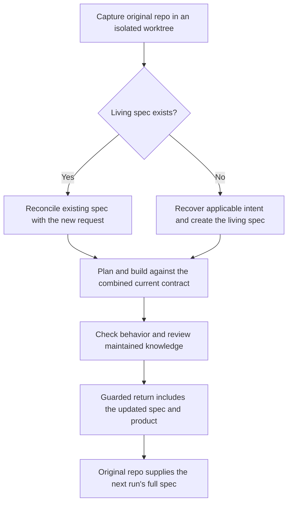

# Audit: prior-run context and the living spec

**Later owner direction, 2026-11-02:** this file describes the inspected implementation, not the newly selected target. The owner wants distinct prior/current intent, deliberate completion-time consolidation and delta-only step plans. See the [revised continuity plan](shiploop-intent-continuity-plan-2026-11-02.md); the earlier recommendation against a consolidation obligation is superseded.

Packets carry the repository's enduring product knowledge and selected requirement entries. They do not reload every old run folder. The living spec is created or updated in the execution worktree during specification, then returned with the product at completion. **There is no separate final semantic merge of a feature spec into an older full spec.**

This follow-up inspects and exercises the source at `3be5daeced25cd39c722701bac9b2d34e894e0cb`; its ShipLoop code is unchanged from `c0bcf83dedc759a15ed924d3966bb8392422eeca`. Five established suites passed, 342 tests total, and a synthetic-state probe rendered the actual packet blocks described below. No live model delivery or product-source change is claimed.

## What prior information reaches each consumer

| Consumer | Information actually supplied | What still depends on engineering judgment |
| --- | --- | --- |
| Intake | The three living knowledge files, located by path/size/outline; the last three Git commit messages; the latest release-verification lessons commit, even if it is outside that window. | Read the relevant existing contract, recover missing accepted intent, and distinguish historical observations from current instructions. |
| Spec | The new request in full; explicit instructions to read the living spec whole and consult discovery/research/current-system sources. The stage is told to create its assigned knowledge file if missing. | Preserve compatible clauses, supersede only authorized conflicts, and recover relevant contracts outside the managed knowledge home. |
| Test strategy and overall plan | Current living-spec references and the script-derived spec/architecture diff from the run-start Git revision. | Select touched preserved behavior and meaningful regression checks along with new behavior. |
| Step plan and test spec | Current spec/architecture/environment locators, accepted current-run planning results, `follows`, criteria and requirement-linked cases. | Include the specific preserved constraints that govern this item and each step. |
| Implement and test | Current entries for selected `follows` IDs, quoted by value, plus criteria and test cases. Individual implementation steps can narrow that set. | Do not treat the new feature's happy-path case as sufficient coverage of inherited constraints. |
| Improve | The producer's packet and result, relevant knowledge-file locators, handed criteria, and the parent-authored review scope/context. | Carry material external/preserved source locators into the actual review contract and inspect them; the import receipt cannot prove an omitted clause was reviewed. |

These are distinct mechanisms: [knowledge.stage_lines — prior commits, lessons and create/update duty](../skills/shiploop/scripts/shiploop_knowledge_home.py#L238), [lessons_lines — latest release-verification learning](../skills/shiploop/scripts/shiploop_knowledge_home.py#L924), [reads_lines — file locators and outlines](../skills/shiploop/scripts/shiploop_navigator.py#L6789), [CONSUMES — fields handed between current-run stages](../skills/shiploop/scripts/shiploop_navigator.py#L88), [handoff_sources — current results and current requirement text](../skills/shiploop/scripts/shiploop_navigator.py#L4020), and [_reviewed_input_lines — review inputs](../skills/shiploop/scripts/shiploop_navigator.py#L7914).

`RUN/results/<action>.md` means a result in the **current** run, not an automatically imported prior-run result. Prior-run requirements survive primarily through maintained repository documents; the historical baseline and lessons supply supporting context. Accepted intent must therefore be durable before a run ends. A requirement left only in an old temporary result is not automatically recovered next time. The cross-run suite explicitly exercises a missing old run while retaining repository requirements: [shiploop-cross-run.test.py](../test/shiploop-cross-run.test.py#L357).

Linked team contracts can remain authoritative in their existing locations. However, the managed ID gate and run diff operate on `docs/shiploop/spec.md` and `architecture.md`; they do not automatically compare every linked PRD or policy. The host must pass exact relevant sections/headings through existing context and evidence fields. See [project-knowledge.md — authoritative homes and handoff rules](../skills/shiploop/references/project-knowledge.md#L295).

## When the full spec is created, updated and returned

*Reconciliation happens before building in the isolated copy. The original repo receives the resulting spec at the guarded return.*

The author performs the clause-level reconciliation. The script supplies the following controls:

- **At spec completion:** `primary` must name at least one existing, non-retired `R-<n>` entry. A missing living spec cannot satisfy the current real CLI gate. This is separate from pure graph simulations, which can use synthetic results. See [shiploop_primary.py — check_spec](../skills/shiploop/scripts/shiploop_primary.py#L79) and [navigator — CLI invocation of the gate](../skills/shiploop/scripts/shiploop_navigator.py#L3751).
- **Before preparation completes:** the managed spec, environment and architecture files must be present and nonempty in a Git checkout. ID-loss checks protect previously committed managed IDs. Neither check proves semantic preservation. See [knowledge.check](../skills/shiploop/scripts/shiploop_knowledge_home.py#L309).
- **As accepted work progresses:** knowledge changes are committed in the execution checkout; inline step changes follow the step's combined commit boundary. The old run-start revision remains available for comparison. See [_knowledge_close](../skills/shiploop/scripts/shiploop_navigator.py#L3422) and [run-baseline/spec_diff](../skills/shiploop/scripts/shiploop_knowledge_home.py#L938).
- **At return:** managed knowledge paths default to `keep`; a return review cannot exclude them unless the caller already excluded them at workspace creation. Clean committed candidates can fast-forward; dirty-start, filtered or uncommitted candidates return the selected working-tree delta. Source drift blocks return rather than triggering an automatic three-way or semantic merge. See [workspace — path defaults](../skills/shiploop/scripts/shiploop_workspace.py#L1179), [return validation](../skills/shiploop/scripts/shiploop_workspace.py#L1365), and [workspace-lifecycle.md — actual return routes](../skills/shiploop/references/workspace-lifecycle.md#L154).

Consequently, completion is not a safety net that restores a clause lost earlier. If the candidate's living spec has an unauthorized meaning change but still retains its ID, path-level return can faithfully deliver that incorrect text. Semantic preservation must be checked before the return. The direct non-Git route also lacks the Git-based knowledge/return protections above.

## A reproduced selection boundary in implementation packets

The probe used a synthetic product with R-1 requiring authorization and R-2 describing export formats. The current R-2 adds CSV while retaining a reference to R-1. The item's `follows` contains R-1, R-2 and AD-1. Step S1's case initially tests R-2's CSV format only.

| Synthetic producer state | Entries quoted in S1's handoff |
| --- | --- |
| R-1 appears in item `follows`, but S1's task, selected criterion and case name only R-2 | R-2 and AD-1; R-1's full authorization clause is omitted |
| S1's criterion also says that R-1 authorization remains enforced | R-1, R-2 and AD-1 |

The renderer does not recursively expand R-2's textual reference to R-1. The first packet still has that reference and the maintained spec remains available, so this is **not evidence that authorization was erased or that a model violated it**. It demonstrates that an item-level dependency alone does not guarantee the old clause is quoted at every dependent step. See [step_scope](../skills/shiploop/scripts/shiploop_navigator.py#L3982).

This is the narrow hardening target: the step producer must explicitly carry each relevant inherited constraint into the step's task/criterion or case, then Improve must verify that the mapping is sufficient. Do not quote every unrelated old requirement into every step. The owner's earlier decision deliberately made coverage relative to the intention of that step: full commit `fdec0f6ed642165effd33be640974c9ee25c1561` moved primary coverage to the overall plan and removed the blanket last-item test requirement.

The exact rendered blocks are retained as [item-level selection](experiments/spec-lineage-plan-20261101/packet-audit/implement-item-follows-only.md) and [step-level selection](experiments/spec-lineage-plan-20261101/packet-audit/implement-step-names-preserved.md), with [probe-summary.json](experiments/spec-lineage-plan-20261101/packet-audit/probe-summary.json). They are actual function output from synthetic state, not full live-run packets or proof of accepted production plans.

## Verification and next action

All five established suites completed sequentially on a clean detached worktree at the stated source revision; its revision and clean status matched afterward. No retries were needed.

| Suite | Tests | Result |
| --- | ---: | --- |
| `shiploop-cross-run` | 10 | PASS |
| `shiploop-knowledge` | 163 | PASS |
| `shiploop-handoff` | 133 | PASS |
| `shiploop-step-packets` | 10 | PASS |
| `shiploop-return-review` | 26 | PASS |
| Total | 342 | PASS |

The [retained execution summary](experiments/spec-lineage-plan-20261101/packet-audit/test-summary.txt) identifies each log. Full logs, pre/post source identity, the probe script, synthetic product and rendered blocks remain under `/Users/dadleet/shiploop-audits/2026-11-01/prior-spec-packets-ou8yjmg2/`. These checks establish the tested structural, CLI and return behavior; they do not establish universal semantic preservation or actual reading by a model.

Continue the [existing plan](shiploop-spec-lineage-plan-2026-11-01.md) with a calibrated cold-context case that tests an old constraint on the new feature and the corresponding review. The present evidence warrants checking that selection boundary. It does not yet select a product patch or justify reintroducing a final spec-merge stage.

The source history remains decisive: `49c502ea75d41c7541f7e4cedce770b0a04d4ecd` replaced model-maintained changed-ID lists with the Git baseline/diff; `589bc03ebe4bb31759a371e10bbc261bb071aab3` removed separate feature specs and their retire/merge machinery; `ab5158692257927a6cafd3e7b867c7b714d37665` deliberately replaced whole-file packet quotes with locators and followed entries. `f9d1f4cf732e9d63b46349c69e7cec3b6207995e` established the real CLI spec-entry gate. Their full messages were reviewed and no design reversal is made here.

No new Opus consultation was attempted: this is the same plan's read-only follow-up, and the earlier subscription-limit failure remains recorded in that plan. Rendered Markdown/Mermaid has not been visually verified; source links and document structure are checked separately.
