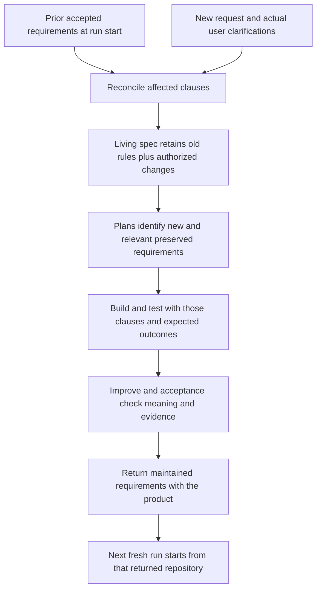

# Plan: preserve product requirements across ShipLoop feature runs

Keep one current product contract. Explicit new instructions override only conflicting earlier clauses; every compatible earlier requirement remains binding. The incoming request need not name an old requirement ID to supersede its conflicting clause. Verify that the affected old clauses and the incoming change reach planning, implementation, tests and Improve, including after context loss.

**Status: proposed verification and conditional hardening, 2026-11-01.** This task changes documentation only. Source inspected at `c0bcf83dedc759a15ed924d3966bb8392422eeca` on `main`; no product test, live delivery, release or deployment is claimed here.

## Assessment of the current setup

The intended delineation already exists and is largely wired. A new feature request receives a fresh run with its verbatim prompt; the repository retains its living spec. The spec producer must read that spec whole, keep stable requirement IDs, and change old clauses in place. Explicit current user instructions supersede conflicting older clauses; silence preserves them. These are current contracts, not proposed new behavior. See [SKILL.md — new request versus recovery](../skills/shiploop/SKILL.md#L108), [shiploop_prompts.py — spec duties](../skills/shiploop/scripts/shiploop_prompts.py#L988), and [requirements-definition.md — reconciliation](../skills/shiploop/references/requirements-definition.md#L34).

The remaining question is whether each real build uses the right requirements and preserves their meaning. ID retention and a passing feature test cannot answer that alone. `knowledge.check` detects disappearing committed IDs, while `step_spec_refusal` protects the committed spec during inline building. Neither establishes that every unchanged clause survived semantically. See [shiploop_knowledge_home.py — ID retention](../skills/shiploop/scripts/shiploop_knowledge_home.py#L309) and [inline spec protection](../skills/shiploop/scripts/shiploop_knowledge_home.py#L640).

Recommendation: **adopt the existing authority model; pilot focused verification of its handoffs; change code or wording only for a reproduced gap.** Additional spec files or state schemas are not justified by this inspection.

## Which material governs what

| Material | Meaning and authority | Location and lifetime |
| --- | --- | --- |
| Maintained product requirements | Accepted desired behavior, including accepted work still awaiting implementation. This is the enduring contract. | Reuse the repo-owned requirements home. Navigator-managed `R-<n>` entries live in `docs/shiploop/spec.md`; linked team contracts retain their existing homes. |
| Previous spec | The spec as it stood at run start, used to identify what this request changes. It remains historical evidence after an authorized replacement. | The execution checkout's recorded Git revision in `RUN/run-baseline.txt`, plus the spec path at that revision. |
| Incoming request | The new change being requested. Actual later user clarifications can refine it; an agent summary cannot acquire that authority. | `state["prompt"]`, projected into `RUN/request.md`; clarifications use existing durable notes/results and revision routes. |
| Current-system baseline | Observed behavior, implementation and verification limits. A discrepancy with accepted intent is a finding to resolve. | Selected source/tests and `RUN/notes/current-system-baseline.md`, with durable useful knowledge returned to the product repo. |
| Spec-stage and planning results | Records of this run's reconciliation and execution assignments. They do not replace the maintained product contract. | `RUN/results/<action>.md`, work-item `context`, `follows`, criteria, test cases and evidence references. |
| Architecture and environment | Structural decisions, runtime facts and verification procedures; distinguish accepted constraints from inferred choices and observations. | `docs/shiploop/architecture.md` and `environment.md`, maintained with the product. |

The prior and current specs are normally **two revisions of the same living file**. A new run is not a new full product specification that silently replaces the old one. Existing documents can own different contract areas; preserve their organization and link their applicable sections. See [project-knowledge.md — maintained requirements and reference destinations](../skills/shiploop/references/project-knowledge.md#L282), [shiploop_request.py — durable request](../skills/shiploop/scripts/shiploop_request.py#L1), and [shiploop_knowledge_home.py — run baseline](../skills/shiploop/scripts/shiploop_knowledge_home.py#L938).



*The next request inherits the returned product contract; it does not need an earlier conversation to reconstruct accepted intent.*

### Reconciliation rule

For each affected requirement, use the existing **preserve, add, modify or retire** distinction. Put the basis beside the changed clause and retain source/test locators in the existing result and work-item context. The script derives the actual file delta from Git; do not introduce a second hand-maintained list of changed IDs.

Hypothetical example: R-2 specifies a default page size of 10, maximum 100, rejection of nonpositive values, and filtering before pagination. A new request saying “change the default to 25” changes only that default. R-2 keeps its ID and its other conditions. Tests change the superseded default assertion and continue checking the maximum, validation and ordering. An unrelated authentication requirement remains binding even though the new prompt does not repeat it.

An accepted deferred feature also remains deferred until the request activates it. Accepted intent, observed implementation, proposals and verification status must stay distinct. A test proving today's code does not authorize rewriting the old contract to match a bug. See [requirements-definition.md — clause-level supersession](../skills/shiploop/references/requirements-definition.md#L43) and [project-knowledge.md — intent versus implementation](../skills/shiploop/references/project-knowledge.md#L319).

## What already reaches the build

| Consumer | Current mechanism | What verification must establish |
| --- | --- | --- |
| Spec | Whole incoming request; duty to read the living spec whole; discovery/research/current-system references. | The selected product sources were actually used, and only authorized conflicting clauses changed. The empty spec `READS` row is intentional, not evidence of a missing spec. |
| Test strategy and overall plan | Current living-file locators and script-derived changes since the run-start baseline. | Changed clauses and touched preserved behavior receive meaningful expected outcomes and work-item ownership. |
| Step plan and test spec | Requirement/decision IDs in `follows`, criteria, test commands and cases linked to current requirements. | Relevant preserved and cross-cutting constraints are selected along with the new feature. A valid ID alone does not prove adequate coverage. |
| Implement and test | Followed current requirement entries quoted by value, assigned criteria and test cases. | Step-specific narrowing retains every selected constraint that governs the actual step. |
| Improve, document and acceptance | Producer packets/results, selected source/test locators, existing review contracts and later spec diffs. | The review receives those constraints, checks the actual candidate, and distinguishes implementation evidence from approved intent. |

Living files are generally exposed through paths, sizes and outlines; followed entries are quoted by value. The implementation packet narrows `follows` using the current step, criteria and cases. That narrowing is a concrete audit target, not a proven defect. See [shiploop_navigator.py — consumer table](../skills/shiploop/scripts/shiploop_navigator.py#L88), [step_scope](../skills/shiploop/scripts/shiploop_navigator.py#L3981), [handoff_sources](../skills/shiploop/scripts/shiploop_navigator.py#L4022), and [reads_lines](../skills/shiploop/scripts/shiploop_navigator.py#L6789). The spec's explicit whole-file read is already pinned by [shiploop-handoff.test.py](../test/shiploop-handoff.test.py#L153).

## Ordered work plan

### P1 — Establish the exact existing contract and evidence

Inspect current source and full relevant commit messages again before changes. Freeze the candidate/control revisions and the selected product fixtures. Record which existing tests already cover new-run identity, spec reconciliation, requirement references, inline write protection and returned knowledge.

Produce one compact evidence table: requirement or clause, its prior source, authorized disposition, current source, consumer and behavioral check. This is a test/readout artifact for this investigation, not a new product state file. Use affected clauses and a few preserved cross-cutting clauses; do not inventory the entire legacy product.

**Complete when:** a second reader can distinguish established behavior from each unproven handoff, and every proposed change has a concrete failing example or is removed from scope.

### P2 — Exercise new-request, baseline and recovery boundaries

Depends on P1. Use isolated toy repositories and the real CLI to cover a fresh feature run, identical-text new request, same-request recovery, durable clarification, existing spec, missing expected source, dirty tracked spec and source edits during an isolated run.

Keep the two baseline uses distinct: `run-baseline.txt` supports comparison across the run; current `HEAD` supports the inline writeback guard. Workspace mode captures starting tracked working content. Direct in-place mode can begin with spec content that differs from `HEAD`; assess that explicitly. A missing/non-Git baseline is “comparison unavailable,” not an empty prior contract. Do not turn the currently non-refusing baseline diagnostic into a new blanket refusal without evidence and a separate behavior decision.

**Complete when:** recovered packets identify the correct request/repo and known prior state; unavailable evidence remains visible; initialization/recovery does not reset or overwrite prior intent. If direct mode needs a content-baseline enhancement, propose the smallest script-owned carrier separately instead of silently adding it here.

### P3 — Prove reconciliation and cold build handoffs

Depends on P1 and P2. Start with existing fields and routes. Trace selected old/new clauses through spec, plan, work-item `context`/`follows`, step criteria, test cases, printed implementation packets and the actual Improve contract. Use a multi-step item where a preserved constraint applies to a step that also implements a new requirement; specifically exercise `step_scope` when some, rather than all, criteria are selected.

Check both navigator-managed IDs and exact headings in linked repo-owned contracts. Verify the selected file, section and repository root, not just the existence of a guide link. If a reference is dropped or stale, repair its responsible producer/consumer and add a fail-first route test. Do not quote every old spec into every packet, add an ID quota, or mistake a string-match test for proof that the model respected the clause.

**Complete when:** a fresh context can recover every applicable selected constraint and its authorized change basis from durable material. A legitimate in-place modification and an unrelated preserved clause both survive the full handoff.

### P4 — Verify semantic preservation and selective supersession

Depends on P3. Calibrate the following cases on known-good and deliberately defective deliveries before using them to judge a candidate.

| Case | Required outcome |
| --- | --- |
| Add a feature without mentioning old rules | Prior behavior and applicable functional/non-functional clauses survive; accepted deferred work is not activated accidentally. |
| Change one clause of an existing requirement | Same stable ID, clear request basis, only the conflicting clause and its tests change. Valid paraphrase and in-place edits pass. |
| Explicitly retire a requirement | ID and reason remain in the maintained historical account; obsolete assertions are replaced only to the authorized extent. |
| Ambiguous conflict or missing expected contract | The material decision/evidence gap is retained before dependent work; neither newest-file selection nor code behavior invents authority. |
| Cold multi-step implementation and Improve | New and selected preserved constraints reach the specific build step and actual review; normal scoped work remains bounded. |
| Dirty start, interruption and concurrent edits | Correct starting content and request lineage remain identifiable; unrelated edits survive reconciliation/return. |
| Existing repo without ShipLoop-managed specs | Relevant maintained contracts and observed behavior are recovered without a competing full spec or an exhaustive rewrite. |
| Implementation and verification status changes | Current claims agree with actual evidence, while accepted intent, deferred work and clearly historical observations remain distinguishable. |
| Final return followed by another fresh run | Durable requirement/decision/test links resolve from the returned repo without the old temporary workspace or conversation. |

Retain pristine earlier behavior checks except assertions explicitly superseded by the new request. Use independent expected outcomes, including negative cases and subclauses. Structural ID checks and semantic review are complementary; neither substitutes for the other.

**Complete when:** each oracle rejects its targeted unauthorized change and accepts valid alternatives. Run a matched live control/candidate only if P2/P3 produced a justified candidate. Reuse the existing incremental harness, keep its selected subject/profile/evaluator fixed, and use fresh contexts and verified predecessors. Existing other-session runs remain their evidence; do not repair or advance them to obtain a green chain.

### P5 — Decide, document and qualify any implementation

Depends on P4. Keep only changes that close a reproduced gap and satisfy the predeclared quality and cost criteria. Record failures, contrary evidence, packet size effects and unresolved coverage. If current behavior passes, retain the evidence and avoid a product patch.

A warranted implementation would primarily touch `shiploop_knowledge_home.py`, `shiploop_navigator.py` or `shiploop_prompts.py` at the failed handoff, plus its focused tests and a ShipLoop change note. Change stage tables only if a demonstrated obligation is actually missing. Preserve inline intent protection; a genuine requirement change uses the existing send-back/replanning route. Coordinate separate status/send-back work with its owning session.

Before shipping a prompt or harness candidate, perform the required adversarial review and applicable evaluation on the exact text/build. Keep generic ShipLoop changes, E2E apparatus changes and retained learning separate. Follow release preflight, the subsequent E2E learning entry and CI; generated plugin/catalog/version output remains release-script owned.

**Complete when:** the accepted result identifies exactly what is proven, any retained fix has matching verification evidence, and the next operator can recover the sources without relying on this chat. Implementation is a subsequent task; this plan does not authorize a new integration, loop limit, changed comparison default or external deployment.

## Verification routes for implementation

The parent selects and diagnoses checks; established suite execution follows the repository's test-runner contract. Begin with the suites exercising changed behavior rather than running an unrelated full matrix:

```sh
python3 /Users/dadleet/src/skill-craft/test/shiploop-cross-run.test.py
python3 /Users/dadleet/src/skill-craft/test/shiploop-knowledge.test.py
python3 /Users/dadleet/src/skill-craft/test/shiploop-handoff.test.py
python3 /Users/dadleet/src/skill-craft/test/shiploop-step-packets.test.py
python3 /Users/dadleet/src/skill-craft/test/shiploop-packet-completeness.test.py
python3 /Users/dadleet/src/skill-craft/test/shiploop-return-review.test.py
python3 /Users/dadleet/src/skill-craft/test/shiploop-e2e-incremental-pilot.test.py
```

Extend to actual Improve/Until Loop route checks, packet bounds and relevant broader suites when the diff requires them. A hermetic incremental-pilot pass proves the apparatus case it exercises; fresh-context product behavior and spec semantics still require their separately retained evidence. No suite above was run for this documentation-only task.

## Evidence and prior decisions that constrain this plan

Full messages of the commits below were read; their recorded measurements are historical evidence, not newly rerun results.

| Commit | Material lesson used here |
| --- | --- |
| `855040644721fd5451c3fd86e522e4499a8ebcad` | Requirements preservation, one authoritative home and actual cold-context source handoffs already exist. A printed policy locator alone is insufficient. |
| `49c502ea75d41c7541f7e4cedce770b0a04d4ecd` | The script-owned Git baseline/diff replaced model-maintained `requirement_changes`/`changed_ids`. Preserve that simplification. |
| `589bc03ebe4bb31759a371e10bbc261bb071aab3` | Feature spec folders and their retire/merge/index machinery were deliberately removed; their consumers use living files and run results. |
| `ab5158692257927a6cafd3e7b867c7b714d37665` | Whole-file packet quotes were replaced with locators/outlines and followed entries after measured packet bloat. Do not reintroduce blanket copying. |
| `b75963f8e8b310ac13d69fc03659fdec0085e92a` | A step cannot make its newly added requirement count as its own allowed baseline. Keep the committed-entry writeback protection. |
| `9e39b146db427c26f68c0e22d900e70c92be5011` | Placement and enduring change-basis wording were implemented and later accepted; their evidence does not prove semantic status freshness. |
| `a232cf038789b532c8485c7583136177cb6be929` | A valid in-place change failed a copied-word/new-ID heuristic. Calibrate alternatives and retain the original verdict alongside corrected readings. |
| `a7d5904985592ff36bb8cf7d48567a623e9bad88` | Four later runs passed inherited/hidden behavior and changed earlier rules in place. Requirement citation predictions were not fully met; one chain without a control is limited evidence. |
| `e7388075310577a7140aafc7f22ace2f5d2d0a2c` | An incremental delivery passed behavioral checks but failed the separate semantic checkpoint because current knowledge contradicted implementation evidence. |
| `c30a829f568b4a4e04866bf875e3ff2acafe1c83` | The carry-forward-only status candidate was dropped; its control already repaired status later. Do not revive it or conflate its separate early recovery hypothesis with this plan. |

External comparison supports the distinction rather than a tooling change: [OpenSpec's own concepts](https://raw.githubusercontent.com/Fission-AI/OpenSpec/main/docs/concepts.md) separate enduring specs from proposed deltas. Its [troubleshooting guide](https://raw.githubusercontent.com/Fission-AI/OpenSpec/main/docs/troubleshooting.md) documents how replacing a modified requirement can omit still-valid scenarios. That is a useful counterexample for P4, not evidence that ShipLoop needs OpenSpec or its artifact layout. No dependency or integration is proposed.

The standing Opus review was attempted through the existing subscription runner with alias `opus`, streaming, no fallback, read-only tools, requested `xhigh` effort and served-model verification. It failed at the weekly subscription limit. Process exit was 6; the preserved JSON envelope reports `exit: 8`, `floor_failed: true`, `fallback: false`, `text: null` and no verified served model. No advice was obtained or attributed to Opus. The preliminary brief predates the later history review; the plan above supersedes its tentative change-record idea and records the intentional spec-read/locator design correctly.

Raw consultation envelope: [opus-result.json](experiments/spec-lineage-plan-20261101/opus-result.json). Preliminary question: [opus-brief.md](experiments/spec-lineage-plan-20261101/opus-brief.md). Transcript directory reported by the runner: `/Users/dadleet/.grok/skills/ask-opus/runs/20261102T024720Z-73745`; rejected-envelope evidence: `/Users/dadleet/.grok/skills/ask-opus/runs/20261102T024724Z-ask-opus-73736.floor-rejected`. Architectural recommendations therefore lack the requested usable Opus review. This does not block reversible inspection or planning.

Planning artifact verification: an independent native source review found no material findings and retained the need to calibrate semantic checks. All 17 local document links resolve and their line anchors are within the referenced files; the Markdown fences and whitespace check cleanly. Rendered Markdown/Mermaid was not visually verified: the app open request was queued and no local Mermaid renderer was available. These document checks do not establish future product behavior.
