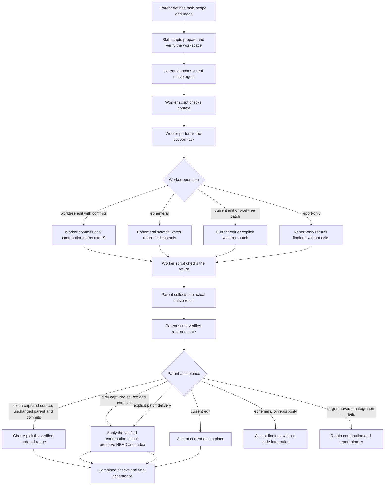

# Compact task interface

Use Ask Agent as the public skill. The parent supplies a task and workspace
choice; scripts perform the mechanical checks; native agents perform the work.
This is the normal standalone entry path. It reduces the command sequence the
parent and worker must assemble without adding a coordinator agent.

The existing [skill contract](../SKILL.md) still governs permissions, native
capabilities, fresh context, integration and acceptance. This interface supports
current-workspace edits and report-only tasks, isolated worktree edits,
and findings-only ephemeral work. For worktree edits, commit delivery is the
default; patch delivery is an explicit choice. Consumer-owned workspaces and
orchestrated callers retain their existing interfaces.



The native host launches and collects the worker. The scripts prepare the
workspace and check files; they do not launch agents, integrate contributions,
or clean up worktrees. For dirty inherited working-tree content, commit
preparation creates private base `S` in the worker only. If source index/worktree
state is dirty but nets to the captured tree, `S` remains the captured source
`HEAD` and `source_dirty` still records the original state. Preparation and
filesystem evidence do not prove native completion.

## Request

Bind the script from the **selected, loaded** skill card, as in
[package binding](workspace-operations.md#bind-and-verify-the-selected-package).
Prerequisites are Python 3 and Git for repository work. This command prepares
one task; it does not launch an agent:

```sh
SKILL_CARD="/absolute/path/to/the/selected/ask-agent/SKILL.md"
TASK="/absolute/path/to/the/selected/ask-agent/scripts/ask_agent_task.py"
python3 "$TASK" prepare --skill-card "$SKILL_CARD" --request - <<'JSON'
{
  "objective": "Implement the agreed price rounding rule in src/pricing.py",
  "expected_result": "The requested cases pass and the handoff names the checks run",
  "source": "/absolute/path/to/caller",
  "workspace": "current",
  "mode": "edit",
  "write_set": ["src/pricing.py"],
  "exclusive_writer": true
}
JSON
```

The example is illustrative: the parent supplies the real objective, expected
result, absolute source and narrow write set from the request. Add
`current_learnings` and `authorization` strings when the assignment needs prior
findings or applicable approvals. They carry context; they do not grant new
authority. Do not put credentials in them.

`workspace` defaults to `current`. `mode` is `edit`, `report-only`, or
`ephemeral`. Editing and ephemeral work require a nonempty `write_set`;
report-only work has no write set. `delivery_mode` is accepted only for an
edit in a worktree: it defaults to `commits`, and `patch` is the explicit
alternative. Current edits, report-only work, and ephemeral work have no
delivery mode. Unknown fields, unsupported modes and malformed inputs fail
rather than select another route. This is a single-task interface: prepare
each independent task and retain each result separately. It is not a batch
scheduler.

Use exact normalized repository-relative file paths or directory prefixes in
`write_set`, such as `src/pricing.py` or `src/pricing/`. A trailing slash selects
the directory and its descendants; without it the path is exact. This interface
rejects glob characters (`*`, `?`, `[` and `]`) before
setup: it does not inherit the older helper's glob matching across directory
separators. Use `src/` for a recursive directory boundary.

On `READY_TO_LAUNCH`, pass `launch.prompt` inline to the native launch tool and
use `launch.cwd` as its verified workspace. These are host-neutral hints,
**not a native tool's argument schema**. Retain the actual native handle. Never
shell-launch a child model. Read a failed preparation before dispatching.

### Packet transport

When the parent and worker can read the same local paths, add
`--packet /absolute/external/new-task.json` to `prepare`. Its existing parent
directory must be outside the source repository, selected package and Git
metadata. The script rejects a destination that exists, is symlinked, or resolves
inside a protected tree; it does not overwrite a previous attempt. The packet
contains the exact binding. Packet output contains `packet.path`,
`packet.binding_sha256`, `packet.sha256` (the file bytes), the short launch
assignment, and `commands` entries for `worker-start`, `worker-finish`, and
`verify-return`, each with `argv` and `cwd`. It omits the bulky inline `binding`.
The script creates the packet; the user does not need to prepare a transport file.

Each emitted command pins `--expected-binding-sha256`. Use these command fields
as supplied; do not rewrite the prompt to discover a command. A worker's first
`worker-start` call both validates its actual context and returns the task,
mode-specific rules and exact finish command in `action_packet`. This replaces
repeated briefing mechanics without adding a tool call or delegating a second
coordinator. File access requires a shared filesystem; there is no assumed
native `prompt_file` feature or automatic file upload.

Without `--packet`, preparation keeps its original read-only current-workspace
behavior and emits `binding` plus the complete inline assignment. Retain that
binding in the parent's coordination record. With packet transport, the only
additional preparation write is the explicitly selected external packet.
Worktree preparation still creates its managed workspace under either transport.

`payload_sizes` reports binding, prompt and JSON byte counts. Output is never
silently truncated. If the host truncates a result, stop before dispatch and
verify the complete assignment can be transferred. The advisory 20 KB warning
concerns Grok's default Bash output limit, not a native prompt limit or a
host-neutral maximum. See the
[Grok settings reference](https://docs.x.ai/build/settings/reference).

For an isolated edit, set `workspace` to `worktree`, provide
`writers_quiescent: true`, and keep the same narrow `write_set`. Set `mode` to
`edit`. Omit `delivery_mode` or set it to `commits` for commit delivery; set it
to `patch` only when patch delivery is intended. `delivery_mode` is valid only
for an isolated edit. Current-workspace edits and report-only work have no
delivery mode. `mode: report-only` has no write set and produces findings
without filesystem edits. `mode: ephemeral` requires `workspace: worktree`
and a nonempty write set; the worker may make scoped scratch changes, but
returns findings only, with no commit, patch, or code integration.

## Workspace

| Choice | Parent precondition | Script behavior |
|---|---|---|
| `current`, `report-only` | Keep the checkout stable for meaningful drift checks | Capture a read-only baseline; make no filesystem edits |
| `current`, `edit` | Declare `exclusive_writer: true`; only one writer in the checkout | Refuse overlap between the write set and existing dirty paths; capture a baseline; make no automatic commit |
| `worktree`, `edit` | Explicit route choice and `writers_quiescent: true` during preparation | Verify package identity and snapshot; default to commits, or use explicit patch delivery |
| `worktree`, `report-only` | Explicit route choice and `writers_quiescent: true` during preparation | Prepare an isolated snapshot; make no repository edits and return findings |
| `worktree`, `ephemeral` | Explicit route choice, `writers_quiescent: true`, and a nonempty write set | Permit only scoped scratch writes; return findings only, with no commits, patches, or integration |

For any separate worktree, change `workspace` to `worktree`, supply
`writers_quiescent: true`, and omit `exclusive_writer`. An optional absolute
`store` follows the existing helper's storage policy. Worktree edit uses commit
delivery by default; select `delivery_mode: patch` for a patch handoff.
Separate worktrees are filesystem separation, not an operating-system sandbox.

The assertions about writers are statements by the parent, not locks acquired
by this wrapper. For current-workspace editing, pause parent checkout writes
until verification: changes outside the declared write set are drift, even
when the parent made them intentionally. Ignored build output is outside the
current-state fingerprint. Outside Git only a current report-only request is
supported, with an explicit warning that no drift check is available.

Every worktree starts from the captured parent `HEAD`, applies the staged and
unstaged binary Git patches as separate layers, then copies non-ignored
untracked inputs. The helper verifies each captured layer and the resulting
working files before dispatch. Existing repository-root `.gitignore` and
`.claspignore` are included even when ignored or untracked; absent or deleted
controls remain absent. Other ignored dependencies are omitted.

For commit delivery, the helper verifies the copied layers before establishing
base `S`. If the captured parent is clean, `S` is the original source `HEAD`.
If dirty source layers change the inherited working tree, `S` is a private
one-parent commit in the child only. If source index/worktree state is dirty but
the net tree equals `HEAD`, `snapshot.created` is false and `S` remains the
source `HEAD`; `snapshot.source_dirty` still records the original dirtiness.
The helper retains the original source capture and patches, advances only the
child branch and index, and verifies that the working files were not rewritten.
The parent checkout, index, and history are unchanged.
`binding.workspace.ignored_dependencies_omitted` forwards omitted inputs to the
parent and worker. Decide whether required dependencies are missing before
dispatch. Retain any receipt or failure locator on error and inspect it before
another preparation.

## Worker

Each worker receives the objective, bound directory and delivery header in its
native assignment. In packet mode it runs the emitted, digest-pinned start
command before task work, then reads `action_packet`: the full task, scope,
learnings, authority, delivery/delegation rules and exact `finish_command`.
It still follows applicable host and repository instructions. The start script
does not run task commands, tests or commits for the model.

Legacy inline transport supplies the full binding on stdin in separate calls:

```text
python3 /selected/ask-agent/scripts/ask_agent_task.py worker-start --binding -
python3 /selected/ask-agent/scripts/ask_agent_task.py worker-finish --binding -
```

These are separate calls with actual JSON stdin, not commands to run with empty
input. Start and finish run **from the worker's assigned directory**. A native
tool's workdir argument or an explicit shell directory binding must set it;
reporting a directory in JSON does not change process cwd. Use the bound
directory for later shell commands and absolute paths for file tools.

Start checks the actual operation context and package identity. A worktree must
still match its prepared state before task edits begin. The worker performs the
task and appropriate checks. For commit delivery the assignment includes the
header `Git commit — return these changes`; before running finish, the worker
commits only named contribution paths, never `git add -A`, and leaves private
base `S` untouched. The returned contribution is the complete ordered linear
range `S..C`; `S` itself is excluded. Residual staged, unstaged or untracked
files, out-of-scope paths, incomplete/nonlinear ranges, or branch movement fail
verification. For ephemeral work, finish records scoped scratch changes for
audit only; it creates no commit or patch delivery. A failed check stops the
operation. The worker returns script evidence alongside actual checks and
findings; script status does not substitute for doing the task. Production
accepts a complete linear range with one or more contribution commits; the
focused fixture's one-commit case does not by itself exercise multi-commit
verification.
The generated assignment prohibits further delegation by a current-workspace
edit worker. Where native delegates are permitted, they inherit the workspace,
scope and handoff constraints and must be collected before finish/return.
Report-only workers and their delegates make no filesystem changes.

Every generated packet command compares its externally supplied expected digest
before package or workspace checks. A different internally valid binding is
therefore rejected when it does not match the parent pin. Legacy callers may
omit the new argument; that older self-consistency check is not a parent pin.

Bindings are trusted parent coordination data, not signed authorization,
restart-safe job state, or a security boundary. Package checks detect a changed
selected implementation; they do not authenticate a native agent or prove it
followed its assignment.

## Acceptance

After collecting the actual terminal native result, the parent runs
the emitted `commands["verify-return"]` for packet transport, or
`verify-return --binding -` with the same inline binding. Unlike worker start/finish,
this command may run outside the worker directory. It obtains fresh filesystem
evidence and rejects scope drift. It does not learn agent lifecycle state from
a result file or a caller-supplied success flag.

`READY_FOR_PARENT_ACCEPTANCE` means those filesystem checks passed. The parent
still evaluates the worker's answer and test evidence and verifies actual
native completion. Current-workspace edits are already in place and are never
committed automatically. For ephemeral work, `workspace_evidence.ephemeral_audit`
contains `status: ephemeral-audit`, `findings_only: true`, changed paths,
baseline/current fingerprints, HEAD and branch, and `scratch_retained`; it has
no inspection, delivery or integration evidence. If `snapshot.source_dirty`
is false and the parent
remains clean at the captured `HEAD`, the parent may cherry-pick the complete
verified `S..C` contribution range. If the captured source was dirty, the
parent revalidates that state and applies only the verified contribution
patch, even when no private `S` commit was needed. This
preserves the parent's `HEAD` and index and keeps a private `S` out of parent
history. An explicit patch handoff follows the project's patch
policy. For commits, `verify-return` reports `integration_strategy` from the
captured snapshot; it is a recommendation that must be rechecked against the
current target. The parent runs combined checks before acceptance. Ephemeral and
report-only results require no code integration; ephemeral findings are
accepted only with the verified audit metadata and no commit or patch delivery.

`worker-start`, `worker-finish`, and `verify-return` do not launch native agents,
integrate contributions, or clean up worktrees. The parent owns those steps and
any later close operation.

The parent reports success only after the requested outcome is verified and any
required integration is complete. Retain work and report the blocker if a gate
fails. Existing [cleanup rules](workspace-operations.md#close-after-acceptance)
apply only after acceptance and stopped-worker evidence.

## Failures

Errors include a stable code, expected and observed conditions, rationale,
reference and evidence locators, and a next action. Successful JSON is on
stdout; error JSON is on stderr with exit status 2. Reference paths resolve
from the selected skill package. Read the JSON status as well as the process
exit. Do not replace a failed operation with an unverified route
or silently retry preparation. Retained evidence is useful precisely because a
failed or incomplete operation stays distinguishable from a successful one.
Packet destination preflight happens before worktree preparation. If a later
packet write fails, any already-prepared worktree and receipt remain retained;
the error cites them for recovery. Do not treat that error as proof that no
workspace was created.

This is a source-level compact route. Legacy direct-helper and orchestrated
callers retain their existing contracts; this interface does not establish a
universal route across hosts. Offline tests validate script behavior; live
qualification requires retained native events for the exact tested package
and route. Neither offline tests nor one live trial proves a speedup, release,
or installation on another host.

From the repository root, run `python3 -B test/ask-agent-task.test.py` for the
focused fixture suite or `bash test/run-all.sh --group ask-agent` for the
registered component suites. Logs and source identity must identify the tested
candidate; a previous harness run is not evidence for this new wrapper.
