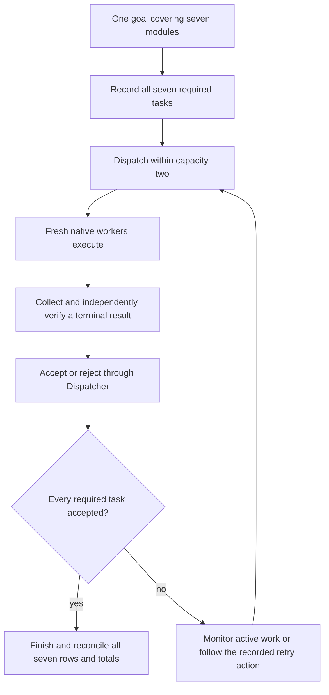
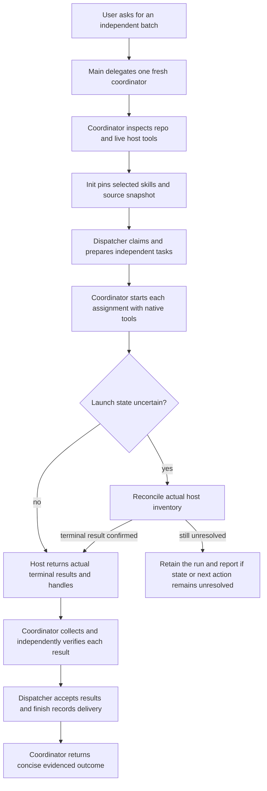

# Usage examples

The examples show how to ask a coordinator to find independent slices in a
goal. Replace every path and check with values from the actual request and
checkout. They are illustrative, not evidence of a host-qualified run.

## Start with one prompt

Select `in-parallel` and supply a goal; the coordinator chooses independent assignments:

> In parallel: review this change for correctness, performance, and maintainability. Use three agents without editing files, and return one prioritized assessment with disagreements and supporting evidence.

> In parallel: implement these independent parser, formatter, and validation changes in three isolated worktrees. Apply accepted contributions, run the combined tests, and summarize the outcome.

The initiating context passes the goal to one fresh In Parallel coordinator. That same
coordinator inspects the target, chooses independent assignments, drives native
workers, and synthesizes the aggregate. It does not create a second coordinator
or a new model launcher. `in-parallel/scripts/harness.py` remains the script
entry; decomposition and synthesis are the coordinator's reasoning work.

The interface currently requires an existing Git workspace and inherits the
selected In Parallel host limits. Without an explicit worktree choice,
current-workspace reviews can run in parallel but edits remain serialized.
An existing Dispatcher or ShipLoop run retains its owner. Use the read-only
inspection route below in the current context to understand it without creating
a new batch or coordinator.

## State the task and delivery expectations

For example, a user with a documentation goal could ask:

> Use the selected In Parallel skill at `/absolute/selected/in-parallel/SKILL.md` to update the setup and operations documentation in `/absolute/repo`. Identify bounded independent slices with disjoint write scopes; do not force parallel work if the changes depend on each other. Use a worktree because I want an isolated snapshot. I will stop other writes while you capture it. Apply accepted changes, run `python3 -m pytest tests/docs`, remove successfully integrated worker worktrees, and report delivery and cleanup outcomes. Use one fresh coordinator and native task workers; collect each actual result before acceptance.

The initiating agent should pass that compact goal and its applicable existing
authorization to exactly one fresh coordinator. The coordinator plans slices
only when they are independent and have disjoint scopes, then checks the
repository and host schema, selects absolute Ask Agent and Plan Dispatcher
cards, writes a request object outside protected trees, and chooses a new
absolute run directory. For this example, a request could be:

```json
{
  "objective": "Update two independent documentation areas and validate the combined result",
  "source": "/absolute/repo",
  "workspace": "worktree",
  "mode": "edit",
  "tasks": [
    {
      "id": "setup-docs",
      "objective": "Update the setup guide to reflect the requested behavior",
      "expected_result": "The setup guide states the agreed setup steps and was checked against the requested behavior",
      "write_set": ["docs/setup/"]
    },
    {
      "id": "operations-docs",
      "objective": "Update the operations guide to reflect the requested behavior",
      "expected_result": "The operations guide states the agreed operational steps and was checked against the requested behavior",
      "write_set": ["docs/operations/"]
    }
  ],
  "writers_quiescent": true,
  "integration": "apply",
  "checks": [["python3", "-m", "pytest", "tests/docs"]]
}
```

`capacity` is omitted, so it defaults to at most five workers (two for this
two-task example). It caps simultaneous reservations, not total queued tasks. A current-workspace
edit instead requires an exclusive writer and runs at capacity one. A
report-only request uses empty write sets; an ephemeral request must use a
worktree and its findings are not integrated.

## More actions than worker slots

> In parallel: inspect every module under `modules/`, report its exact formula
> and its outputs at 0 and 4, and return one complete table with column totals.
> Use at most two agents at a time. Work in the current checkout without edits.

If seven independent modules exist, the coordinator records all seven tasks
with `capacity: 2`. It launches two fresh workers, verifies a completed result,
and refills the free slot from the remaining queue. It can create seven worker
contexts over the whole job, but never more than two concurrent reservations.
The coordinator is additional to that worker cap. The script also counts
unconfirmed launches against capacity, so a delayed handle cannot cause a
replacement launch that exceeds the limit.

This is generator-style consumption of a backlog planned up front. `dispatch`
is the pull interface: it yields only newly eligible assignments, and workspace
preparation happens for those assignments as slots become available. A worker
handles one item and exits. The coordinator consumes later items by launching
new agents, without waiting for a whole wave to complete. The durable Dispatcher
graph holds the remaining items; there is no separate generator process,
long-lived worker pool, or dynamic task-append interface in this batch contract.



If no launch is currently possible, the coordinator checks active and pending
work instead of treating the empty launch list as success. Rejected or uncertain
work stays visible until resolved; an aggregate with a missing required module
is incomplete. Decomposition and coverage review remain the coordinator's
reasoning work; the script enforces completion of the task list it was given.

## Reuse the same worker contract

| Component | Owns | Remains reusable by |
| --- | --- | --- |
| In Parallel coordinator | Decomposition, native worker handles, verification, aggregate synthesis and final delivery | The initiating conversation |
| Ask Agent | Each compact task's context, workspace preparation, scoped return and return verification | A direct caller, In Parallel, or a compatible existing workflow |
| Plan Dispatcher | The single durable task graph, attempts, reports and acceptance transitions | Its owning workflow |
| Agent Harness scripts | The adapter in `scripts/harness.py` and guarded integration in `scripts/delivery.py` | This coordinator; scripts do not launch agents |

These are software and instruction dependencies, not additional agents. Direct
Ask Agent use does not acquire a coordinator. For a batch, the one coordinator
calls the same selected Ask Agent task helper and uses its prepared worker
commands unchanged. Collection, semantic acceptance and combined delivery stay
with the owning caller. A direct caller may have a different final integration
policy; shared worker contracts do not transfer ownership of that policy.

## Lifecycle

The coordinator owns the run and uses actual native tools at the launch and
collection boundaries:



The host owns execution and terminal status; the Dispatcher owns recorded task
state and acceptance transitions. A saved return cannot prove the native job is
finished. If launch is uncertain, reconcile the host's actual inventory before
another launch. `status` remains a read-only view of recorded Dispatcher state.

Interrupted steps reuse their identical saved preparation, result, verification,
or immutable delivery evidence. A duplicate already-published collection is
refused. Retry is available only for a collected terminal result rejected by
verification, when Dispatcher exposes the retry action and the coordinator
confirms the host has stopped it. An unknown launch is never retried. Current
workspace edits require reviewing in-place changes and starting a fresh run
from a reviewed baseline, not retrying the existing run.

## Ask for a read-only batch

For a digest or review, state that no files may be changed and ask for separate,
independent findings. The coordinator uses `mode: "report-only"`, an empty
`write_set` on each task, and `workspace: "current"` or `"worktree"` according
to the user's workspace choice. It collects and verifies every native result,
then finishes without code integration. A review-only request should not be
turned into implementation simply because workers are available.

## Inspect an existing run without taking ownership

> Inspect the recorded status of `/absolute/external/run` and summarize completed, active, blocked, and unverified work. Do not launch, retry, accept, integrate, or clean up anything.

For a run created by this skill, use its pinned helper's `status --run ABS`
command. That view reports recorded state; a question about whether agents are
actually still running also requires the owning host's native inventory. For
other Dispatcher or ShipLoop runs, follow that workflow's read-only inspection
interface. Creating a coordinator does not transfer ownership of existing work.

## Choose the workspace and return behavior

| Request | Worker execution | What returns |
| --- | --- | --- |
| Worktree edits | Independent snapshots; eligible workers launch asynchronously | Apply accepted contributions, preserve parent HEAD and index, then close integrated worktrees after combined checks; retain branches and commits |
| Worktree edits, return only | Same isolated execution | Findings and retained commits and patches; parent unchanged |
| Worktree ephemeral | Scoped scratch edits allowed | Findings only; no code import or worker commits |
| Current workspace review | Shared files, read-only workers | Independently checked findings |
| Current workspace edits | One exclusive writer at a time | In-place edits plus combined checks |

Worktree isolation does not let the parent repository drift unnoticed: keep it
stable through delivery. A new parent change blocks import and requires review.
This conservative constraint preserves the original staged and unstaged state.

The extra coordinator primarily reduces the initiating conversation's workload.
It still spends time reading contracts, launching workers, and verifying their
returns. Use it for a meaningful independent batch; it is not a promise that
trivial tasks will finish faster.

For an explicitly selected Grok or Claude headless coordinator, the fresh
coordinator is a top-level session started through that host's existing CLI.
The main conversation retains one process/session handle and receives its
aggregate handoff. Keep detailed streamed traces in retained files; routine
status needs only counts, blockers, and the final evidence locator. Do not load
every leaf transcript into the main context. Claude Code 2.1.296 unattended headless
coordination is deferred after early nested returns and one direct process that
did not exit after delivery; see [host guidance](hosts.md).

## Reusable validation

From the source checkout:

```sh
bash test/run-all.sh --group in-parallel --output /absolute/evidence-directory
```

The `agent-harness` test group remains an alias
for the same suites. Offline composition tests compare direct and batch worker
contracts; they do not launch models or qualify a native host route.
