# ShipLoop navigator 1.24.1

> **Two readers, one file.** This first part is for developers who *use* ShipLoop: what it is, how to start a run, what you will
> see, how to steer it, and what to do when something stops. The [maintainer reference](#maintainer-reference) after it is the
> design record for people who change ShipLoop itself. If the two ever disagree, the current packet wins, then the maintainer
> reference, then this guide: report the difference.

- [What ShipLoop is](#what-shiploop-is) · [Install](#install-and-invoke) · [Quick start](#quick-start) · [How it works](#how-it-works)
- [Use cases](#use-cases) · [A real run, stage by stage](#a-real-run-stage-by-stage) · [Options](#options-you-choose-at-the-start)
- [Steer a run](#steer-a-run) · [Command cheat-sheet](#command-cheat-sheet) · [Troubleshooting](#troubleshooting) · [FAQ](#faq)

## What ShipLoop is

ShipLoop turns one sentence of intent ("add a `--version` flag", "build a small URL shortener") into a **delivered, tested, committed
change**, through the stages of a normal software lifecycle: understand, specify, plan, build, test, document, review, release.

It exists for the failure that long agent sessions share: the model loses the thread. Its context is compacted or cleared, it
skips the tests, or it declares victory early. ShipLoop moves the thread out of the model and into files and a script:

- **A script owns navigation.** It keeps the run's state in Markdown, decides which stage comes next, and prints a *packet*: the
  stage's goal, what must hold before it counts as done, and the one command to submit the result. The model never picks a
  successor.
- **The model does one step.** It reads the packet, does the work, writes a result, and runs the printed callback. The script
  checks the result before it advances, and refuses it with a reason when a check fails.
- **Every packet stands alone.** After a clear, a compaction or a crash, `shiploop next` reprints the current packet from saved
  state and the run continues where it stopped.
- **Evidence beats assertion.** The script runs the tests, lint and base checks itself; a passing run it observed is the proof, not
  the model's statement.

| | An ordinary agent session | A ShipLoop run |
|---|---|---|
| Where the plan lives | In the conversation | In `state.md` and the knowledge home, committed beside your code |
| After a context clear | You re-explain | `shiploop next` reprints the current step |
| "Done" means | The model said so | The script ran the recorded checks and they passed |
| Tests | Written when remembered | Specified before the code; each new test must fail on the unchanged base first |
| Review | On request | An Improve review of the planning results (with the default `--planning-review stage`), each step and the release plan |
| Your checkout | Edited in place | Untouched until an explicit, guarded return |
| History | Whatever the session left | One commit per step, and a stage-by-stage trace |

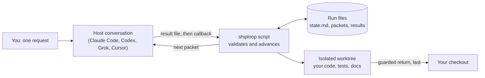

**When to use it:** a feature or project that deserves a spec, tests and review, runs longer than one sitting, or must survive
interruptions. **When not to:** a one-line fix, an exploratory spike, or anything you want to steer turn by turn yourself. Ask the
host directly for those.

ShipLoop is a *skill*: it adds no daemon and launches no model. Your host conversation does the work; the `shiploop` Python script
(standard library only; needs `python3` and `git`) does the bookkeeping.

## Install and invoke

Every skill-craft skill ships in one plugin, `skill-craft`, from the `whichguy` marketplace. ShipLoop needs the Improve skill, and the
same plugin carries it.

```sh
# Claude Code
claude plugin marketplace add whichguy/skill-craft
claude plugin install skill-craft@whichguy

# Codex
codex plugin marketplace add whichguy/skill-craft
codex plugin add skill-craft@whichguy
```

Start a new session after installing, then invoke it:

| Host | Invocation | Notes |
|---|---|---|
| Claude Code | `/skill-craft:shiploop <request>` | Keepalive hooks install with the plugin |
| Codex | `$skill-craft:shiploop <request>` | Approve the hooks once when Codex asks |
| Grok | select the ShipLoop skill | Writes its own keepalive hook file on first use |
| Cursor | select the ShipLoop skill | Hooks install with the plugin; headless runs need `shiploop-drive` |
| OpenCode | `install.sh`, then `scripts/shiploop-hook install --host opencode` | Headless runs need `shiploop-drive` |

Keep **one** installed copy of each skill. A development checkout is source, not a second install; do not add skill-directory links
beside the marketplace package. Details: [host matrix](references/host-matrix.md).

## Quick start

You give the request to your host; the model runs the commands. In a repository you want changed:

```text
/skill-craft:shiploop Add a --version flag to cli.py that prints the package version and exits 0.
Cover it with a test.
```

What happens next, in order:

1. **Isolation.** The skill runs `shiploop workspace start --repo <your repo> --prompt=<your request>`. ShipLoop snapshots your
   current tracked content, including staged and unstaged edits, into a new Git worktree under `<repo-parent>/.shiploop-runs/`,
   and prints the first packet. Your checkout is not touched again until the final return.
2. **Stages.** The model works the packets one at a time. After each, the script prints a one-line milestone you can read as it
   goes. Nothing asks you to approve a stage.
3. **Review.** With the default `--planning-review stage`, the spec, test strategy, plan and first step plan, each step's code, tests
   and docs, and the release plan get an Improve review before they count ([which results](#which-results-are-reviewed)).
4. **Commit.** Each accepted step lands as one `feat(<item>/<step>)` commit in the worktree.
5. **Return.** The script shows what the run changed and what it will leave behind. It returns the accepted files to your checkout
   only through the guarded `workspace return`, then writes `report.html`.

Watch it without interrupting:

```sh
python3 "$SKILL_ROOT/scripts/shiploop" status --run-dir "$RUN"   # where it is, what is done, what is next
open "$RUN/progress.html"                                        # live page; no server needed
python3 "$SKILL_ROOT/scripts/shiploop" view --run-dir "$RUN" --serve   # the same pages in a browser, read-only, until Ctrl-C
```

`$SKILL_ROOT` is the directory holding the loaded `SKILL.md` and `$RUN` is the run directory the first packet prints
(`<workspace-root>/run`). Ask the host "where is the ShipLoop run?" if you lose them.

If the host asks for a write permission, the script has exited **3** with a `SHIPLOOP-GRANT-NEEDED` block naming the path and the
host's way to grant it ([sandbox grants](references/host-matrix.md#sandbox-write-grants)). Grant it and rerun the printed command.

## How it works

### Who owns what

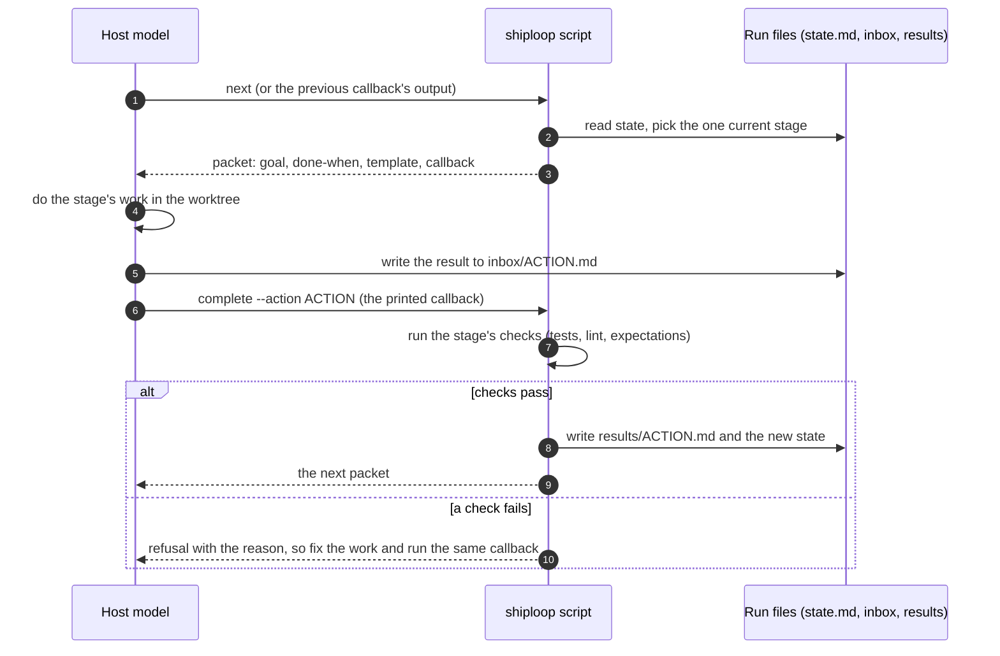

The model reports one of four **outcomes** in each result: `done`; `blocked` (only a person or an outside service can
unblock it); `send-back` (an earlier stage's record is wrong, so that stage reruns); `add-work` (product work is missing, so new
work items are built). The script, never the model, decides what each outcome leads to.

### The stages

A run has 23 stages in three phases. Each stage's packet states its goal and its *Done when* conditions.

| Phase | Stages | What they settle |
|---|---|---|
| **Prelude** (once) | `intake` → `discovery` → `research` → `spec` → `test-strategy` → `plan` → `prepare` | The request mapped to outcomes; the repository and a baseline test run; unknowns resolved; requirements `R-n`; which checks prove each one; an ordered queue of work items; a ready environment |
| **Inner loop** (per work item) | `step-plan` → `test-spec` → `validate-existing` → `implement` → `test` → `document` → `carry-forward` | One change, planned, specified, built, tested and documented; then the knowledge home updated and the queue revised |
| **Outer loop** (once) | `system-test-author` → `system-test` → `product-acceptance` → `release-plan` → `release-check` → `release` → `release-verify` → `operations` → `handoff` | The assembled product tested end to end, accepted against the request, then released and verified where its consumers use it |

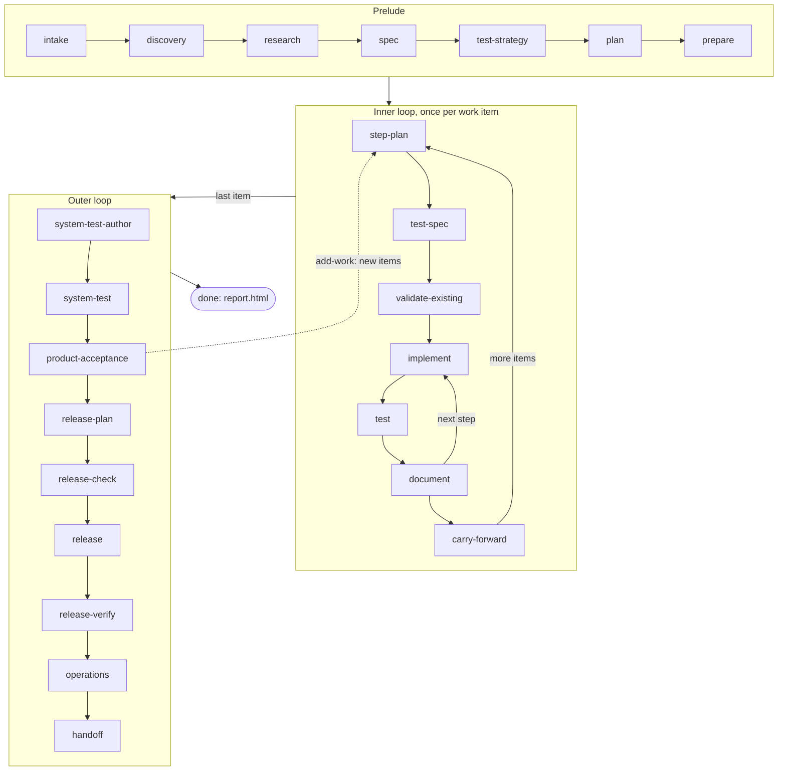

The full map, with every gate and the Improve stages, is the [whole-run map](references/navigator.md#whole-run-map).

### Inside one work item

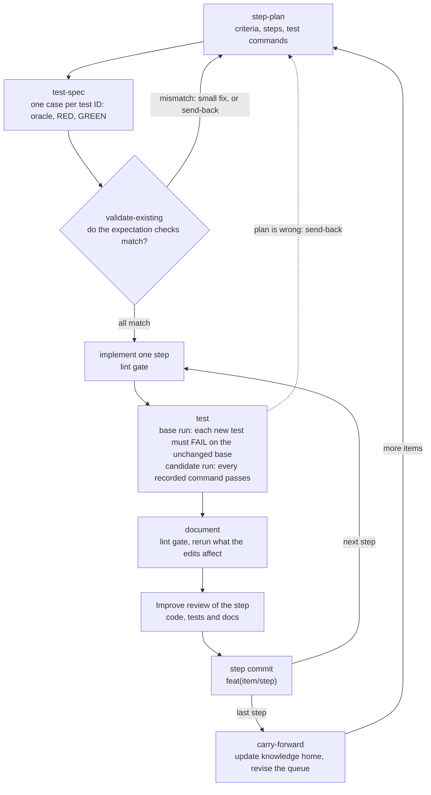

The script, not the model, enforces the gates drawn above:

- **Expectation checks.** `validate-existing` is not accepted while a recorded check disagrees with the base.
- **Lint gate.** `implement`, `test` and `document` are refused once after an auto-fix, and while a new finding on a changed line
  has no waiver. Details: [run options](references/run-options.md#script-owned-lint).
- **Red, then green.** `test` is refused if any new test passes on the step's base (it proves nothing), or if a recorded command
  fails on the candidate.
- **Reruns.** `document` is refused until what its edits could affect has rerun and exited 0.

### Which results are reviewed

With the default `--planning-review stage`, the **Improve** skill reviews `spec`, `test-strategy` and `plan`; the first work item's
`step-plan` (and any item that was sent back); every step's `document` result; `system-test-author`; `release-plan`; and the last
`carry-forward`. A review repeats its own passes until a pass finds only trivial changes. The script imports the review's evidence
before moving on. `--planning-review none` skips the four planning reviews; the rest stay. See [when Improve runs](references/improve-stages.md#when-improve-runs).

### What survives a context clear

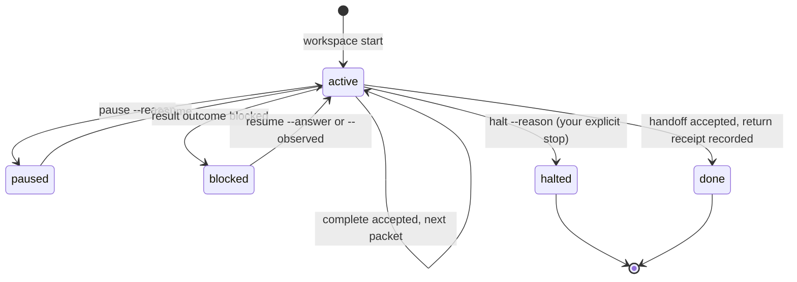

Whatever interrupts the model (a `/clear`, compaction, a crash, a closed laptop) leaves `state.md` intact. The recovery command
is always:

```sh
python3 "$SKILL_ROOT/scripts/shiploop" next --run-dir "$RUN"
```

`next` rereads the saved state and reprints the current packet. It never advances the run. Every packet prints this command and the
absolute paths it needs, so a fresh context can pick up from the packet alone. The host never "clears" for you: no packet or hook
can reset a conversation, and ShipLoop does not pause waiting for one.

### Keeping a run moving

A host ends a turn when the model chooses, even with work left. **Keepalive** hooks ask `shiploop hook-status` at each turn end
and, while the run is active and progressing, refuse the stop and name the next command. For unattended runs where hooks cannot
help (Cursor and OpenCode headless modes), `scripts/shiploop-drive` starts and resumes host sessions until the run is done, paused,
blocked or stuck. A run stops when you say stop or pause, not when you ask a question about it. `SHIPLOOP_KEEPALIVE=off` turns the
hooks off. See [keepalive](references/keepalive.md).

### Your checkout and the guarded return

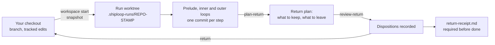

Until the return, your checkout is exactly as you left it. The return plan lists what the run created (for example its knowledge
home under `docs/shiploop/`) and lets the run keep or leave each path. The run is `done` only after the return receipt exists. An
in-place run (`init` without a worktree) has no such protection; use it only on purpose. See
[workspace lifecycle](references/workspace-lifecycle.md).

### What a run leaves behind

Everything a run writes lives in one workspace root next to your repository, so your checkout stays clean. This listing is from the
recorded run in [A real run](#a-real-run-stage-by-stage); `RUN` below means the `run/` directory.

```text
<repo-parent>/.shiploop-runs/<repo>-<stamp>/   the workspace root
  workspace.md          your original checkout, its branch and the baseline commit
  worktree/             the run's checkout: all product work happens here
    hello.py  test_hello.py
    docs/shiploop/      the knowledge home: spec.md, environment.md, architecture.md
  run/                  the navigator's state
    state.md            the authoritative state (never edit it)
    request.md          your request, split into sentences S1..Sn
    packets/            every packet; packets/sent/ holds each print exactly as sent
    inbox/  results/    the result the model wrote, and the result ShipLoop accepted
    tests/  checks/  lint/  expectations/  loops/  improve/  iterations/  commits/  notes/
    status.md  context-index.md  reference.md  timeline.json  trace.jsonl
    progress.html  trace.html  report.html     the views you open in a browser
  return-plan.md        what the run will keep or leave when it returns to your checkout
  return-receipt.md     the script's record of the return; the run is done only after it exists
```

The **knowledge home**, `docs/shiploop/` in your repository, holds the living `spec.md`, `environment.md` and `architecture.md`. It is
committed with your code, so the next run starts from what the last one decided. The model's per-run notes and the packets stay in
the run directory, outside your repository. File-by-file reference: [state files](references/state-files.md).

## Use cases

Each recipe shows the request you give the host and what ShipLoop does with it.

### 1. Add a feature to an existing repository

```text
/skill-craft:shiploop Add rate limiting to the /upload endpoint: 10 requests per minute per user,
429 with a Retry-After header. Add tests and update docs/api.md.
```

The default and the best-tested path. Discovery runs your existing suite on the unchanged checkout first, so a failing baseline is
recorded rather than blamed on the change. Output: commits in the worktree, an updated knowledge home, a return plan for you to
review.

### 2. Start a project in an empty directory

```text
/skill-craft:shiploop Build a small URL shortener served by a Node.js HTTP server with no npm
dependencies: POST /shorten returns a short code, GET /<code> redirects. Cover it with node:test tests.
```

`workspace start` initialises an empty directory as a Git repository on `main` with one empty baseline commit. Do not run `git init`
yourself. The prelude spends more effort here, because there is no existing code to read.

### 3. A second feature on the same project

Start a **new** run with the new request. Do not reuse an old run: it tracks one request, and a retry with different text is
refused. The new run inherits the first one's `docs/shiploop/` knowledge home, so it plans against what exists. Finished runs stay
on disk as a record.

### 4. Resume after a clear, a crash or a reboot

```sh
python3 "$SKILL_ROOT/scripts/shiploop" next --run-dir "$RUN"
```

If you do not know the run directory, list `<repo-parent>/.shiploop-runs/*/run/state.md`. Use `next` only for the *same* request.
Never start a replacement run to "make progress".

### 5. Steer a run in flight

Leave an instruction for the next step without stopping anything:

```sh
python3 "$SKILL_ROOT/scripts/shiploop" note --run-dir "$RUN" --text "Reuse the existing date helper; do not add a library."
```

The next packet quotes the note until a step that showed it is accepted. `note` takes no lock, so it never waits for a command the
model is running.

### 6. Pause for the night, resume in the morning

```sh
python3 "$SKILL_ROOT/scripts/shiploop" pause  --run-dir "$RUN" --reason "Stopping for the day"
python3 "$SKILL_ROOT/scripts/shiploop" resume --run-dir "$RUN"
```

A pause keeps the action pending. Context housekeeping ("clear", "compaction") is not an accepted reason.

### 7. Answer a question the run could not default

ShipLoop runs unattended: it records a default and continues, and it asks only when nothing else can proceed. A `blocked` run waiting
on you prints the question, or the steps you must do, and stops. Reply with your own words:

```sh
python3 "$SKILL_ROOT/scripts/shiploop" resume --run-dir "$RUN" --answer "Use the staging account"
python3 "$SKILL_ROOT/scripts/shiploop" resume --run-dir "$RUN" --observed "Created the API key and stored it in the vault"
```

"Continue" is not an answer.

### 8. Run unattended

On Claude Code, Codex and Grok, keepalive keeps the session going. For Cursor and OpenCode, or to survive host crashes:

```sh
"$SKILL_ROOT/scripts/shiploop-drive" --host claude --run-dir "$RUN" --max-minutes 240 -- --model sonnet
```

The driver stops when the run is done, paused, blocked or stuck, and prints which. Review the branch and the trace afterwards.

### 9. See what a run actually did

```sh
python3 "$SKILL_ROOT/scripts/shiploop" status --run-dir "$RUN"            # the fixed status block
python3 "$SKILL_ROOT/scripts/shiploop" trace  --run-dir "$RUN" --request  # your request beside its expansion
python3 "$SKILL_ROOT/scripts/shiploop" trace  --run-dir "$RUN" --html     # a self-contained page
python3 "$SKILL_ROOT/scripts/shiploop" trace  --run-dir "$RUN" --action ID  # one action's packets as sent
```

`trace` shows every stage done, current or pending, each packet as sent, refusals and hook continuations. See
[run trace](references/status-display.md#run-trace).

### 10. Rehearse the route without a model

```sh
python3 "$SKILL_ROOT/scripts/shiploop" graph-dry-run --list
python3 "$SKILL_ROOT/scripts/shiploop" graph-dry-run --scenario send-back --format markdown
```

`graph-dry-run` drives the real navigator with synthetic results and prints its actual packets. No model runs, no project work
happens, and nothing is created in your repository. Use it to learn the packets or to check a route after changing the skill.

### 11. Run it in an environment with a sandbox

Hosts such as Codex (`workspace-write`), Grok sandbox profiles and Claude's Bash sandbox can refuse the two places ShipLoop writes
outside your repo. The script detects this before creating anything and exits 3 with the grant to give. See
[host grants](references/host-matrix.md#sandbox-write-grants).

### 12. Delegate steps to fresh workers

```text
/skill-craft:shiploop <request>. Use ask-agent delegation.
```

Name the option in your request and the skill passes `--delegation ask-agent` to `workspace start`. The default `inline` route runs every step in the conversation you started. `ask-agent` runs each implementation step and each
Improve review in a fresh native worker. Switch an existing run from its next action with
`shiploop delegation --run-dir "$RUN" --set ask-agent`. See [run options](references/run-options.md#execution-delegation).

## A real run, stage by stage

This is a recorded run, not a mock-up. It was made on 2026-10-29 with ShipLoop 1.23.0 (skill-craft 2.24.0), default options, in an
empty directory, on the Codex host with `gpt-6.1-terra`. The request was one sentence:

```text
$skill-craft:shiploop Create hello.py that prints exactly "Hello, world!" when run, plus a unittest
test in test_hello.py that verifies that output.
```

It is the smallest case ShipLoop has, so every stage is short. A real feature has the same stages with more in them. The run took
about 13 minutes, accepted 27 results, printed 36 packets and ran 60 ShipLoop commands. Nothing was refused and one work item was
sent back once. `shiploop trace` printed this plan, where `+I` marks a result that had an Improve review in this `--planning-review stage` run and `↩1` means sent back once:

```text
Preparation  ✓intake ✓discovery ✓research ✓spec+I ✓test-strategy+I ✓plan+I ✓prepare
W1 Create greeting script…  ✓step-plan×2+I ✓test-spec×2 ✓validate-existing×2 ✓implement(1 step)↩1 ✓test ✓document+I ✓carry-forward+I
Release      ✓system-test-author+I ✓system-test ✓product-acceptance ✓release-plan+I ✓release-check ✓release ✓release-verify ✓operations ✓handoff
```

### The 27 accepted results

Each headline below is the one-line summary the model wrote for its stage, and the time is how long the stage took.

| # | Stage | What the model reported | Time |
|---|---|---|---|
| 1 | `intake` | Mapped the requested script and test to local delivery | 8 s |
| 2 | `discovery` | Established the empty baseline and local Python environment | 17 s |
| 3 | `research` | Resolved the local implementation and verification approach | 12 s |
| 4 | `spec` +I | Specified the greeting and its executable test (`R-1`, `R-2`) | 44 s |
| 5 | `test-strategy` +I | Selected a subprocess unittest and local verification | 34 s |
| 6 | `plan` +I | Planned one local implementation and verification item | 48 s |
| 7 | `prepare` | Verified the local test runner is ready | 11 s |
| 8 | `step-plan` +I | Plan the greeting and the unittest, verified by subprocess and unittest discovery | 65 s |
| 9 | `test-spec` | Specified the exact-output subprocess test | 25 s |
| 10 | `validate-existing` | ShipLoop ran every expectation check on the unchanged checkout; each matched | 0 s |
| 11 | `implement` | **send-back:** the plan asks for a check that cannot run yet | 46 s |
| 12–14 | `step-plan` +I, `test-spec`, `validate-existing` | The same three stages, rerun with the corrected plan | 76 s |
| 15 | `implement` | Verified the greeting implementation | 22 s |
| 16 | `test` | Added and verified the greeting unittest | 57 s |
| 17 | `document` +I | Recorded observed script and test behavior | 53 s |
| 18 | `carry-forward` +I | Carried the verified item into release | 49 s |
| 19 | `system-test-author` +I | Selected the existing real-boundary test for system verification | 35 s |
| 20 | `system-test` | Passed the assembled local system check | 8 s |
| 21 | `product-acceptance` | Accepted the locally tested candidate | 8 s |
| 22 | `release-plan` +I | Planned the guarded local return and verification | 46 s |
| 23 | `release-check` | Confirmed local return readiness | 23 s |
| 24 | `release` | Returned the candidate to the source checkout | 33 s |
| 25 | `release-verify` | Verified the returned local result | 11 s |
| 26 | `operations` | Confirmed local operational scope | 8 s |
| 27 | `handoff` | Completed the local handoff | 10 s |

Nine of those results got an Improve review (the `+I` rows). The rest were accepted on ShipLoop's own checks.

### One packet, one result

The first packet the model saw, trimmed to its essentials (paths shortened; the real print also carries the callback, references and
the original request):

```text
ShipLoop navigator | intake | revision 0
Lost context, or unsure? Run python3 …/scripts/shiploop next --run-dir=RUN (it reprints this step).
Callback for this stage (run once after its work, with the result written to RUN/inbox/<action>.md): …/shiploop complete --run-dir=RUN --action=<action>
Goal: Map the request to outcomes, boundaries and open questions in this result's `summary`.
Done when (confirm each before calling done; keep going until all hold):
- every sentence of the request maps to an outcome, a boundary or an open question
- each open question names who answers it (discovery, or a recorded default) and what it blocks
- the result says where the outcome will be visible, and when
Checked by: at done ShipLoop refuses the usual faults (no outcome or summary, or an absolute evidence_refs path that does not exist).
It does not judge the work: you confirm each condition. A refusal does not advance the run: fix the cause and run the same command again.
```

The model wrote its answer to `RUN/inbox/<action>.md`, in the packet's result template, and ran the callback. ShipLoop accepted it and
stored it as `RUN/results/<action>.md`:

```json
{
  "outcome": "done",
  "headline": "Mapped the requested script and test to local delivery",
  "summary": "S1: Create hello.py and a unittest in test_hello.py verifying its exact stdout. Fact: the consumer runs the script and test locally in the requested repository. Assumption: the conventional print newline is part of the output. The isolated candidate becomes visible in the source checkout at final return. Discovery will verify the Python environment and repository conventions; no external delivery or additional authority is required.",
  "evidence_refs": []
}
```

Notice what the model did and did not do. It mapped the sentence (`S1`), separated a fact from an assumption, and said where the
outcome becomes visible. It did not choose the next stage: the callback's output was the discovery packet.

### The plan is checked before it is built

The `step-plan` result carries the checks ShipLoop will run itself: a criterion with a `Confirm by:` method, one step whose `proof`
is a command, and an *expectation* that `hello.py` does not exist yet:

```json
{
  "outcome": "done",
  "criteria": [{"id": "C1", "confirm": "executed",
                "text": "R-1: The script emits exactly the greeting and exits successfully. Confirm by: python3 -m unittest -v test_hello; pass when TC_1 executes and succeeds with exact stdout and zero script exit."}],
  "expectations": [{"id": "E1", "state": "absent", "statement": "The script path is free",
                    "check": "test ! -e hello.py", "paths": ["hello.py"], "steps": ["S1"]}],
  "steps": [{"id": "S1", "paths": ["hello.py"], "criteria": ["C1"], "task": "Implement C1 in hello.py.",
             "proof": "python3 -c \"import subprocess,sys; p=subprocess.run([sys.executable,'hello.py'],capture_output=True); assert p.returncode==0 and p.stdout==b'Hello, world!\\n'\""}],
  "paths": ["hello.py", "test_hello.py"]
}
```

At `validate-existing`, ShipLoop ran `test ! -e hello.py` itself on the unchanged checkout and found it matched the recorded state, so
that stage issued no packet at all (row 10, 0 s).

### The send-back

At row 11 the `implement` stage found a flaw in its own plan: criterion `C1` is confirmed by running the unittest, but the unittest
is written later, at `test`, and `implement` is not allowed to write tests. The model did not work around it. It reported:

```json
{
  "outcome": "send-back",
  "headline": "Correct the implementation confirmation order",
  "summary": "C1 requires the unittest command before the test stage writes it, while implement cannot write tests. Change C1 confirmation to its direct subprocess proof and retain TC_1 as required later. Script was written and direct proof and lint passed; unittest remains pending."
}
```

ShipLoop returned the item to `step-plan` (the stage that wrote the faulty plan), reran `step-plan`, `test-spec` and
`validate-existing` (rows 12–14, about 76 seconds, including the second Improve review that `--planning-review stage` gives a sent-back plan), and then accepted `implement`.
That is the loop doing its job: a wrong plan is repaired where it was made, not patched at the end.

### The gates at `test`

At `test` the model wrote `test_hello.py` with one test, `TC_1`. Before accepting the stage, ShipLoop ran the recorded commands
itself, twice. First on the step's base (a copy of the checkout from before the change), where a new test must fail because the
behaviour is not there yet. It did: `python3 -m unittest -v test_hello` ran 1 test, 1 failed, exit 1, `TC_1: failed`. Then on the
candidate, where every command must pass. ShipLoop kept both runs under `RUN/tests/`. The last rerun, at `release-verify` against the
returned result, shows what it captured:

```text
command: python3 -B -m unittest discover -v     exit 0, 1 test ran, 0 failed, ids: TC_1
test_greeting (test_hello.HelloTest)
TC_1: The script prints the requested greeting. ... ok
Ran 1 test in 0.021s   OK
```

### What was committed

`git log` in the run's worktree, oldest first (the empty baseline commit is ShipLoop's, made at `workspace start`):

```text
68c01d6 Empty baseline for the first ShipLoop run
ec0e8ea docs(shiploop): record create-hello-py-that-prints-exactly-0de30d knowledge after discovery
4f665cf docs(shiploop): record … knowledge after spec
f1dfad5 docs(shiploop): record … knowledge after test-strategy
0fc2727 docs(shiploop): record … knowledge after plan
de91a67 docs(shiploop): record … knowledge at prepare
11c026a feat(W1/S1): Verified the greeting implementation
d5b0f6c docs(shiploop): record … knowledge after carry-forward
6f33146 docs(shiploop): record … knowledge after system-test-author
8608147 docs(shiploop): record … knowledge at release-plan
eed33ac docs(shiploop): record … knowledge at release-verify
```

One `feat(W1/S1)` commit for the single step, plus a `docs(shiploop)` commit each time a stage changed the knowledge home. After
`release` the source checkout had been fast-forwarded to the same history: five files, `hello.py`, `test_hello.py` and the three
`docs/shiploop/` files. None of the run's own working directories (`.shiploop-improve/…`) were kept.

### The end

The last callback returned a short `done` packet, and `shiploop status` printed:

```text
=== ShipLoop status ===
Where:     Run complete
Run:       Preparation ✓ | Work items 1/1 ✓ | Release ✓
Done:      handoff: Source: hello.py and test_hello.py returned to main with a verified fast-forward receipt.
Next:      nothing; the run is complete. Report: report.html
=== end ShipLoop status ===
```

`RUN/report.html` summarises the run. As its own header says, it records the agent's declared completion and does not independently
prove the checks, so read the trace and the recorded test runs, not only the report.

**What this run does not show.** It had one work item, so there was no carry-forward revision of a queue. Nothing was `blocked`,
nothing was refused, and the release was a local return with no deployment or consumer to verify. A larger feature adds work items,
more steps per item, refusals from the lint and test gates, and (when delivery needs it) a question for you.

## Options you choose at the start

Options are recorded when the run starts and cannot be changed by a retry. You choose them by naming them in your request ("use `--planning-review none`"); the skill passes them to `workspace start`.

| Option | Values (default first) | Choose another when | Change mid-run |
|---|---|---|---|
| `--delegation` | `inline`, `ask-agent` | You want each step in a fresh worker's context | `delegation --set` |
| `--lint` | `fix`, `report`, `off` | `report` to see fixes without applying them; `off` for a repo whose linters you do not trust | `lint-mode --set` |
| `--planning-review` | `stage`, `none` | `none` to skip the four planning reviews (needs `--improve-skill=<absolute path>`) | no: start a fresh run |
| `--backchain-passes` | `one`, `converge`, `none` | `converge` for a plan whose dependencies matter; `none` to skip the plan graph check | no: start a fresh run |
| `--delivery-contract` | off | The change must reach a consumer (an app, an endpoint) and you want that stated up front | no |

`--planning-review none` together with `--backchain-passes none` removes every model-run second look at the plan. It is allowed,
and it is the highest-risk combination. See [run options](references/run-options.md).

## Steer a run

| You want to | Do this | What it does |
|---|---|---|
| See where it is | `status`, `progress.html`, `view --serve` | Read-only; `--serve` shows the pages in a browser at `127.0.0.1` |
| Tell it something | `note --text` | The next packet quotes it; delivered once a step that showed it is accepted |
| Stop for now | `pause --reason` | Keeps the pending action; `resume` continues |
| Answer a question | `resume --answer` | Only your own words count |
| Stop for good | `halt --reason` | Terminal |
| Recover after a clear | `next` | Reprints the packet; never advances |
| Check a result before submitting | `check --run-dir RUN --action ACTION` | Would `complete` accept this now? Counts nothing |

## Command cheat-sheet

The packet is authoritative for every command and argument. This is the short list; the
[command reference](#command-reference) has the full syntax.

| Command | When | Prints or changes |
|---|---|---|
| `workspace start --repo R --prompt=…` | The model starts a run | Worktree, run directory, first packet |
| `init --repo R --run-dir D --prompt=…` | An explicit in-place or non-Git run | Run directory, first packet |
| `next --run-dir D` | After any interruption | The current packet; no state change |
| `complete --run-dir D --action A` | The packet's callback | Accepts the result and prints the next packet, or refuses with the reason |
| `status`, `report`, `trace`, `view` | Any time | Read-only views |
| `note`, `pause`, `resume`, `halt` | You steer | Run control |
| `workspace plan-return`, `review-return`, `return` | The return steps the packets print | Guarded return to your checkout |
| `graph-dry-run` | Rehearsal | Synthetic walk of the real navigator |
| `delegation`, `lint-mode`, `lint` | Option changes and lint reruns | Described in [run options](references/run-options.md) |

## Troubleshooting

| Symptom | Cause and fix |
|---|---|
| The script exited **3** with `SHIPLOOP-GRANT-NEEDED` | The host sandbox refused a write. Grant the named path with the host's mechanism, then rerun the printed command. |
| A callback was **refused** | The reason names the failed check. Fix the work (not the check), rerun every check, and run the same callback again. A refusal never advances the run. |
| A packet print ends without `=== end ShipLoop print ===` | The host or a pipe cut it. Run `next` with no pipe, or read the packet file named by `Full packet:` with a file tool. |
| The model stopped mid-run | Run `next --run-dir D`. With keepalive installed this should be rare; check `shiploop hook-status --run-dir D`. |
| "run saved by an older protocol" | ShipLoop keeps one supported version and does not migrate. Keep the old run as evidence and start the request again. |
| The run is `blocked` | Read the question, answer with `resume --answer` (a decision) or `--observed` (what you did). "Continue" does not count. |
| Two sessions are fighting over a run | Only one session per run is kept alive. Stop the second one; ownership passes on when the owner's turn ends. |
| You want to edit `state.md` | Don't. The script writes it in transactions. Use `note`, `pause`, `resume` or `halt`. |
| The baseline failed | Discovery records it and finishes; dependent feature work is left unready. Fix or accept the baseline, then start a new run. |

## FAQ

**Does ShipLoop call a model itself?** No. The `shiploop` CLI never launches a model. Your host conversation does the work. Only the
optional `shiploop-drive` script starts host sessions, and only when you run it.

**Will it touch my checkout while it works?** No. It works in a worktree. The guarded return is the only step that writes to your
checkout, and it follows a return plan you can review.

**Can I use it without Git?** Yes, explicitly: `init` runs in place and states why isolation is not used. You lose the automatic
return protection.

**Does "done" mean it is deployed?** No. Completion records the host's declaration. Whether a release reached its consumer is
checked by the `release-verify` stage, and remote writes need an explicit grant first. Absence of the word "publish" in your request
does not make hosted delivery optional, and it does not grant permission to write remotely.

**How long does it take?** Minutes for a tiny change, hours for a project with several work items and reviews. The cost is mostly
the Improve reviews and the test runs. `--planning-review none` cuts planning time at the price of unreviewed plans.

**What does it commit?** One commit per accepted step in the worktree, a knowledge-home commit when a planning result is accepted,
and the guarded return into your checkout. ShipLoop does not push your branch.

**Where do I report a problem with the docs?** Record it as a ShipLoop improvement proposal; the packet is authoritative when it
differs from this guide.

## Maintainer reference

Everything below this point is the design record for ShipLoop's maintainers. Its headings and anchors are referenced from the
skill's guides and tests and are kept as written.


> **Main tenet: context can be cleared or compacted between any two stages, so every packet must stand alone.** A packet states what
> its stage is for, how the stage operates, how its result will be checked and reviewed, what it must produce, and how to recover. It
> does so even when the previous packet said the same thing. Repetition from one packet to the next is how a cleared model is grounded;
> the only repetition to remove is inside one packet. Make a packet smaller only by dropping what that stage does not need, and prove
> the result by clearing the context at a stage boundary and inside a stage and comparing the redone work. SPEC S-6 states the rule.

ShipLoop's invoking conversation owns navigation, acceptance and delivery. New
runs record `delegation: inline`, so that conversation also executes every
assignment, continues every INNER stage in the same context, and runs each bound
Improve invocation through the selected Improve skill in the exact Child workspace
without Ask Agent, native workers, an extra worktree or `host-owner.md`; its
reviews and checks run there too, with no reviewer or test-runner agent unless
the user asks for independent review. No packet or hook clears the conversation:
the packets say not to pause for a clear, because a model cannot clear its own
conversation, and a host that clears or compacts anyway (or a crash) is resumed
from the Recovery and Resume commands every packet prints, which is why each
packet stands alone (the tenet above). In the
[clear-ledger study](https://github.com/whichguy/skill-craft/blob/59be9b8232e34dc00ae777052a608a13967ffab2/docs/shiploop-clear-ledger-experiments-2026-09-21.md#live-ledger-study-september-21-2026)
each packet-text variant produced a verified fresh entry in 0 of 2 cases, while
external host `/clear` worked in 3 of 3 resets.

`--delegation ask-agent` at `workspace start` or `init` opts a new run into the
delegated route. For a new
ephemeral Improve invocation, the selected `improve-agent` skill starts one
fresh native worker through Ask Agent's explicit consumer-owned workspace route,
and that worker runs `/improve` inline. The
worker executes the entire loop in the already-bound candidate; the parent
collects and verifies it, then performs the guarded final return when required.
`shiploop delegation --run-dir RUN --set inline|ask-agent` switches an existing
run from its next issued action; see the [command reference](#command-reference).
Read [Improve context ownership](references/improve-context.md) for capability,
exclusive writer, interruption and retention rules. A worktree alone does not
create a separate model session. Shell model-CLI launching belongs only to the external
E2E harness, not normal ShipLoop CLI operation. Each implement step runs in one
fresh worker on an ask-agent run, and in the main conversation on an inline run;
ShipLoop has no implementation chain (retired, design T section 9.1 2c-2). The `shiploop` CLI never launches a
model: the former `drive` command and model transports are removed. The optional
[keepalive](#keepalive-keep-a-run-moving) driver, `scripts/shiploop-drive`, is a
separate script you start yourself.

Install and update ShipLoop and its selected Improve dependency through your
host's configured marketplace. Keep one discovered installation of each skill;
a development checkout is source code, not an additional installed copy. Do not
add same-name skill-directory links alongside marketplace packages. Open a fresh
host session after an update so it loads the selected package's current card.

New runs use navigator protocol 4: the script persists and traverses the SDLC
graph and issues one producer prompt at a time. After a planning result the run's
`planning_review` option reviews, a step's `document` stage, or the last carry-forward, it parks that parent action
for the selected actual Improve skill; every other result advances directly. The script owns navigation; the
model is a library call that performs the current step and runs the printed
callback. Improve follows the Until Loop runtime bound by
its selected card and owns its own iterations, evidence, and convergence. The
script imports one accepted child result before choosing the next producer; it
does not recreate Improve's review logic, phases, counters, or policy in a
ShipLoop prompt.

Every run recorded with the default `--planning-review stage` includes experiment-informed
Plan Improve and a guarded return to the earliest invalidated planning stage; `--planning-review
none` has no Plan Improve child, so neither. There is no protocol selector.
Read [experiments during planning](references/planning-experiments.md) for effects,
evidence, budget limitations and recovery. No separate experiment loop is added.

- [Navigator guide and flat SDLC diagram](references/navigator.md)
- [One stage in detail, and where each part of the map lives in code](references/navigator.md#one-stage-in-detail)
- [Graph dry-run commands and examples](references/graph-dry-run.md)
- [Skill entrypoint](SKILL.md)
- [Isolated workspace and artifact return policy](references/workspace-lifecycle.md)
- [Delivery-authority readiness](references/delivery-authority.md)
- [README-led current-system baseline and planning handoff](references/current-system-baseline.md)
- [House style: evidenced conventions and per-item exemplar match contracts](references/house-style.md)
- [Plan record: what a step plan records when the item touches code or stored data, a pinned value, or interactions, UI or service state](references/plan-record.md)

The planning-artifact handoff published at `c33a103` and its bounded native
Codex Ask-Agent `A/B → C` pilot were verified; see the [Native Ask-Agent
pilot](https://github.com/whichguy/skill-craft/blob/c33a103cd394506de680bd574ff5b5ef6b8b1de7/docs/shiploop-planning-artifact-handoff-plan-2026-09-19.md#native-ask-agent-pilot).
The goal-field omission was tested separately after that pilot. This evidence
does not establish installed or marketplace activation, other-host behavior, or
general Ask-Agent protocol compatibility. Binding a skill card freezes its
bytes; it does not establish semantic protocol compatibility.

`init` and `workspace start` create navigator protocol 4 runs with `delegation:
inline`; `--delegation ask-agent` opts in to the delegated route.
A retry cannot change the setting; use `shiploop delegation` instead. Protocol
4 is the only protocol: a saved navigator v1/v2/v3, managed or legacy run
is refused with an error naming it (see
[saved runs the current code cannot load](#saved-runs-the-current-code-cannot-load)).
The skill uses `workspace start` for new Git-backed work and direct `init` for
explicit in-place/non-Git use.
Navigation completion records the host's declared result; it does not certify
tests or deployment. Workspace-mode completion additionally requires its actual
local return receipt, not just a host assertion that integration happened.

## Keepalive: keep a run moving

A host ends its turn when the model decides to, even while the run has work it
can do. Keepalive hooks ask `shiploop hook-status` at each turn end and, while the
run is active and progressing, refuse the stop and name the run's next command.
A marketplace install of the ShipLoop plugin brings the hooks with it for Claude
Code, Codex (approve them once when Codex asks) and Cursor. Grok never runs
plugin hooks, so ShipLoop writes `~/.grok/hooks/shiploop-keepalive.json` itself
the first time it runs under Grok; new Grok sessions load it. A skill-directory
install adds them with
`scripts/shiploop-hook install --host HOST` (the only route for OpenCode);
`install.sh` never writes host hook config.

- Only one session per run, its owner, is kept alive; a parallel worker or a
  second terminal on the same run is let go. Ownership passes on when the
  owner's turn ends.
- A user stops the run by asking to stop or pause; a question about the loop does
  not stop it. `SHIPLOOP_KEEPALIVE=off` disables the hooks.
- For unattended runs, `scripts/shiploop-drive --host HOST --run-dir RUN -- HOST_ARGS`
  starts or resumes host sessions until the run is done, paused, blocked or stuck.
  Cursor (`cursor-agent -p`) and OpenCode (`opencode run`) need it; their headless
  modes cannot be kept going from inside.

Details, host table and decision log: [keepalive](references/keepalive.md).

## Navigator: producer, Improve child, then transition

The [navigator guide](references/navigator.md) draws this producer, Improve and
routing pattern and the [whole-run map](references/navigator.md#whole-run-map)
of the prelude, per-item inner loop and outer loop, with their gates and
loops.

Planning results (`spec`, `test-strategy`, `plan`, `step-plan`, `system-test-author`,
`release-plan`; `test-spec` is not reviewed), every accepted step review and the
successful `carry-forward` that leaves no work item pending follow this
sequence; every other producer result is accepted on its own checks and the
script selects the next producer directly (see "When Improve
runs" in [the Improve schedule](references/improve-stages.md#when-improve-runs)). That is the default of the run option `--planning-review stage|none`;
with `none` the first four of those (`spec` through `step-plan`) are accepted on
ShipLoop's checks at `complete` too, and only each step's review,
`system-test-author`, `release-plan` and the last `carry-forward` follow this
sequence. The 23 producers' full flat order is: `intake`, `discovery`,
`research`, `spec`, `test-strategy`, `plan`, `prepare`; then, for each ready
item, the 7 inner stages in 4 phases: Plan (`step-plan`, `test-spec`), Validate
existing (`validate-existing`), Build (`implement`, `test` and `document`, run
once per step, each step committed before the next begins) and Carry forward
(`carry-forward`); then
`system-test-author`, `system-test`, `product-acceptance`, `release-plan`,
`release-check`, `release`, `release-verify`, `operations`, and `handoff`.

Every inner stage runs its work inside one Until Loop, started with one literal
command on every host: the packet says to `RUN` the Until Loop, prints the start
command, then the argument between two marker lines (it is already in the
contract file ShipLoop wrote to `loops/<action>-contract.json`) and what to do
with the loop's result, and ShipLoop accepts the result only with a
terminal receipt that matches the contract rebuilt from state (see "Stage Until
Loops" in [the inner loop](references/inner-loop.md#stage-until-loops)). `shiploop check` asks whether ShipLoop
would accept a draft result now, without completing it; `complete` takes its yes.

- `step-plan` records the item's steps, paths, criteria, test and check commands
  and `expectations`: each a works, absent or broken fact with a read-only check
  command, so the build starts from facts that were checked.
- `validate-existing` runs those checks on the unchanged checkout. When every
  check matches, ShipLoop records the stage without a packet. A works
  expectation found broken with a known small fix is fixed there, and ShipLoop
  commits that fix on accept as its own preparatory commit.
- A step is one iteration: `implement`, `test` and `document` run for it, one
  Improve child reviews it, and ShipLoop commits it before the next step's
  `implement` begins. There is no `verify` stage: what it checked once per item
  is checked inside each step, below.
- `implement` builds the step. ShipLoop runs the step's proof on the candidate
  and the lint gate on the lines the step changed. A step plan's `skills`
  entries take `stages` (`implement` by default, `test`, `document` or
  `improve`), and each stage's packet lists the skills meant for it.
- `test` writes this step's part of the test spec: a test per case due at the
  step (a case is due at the last step that lists its criterion), each asserting
  the case's oracle. A case may name the mock it runs against
  (`"mock": {"simulates", "plays"}`); the test stage builds each named mock
  before its case's test. ShipLoop then runs the commands on the step's base and
  on the candidate:
  - On the step's base, no test ID new at this step may pass there unless
    `red_na` names it (a characterisation test). An earlier step's cases pass on
    that base; they are run and counted, not judged. `shiploop red-check` runs
    this check on demand. A step's base is where its iteration began; a
    preparatory fix moves only the first step's base.
  - A step runs its own cases in detail, every earlier step's cases and the
    minimum regression (the step plan marks one regression command `minimum`, or
    says why it has none). The full regression runs only at the item's last step.
  - Each command is held to a floor that adds up across steps
    (`retired_tests` declares a deliberate removal).
- `document` is issued only when the step's diff touches a code or test path. It
  records the step's change and what the step showed in the knowledge home
  (there is no stage of its own for that), and it is gated on its own edits: lint
  on the lines it changed, and a rerun of what those edits could affect (nothing
  after no edit, the step's check commands after a documentation edit, every
  command of the test stage after a code or test edit). A test it adds is
  registered in the result's `added_tests`, so every later run of that command
  must show it.
- One Improve child then reviews the step's code, tests and docs after its
  `document` stage (in both planning review modes) from the tree the step began from, and
  commits nothing.
  When the review changed a file, its import lints the lines it changed and
  reruns the step's commands before the review is accepted. A step that changed
  no file starts no review.
- ShipLoop commits the step in the call that accepts it (document's, or its
  review's import) as one commit on the step's base. If Git refuses, the call is
  refused and nothing is saved; the same callback commits once the cause is
  fixed. A pending record in `RUN/iterations/<item>.json` makes a retry after a
  crash commit once, and a commit made inside the step by anything else is
  refused.
- A send-back to planning ends the iteration, commits nothing and keeps the
  earlier steps' commits. The redone plan starts from the last commit and counts
  its steps afresh, so a case an earlier plan committed is new again at its first
  step and goes in `red_na`.
- The ask-agent route has the same step boundaries: one `implement` action per step, built by a fresh worker in the
  shared execution checkout, which makes no commit and advances no callback; the parent submits it and ShipLoop commits
  the step. Only who executes each stage differs from the inline route.
- `carry-forward` records a skill decision (`none`, `reuse`, `update` or
  `create`); ShipLoop commits a created or updated skill.

Preparation, release, and operations still produce a reviewed result when they are
inapplicable; they record a concrete N/A disposition rather than disappearing
from the graph. `test` and `document` are recorded as not applicable to an item
only on the script's proof. Release and verification never replay an uncertain
external operation merely to make traversal continue.

A run saved by an earlier inner loop (state version 10 or older: version 9 closed each
item at a `verify` stage, version 10 built every step of an ask-agent run in one action) is refused with a reason; start
the request again in a fresh run directory.

[Reusable product skills](references/testing-and-documentation.md#reusable-product-skills)
stay in the product repository. `discovery` inspects the local index before
planning; each `step-plan` rereads it for skills learned by earlier items and
lists each step's helper `skills` with the stages they are for, which each
stage's packet prints. Prefer
unchanged reuse with supported inputs/defaults, then a compatible local update,
or a separate skill when contracts differ. `carry-forward` decides, with repeat
evidence, whether to reuse, update or create a skill, makes the warranted skill
edits, runs a created or updated skill once on the run's real procedure and
maintains the repository index. Carry selected-skill references into Improve's
host-authored contract. This uses ordinary evidence/plan notes and work-item
context; it adds no global installation or skill-specific runtime schema.
Fresh-reader reuse remains untested until a reader actually finds and applies
the local skill.

Testing builds a [repeatable repository suite](references/repeatable-test-suites.md).
Initial planning selects or revalidates the harness and focused/smoke/full commands.
Each INNER change considers setup, test, teardown, and suite inclusion; stateless
cases need no artificial lifecycle. Share expensive fixtures only when tests cannot
interfere, otherwise isolate them. Retain cases and rerun instructions beyond the
run, and include tests, fixtures and suite wiring in their actual Improve review.
Plan local and remote execution explicitly. Where the remote framework requires
in-system tests, retain their definitions and authorized setup/invocation/cleanup
route; unavailable remote checks remain unrun even when local tests pass.

At initialization, `--improve-skill=ABSOLUTE_SELECTED_SKILL_CARD` may bind the
actual card (`--planning-review none` requires it: no planning child binds the card before the first
step's Improve child, after its `document` stage). If omitted, `init` records the card installed beside ShipLoop when it
validates, and ShipLoop binds that card to each Improve stage itself; only when the recorded card
no longer resolves does the Improve packet print `improve-bind --action <improve id> --skill-card ...`
with the path, and where none validates the stage stays pending on a marked blank. The
packet is authoritative for argument values and recovery.

Improve is a stage of its own (`improve`) with its own action id after each reviewed stage. At the
transition ShipLoop writes the child's opening, freezes its contract and starts it, so the packet is
two lines: run the improve skill on the handoff, then `complete --action=<improve id>`. That
`complete` imports the child's last review pass(es) and check output once, with no separate record
to submit, and refuses a review that repeats another Improve stage's. A recorded child is resumed
through its own state. (Before 2026-10-11 the model wrote the opening, ran `improve-start --opening`
and finished with `improve-complete`; `improve-complete` is gone and `improve-start` only restarts.) New
children commit verified scoped improvements in their bound worktree under
the selected Improve policy, unless an explicit user or repository no-commit
override applies. The parent verifies the commit evidence and owns integration;
a child commit alone does not prove caller delivery. ShipLoop's `state.md` remains SDLC-state authority;
the selected Until Loop runtime remains child-execution authority.

### Status: building the per-step iteration

The lifecycle above is design T (`docs/shiploop-review-after-tests-design-2026-10-27.md`, section 8; the build order
is section 9.1). Saved runs from before it are refused (state version 11).

**Plan.** The build order, in the design's numbering:
1. The iteration contract: identity, producer ownership, retry invalidation and the final-tree commit invariant.
2. One lifecycle for every step: due cases (2a), the stages, gates, commit stage and skills (2b), the ask-agent route's
   step boundaries (2c) and test gradations (2d).
3. Per-step bookkeeping: cumulative floors, tests a review adds, shared baselines and one aggregate of every step's
   results.
4. The edge cases: send-back, commit failure and retry, test-only steps, cross-step cases and tests a review adds.
5. Packets and Run Review (v6, older runs still read), then two pilots with stage-level defect and cost attribution.
6. This README.

**Accomplished** (each with its evidence in the design doc's records):
- 1: `shiploop_iteration.py`, pinned by `test/shiploop-iteration.test.py` (35 tests, written first).
- 2a and 2b: the per-step lifecycle, verify retired, the commit stage, per-step gates on document and its review, step
  skills, and Run Review v6 and the harness counters.
- 2d: the minimum regression at every step and the full regression at the last.
- 3: floors that add up, tests a review registers, one preparatory base and the per-step aggregate.
- 4: `test/shiploop-step-edges.test.py` drives the edges through the real `complete`. It found a defect from 2b-2: a
  step after the first was refused because the base run judged an earlier step's cases as new. Fixed and pinned.
- F5 (a test case names its mock, built first) and F6 (every lint result says how each file was covered).
- 2c: the ask-agent route runs one implement action per step in a fresh worker (owner decision G1, "adopt a2"), and
  ShipLoop's chain is retired: its code, commands, guides and tests. The commit stage saves its record with the state,
  so a call that stops anywhere is retried.
- The pilots (Codex `gpt-6.1-terra` at xhigh, one two-step case, 2026-10-29): the inline control and the per-step
  ask-agent route both pass, each committing its steps in plan order with S2 based on S1's commit. The per-step route
  used 13 fresh workers against the 8 of the item-level route it replaced, about 1.25 times the time and 1.16 times the
  input tokens; one run per arm, so the cost is indicative. Evidence: `docs/experiments/shiploop-per-step-pilot-20261029/`.

**In progress.** Nothing. Released as ShipLoop 1.22.0 (skill-craft 2.23.0).

**Pending.**
- Still unmeasured, said openly: what a fresh worker was told (the messages between agents are encrypted on Codex), a
  killed implement worker (the slice harness has no trigger for it, so what the parent does when it cannot show a worker
  stopped is open), and the bases after a preparatory fix or a send-back (none occurred in the pilots; tests cover them).
  How faithful the mocks are, and whether the review and the entry-point trace catch what verify caught, need more runs
  than one case gives.
- The owner's framing decision (G2: present the lifecycle as a quality and feedback-speed pilot).
- Landing: done. `shiploop check` (phase B) landed first (ShipLoop 1.21.0); this stack followed in 1.22.0.

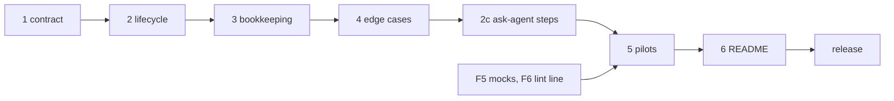

### Current Improve and Until Loop binding

The canonical Improve package bundles Until Loop at the version and upstream
commit recorded in `skills/improve/runtime/until-loop/PROVENANCE.json`. Its default child uses
`scripts/until_loop_ephemeral.py`, and its card (`ADAPTER.md`) can be invoked by
the model and starts a parent-written contract file unchanged, which is how
every inner stage's loop starts; the provenance manifest records the copied
source hashes. The selected card (the explicit `--improve-skill`, else the card installed
beside ShipLoop and recorded at `init`) determines this binding. An
ambient same-named skill or an older `scripts/until-loop` on `PATH` cannot select
the child runtime. Changing an external Until Loop installation alone does not
refresh Improve's bundled copy.

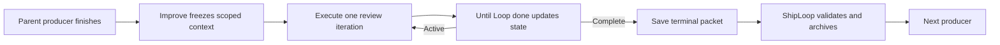

The runtime writes complete raw `start`, `next` and `done` JSON responses at
`<workspace>/.shiploop-improve/<stage>-<last 8 characters of the reviewed action>/packet.json`
(for example `implement-5e2f1a9b`; the child directory). This file
is a receipt and recovery locator, not another loop controller. Until Loop owns
one independent temporary file for the active child. Separate parents/actions
have separate receipts and runtime files; overlapping product edits still need
coordination. ShipLoop excludes `.shiploop-improve` from product return and
commits, and likewise excludes `.until-loop` state that an external Until Loop
installation may create in the workspace.
For the final worktree handoff, untracked receipt files remain in the execution
worktree with an `exclude` return-plan disposition so import can read them after
product return. Staging, committing or placing them in candidate history still
blocks return. Generate the return plan after the terminal packet is saved:
earlier active-packet bytes would make that plan stale.

The child freezes the exact parent binding line in `context.request`, scope,
commit policy, environment, and resource locators for the original request,
parent state, latest packet and return instructions. Every `done` report provides
a replacement `handoff`. Thus a compacted host can read the latest full packet,
recover an active child through its exact `next_argv`, execute the returned work,
and submit the exact `done_argv`. It does not remember or choose the next state.
Relevant resources still have to be available; a locator does not embed their
contents or grant authority to change them.

For example, with `required_trivial_reviews: 1` (Improve's own stop rule since 2026-10-20, the same
for every reviewed stage), a material repair reported as `non-trivial` leaves the streak at zero
and returns another active action. A qualifying `trivial` review raises it to one; with
`exit_assessment: satisfied`, Until Loop returns `status: complete` and deletes its temporary
file. These are two separate execution/report cycles. The LLM judges the evidence and classification; the runtime applies the
counter and transition. ShipLoop validates the terminal packet's parent/workspace
identity, context and gate, then archives it as `improve/<reviewed action>/terminal.json`
alongside the final review file and current check evidence. Only an
accepted import releases the parent action. Duplicate matching parent callbacks
remain idempotent.

**Failure boundary:** an active, stopped, foreign, malformed or missing terminal
receipt cannot advance the parent. If a process loses terminal stdout after the
runtime deletes its state, neither `next` nor a missing file proves success:
leave the parent incomplete. There is deliberately no second state journal or
automatic replacement child. Save stdout directly or through a JSON-aware
runner; manually rewriting returned JSON risks destroying the only receipt.
The importer verifies structure, identity and evidence-file availability; it
does not independently prove the truth of the LLM's review claims.

Only the ephemeral runtime is supported. A selected card whose bound runtime is
not `scripts/until_loop_ephemeral.py` (for example a durable Until Loop package
or the older example layout) is refused with an error; nothing is converted.
Already bound children are not migrated when a package changes: a
binding/version mismatch requires access to the original selected package.

The real-CLI composition tests in `test/shiploop-actual-improve-cli.test.py`
exercise the material/trivial/trivial sequence, cold packet recovery, terminal
cleanup, rejected imports and final workspace return. Their judgments are
synthetic protocol fixtures, not evidence of live model review quality.

## Worktree isolation and artifact-safe return

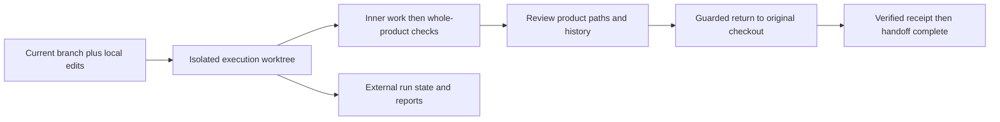

Start once with the selected package's CLI:

```sh
python3 "$CLI" workspace start --repo "$REPO" \
  --workspace-root "$WORKSPACE_ROOT" --prompt='<new request>'
```

Choose a dedicated durable external workspace directory, for example a fresh
`<repo-parent>/.shiploop-runs/<request-name>`, outside the product repository.
The script records the actual starting branch and captures tracked working
content, including unstaged edits, without changing the source index. Needed
non-ignored untracked inputs must be named with `--include-untracked`; ignored
credentials/caches are not copied. It does not default to `main`, pull, push,
stash, reset, or commit the original checkout to make isolation possible.

The returned packets point to the execution checkout at `WORKSPACE_ROOT/worktree`
and navigator state at `WORKSPACE_ROOT/run`. `workspace.md` records source and
baseline provenance. Work and INNER integration stay in the execution checkout;
the original branch receives nothing after an individual item. System checks
and outer Improve evaluate the assembled candidate before final return.

At the planned final integration boundary, the packet supplies `workspace
plan-return`, `workspace review-return` and `workspace return`. Decide every path of
the candidate-bound Markdown plan with `review-return --keep/--exclude`, never by
editing the file: keep intended code/tests/configuration and maintained project
knowledge; exclude transient output. The helper blocks pending/stale decisions,
known runtime paths, source drift and unsafe merges. For a clean start it also
checks reachable commit paths, so committing then deleting a runtime artifact
does not hide it from the return guard.

| Starting checkout | Result of guarded return |
| --- | --- |
| Clean | A clean, committed, reviewed worktree branch can fast-forward the exact original branch. |
| Staged/unstaged work or selected untracked inputs | Return only the new baseline-relative working-tree delta. Original staged content is unchanged; no private snapshot commit or automatic product commit enters the original branch. |
| Reviewed exclusions or an uncommitted candidate | Return only kept working-tree changes, even for a clean start. Excluded artifacts and their commits do not enter the original branch. This is not a merge/commit. |
| No kept changes or new history to integrate | Record `no-change-return`; do not manufacture a merge or commit. |
| Changed source, unsafe history, stale plan or unresolved collision | Refuse the return and retain both checkouts for reconciliation. Do not force/reset/stash. |

For example, staged plus unstaged edits to `game.js` become the worktree's
starting contents. New drag behavior is implemented and checked there. Return
adds that new delta to the original working file while keeping its original
index exactly intact. This is explicitly reported as a working-tree return,
**not a Git merge or commit**. The helper does not silently decide to commit the
user's earlier edits merely because ShipLoop used them as context.

Durable README/environment/design/decision updates and a host-authored
`SHIPLOOP.md` belong in the reviewed product set (ShipLoop commits only
`docs/shiploop/` itself). Run prompts/results, scratch, raw logs, credentials,
return manifests and the generated HTML achievement report do not. Reports stay
under external run storage; reusable facts are promoted into project docs. The
host must judge ambiguous/custom artifacts—the guard cannot infer their meaning.

Handoff cannot declare completion without a current verified return receipt.
The navigator performs its source return at release or handoff once no
Improve child is active. Earlier or unfinished work cannot return. A product
change committed after the return goes back as a follow-up return from the
previous receipt, by the same route; source drift since that receipt blocks it.
If branch integration activates deployment, plan it as an authorized release
operation from the execution checkout where possible; a required source-return
prerequisite remains incomplete for reconciliation. Verify effects separately.
A local return never proves remote
delivery. All source documentation intended for return must be finalized before
the return; subsequent changes require renewed validation and a follow-up return.
Worktrees and run records are retained, not automatically deleted.
Never push all workspace branches: a local private baseline may contain earlier
uncommitted inputs. Push only the intended reviewed branch when authorized.

See [workspace lifecycle](references/workspace-lifecycle.md) for exact storage,
review duties, recoverability and unsupported-state boundaries.
Focused checks: `python3 test/shiploop-workspace.test.py`.

## Navigator task entry and recovery

The navigator makes per-item execution ownership explicit. Before stage work, use `workspace start` once for new Git-backed work (`init`
for explicitly selected direct mode), or use `next` to
recover the same existing run, then verify the printed original goal and
repository. `next` rereads saved state; it does not advance the graph.

Each navigator packet provides absolute CLI, repository, and run-directory
locators plus an exact `Recovery command:`. Preserve those in host-owned durable
handoff material, but do not copy the current node, action ID, result path,
status, or successor as graph authority. A fresh host recovers with that command,
reads one current packet and its relevant references, and performs only that
action. The run owner alone submits its callback and consumes the returned
packet; a delegated worker does not initialize a child run or advance the parent.

After interruption, call `next`, inspect durable evidence and actual effects,
then reconcile what has already happened before continuing. A paused or blocked
packet waits for its stated condition and printed `resume` command; halted or
done packets stop. A missing or relocated locator must recover the same run and
task/repository identity or remain incomplete, never become a replacement `init`.
The script does not retain the host handoff, launch a fresh model, reset a model
context, or force a host to use its tools. See the [Navigator recovery contract](references/navigator.md#recover-one-existing-run).

## New feature, retained project knowledge, fresh run

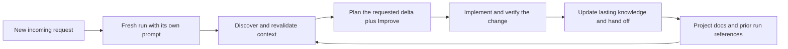

A new ShipLoop invocation for a later feature must not resume the previous
feature's prompt. Keep the same original repository, preserve its prior runs,
and start the new request in a fresh dedicated external workspace. For example,
after a run completed “create a checkers game,” use a new sibling workspace
`.shiploop-runs/drag-animation-01` for “make checkers visually drag.” The
host supplies the new incoming text verbatim to `workspace start` (or `init`
in direct mode). `next` is exclusively
same-run recovery; it is not a new-feature entrypoint.

The script refuses an existing-run `init` whose prompt or explicitly supplied
repository differs from the saved identity. It preserves existing state and
directs the caller to a fresh `--run-dir`. A matching retry is idempotent,
including on a completed run: it remains complete and does not replay work.
Even identical wording needs a fresh run if it is genuinely a separate request.
Recorded execution protocols/options are not changed by re-entry.

Every navigator packet supplies the absolute repository `SHIPLOOP.md` knowledge
index locator and the [cross-run knowledge policy](references/project-knowledge.md).
The index is ordinary host-maintained Markdown, not another scheduler or a copy
of run state. It points to existing environment, architecture/design/decision,
testing and deployment documents plus useful historical run/report references.
Stable knowledge lives in repository documents outside disposable run storage;
the index need not duplicate their contents. Preserve existing index content and
repository conventions. No particular environment-document filename is required.

| Existing phase | Cross-run responsibility |
| --- | --- |
| Intake and discovery | Read README/AGENTS, the index if present, relevant environment/decision documents and known prior-run artifacts. Verify applicability against current code/targets; record reused facts, sources, stale facts and gaps. A missing index does not mean an empty repo. |
| Research, specification and its Improve review (`stage` runs) | Challenge the context assessment and resolve consequential unknowns. Preserve applicable accepted product conditions without replaying old task scope. |
| Overall and step planning, and their Improve reviews (`stage` runs) | Plan only the new delta from verified existing behavior; reference applicable persistent decisions and new checks in work-item context. |
| Document and carry-forward | Incrementally update reusable knowledge and its index; keep observed facts, proposed changes and pending outer work distinct. |
| Handoff | Reconcile knowledge with final outcomes, retain provenance and relevant run/report locators, and verify useful knowledge survives beyond temporary run notes. |

In the checkers example, discovery reuses the existing game's deployment target,
design rationale and test setup after appropriate revalidation; planning adds
drag behavior to the existing game. It does not rebuild the game, copy old work
items, replay a deployment, or treat earlier tests as proof the new feature works.
If the old environment points at a removed sandbox or conflicts with the current
request, record the discrepancy and resolve the relevant prerequisite before
dependent work. Earlier approvals do not automatically authorize new writes.

This keeps the graph and Markdown state schema unchanged. Scripts enforce run
identity and expose stable references; hosts perform reads, curate the project
knowledge and judge applicability. Packet locators and synthetic routing tests
do not prove an LLM consulted the files or that historical remote facts are current.
From the source checkout, run `python3 test/shiploop-cross-run.test.py` for the
focused regression checks.

## Product requirements that survive every feature run

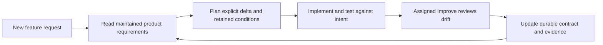

The current request defines the **change**; it does not erase unrelated accepted
behavior. The first run establishes or locates the maintained product contract.
Every later run reads the relevant contract and cross-cutting conditions, even
when old run folders and conversations are unavailable. A first ShipLoop run
against an existing product documents only the touched scope rather than
inventing a new whole-system specification from code.

| Material | Home and authority |
| --- | --- |
| Accepted logical requirements | Reuse the existing maintained spec, requirements, API or policy document. If none is suitable, use **`docs/requirements.md`**. An existing tiny README contract is sufficient; do not create a duplicate. |
| Project introduction | README summarizes the product and links to its contract. It is the front door, not another copy of detailed requirements. |
| Recovery/discovery index | `SHIPLOOP.md` links to the actual requirements home and other lasting knowledge. No new state cursor or duplicated spec. |
| Implementation and evidence | Code and concise comments explain how/why; tests check independent expected outcomes. Passing code/tests cannot redefine approved intent. |
| This change's execution | Run-local spec, plan, prompts and receipts remain historical or recovery records. They must not be the only home of a condition needed by future runs. |

Keep observable behavior, invariants, state transitions, negative cases and
material constraints with stable headings/IDs, short rationale/change sources,
and test pointers. Distinguish accepted intent from design choices, proposals,
observed behavior and verification status. Reasonable defaults can be chosen
within scope without being mislabeled as explicit user requirements.
Review **preserve / add / modify / retire** for affected
conditions; keep unrelated sections and meaningful subclauses intact. No new
formal schema, required database, DAG node or duplicate Improve loop is added.

[Requirements definition](references/requirements-definition.md) is an explicit
activity within discovery, research, and spec. It screens relevant performance,
reliability, security/privacy, accessibility, compatibility, operations, and
maintainability conditions; records operating conditions and observable criteria;
and maps new and preserved requirements to verification. Existing specs and
policies remain the baseline. Current explicit user instructions supersede only
conflicting older clauses; silence preserves unaffected conditions. Missing
targets remain open rather than becoming invented defaults. Navigator packets
expose this guidance for fresh and resumed work.

For example, a notes app may require "confirm deletion; cancel leaves the note
and list unchanged." A later search feature must retain both clauses. A request
to preserve notes across refresh deliberately replaces an earlier reset rule,
but does not remove deletion safeguards or local-only privacy. A test that passes
while deleting immediately is a conflict to investigate, not permission to
rewrite the requirement. Missing consequential intent stays a visible gap.

Existing spec/planning, test, document/carry-forward, acceptance and handoff
stages perform this work. Their assigned **actual Improve** campaigns review
drift within the candidate's scope. Shared navigator packets, including fresh
and recovered Improve handoffs, print the
[Maintained requirements policy](references/project-knowledge.md#maintained-product-requirements).
Hosts retain requirement/test locators in work-item context and child notes;
scripts provide routes, not proof that a model read or preserved every condition.
Keep maintained docs in the product return, outside transient run storage, so
the next invocation can recover intent without replaying the previous request.

### Correlated references across skills and prompts

The [reference handoff map](references/project-knowledge.md#reference-handoffs-and-destinations)
names each artifact's home, writer and downstream readers. It distinguishes
package guidance from product requirements, current-run notes and Improve child
state. Current navigator packets route to this same map; they do not invent another requirements registry.

For example, when the accepted rule lives in `docs/product-rules.md#deletion`,
planning retains that section and its test selector in work-item context. The
producer includes those locators and relevant run evidence in `evidence_refs`;
the host passes them into the selected Improve skill's existing contract prose
and review notes. Its bound Until Loop runtime persists that contract for child
recovery. ShipLoop imports the child's own review and check files, not a new product specification.
This last transfer is a host duty, not an automatic semantic guarantee.

[Backchain planning guidance](references/backchain-planning.md#navigator-planning)
uses the same outcome/source/test mapping in the relevant planning and review
packets. It is ShipLoop's planning checklist, not a second standalone planning
run; a Backchain call uses only the `source-aware-native` route.
The plan packet's Backchain loop takes one review/fix/check pass by default
(`--backchain-passes one`; `converge` takes two consecutive trivial reviews, `none` takes no whole loop), and
`--planning-review stage|none` turns the per-stage planning reviews on or off; both are fixed for the run
([Backchain route](references/backchain-route.md#backchain-passes-option) and [run options](references/run-options.md#planning-review-option)).
Keep product-document links portable across worktree return; verify destination
files and anchors, distinguish planned tests from evidence, and repair affected
links together when an authorized change moves a destination. Improve/Until Loop
remain standalone skills; neither acquires a dependency on ShipLoop's filenames.

## Per-item navigator ownership

The same `state.md` stores the root's global status, queue and `work_index`,
plus an `inner_loops` record for each entered work item. While W2 is active, root stays at `inner-loop` with no action; W2 owns the
current inner stage and parent action. A completed W1 remains `done` with no
action. At an Improve checkpoint the script parks that action while its actual
Improve child runs.

After `carry-forward` is accepted (and, for the last item, its Improve child is
imported), the script selects the next item's `step-plan`, or returns
ownership to `system-test-author` after the final item. The
[navigator ownership guide](references/navigator.md#one-shared-inner-graph-and-per-item-records)
explains the shared cursor boundary. ShipLoop stores the actual child binding
and imports its outcome; the selected Improve skill and its bound Until Loop
runtime own child iterations. ShipLoop has no second review counter.

## Improve discovery and planning before proceeding

The navigator applies the actual-skill handoff to the planning stages (spec, test
strategy, plan, step plan, test spec, system-test authoring and release plan; with
`--planning-review none`, only system-test authoring and release plan), to each
step's accepted document stage, and to the last carry-forward, whose review covers all
executed steps before OUTER work. See "When Improve runs" in [the Improve schedule](references/improve-stages.md#when-improve-runs). The producer callback first saves its attempt. The next
packet binds or resumes the selected Improve skill; the graph advances only
when that skill completes and the bound outcome is imported. Read the actual
selected skill's instructions for its review, history, evidence and commit
policy. ShipLoop does not reproduce those instructions as its own campaign.

For example, Improve may find an omitted API consumer in a spec result, repair
the requirement and test implications, and perform its required subsequent
reviews. The parent remains at `spec` until the child completion is imported;
then the script returns the `test-strategy` producer. An incomplete child stays
pending.

## Consumer delivery: an incremental feature must reach its intended user

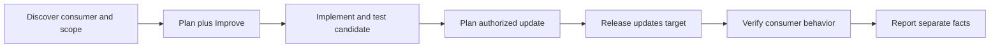

The consumer may be an existing hosted page, API caller, local CLI user, library
consumer, or documentation reader. A Git commit is not automatically that
boundary. Discovery and planning distinguish a genuinely new product from an
existing system and identify how the requested change becomes usable. Explicit
source-only work is valid; an ambiguous hosted-feature request needs a scope
decision, not an invented local-only completion criterion.

Improve reviews the original outcome as well as the generated plan (the plan only in a `stage` run): **if every step succeeds, will the intended user actually receive the requested behavior?**
The actual selected Improve skill performs that review through
its bound Until Loop runtime. Its own convergence policy remains authoritative;
ShipLoop adds neither an internal review graph nor a second review counter.

For a new run, `workspace start --delivery-contract` (or `init --delivery-contract`) enables an **opt-in
declaration guard**. The script retains the accepted delivery contract in the
existing authoritative `state.md` ledger and reprints it with pending checks
and evidence references after a context reset. Full contract corrections and
partial observations are distinct: a partial result cannot erase requirements.
Even an explicitly source-only contract needs a required local consumer-behavior
check; no remote activation does not mean no verification.
The normal completion template supplies the binding; the host does not calculate
another cursor or successor. See the [contract, examples, and recovery rules](references/consumer-delivery.md).

| Boundary | Required distinction |
| --- | --- |
| Discovery / plan | Intended consumer, target, needed operation, authority source, and expected behavior. |
| System test / release planning | Current pre-update checks versus checks that need the updated consumer. |
| Release | Update effect and target/candidate identity, including an evidenced already-current target. |
| Release verify | Actual required consumer behavior; source matching or a URL alone is insufficient. |
| Handoff / HTML | What was implemented, updated, identity-checked, behavior-verified, and left unresolved. |

For example, an incremental visual change to an existing hosted game may require
an approved private source update without any public or versioned deployment.
The existing release action owns that update. If it succeeds but the browser
reaches a login screen, preserve the update evidence and leave visual behavior
unverified; do not retry the write merely to obtain another receipt or report
the feature complete. Resolve access within authority, then resume verification.

The guard checks declared coverage, consistency, and bindings. It does **not**
authenticate approval, inspect a live target, execute tests, or prove an evidence
claim true. Required but unauthorized/unverified is incomplete, not N/A. A repo
file grants no permission merely because an agent wrote it. New authority,
public access, credentials, and unrelated targets remain outside the packet's
power. Old unmarked runs retain their existing schemas; the option cannot
silently enable on resume. Default adoption is separate from this pilot.

## Delivery authority readiness: ask early, reuse narrowly

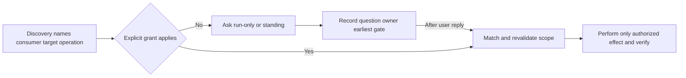

This is ordinary navigator guidance for any necessary external operation, with
or without `--delivery-contract`; it does not add a phase, parser, automatic
deployment, or new authority store. At discovery, once the consumer,
target/account, and operation are concrete, check for an explicit applicable
grant. If it is missing, ask promptly rather than waiting for `release`: name
the operation, target/account, environment, exclusions, expected effect, and
whether approval is for this run or standing. Silence, a login, an old one-off
approval or receipt, and agent-authored policy are not grants.

Record the assessment in the canonical current-run
[`notes/environment-lifecycle.md`](references/environment-lifecycle.md#durable-record-and-responsibility)
note and point ordinary result `evidence_refs` to it. Include necessity, the
consumer/target/account/operation match inputs, actual sources/current binding
evidence, the grant or outstanding question with owner/earliest gate, and
required effect, identity, and behavior evidence. This is not a new ledger or
proof that a claimed grant or observation is authentic.

Once the missing question has been recorded, do not ask it again on every
action. Discovery and other independent authorized work may continue; the gap
blocks at the earliest dependent write or `release-plan`, not merely because it
exists. After the user replies, recover the current action if needed, record the
answer, finish its assigned Improve work, and use its normal callback. A reply
does not create a new phase or itself complete the current action.

A standing policy is reusable only when it still matches product and consumer,
target/account, operation, environment/access, exclusions, its user approval
reference, and current revocation/expiry state. It must also cover the current
effect without broader access, data exposure, or security impact. The current
request can narrow or override a standing permission: an explicit source-only
request wins over a policy that otherwise permits a private sync. An ordinary
new feature behavior within the unchanged approved scope needs no repeat
approval; ask again only when changed effects fall outside that scope. Keep a
standing policy in an existing repository-owned `SHIPLOOP.md`, `AGENTS.md`, or
deployment document linked from the knowledge index, never solely in run notes.

For example, an existing policy may permit a user-approved standing sync of the
current candidate to one private development account, excluding public release.
For a source-only request, do not sync despite that permission. For a request to
make the private page usable, revalidate the exact account, environment, and
exclusions, then perform the unchanged in-scope sync without seeking a duplicate
approval. If the sync succeeds but the browser reaches login, preserve the sync
and identity evidence, mark behavior blocked, and report the feature unverified.
Do not automatically repush merely to create another receipt; restore suitable
access and verify the same candidate, or replan if scope/target/authority changes.

The optional declaration guard maps these same facts to its existing contract
fields and checks declarations rather than approval authenticity. It remains
opt-in and cannot be silently enabled for an existing run. See
[delivery-authority readiness](references/delivery-authority.md) for the full
current-run and durable-policy record.

## Lightweight checks, browser evidence when needed

Prefer `curl` or an existing HTTP/API client when it can prove the required
outcome. Choose tools by evidence coverage and overhead, not by a fixed ladder.
Always consider Chrome DevTools, browser automation or an equivalent available
browser surface for rendered behavior, interactions, or browser-specific auth
such as session/SSO/MFA flows. No new browser integration is required by default.

Discovery and test planning establish the target, intended user role, expected
behavior and access prerequisites. INNER/system/release verification uses that
selection and revisits it when observations change. A JSON response contract
may need only curl; checkers dragging needs an actual browser interaction.
HTTP 200 on a login page is not app success, and a curl redirect does not prove
that an authorized browser cannot reach the app. Inspect that route or retain
the required check as blocked; do not hide the gap with a lighter but insufficient
test. Successful deployment and browser verification remain separate evidence.

Each navigator packet links the [shared testing guide](references/testing-and-documentation.md#lightweight-and-browser-checks).
Use supported authentication, ask for necessary user action early, and keep
cookies, tokens and browser auth state out of commands, reports and Git. This
changes prompt guidance and reference routing, not the state graph or permissions.

## Early authentication without premature sign-in requests

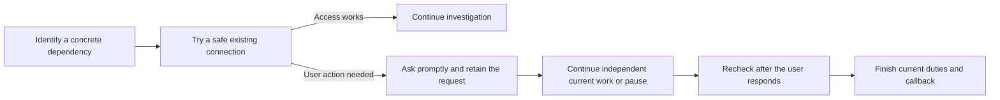

Discovery performs this checkpoint after identifying the relevant system and
environment, before deeper research needs its access. The same policy applies
when later research or an Improve campaign discovers a new required boundary.
Do not request sign-in for every available connector or speculative technology.
Reuse a current successful probe; do not prompt on every iteration.

If an existing-connection read reports an expired session, ask the user promptly
to reconnect through the supported provider/host surface. Name the non-secret
target/role, attempted check, needed action, earliest blocked activity, and work
that can continue. A missing tool or a network failure is not an auth diagnosis;
a wrong role may need an administrator rather than another login. Do not test
write permission by publishing, and never collect credentials in chat or notes.

For example, a hosted-app change can continue local code inspection during
discovery while a known development-account login is pending, provided that
inspection does not depend on the missing remote facts. Independent work stays
within the current action; it does not allow coding early or skipping graph
stages. Only its completed callback lets the script advance. At `plan`, and in a `stage` run its Improve review, check that each concrete external dependency has access evidence or a disclosed
access/setup requirement with an owner and gating stage. Step and release
planning recheck stale or changed access, not blindly reuse an old login.
Connector access and the browser user's access can require separate checks.

The host retains the request, disposition and recheck condition in an existing
run note, carries its locator through dependent results and work-item context,
and avoids duplicate requests. After a user reply, recover/resume the current
packet as needed and retry the safe read. A reply or successful login alone does
not complete discovery: finish its duties, then use the packet's current
callback. Required current access remains incomplete
if verification fails; downstream-only requirements need not block independent
work and cannot silently become N/A.

Every navigator packet links the [shared access-readiness policy](references/research-loop.md#early-access-readiness),
including cold paused/blocked packets. Scripts own those locators and the
existing transitions; the host owns probes and timely questions. No new graph
node, auth schema, OAuth client, or grant is introduced, and the script does not
certify that a host performed authentication. Sign-in is not deployment authority.

## Prepare the development area, then promote the result

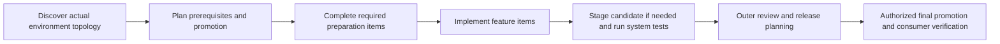

This is a responsibility view, not a new graph. Some work is entirely local;
other systems use sandbox/prod, dev/stage/prod, ephemeral previews, or a different
promotion route. Discover the real one and reuse it where appropriate. A branch
or worktree isolates source changes, not necessarily remote data or services.
Read deployment automation too: commit/push/merge can trigger an external update.

| Point in the existing navigator | Responsibility |
| --- | --- |
| `discovery` and `research` | Identify where code is edited, built, run, tested and consumed; inspect existing areas, access, isolation, baseline behavior, deployment triggers and promotion rules. Do not provision during investigation. |
| `test-strategy`, `plan` and their Improve reviews (`stage` runs) | Plan readiness checks, environment preparation, candidate staging and final promotion before feature coding. Put required setup producers before their consumers in `work_items`, with definitions of ready/done and authority. |
| Preparation work item through INNER | Perform only authorized setup; verify the intended target, binding, isolation and baseline; document its receipt and complete Improve before dependent feature work begins. An already-ready environment needs no artificial setup item. |
| Feature work and `carry-forward` | Recheck applicable readiness, use only the planned workspace/target, and retain newly discovered staging/migration/approval requirements in the shared environment note. |
| `system-test`, `product-acceptance` | Use the planned candidate and environment, inspect real readiness/check evidence, and reconcile pending deployment work. A required test deployment must already have an explicit producer; do not improvise a production update to make tests run. |
| `release-plan`, `release`, `release-verify`, `handoff` | Read the retained route, plan and execute only remaining authorized hops, preserve candidate identity and partial receipts, verify the final consumer, and report cleanup ownership and unresolved work. |

For example, a sandbox/prod app might plan `PREP` (ready the authorized sandbox),
`FEATURE` (implement and verify the change there), and, only if needed, `STAGE`
(install the candidate in the selected test area). The script completes each
item before selecting its successor. Outer system tests then inspect the
prepared candidate; release planning reviews production promotion and its
approval, release performs it when authorized, and release verification checks
the production consumer. Sandbox success alone is not production success or
permission. This is an illustrative sequence, not a report of a live deployment.

Every packet prints the canonical run-note path `notes/environment-lifecycle.md`,
even after later work items or a cold restart. When relevant, retain setup facts,
receipts and pending outer requirements there, or point it to adequate existing
environment/deployment documentation without copying its body. Dependent
results/work items also carry useful evidence locators. No empty note is needed
for irrelevant local-only work. A fresh context can find and update it without
duplicating requests; an absent expected note is a gap. Missing coding isolation blocks
dependent code changes; a release-only staging requirement need not block
independent local work. Never silently substitute production for a missing test
area or clone sensitive production data into a sandbox.

The [shared environment lifecycle policy](references/environment-lifecycle.md)
defines these boundaries. Navigator uses existing ordered work items, **not a
new outer-before node**; scripts enforce their declared order, while the host
must identify all required setup and establish real readiness. No automatic
provisioning, deployment authority, new schema, or environment-name convention is
introduced.

## Agentic duties within a work item

Existing stages now explicitly challenge acceptance examples and test quality,
assign ownership when work is delegated, diagnose persistent failures with
small experiments, and select operational checks for the changed boundaries.
Available independent review covers the final candidate; integration refreshes
affected reviews and checks. Consequential learnings remain scoped until shared
adoption is justified by representative regression evidence and existing authority.
See [stage responsibilities and an integration example](references/navigator.md#agentic-responsibilities-inside-existing-stages).
Each Improve child runs independently under its parked parent action and is
imported once.

## Bounded recursive discovery

The [service discovery guide](references/service-discovery.md#select-scope) maps
affected UI/business flows to actual service capabilities and existing remote
state. It covers zero-copy/cache choices, permission-aware invalidation, durable
async cooperation, and reuse of owned observability for local or remote systems.
Decisions, prerequisites, affected files and checks travel through maintained
project notes, the existing knowledge index, and work-item context. The navigator
routes readers to these notes; it does not prove their semantic correctness or
remote access. [Salesforce](references/platforms/salesforce.md) is an example,
not a required stack. Local/stateless work can record a short no-change outcome.

Discovery follows task-relevant boundaries behind an MCP or other gateway and
screens message passing, client connections, service authentication, design,
client-side libraries, storage, caching, and security. Existing platform
facilities, libraries, and patterns are the default reuse candidates. A new
mechanism needs evidence of a substantial task-relevant improvement.

When authorized by the task, the host can acquire a temporary skill, MCP, SDK,
or dev/test dependency for a specific observation, establish its actual access,
and run a discriminating experiment. It retains unresolved access and labels
source inspection, local tests, service reads, and deployed-user evidence
separately. A catalog alone does not establish target access.

The shared default allowance is 15 active minutes / 64 observable host actions,
at most two capability candidates and three experiments. New exploration stops
at 13 minutes or 56 actions, reserving two minutes / eight actions to record
findings and clean up. These are host-followed instructions, not a script
watchdog. Resuming the same investigation does not refill its allowance.

Navigator discovery and research packets select the
[shared discovery policy](references/research-loop.md#recursive-discovery-and-experiments)
and [navigator adapter](references/research-loop.md#navigator-execution-mode-adapter).
Later product/outer Improve packets select them for consequential new findings.
The host stores evidence, reuse decisions, open gaps, and remaining allowance in
durable notes referenced by its generic result. Unaccepted draft + pause retains
the action; an accepted blocker report creates a new action at the same stage.

### Plan actor interactions before choosing channels

Discovery and planning use the
[interaction design guide](references/behavioral-requirements.md#actors-channels-and-state-ownership)
to connect actor needs to interface and state decisions:

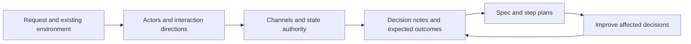

Identify people/services/systems, who initiates or receives each interaction,
its channel and observable effect, and where authoritative versus presentation
state belongs. Prefer existing capabilities; justify a new mechanism with a real
requirement or gap. For example,
a single-browser in-memory Tic-Tac-Toe game can handle moves locally even when
the page is hosted. Separate-browser multiplayer needs an agreed shared-state
contract. A message service needs an explicit sender/recipient path and a clear
distinction between acceptance and delivery; it does not automatically need a
queue or bidirectional connection.

Discovery retains the rationale, sources and unresolved questions in existing
notes. Spec/global planning and step planning read those locators, carry them in
affected work-item context, and derive relevant success/failure cases. Improve
rechecks affected decisions and updates the same notes. Fresh navigator producer
and child packets include the guide locator; the child carries relevant locators
into its own contract.
This adds design guidance, **not** a new stage, state field, or script claim that
the architecture has been proven correct. Simple cases need only a short trace;
shared-state, security and delivery complexity must be justified by the spec.

## Saved runs the current code cannot load

ShipLoop 0.24.0 keeps only navigator protocol 4 (execution modes
`navigator` and `navigator-worktree`). Navigator v1/v2/v3 and the former managed
and legacy stage machine are removed, together with their commands, embedded
Improve policy and compatibility documentation. Every verb refuses a saved run
it cannot load, with an error that names the recorded protocol or mode, or the
unexpected or missing `state.md` keys (for example a run without its
`delegation` key). Nothing is converted, migrated or partly resumed. Keep the old
run directory as evidence and start the same request again with a fresh
`--run-dir` or `--workspace-root`; product commits and worktrees are unaffected.

## Command reference

The compact stdout packet is authoritative for the current action; the two lines
under a producer packet's header are the `next` command (`Lost context, or unsure?
Run ...`) and the packet file (`Full packet: <path> - ...`), and the one legal callback
is the line labelled `Callback for this stage`, the third line after the header, followed
by the owner rule (an Improve child's packet labels it `Next command (` or `2. When the
improve skill has completed, run:`, and the bound one carries neither pointer). The
command surface is:

```sh
# Start a navigator protocol 4 run
shiploop workspace start --repo REPO --workspace-root ROOT [--improve-skill ABSOLUTE_SKILL_CARD] [--include-untracked=PATH]... [--exclude=PATH]... [--delivery-contract] [--delegation=inline|ask-agent] [--lint=fix|report|off] [--backchain-passes=one|converge|none] [--planning-review=stage|none] --prompt=TEXT
shiploop workspace plan-return --workspace-root ROOT
shiploop workspace review-return --workspace-root ROOT [--keep PATH...] [--exclude PATH...]
shiploop workspace return      --workspace-root ROOT
shiploop init     --repo REPO [--run-dir RUN] [--improve-skill ABSOLUTE_SKILL_CARD] [--delivery-contract] [--delegation=inline|ask-agent] [--lint=fix|report|off] [--backchain-passes=one|converge|none] [--planning-review=stage|none] --prompt=TEXT
# Reread the current packet; never advances
shiploop next     --run-dir RUN
shiploop report   --run-dir RUN
# Callbacks the packet prints
shiploop complete --run-dir RUN --action ACTION [--result RUN/inbox/ACTION.md]   # --result is that one path, which is the default
shiploop complete --run-dir RUN --action IMPROVE_ID [--notes LESSONS.md] [--final-result RESULT.md] [--no-commit=TEXT]   # the Improve stage's import
shiploop improve-bind --run-dir RUN --action IMPROVE_ID --skill-card ABSOLUTE_SKILL_CARD
shiploop improve-start --run-dir RUN --action IMPROVE_ID --restart-stopped
shiploop improve-commit --run-dir RUN --action IMPROVE_ID --message MESSAGE_FILE [--remote-change]
shiploop improve-pass --run-dir RUN --action IMPROVE_ID [--no-commit=TEXT]   # one review pass: commit, checks.md, runtime report; prints done and complete
shiploop improve-reconcile --run-dir RUN --action IMPROVE_ID --result RECONCILIATION.md
# Run control
shiploop pause    --run-dir RUN --reason=TEXT
shiploop resume   --run-dir RUN
shiploop halt     --run-dir RUN --reason=TEXT
shiploop delegation --run-dir RUN --set=inline|ask-agent   # from the next issued action
shiploop lint-mode --run-dir RUN --set=fix|report|off      # later lint passes
shiploop lint     --run-dir RUN --action ACTION [--show --part N [--rerun N | --gate N]]   # report-only rerun
shiploop backchain-check --candidate PLAN.json [--run-dir RUN]   # record-only Backchain graph check
# Keepalive (see references/keepalive.md)
shiploop hook-status --run-dir RUN                        # read-only JSON; never locks or writes
scripts/shiploop-hook install|status|uninstall --host HOST [--dry-run]
# Run trace (see references/status-display.md#run-trace): read-only; --html writes only the page
shiploop trace    --run-dir RUN [--action ID | --request | --json | --html [PATH]] [--last N]
scripts/shiploop-drive --host HOST --run-dir RUN [--max-minutes N] [--session-timeout S] [-- HOST_ARGS]
# Inspection without project work
shiploop graph-dry-run [--list] [--scenario NAME | --script STEPS.json] [--delegation=inline|ask-agent] [--format=summary|json|markdown]
```

`delegation` applies from the next issued action; the pending action and its
Improve checkpoint keep their issued route. It is refused on halted or done runs;
setting the recorded value is a no-op.
`lint-mode` changes the run's script-owned lint option (new runs record `fix`;
a saved run without it is refused) and is refused on halted or done runs.
`lint` reruns the pass report-only for the current action, or `--show` prints
one part of a stored record (`--gate N` for implement gate pass N); it exits 0
clean, 1 with new findings or an uncovered file, 3 when it could not run, and
ShipLoop never gates on that exit code. The implement gate runs its own pass on
`complete`. See
[lint catalog](references/lint-catalog.md).
`backchain-check` checks a Backchain candidate plan, packaged first, against
Backchain's seven structural invariants (a Python port of its reference
validator). It prints a JSON receipt, writes it and a snapshot of the checked
bytes under `RUN/backchain/<action>/` (the run is found from the working
directory without `--run-dir`), exits 0 valid, 1 invalid, 3 could not run, and
never gates.
`graph-dry-run --list` prints the scenarios;
`--delegation` selects the simulated route (inline by default). See
[graph dry runs](references/graph-dry-run.md).

The packet is authoritative for `complete`, `improve-bind`, `improve-start`,
`improve-commit`, `improve-pass` and `improve-reconcile` arguments and for recovery; the improve-* verbs and the
Improve stage's `complete` take the Improve stage's id, and a command given the reviewed action's id
is refused. A parent imports only
matching accepted child evidence and never replaces a blocked child with a
hand-written review loop outside the selected Improve skill. `scripts/shiploop-next`
and `scripts/shiploop-complete` are thin wrappers around `next` and `complete`;
they refuse another verb passed as their first argument.

`TEXT` is literal data: use one `--name=value` argument, including with
structured argv. In a shell single-quote it, escaping embedded `'` as `'\''`.
For example `--reason='--help'` records that literal reason instead of parsing
it as an option. Never paste raw requests into double-quoted shell source.
Use absolute paths for `--result` when the working directory is ambiguous.

`report` prints the derived HTML report with the same escaped progress snapshot
the packets carry. Automatic `report.html` persistence is limited to done and
halted runs. The report is a derived view, not workflow state or proof of
semantic acceptance.

## Maintainer map and verification

The entry [SKILL.md](SKILL.md) is intentionally small. Human explanation lives
here; stage guidance lives under `references/`; scripts own state, navigation,
packets and gates. The scripts return the prompt for the current step and the
model performs that one step; a routing decision belongs in a script, not in
prompt guidance. Update documentation against actual routing, not a desired
phase diagram.

| Question | Decisive implementation |
|---|---|
| What action runs next, and what must a completion prove? | [Navigator graph, validation, packets and dispatch](scripts/shiploop_navigator.py), [stage prompts and reference catalog](scripts/shiploop_prompts.py), the [CLI entry and run lock](scripts/shiploop) and its [verb routing](scripts/shiploop_protocol.py). |
| How is an Improve child bound, completed and imported? | [Standalone Improve binding and import](scripts/shiploop_standalone_improve.py). |
| What persists across a cold context? | [Markdown transactions](scripts/shiploop_store.py) and the [state-file guide](references/state-files.md). |
| How does isolated work return to the source checkout? | [Workspace start, return plan and guarded return](scripts/shiploop_workspace.py). |
| How are consumer-delivery declarations checked? | [Consumer-delivery contract](scripts/shiploop_consumer_delivery.py). |
| How does the navigator rerun invalidated planning? | [Planning revision archives](scripts/shiploop_planning_revision.py). |
| How are routes inspected without project work? | [Graph dry run](scripts/shiploop_navigator_dry_run.py). |
| What does the script-owned lint pass run, fix and record? | [Lint pass and implement gate](scripts/shiploop_lint.py) and its [lint catalog](references/lint-catalog.md). |

In the **skill-craft source checkout**, not an installed package, the stable
verification entrypoint is:

```sh
bash test/run-all.sh --group shiploop
```

Focused examples:

```sh
python3 test/shiploop-navigator-contract.test.py
python3 test/shiploop-improve-schedule.test.py
python3 test/shiploop-delegation.test.py
python3 test/shiploop-reference-routing.test.py
```

A green synthetic walk establishes the exercised local navigator behavior, not
production acceptance, research quality or an actual remote deployment. For
README changes, also check internal anchors, packaged relative links, Mermaid
rendering and agreement with the current packet vocabulary.
In the source checkout, `skills/shiploop/` is canonical and
`plugins/shiploop/` is release output that only `scripts/release.py` writes.
After an edit, add `changes/shiploop/<slug>.md` and check a build of the
current source:

```sh
python3 scripts/build-packages.py "$(mktemp -d)/build"
git diff --check
```

Do not run `sync-plugin-views.sh` or commit `plugins/` or catalogs. Do not use
documentation validation as a reason to initialize a real run, start standalone
Until Loop, install an integration, change persistent configuration, or publish
a product.

## Related references

- [Navigator guide](references/navigator.md): graph, packets, result contract,
  recovery, progress reporting and per-item records.
- [Graph dry runs](references/graph-dry-run.md): synthetic route and prompt
  inspection.
- [Improve context ownership](references/improve-context.md): inline and
  ask-agent Improve routes, exclusive writer and recovery.
- [State-file guide](references/state-files.md): durable run files and their
  readers.
- [Workspace lifecycle](references/workspace-lifecycle.md): isolated start and
  guarded return.
- [Backchain planning in ShipLoop](references/backchain-planning.md): selective
  native outcome/dependency guidance mapped to current ShipLoop Markdown, not a
  runtime dependency or new result schema.
- [Execution planning](references/execution-planning.md): initial repository
  baseline, step microplans, baseline tests and migrations, and cold-start
  evidence.
- [Research and recursive discovery](references/research-loop.md#recursive-discovery-and-experiments):
  scoped investigation, early access readiness, experiments and reuse.
- [Carry-forward checkpoint](references/carry-forward.md): post-item mapping
  and future-work revision.
- [Testing and documentation contract](references/testing-and-documentation.md):
  stage readiness, case records, surface selection, documentation and
  deployment evidence.
- [Repeatable test suites](references/repeatable-test-suites.md): harness
  selection and test decisions carried through stages.
- [Global system-test catalog](references/system-tests.md): catalog shape,
  placement and pre/post-deployment sequencing.
- [Behavioral requirements contract](references/behavioral-requirements.md):
  evidence-led discovery, product flows and states, `R-/F-/T-` traceability and
  model-to-case links.
- [Consumer delivery](references/consumer-delivery.md) and
  [delivery authority](references/delivery-authority.md): opt-in delivery
  declarations and early authority questions.
- [Host matrix](references/host-matrix.md): host-specific invocation
  constraints; it is a reference, not mutable run state.
- [Lint catalog](references/lint-catalog.md): the script-owned lint passes and
  implement gate, the discovered linters, safety pins and catalog data.

If this guide and the current packet differ, follow the packet, preserve the
evidence, and record the documentation issue as a ShipLoop improvement proposal.
