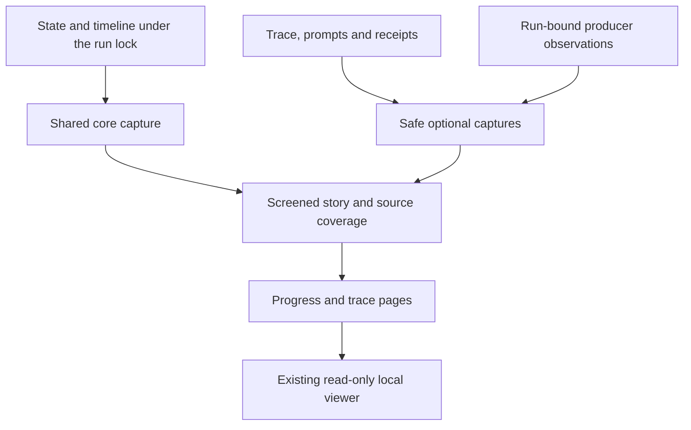

# Status display

ShipLoop renders one fixed **status block** from saved run state, and at
milestones a **run narrative** that tells the story of the run. The model writes
neither; in a terminal CLI a hook can show them to the user directly. A packet
carries one progress block: the narrative at a milestone, otherwise a one-line
**status line** cut from the block; the full block is in `status.md` and
`shiploop status` (see [where it appears](#where-it-appears)).

```text
=== ShipLoop status ===
Where:     Work items > W2 "Add --version flag" (2 of 4) > Build > test
Run:       Preparation ✓ | Work items 1/4 ▶ | Release ·
Item:      Plan ✓ | Validate existing ✓ | Build ▶ | Reflect and revise ·
Done:      W2 implement: --version added to the cli.py argparse; checks pass.
Next:      test: write the specified tests and make every recorded command pass
Item plan: Add --version to cli.py argparse; tests in test_cli.py.
Completed: 1 item; W1 "Config loader refactor": loader split, 12 tests added
=== end ShipLoop status ===
```

`✓` is accepted done, `▶` is current, `·` is pending.

| Line | Content |
|---|---|
| Where | Phase, then item (N of M) and its stage group, then the stage. `> improve` follows it while the Improve stage owns the step. |
| Run | Preparation, work items (completed/total) and Release. |
| Item / Stages | During a work item, its 7 stages in four phases: Plan, Validate existing, Build, Reflect and revise. In preparation and release, each stage. |
| Done | The latest accepted result's first sentence, marked when Improve reviewed it or the outcome was blocked, send-back, add-work or reconcile. While a child is parked, the result it is reviewing. |
| Next / Stopped | The current stage and its one-line purpose, or, at the Improve stage, `improve: run the improve skill on the <stage> result`. A paused, blocked or halted run shows its reason; the packet prints the resume command. |
| Item plan | The first sentence of the item's accepted `step-plan` summary, or of the item's `context` before that. Omitted when neither exists. |
| Completed | Completed items, the three most recent with the first sentence of their `reflect-and-revise` summary. |

## Live HTML progress view

Open `<run>/progress.html` as an ordinary HTML file. After a successful `init`,
`next`, `resume`, callback, `pause`, or `halt`, the CLI ensures one read-only
background observer for that run. It samples about every two seconds and
publishes a complete page only when what the page shows has changed. No web
server, browser file permission, external asset, or model call is required.

The open page never reloads itself. About every five seconds it loads a small
script the observer keeps beside the page, `progress-version.js`, which names
the current version of each page and the time of the observer's last good
sample; the observer rewrites that one file at every sample, so it is also the
heartbeat. When the version is the one the page already shows, only the "data
age" line moves. When it differs, the page loads `progress-content.js` (the
page's `<main>`, written together with the page) and swaps in place just the
blocks whose content changed: a block the reader has open, the scroll position
and the search text stay as they are, and nothing flickers. A page opened as a
file and a page served by the [browser viewer](#browser-viewer) update the same
way, because a `file:` page cannot fetch but can load a sibling script; the
page's content security policy admits its own inline script and those sibling
scripts and no connection of any other kind. An update waits while text is
selected. Checked in Chrome; other browsers are not measured.

The page opens with where the run stands (the phase strip and the current
focus), then the visit journal. The lists that grow with the run, the evidence
previews and the per-source coverage, are folded under a line that counts them
by status and open on request; a link to one preview opens the fold it is in.

At the first successful startup, the host shares the packet's absolute HTML link
with the user: "You can use this HTML file to track changes during this ShipLoop
run." It shares the link once per run and then continues the current action. The
first packet's line also names the command of the [browser viewer](#browser-viewer),
which the host gives the user in the same message. If observation is unavailable or
disabled and no page exists, it reports that status instead of offering a working
link.

The page connects the current stage and blocker to a linear journal of stage
visits, recorded attempts, prompts as issued, gate evidence and Until receipts.
Repeated visits stay separate. Expand a visit to inspect its recorded evidence,
or follow the relative **Run trace** link for the detailed inspector. The
preparation/work/release outline, accepted items and expandable spec,
architecture, plan and test-strategy previews remain available.
Before plan acceptance it says the work plan is
pending. Current repository documents are **saved drafts** with a path, content
hash and observation time. Accepted planning-result records appear separately;
an updated document or worker report does not itself accept work. The observer
cannot display unrecorded work or intermediate edits it did not sample. Each
file is checked for a stable read; several document previews do not represent
an atomic repository-wide snapshot.

Generated implementation steps have their own dependency diagram. Inline step
plans supply their recorded `deps` and accepted per-step progress. Each bound
execution graph supplies its nodes and prerequisite edges; saved dispatcher
state supplies their recorded status. The diagram is rebuilt when these inputs
change, even while the parent action stays the same. Graphs are labeled by work
item/action so identically named steps in separate plans remain distinct. A text
dependency list accompanies each diagram. Older step plans without explicit
`deps` can show their accepted tasks but label their dependencies unknown.
The preparation/work/release outline is separate from these generated steps.

Previews are embedded in the file so a saved copy remains useful offline. Evidence
links open those previews in the page; selectable source paths, line or selector
references and source-byte hashes support inspection on disk. A source-byte hash
identifies the original bytes, not the credential-screened preview. Packet
previews compare those bytes with the issued digest when it was recorded;
a mismatch or absent digest keeps issued-content provenance unverified.
Selected text and structured evidence files are bounded, credential-screened and escaped; symlink,
hardlink, special-file and out-of-root references are refused. Missing or withheld
files have explicit placeholders. The existing privacy screen recognizes only
specific credential patterns, not every possible secret.

A status on the page says what was recorded, in plain words. A command shows
`ok`, or `refused`, `not passed` (a `check`), `held`, `interrupted` or `crashed`
with its exit code; a packet shows `sent`; a hook shows its decision; a kind
with no status of its own shows alone. An Until receipt, a check answer, an
expectations record and a test record are listed for a visit only when the file
exists: most stages never write most of them, and a file that was never due is
not "missing". Every such record is read for its status. The preview budget
(160 files) bounds only whose content is embedded: a record past it shows `not
embedded` beside its real status, and a packet preview past it shows `not
loaded`. The events of an Improve pass appear under the visit the pass reviewed,
marked `Improve pass`; a preparation or release stage, which belongs to no work
item, shows `run-wide`.

The page distinguishes last recorded activity, last successful observation and
content generation. Each optional source reports its coverage: missing, unsafe,
partial or retained stale content cannot masquerade as a complete fresh read.
An unfinished JSONL tail remains pending; an interior damaged record is a gap.
Repeated copies of a prompt are separate emissions, while copied check results
retain their reuse provenance and do not count as new test executions.

Engine status, recorded execution status, product acceptance, source return and
owner hold are separate facts. Only the engine state comes from ShipLoop state;
external lifecycle assertions require a run-bound producer observation and show
the scope beside their producer. Unknown
stays unknown: once a producer reports any of the four, each one it did not
report shows `unknown`. With no producer reporting at all, which is the ordinary
run, the page shows the engine row and one line saying the other four are not
reported, instead of four rows of `unknown`. An Until file named `terminal` can still contain an active receipt.
Visit duration is recorded or inferred dwell, not a measure of model compute;
overlapping command times and reused checks must not be added into an execution
total.

Its stale indicator means observation may have stopped; a fresh observation is
not proof the agent is running. **Pause updates** affects only the browser, never
ShipLoop: a paused page stops checking, and **Check now** takes one update. The
reader's own browser reload restores the reading position where browser storage
permits; the full saved content remains available without it. Background-tab
throttling and busy run locks can delay an update, so timing is not a real-time
guarantee.

Use the same selected package's CLI and exact run directory:

```sh
python3 "$CLI" view --run-dir "$RUN_DIR"            # write one offline snapshot
python3 "$CLI" view --run-dir "$RUN_DIR" --start    # start or reuse background observer
python3 "$CLI" view --run-dir "$RUN_DIR" --watch    # watch in this foreground process
python3 "$CLI" view --run-dir "$RUN_DIR" --status   # process status, read-only
python3 "$CLI" view --run-dir "$RUN_DIR" --stop     # stop; disable automatic restarts
python3 "$CLI" view --run-dir "$RUN_DIR" --serve    # the same pages in a browser, read-only, until Ctrl-C
```

`--start`, `--watch` or `--serve` reenables observation after `--stop`. A one-shot
snapshot refuses to compete with an existing observer. `--interval` selects the
sampling interval (default two seconds); `--idle-timeout` defaults to 1800 seconds
without recorded activity. A sample that finds nothing new rewrites only the
version script and does not reset that clock.
An idle observer exits and a later packet can restart
it. Set `SHIPLOOP_PROGRESS=off` in a command's environment to suppress automatic
startup, for example in a hermetic harness. It does not stop an existing observer
or disable explicit `view` commands.

Only the observer writes `progress.html`, `trace.html` and their three scripts
(`progress-version.js`, `progress-content.js`, `trace-content.js`). It holds a separate singleton lock and
briefly takes the existing run lock to capture state and timeline once for both
pages, then releases it before reading optional streams and rendering. It skips pending transactions
without recovering them, never writes authoritative state, and never accepts
results or launches workflow/model execution. Its heartbeat/process JSON is
display metadata, not another workflow record. A failed read or render retains
the last good page; trace publication has its own visible status. A viewer
failure cannot fail a ShipLoop transition.

Startup waits briefly for the first publication. A large retained run can take
longer: a running observer is then reported as starting with publication pending,
and an existing page may still show its previous capture. That acknowledgement
does not claim a fresh page or active workflow execution.

On a terminal state the observer re-samples to reconcile selected documents and
workspace-return information, then marks both pages final and exits. A watched
page keeps refreshing through that reconciliation; a one-shot or stopped
observer publishes a static snapshot. Unverified
delivery remains visibly unverified; a halted run remains unfinished. The
existing `report.html` stays the terminal report. An archived HTML snapshot has
no ongoing observation unless an observer still owns its original path. BLOCKED
remains resumable; it is not treated as DONE merely to stop an elapsed-time display.



Both pages share one core generation. Optional evidence retains its own capture
time and coverage; the diagram does not imply an atomic snapshot of every file.

### Producer observations

An optional `<run>/progress-observations.jsonl` supplies already recorded facts
and authored interpretation. The observer reads this one explicit path; it does
not scan parent directories, run evidence suppliers or write observations.
Every complete line is a JSON object with schema
`shiploop-progress-observation/v1` and these fields:

| Field | Meaning |
|---|---|
| `id`, `run_id`, `producer` | Stable observation identity, exact ShipLoop run binding and responsible producer |
| `kind`, `scope` | `fact`, `derived` or `interpretation`, and the claim's scope |
| `title`, `summary`, `status` | Producer's recorded account; never a new acceptance verdict computed by the viewer |
| `observed_at`, `logged_at` | When the producer observed it and when the annotation became available |
| `event_at` | Optional original event time; omit when unknown instead of inventing one for a backfill |
| `evidence` | Optional run-relative path locators with a line or selector; unsafe paths are withheld |
| `lifecycle` | Optional scoped assertions for `execution`, `acceptance`, `source_return` or `owner_hold`, with status, summary and time |

The reader diagnoses invalid or foreign-run rows and leaves them out. Retained
records without a recorded run ID cannot establish a producer binding. A later
annotation about an earlier event remains later knowledge. Missing observations
do not imply absence of a hold, successful delivery or an active worker. A
producer assertion is displayed with its provenance; it does not change engine
state or make evidence satisfy a gate.

### Browser viewer

`view --serve` is the opt-in alternative to opening the file (owner, 2026-10-29). It makes
sure the observer is running, as `--start` does, and then serves `progress.html` (also at
`/`), `trace.html` and `report.html` from the run directory on `127.0.0.1` until the user
stops it with Ctrl-C. A done or halted run keeps the pages it froze; nothing restarts for
it. The command prints its address. The default port comes from the run directory, so a run
keeps its address across restarts; a taken port moves on to the next free one, `--port N`
sets one and `--port 0` lets the system pick. Use it when the file is awkward: a browser that
blocks local files, or a run on another machine reached through an SSH port forward. On the
same machine the file works as before.

The first packet of a run carries the command in its `Progress view:` line, and the host
gives it to the user once, beside the link. The user runs it in their own terminal. A model
that ran it would block on a server that never exits, and a server ShipLoop started itself
would be a command the host's hooks never saw. Later packets do not repeat it.

The viewer only reads; the observer still owns every page. It answers GET and HEAD for the
three pages above and the three scripts an open page loads to update in place
(`progress-version.js`, `progress-content.js`, `trace-content.js`), and nothing else: 405 for
any write method, 404 for any other path, 403 for
a file that is a symbolic link or has a second hard link. It refuses a request whose `Host` is
not its own address, so a page on another site cannot read the run through a name it points
at 127.0.0.1. It listens on the loopback address only and sets `no-store` and a content
security policy that allows only the page's own inline script and style and those three
scripts. While it runs, any
process on this machine can read the pages. It adds no push: a served page checks the version
script on its timer and updates in place, exactly as a page opened as a file does. Primary evidence navigation opens embedded previews, including over HTTP;
disk paths remain selectable for manual inspection. Progress and trace use
relative page links, and the saved-report link points at the viewer's own `/report.html`.

## Run trace

The status block says where the run is; the **run trace** says what happened and
what is still scheduled (owner, 2026-10-25). ShipLoop appends one JSON line per
event to `<run>/trace.jsonl` as it happens: `command` (every navigator command
that loaded a current run, such as `init`, `next`, `complete`, `pause` or
`status`: exit code, revision, stage and action before and after, results
accepted, refusal text), `packet` (every packet such a command prints, its text
kept as sent in `packets/sent/<sha>.md`, since `next` rewrites
`packets/<action>.md`) and `hook` (each keepalive stop decision, with the text it
put into the turn, and each session end the host reported for the run). `lint`,
`red-check` and `backchain-check` are not traced: they never load the run through
the navigator, and appear only in the host's command stream. Skill-tool calls
stay in `skill-calls.jsonl`. The trace is evidence, never state: nothing resumes
from it, and a failed append never fails a command.

Every line is one ASCII JSON object (non-ASCII text is `\u` escaped; a reader
splits lines at `\n` only) with `v` (1), `ts` (epoch seconds), `at` (UTC) and
`kind`; a field with no value is left out:

| `kind` | Fields |
|---|---|
| `command` | `verb`, `action` (its `--action`), `exit`, `ms`, `rev`, `stage` and `cursor` (each `[before, after]`), `status`; `accepted` (`action`, `stage`, `item`, `outcome` per step it accepted), `error` (refusal text, cut at 4,000 characters), `note` (the owner note a `note` command wrote), `crashed` (the exception that ended the command before it answered: `KeyboardInterrupt` for an interrupt, exit 130; any other, exit 1) |
| `packet` | `action`, `stage`, `item`, `reviewed` (at an Improve stage, the stage it reviews), `status`, `rev`, `chars`, `printed`, `whole`, `sha`, `file` and `head_file` (the kept copies) |
| `hook` | `hook` (`stop` or `session-end`), `host`, `session`, `decision`, `why`, `text` (what a stop decision put into the turn); a session end adds `released` and the host's `reason` |

A run made before ShipLoop 1.21.0 may hold `complete` lines with `check_only`
(a check before the `check` verb); this reader reads the verb only, and the E2E
harness still reads `check_only` for that saved evidence.

```sh
python3 "$CLI" trace --run-dir "$RUN_DIR"              # digest: where the run is, every stage, steps run, recent events
python3 "$CLI" trace --run-dir "$RUN_DIR" --action ID  # one action (6+ characters of its id suffice): packets as sent, commands, refusals, hooks, files
python3 "$CLI" trace --run-dir "$RUN_DIR" --request    # the original request beside its expansion by planning
python3 "$CLI" trace --run-dir "$RUN_DIR" --json       # the whole model
python3 "$CLI" trace --run-dir "$RUN_DIR" --html       # writes <run>/trace.html
```

Standalone trace inspection can read retained records even when their execution
mode can no longer resume. When the original run lock is absent, it reads stable
files without creating a lock and marks the capture as lacking a shared lock;
it cannot claim an atomic run generation. An existing lock still governs the
read, and a pending transaction prevents inspection. This fallback does not
change the live progress observer's locking or current-state requirements.

The digest prints its own legend. An event belongs to its own `--action`, else to
the action of the last packet before it. That fallback is contextual attribution,
not proof of a causal link. A failed `shiploop check` is a check, not
a refusal, and so is a command interrupted or crashed before it answered. A
result refused for its owner notes is a refusal like any other. A run saved before the trace reads from `state.md` and `timeline.json`,
and what it never recorded shows as "not recorded", not zero.

## Owner notes

The run's owner can write to a running run, and the stage that next submits a
done result must account for the note (owner, 2026-10-26; accounted for by a
row since the design of 2026-11-22):

```sh
python3 "$CLI" note --run-dir "$RUN_DIR" --text "Reuse the date helper; do not add a library."
python3 "$CLI" note --run-dir "$RUN_DIR" --file note.md
```

Each note is `<run>/owner-notes/N<k>.md`, written once. `note` takes no run lock,
so it never waits for a command the model is running, and its reply says which
stage's result will account for the note. A note written as the run ends is
reported as read by no stage.

- **Accounted for.** A done result of any producer stage carries `notes`: one
  row per note it owes, `{"note", "did", "detail"}`, where `did` is `applied`
  (this stage did it), `already` (the run already does it), `carried` (it needs
  something this stage may not change) or `declined` (it cannot be done in this
  run). At `plan` and `reflect-and-revise` an applied row also names in `item` the
  work item that does the work. ShipLoop refuses `done` while a row is missing,
  extra or malformed; the refusal's first line names the notes, their folder and
  the result file.
- **Where a note stands** is read from the rows of every accepted done result in
  the order they were accepted: **open** (no row yet), **carried** (its latest
  row is `carried`) or **settled** (its latest row is `applied`, `already` or
  `declined`; a settled note stays settled, a rewind included).
- **Who owes a row.** A done result owes one for every open note and every
  carried one, except that a note a work item's step carried (step-plan to
  document) is owed by that item's reflect-and-revise. `reflect-and-revise` and `handoff`
  settle every note they owe, and `handoff` owes every note not settled. A
  blocked, send-back or add-work result holds no rows; a stage the script
  records owes none. An Improve review keeps the rows of the result it reviews.
- **Quoted.** The packet of a stage that owes rows quotes those notes (a carried
  one with who carried it) right after its top lines, with what to do with each,
  and gives the template its `notes` rows. Other packets list the notes accounted
  for in one line.

A note may hold 2,000 characters, and no `SHIPLOOP-RUN` or `=== ShipLoop`
marker. A done or halted run refuses one. The done packet lists every note with
how it ended, the report has a section "Your notes" with each note's words and
every row, `trace` shows where each note stands, and `trace.html` builds the
`note` command to copy, because the page cannot write to the run.

The **request view** sets the request, sentence by sentence (`S1..Sn`, joined
they are the verbatim `request.md`), beside its expansion from the current
accepted results: intake's reading of each sentence (`S<n> outcome:`,
`boundary:`, `open question:`), each planning stage's headline and summary, the
living spec's `R-n` requirements, the work items with their step plans, the
plan's assumptions and the owner's answers (`decisions/`). Results a send-back or
reconciliation replaced count as superseded.

`trace.html` holds the same in one self-contained page: the request (verbatim
beside the expansion), the plan grid (its legend names only what the run shows
and never animates), each step's events with filters and search, and each
packet's text as sent, screened for credentials. Times show in the viewer's time
zone, with UTC in the tooltip. The progress observer rewrites the page, and its
content script `trace-content.js`, when the trace's displayed content changes. An
open active or blocked page never reloads: it checks `progress-version.js` about
every five seconds and, when the trace's version moved, loads the content script
and redraws in place, keeping the scroll position, the open steps, the filters
and the search text. An update waits while a packet is open, a search is being
typed or text is selected, and the checks stop while live updates are off. A
check on a blocked page only looks for newly published evidence; it does not
imply the builder is running or resume the run. Done and halted pages remain final.

## Where it appears

1. **Every packet, one progress block**, after the Until Loop block and
   before the duties (owner, 2026-10-17: the block and the narrative said the
   same; a live run printed both in 28 of 36 packets). A milestone packet,
   which every paused, blocked, halted and done packet is, carries the
   [narrative](#run-narrative) only. Any other producer packet carries the
   status line, the block's `Where` and `Next` rows on one line:

   ```text
   Where: Work items > W2 "Add --version flag" (2 of 4) > Build > test · Next: test: write the specified tests and make every recorded command pass · Goal: Add a --version flag to cli.py
   ```

   An Improve packet carries neither: the packet before it showed the step under
   review, and the next producer packet shows the result. The progress orients
   the owner, which does not reprint it: it composes no progress sentence of its
   own, shows the narrative at a milestone as that narrative's first line says,
   and leaves the status line to the host status hook. When the user asks for the
   full status, it shows the block that `status` prints, unchanged. Measured
   2026-11-03 over 116 recorded runs, no run pasted a status line into its own
   text, and none needed to: the block reaches the user from the packet and the
   hook, or from the next narrative.
2. **`<run>/status.md`**, rewritten by every saved transition in the same
   journaled transaction as `state.md`, and **`shiploop status --run-dir=…`**,
   which prints the full block read-only. `status` takes the run lock like `next`,
   so it first finishes any interrupted save. Only a direct read of
   `status.md` during an interrupted save can show the previous step.
3. **Host status hook**: `scripts/shiploop-status-hook` reads the progress from a
   ShipLoop command's own stdout and puts it in the hook's `systemMessage`: the
   narrative at a milestone, with terminal bold in place of the Markdown, and
   otherwise a two-line summary of the status line (or of the block `status`
   prints). Only the Claude Code terminal CLI shows it, in dim text
   after `PostToolUse:Bash says:`; the Claude desktop app, the VS Code panel
   and the Codex TUI (0.157.1) drop a PostToolUse `systemMessage`, and the
   model never sees it:

   ```text
   ShipLoop ▶ Work items > W2 "Add --version flag" (2 of 4) > Build > test
   Next: test: write the specified tests and make every recorded command pass
   ```

   From the block `status` prints, the second line also names what finished
   (`Done: … | Next: …`) and takes `Waiting on you` or `Stopped` in place of
   `Next` when the run waits or stops. An Improve packet shows nothing. A
   marketplace install sets it up; see [host hooks](#host-hooks).

## Run narrative

At milestones a packet carries a script-rendered narrative between
`=== ShipLoop narrative ===` and `=== end ShipLoop narrative ===`, in place of
the status line: the goal, a
progress bar per phase, what has been achieved, what is happening now, what
comes next and the run's observed pace. A milestone is the first producer packet
after one of these: the start of a run, `prepare`, a work item's `reflect-and-revise`,
`product-acceptance`, `release` and `handoff`; and every paused, blocked,
awaiting, halted or done packet. That set is the boundaries a reader looks for,
not every prelude and outer stage: asked at 20 of 23 stages, a live corpus of 102
runs showed the narrative at 61% of 2,111 emissions (median 70% a run, 5 runs at
zero), so the rule narrowed to the boundaries and a one-item run now asks 6 times
instead of 21 (2026-11-03). An Improve packet is never one: the step it reviews is
accepted only when it completes, so the last accepted step is still the one the
packet before it showed (a live run repeated that narrative on 8 of 11 Improve
packets until 2026-10-17). Other packets carry no narrative.

```markdown
#### 🚢 ShipLoop — Add a --version flag to the CLI.
`█████░░░░░░░` **Preparation 3/7** · Work items (set by plan) · Release (9 steps)

**✅ Achieved**
- **intake** — Scope: a --version flag that prints the package version and exits 0
- **discovery** — argparse lives in cli.py; 142 tests pass on a clean checkout
- **research** — importlib.metadata reads the installed version; no new dependency

**▶️ Now** — **spec**: define required behavior and acceptance lines

**🔭 Ahead**
- **test-strategy** — map requirements to the checks that will prove them
- **plan** — build the dependency plan and the work-item queue
- **then prepare, the work items, release**

**⏱ Pace** — 3 steps in 11 min
```

- **Achieved** lists each accepted step's `headline`: one line that the step
  writes for the user in its result, of any length; the row shows its first 100
  characters. A result without one falls back to its summary's first sentence. During work items it lists
  the completed items with their `reflect-and-revise` headline and the current
  item's latest step; during release, the accepted release stages.
- **Ahead** names the next stages with their purpose, then the remaining
  groups, work items and release.
- **Pace** reads `<run>/timeline.json`, a derived display file written in the
  same transaction as `status.md`: the run's start and when each step was
  accepted. It states what was recorded, the steps accepted and the time they
  took, and forecasts nothing: the average time per step times the steps left
  is not a rate in any phase (one recorded preparation ran from 0.8 to 9.6
  minutes per stage, another from 2.5 to 121, and the forecast read 2.4 to 6.8
  times short after the second step of five recorded preparations). The model
  never estimates time itself.

The section's first line tells the owner who shows it:

| Where the owner runs | First line | Who shows it |
|---|---|---|
| Claude Code terminal CLI (`CLAUDE_CODE_ENTRYPOINT=cli`) | the host's hook already shows it; do not repeat it | the status hook, as styled terminal text |
| every other host and surface, including the Claude desktop app, the VS Code panel, Codex, Grok, Cursor and OpenCode | show it exactly as written, as Markdown in your own message | the owner, once per milestone |

Pasting the narrative costs the owner its output tokens at each milestone,
roughly 200, and nothing between milestones.

## Host text is untrusted

Titles, summaries and reasons come from host results. The block cleans each
value: it drops control characters, collapses whitespace and turns any `===`
run into `==` so text cannot close the block early. It also caps each value:
IDs at 32 characters, titles at 60 (40 in Completed), and summaries and reasons
at 140 (60 in Completed). The block holds no commands or absolute paths, is at
most 11 lines, and stays under about 1,500 characters for any queue. The status
line is its `Where` and `Next` rows, cleaned the same way.

## Host hooks

`host-hooks.json` declares the hook, and the marketplace package carries one
generated hook file per host, so installing the ShipLoop plugin sets it up:

| Host | Package file | After installing | Shows the summary to you |
|---|---|---|---|
| Claude Code | `hooks/hooks.json` | active once the plugin is enabled | terminal CLI only; the desktop app and the VS Code panel drop hook messages |
| Codex | `hooks/codex.json` (manifest `hooks`) | review and trust it once in `/hooks` | no: the 0.157.1 TUI drops a PostToolUse `systemMessage` (measured 2026-09-27) |
| Grok | `hooks/hooks.json` (Claude format) | install with `--trust` | no: Grok never shows a successful hook's output |

On Grok, a same-named plugin from Claude's marketplace clone
(`~/.claude/plugins/marketplaces/<market>/plugins/shiploop`) outranks Grok's own
installs, and Grok never trusted that path, so its hooks stay inactive. Linking
the trusted install at `~/.grok/plugins/shiploop` makes it win; check with
`grok inspect --json`. Grok 1.0.41 also runs no plugin hooks in headless
`grok -p` sessions, only settings-file hooks, so verify there in an interactive
session. Grok sends the command's output as a list of byte values.
| Cursor | `hooks/cursor.json` (manifest `hooks`) | active in a trusted workspace | no: `afterShellExecution` has no output field |

On Grok and Cursor the hook recognizes the call and stays silent, so the
owner's one-line updates, `shiploop status` and `status.md` are the display
there. OpenCode has no marketplace and uses the same three.

### Skill-directory installs

`install.sh` never writes host settings. For a symlinked Claude Code install,
add the hook yourself to `~/.claude/settings.json` (adjust the path if the skill
is installed elsewhere). Do not also enable the plugin, or each summary shows twice:

```json
{
  "hooks": {
    "PostToolUse": [
      {
        "matcher": "Bash",
        "hooks": [
          {
            "type": "command",
            "command": "\"$HOME/.claude/skills/shiploop/scripts/shiploop-status-hook\""
          }
        ]
      }
    ]
  }
}
```

The hook stays silent, and always exits 0, unless every check passes:

- The Bash command directly invokes a ShipLoop entry point
  (`…/scripts/shiploop`, `…/scripts/shiploop-complete` or
  `…/scripts/shiploop-next`), optionally after `python3` or environment
  assignments. It uses a packet verb, `workspace start` or `status`.
- The command has no pipe, redirect, chain or background operator.
- Stdout begins with the packet header (after a known context prefix or
  wrapper line), or with the block itself for `status`.
- A packet's stdout holds exactly one progress block (one narrative or one
  status line, not both), and `status`'s exactly one block, ending within the
  first 16,000 characters (the most ShipLoop prints). Claude Code keeps the
  head of oversized Bash output, and the progress ends by about character 4,000.
  The shell gate starts Python only for output with a packet header or a block.

So `cat status.md`, a `grep` over fixtures or an `echo` of the markers never
shows anything. A backgrounded call has no stdout at hook time and stays
silent; ShipLoop callbacks are not backgrounded.

The script reads each host's payload shape: Claude Code and Codex
(`tool_name`, `tool_input.command`, `tool_response`), Grok (`toolName`,
`toolInput.command`, `toolResult.output_for_prompt`) and Cursor (`command`,
`output`). An unknown shape stays silent.
