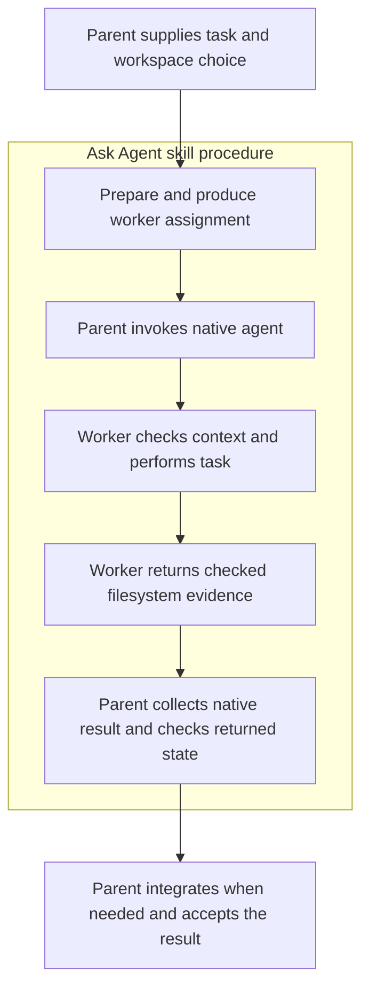

# Compact task interface

Use Ask Agent as the public skill. The parent supplies a task and workspace
choice; scripts perform the mechanical checks; native agents perform the work.
This is the normal standalone entry path. It reduces the command sequence the
parent and worker must assemble without adding a coordinator agent.

The existing [skill contract](../SKILL.md) still governs permissions, native
capabilities, fresh context, integration and acceptance. This interface supports
current-workspace editing/reviews and helper-managed patch/review work. Commit
delivery, consumer-owned workspaces and orchestrated callers retain their
existing interfaces.



The box groups responsibility. It is not a separate execution context: only
the native worker runs in a new context. Scripts never start models or wait for
agents. Preparation and filesystem evidence are not proof of native completion.

## Request

Bind the script from the **selected, loaded** skill card, as in
[package binding](workspace-operations.md#bind-and-verify-the-selected-package).
Prerequisites are Python 3 and Git for repository work. This command prepares
one task; it does not launch an agent:

```sh
SKILL_CARD="/absolute/path/to/the/selected/ask-agent/SKILL.md"
TASK="/absolute/path/to/the/selected/ask-agent/scripts/ask_agent_task.py"
python3 "$TASK" prepare --skill-card "$SKILL_CARD" --request - <<'JSON'
{
  "objective": "Implement the agreed price rounding rule in src/pricing.py",
  "expected_result": "The requested cases pass and the handoff names the checks run",
  "source": "/absolute/path/to/caller",
  "workspace": "current",
  "mode": "edit",
  "write_set": ["src/pricing.py"],
  "exclusive_writer": true
}
JSON
```

The example is illustrative: the parent supplies the real objective, expected
result, absolute source and narrow write set from the request. Add
`current_learnings` and `authorization` strings when the assignment needs prior
findings or applicable approvals. They carry context; they do not grant new
authority. Do not put credentials in them.

`workspace` defaults to `current`. `mode` is `edit` or `report-only`. Editing
requires a nonempty `write_set`; report-only work has no write set. Unknown
fields, unsupported modes and malformed inputs fail rather than select another
route. This is a single-task interface: prepare each independent task and retain
each result separately. It is not a batch scheduler.

Use exact normalized repository-relative file paths or directory prefixes in
`write_set`, such as `src/pricing.py` or `src/pricing/`. A trailing slash selects
the directory and its descendants; without it the path is exact. This interface
rejects glob characters (`*`, `?`, `[` and `]`) before
setup: it does not inherit the older helper's glob matching across directory
separators. Use `src/` for a recursive directory boundary.

On `READY_TO_LAUNCH`, retain `binding` in the parent's existing coordination
record and pass `launch.prompt` inline to a native worker. `launch.cwd` is the
verified workspace. These are host-neutral hints, **not a native tool's argument
schema**. Select the native agent and map them to the live host API, preserving
the complete assignment and fresh context. Retain the actual native handle.
Never shell-launch a child model. Read a failed preparation before dispatching.
`payload_sizes` reports binding, prompt and JSON byte counts. Output is never
silently truncated by the wrapper. If the host truncates a tool result, stop
before dispatch; verify the full assignment can be transferred. The advisory
20 KB warning concerns Grok's documented default Bash output limit, not a native
prompt limit or a host-neutral maximum. See the
[Grok settings reference](https://docs.x.ai/build/settings/reference).

## Workspace

| Choice | Parent precondition | Script behavior |
|---|---|---|
| `current`, `report-only` | Keep the checkout stable for meaningful drift checks | Capture a read-only baseline; create no worktree or receipt |
| `current`, `edit` | Declare `exclusive_writer: true`; only one writer in the checkout | Refuse overlap between the write set and existing dirty paths; capture a baseline |
| `worktree` | Explicit route choice and `writers_quiescent: true` during preparation | Verify package identity, prepare an isolated snapshot, and inspect it before dispatch |

For a separate worktree, change `workspace` to `worktree`, supply
`writers_quiescent: true`, and omit `exclusive_writer`. An optional absolute
`store` follows the existing helper's storage policy. Worktree editing uses
patch delivery. Separate worktrees are appropriate for simultaneous writers;
they are filesystem separation, not an operating-system sandbox.

The assertions about writers are statements by the parent, not locks acquired
by this wrapper. For current-workspace editing, pause parent checkout writes
until verification: changes outside the declared write set are drift, even
when the parent made them intentionally. Ignored build output is outside the
current-state fingerprint. Outside Git only a current report-only request is
supported, with an explicit warning that no drift check is available.

Every worktree starts from the current parent checkout's HEAD, with its staged
and unstaged binary Git patches applied separately, then its non-ignored
untracked inputs copied. Repository-root `.gitignore` and `.claspignore` are
always preserved when present, even if ignored/untracked. Their staged and
unstaged layers remain separate; absent or deleted files stay absent. Other
ignored dependencies are omitted, and preparation never silently recovers an
ambiguous previous attempt. `binding.workspace.ignored_dependencies_omitted`
forwards the exact omitted entries to the parent and worker, with a warning when
nonempty. Decide whether the task requires those inputs before dispatch.
Retain any receipt or failure locator
on error; inspect it before considering another preparation.

## Worker

Each worker receives the objective, scope, expected result, bound directory,
applicable context, binding JSON and exact start/finish instructions. It does
not need to reconstruct the snapshot or patch procedure. Supply that binding
as stdin to the selected task script:

```text
python3 /selected/ask-agent/scripts/ask_agent_task.py worker-start --binding -
python3 /selected/ask-agent/scripts/ask_agent_task.py worker-finish --binding -
```

These are separate calls with actual JSON stdin, not commands to run with empty
input. Start and finish run **from the worker's assigned directory**. A native
tool's workdir argument or an explicit shell directory binding must set it;
reporting a directory in JSON does not change process cwd. Use the bound
directory for later shell commands and absolute paths for file tools.

Start checks the actual operation context and package identity. A managed
worktree must still match its prepared state before task edits begin. The
worker then performs the task and appropriate tests, and runs finish. A failed
check stops the operation. Finish checks changes against the declared scope and
returns filesystem evidence. The worker returns that evidence with its actual
test results and conclusions; it must not substitute script status for doing
the task. Preserve inherited content and follow the assignment's Git limits.
The generated assignment prohibits further delegation by a current-workspace
edit worker. Where native delegates are permitted, they inherit the workspace,
scope and handoff constraints and must be collected before finish/return.
Report-only workers and their delegates make no filesystem changes.

Bindings are trusted parent coordination data, not signed authorization,
restart-safe job state, or a security boundary. Package checks detect a changed
selected implementation; they do not authenticate a native agent or prove it
followed its assignment.

## Acceptance

After collecting the actual terminal native result, the parent runs
`verify-return --binding -` with the same binding. Unlike worker start/finish,
this command may run outside the worker directory. It obtains fresh filesystem
evidence and rejects scope drift. It does not learn agent lifecycle state from
a result file or a caller-supplied success flag.

`READY_FOR_PARENT_ACCEPTANCE` means those filesystem checks passed. The parent
still evaluates the worker's answer and test evidence, verifies actual native
completion, and follows [Git integration](git-integration.md) for managed edits.
Integration is still a parent-owned operation; this interface never applies patches,
commits, closes worktrees or deletes evidence. Current-workspace edits are
already in place, so they need acceptance rather than a merge.

The parent reports success only after the requested outcome is verified and any
required integration is complete. Retain work and report the blocker if a gate
fails. Existing [cleanup rules](workspace-operations.md#close-after-acceptance)
apply only after acceptance and stopped-worker evidence.

## Failures

Errors include a stable code, expected and observed conditions, rationale,
reference and evidence locators, and a next action. Successful JSON is on
stdout; error JSON is on stderr with exit status 2. Reference paths resolve
from the selected skill package. Read the JSON status as well as the process
exit. Do not replace a failed operation with an unverified route
or silently retry preparation. Retained evidence is useful precisely because a
failed or incomplete operation stays distinguishable from a successful one.

This interface uses the same Git/Python helper on supported platforms and
leaves native tool mapping to the host. Offline tests validate script behavior;
live qualification requires retained native events for the exact tested
package and route. Neither offline tests nor a single live functional trial
prove a speedup or establish installation on another host.

From the repository root, run `python3 -B test/ask-agent-task.test.py` for the
focused fixture suite or `bash test/run-all.sh --group ask-agent` for the
registered component suites. Logs and source identity must identify the tested
candidate; a previous harness run is not evidence for this new wrapper.
