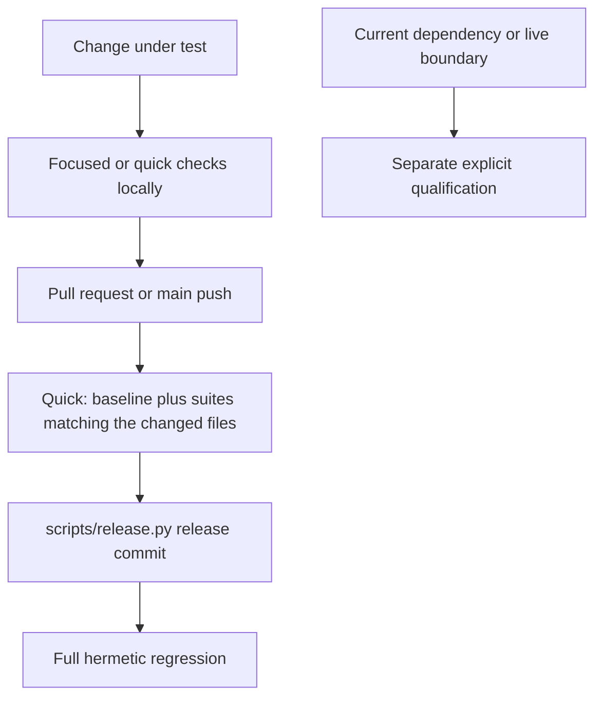

# Test runners

Use `bash test/run-all.sh --group quick --changed-from origin/main` for fast,
targeted feedback and `bash test/run-all.sh` for complete hermetic regression. Local runs and GitHub CI
use the same [suite catalog](suite_catalog.py). A pass means the selected checks
passed; offline fixtures do not establish live model or host behavior.

The hermetic runner sets `SHIPLOOP_PROGRESS=off` for ordinary suites so disposable
run fixtures do not leave background HTML observers. The progress integration
suite explicitly enables the default observer and stops its own processes.
For a focused non-progress suite, the same environment variable can suppress
automatic observation without changing workflow behavior.

Each suite also runs with a private `XDG_STATE_HOME`, and without an inherited
`UNTIL_LOOP_STATE_DIR` or `SHIPLOOP_KEEPALIVE_HOME`. A suite that leaves
anything in that home fails, and the failure names the files. Two stores live
there, keyed to the host session the suite runs in. Until Loop keeps session
stacks there, and a SessionStart hook offers an active one to the next real
session as saved work. ShipLoop's keepalive keeps per-session health records
there. A suite run inside a Claude Code or Grok session inherits that session's
markers. Without isolation, its records would land in the developer's
`~/.local/state` under the live session's key.

A suite that runs ShipLoop or Until Loop calls `state_home.isolate()` once at
module level, before anything copies `os.environ`. That gives the suite's
process, and every process it starts, a private `XDG_STATE_HOME`, so a focused
`python3 -B test/<name>.test.py` run is protected too. A private `HOME` alone is
not enough, because `XDG_STATE_HOME` takes precedence over it.

Backchain chunk regressions have two layers. `python3 -B test/backchain-chunks.test.py`
checks the evaluator against useful plans, deliberate corruptions, and actual Until Loop
complete/blocked transitions using authored reports. It does not call a model. Quick
runs select it when Backchain, its evaluator, or its fixtures change.

For live behavior, run `bash test/run-integration.sh backchain-chunks prepare --output /tmp/new-chunk-run`.
Execute each generated `request.md` in a fresh native agent with no parent history,
memory, prior results or expected answers; allow only its declared inputs, selected
skills and output directory. Each case uses the actual bundled Until Loop. Then run
`bash test/run-integration.sh backchain-chunks check --run /tmp/new-chunk-run`.
Preparation and checking launch no model. Missing output, changed inputs/source,
lost goals/confirmations, invalid branches and wrong terminal states fail the check.
The seven cases cover evals 17–22, including both routes in case 22; the historical
five-case outcome campaign and frozen efficiency study remain separate.

The checker reports mechanical evidence only. Independently inspect retained reviews
and final plans for useful boundaries, checks executable with their own suppliers,
source-linked mappings, audit permission for changed confirmations, and specific
recovery (including a new binding for draft replacement). Record that assessment
against the final candidate hash. A stopped missing-authority case is a passing
regression only when it preserves the inherited obligations and edit bounds and
truthfully reports incomplete planning with a usable recovery action.

| Selection | Command | Scope |
|---|---|---|
| Focused | `python3 -B test/<name>.test.py` | One module; useful while changing its contract |
| Quick | `bash test/run-all.sh --group quick [--changed-from REF]` | A fixed light baseline (3 core, the mock replay, 12 ShipLoop boundary suites) plus the light suites matching files changed since REF, uncommitted and untracked included |
| Prompt | `bash test/run-all.sh --group prompt [--changed-from REF]` | The four packet-size suites (`packet-completeness`, `step-packets`, `packet-recut`, `head-order`) and the packet obligation ledger (`packet-obligations`, whose anchors are literal prompt phrases), about 25 s, plus the light suites whose own files changed since REF: the loop while editing a ShipLoop prompt or packet source; quick is still the gate before a push |
| Ask-Agent component | `bash test/run-all.sh --group ask-agent` | Supported helper tests and ShipLoop consumers |
| Composition component | `bash test/run-all.sh --group shiploop-composition` | Chain and Improve integration boundaries |
| Full hermetic | `bash test/run-all.sh` | Core, all ShipLoop suites and the source E2E apparatus |
| Installed or live | `bash test/run-integration.sh --help` | Selected real host, engine, installed package or credentials; opt-in |



Pull requests and ordinary `main` pushes run the quick tier: the fixed baseline
plus the suites that match the changed files (a changed suite runs itself; a
changed file selects the suites named after it, so `shiploop_lint.py` selects
the `shiploop-lint` suite; a change under `skills/<leaf>/` selects the core
suites named after the leaf; a changed file under `skills/`, `agents/`,
`scripts/` or `test/` also selects the suites whose source, or a test helper
they import, names it, so `shiploop_navigator.py` and
`test/shiploop_*_support.py` reach their consumers; ShipLoop's `SKILL.md`,
`references/` and `commands/` select its packet, guidance and package-integrity
suites; its packet sources (`shiploop_prompts.py`, `shiploop_navigator.py`,
`shiploop_stage_spec.py`, `shiploop_loops.py`, `shiploop_narrative.py`) select the
packet-size suites and the packet obligation ledger beside their hub consumers;
and the `scripts/shiploop` entrypoint and `shiploop_protocol.py` select
every light ShipLoop suite). Suites measured above two minutes and the E2E
apparatus never run in quick. A pull request diffs from its merge base and a push
from the previous `main` head. Only a push that contains a release commit (its
`Skill-Craft-Release:` trailer), even under later ordinary commits, runs the
full tier. Manual dispatch offers `quick` (the last commit's
changes) or `full`. The `hermetic` aggregate requires both the planner and all
selected jobs to succeed; its summary states the tier and tested SHA.
Server-side merge protection is a separate repository setting; this workflow
does not enable it.

CI uses `ubuntu-latest`, latest stable Python 3 and latest stable Node, resolving
fresh versions through setup actions. Receipts record the versions actually used.
Chain and integration suites use the repository's own Plan Dispatcher package
(`skills/plan-dispatcher`), so a dispatcher change is exercised by them at once. Older
package versions are not kept: refusal cases mutate copies of current fixtures.

## Inventory, union and evidence

```sh
bash test/run-all.sh --list
bash test/run-all.sh --group ask-agent --group shiploop-composition --list
bash test/run-all.sh --group quick --changed-from origin/main --output /tmp/skill-craft-quick-unique
bash test/run-all.sh --group shiploop --list
bash test/run-all.sh --group shiploop-1 --list
```

`test/run-all.sh` is the only runner command; it has no ShipLoop-specific
flags. Repeated groups form a union: shared entries run once, in catalog order.
`--jobs N` runs up to N suites at once (default: the CPU count, capped at 8);
each suite is its own hermetic process, and its output, `OK`/`FAIL` line and
receipt record still appear in catalog order, so a parallel run prints what a
serial one prints and exits the same way. `--jobs 1` runs one suite at a time,
each started after the previous one is in the receipt. The closing line gives the
wall time and the three slowest suites, the floor no job count goes under.
Ctrl-C stops the suites already started. `--list` and help execute no suites. Listing prints one row per constituent
entry, with family, ID and command. `core`, `shiploop` and `e2e-apparatus` can
also run separately. The three `shiploop-1`/`2`/`3` groups partition ShipLoop using
checked-in duration estimates and a deterministic fallback. They are scheduling
slices of the same full inventory, not additional coverage.

The quick baseline is three core suites (`test-groups`, `ci-policy`,
`skill-frontmatter`), the apparatus's no-model mock replay
(`shiploop-mock-replay`, `check_suite.py --suite mock`: captured agent results
drive the real navigator, about two seconds) and ten ShipLoop suites
(`no-model-launch`, `navigator-contract`, `navigator-v4`, `stopped-improve`,
`packet-bounds`, `navigator-dry-run`, `status-display`, `narrative`,
`stage-spec` and `planning-handoff`).
The Ask-Agent workspace, delivery and managed-harness checks run in core.

An optional `--output` directory must be new and outside the checkout. It retains
source identity, runtime versions, selected/completed suites, outcomes, durations
and per-suite logs. The runner continues remaining selected suites after a
failure and returns failure overall. CI uploads these artifacts even on failure
and rejects source drift or new checkout artifacts except Python bytecode under
`__pycache__`. A separate `release-boundary` job runs
`scripts/check-release-boundary.py --base` over the pushed range. Running the
local suite alone does not perform these additional CI checkout and boundary
checks.

Full regression runs the source E2E apparatus with `check_suite.py --suite all`
once. Its named diagnostic groups intentionally overlap; do not concatenate them
to claim full coverage. Quick runs only its `mock` group, as partial evidence;
full also runs that group separately, which costs about two seconds. The copied-package mock in core remains separate because
it checks relocation and package binding. The apparatus uses synthetic evidence
and portable recorded source fixtures, with no model calls. The recorded GAS
products carry provenance and run everywhere; missing fixtures fail instead of
skipping a required regression case.

`shiploop-package-integrity` statically checks the ShipLoop package: every
relative Markdown link resolves, every reference is reachable by name from the
card, README, a command, script or hook, `host-hooks.json` names executable
scripts for known events, Python scripts compile and the OpenCode hook parses.
It runs in well under a second and reads files only.

## Check ShipLoop progress-view changes

Run these commands from the selected checkout, in order. Before editing, freeze
the comparison base below (or use the branch's agreed base commit). Keep that
SHA through delivery: resolving `origin/main` again after a push can omit the
changes being checked.

```sh
SHIPLOOP_TEST_BASE="$(git -C . rev-parse origin/main)"

python3 -B skills/shiploop-e2e-audit/harness/check_suite.py \
  --suite mock --skill-root skills/shiploop --list
SHIPLOOP_PROGRESS=off PYTHONDONTWRITEBYTECODE=1 \
  python3 -B test/shiploop-progress.test.py
bash test/run-all.sh --group quick --changed-from "$SHIPLOOP_TEST_BASE"
python3 -B scripts/check-release-boundary.py --base "$SHIPLOOP_TEST_BASE"
```

The first command validates and fingerprints the selected package's references;
`--list` executes no tests. Run it before the focused tests so malformed package
links fail early. The focused suite checks startup-link generation and the
observer/HTML contract. The quick tier checks affected consumers before pushing;
the final command checks the release boundary across the same range. A failed
check needs investigation before delivery.

These checks do not establish how a browser reloads an ordinary local file.
Use the [local-file browser checklist](../docs/plans/shiploop-progress-view.md#local-file-browser-check)
for that boundary and retain its results separately from automated test results.

## Fixture ownership and intentional overlap

| Boundary | Why its tests remain separate |
|---|---|
| Ask-Agent workspace / delivery / managed harness | Helper preservation, caller integration and synthetic host-event validation have different assertions |
| ShipLoop chain / lifecycle / async / planning context | Binding, worker lifecycle, concurrent callbacks and planning provenance fail in different ways |
| Navigator / action walk / full runtime | Synthetic state transitions, protocol traversal and copied-package public CLI execution are distinct checks |
| Improve standalone / actual CLI / stopped completion | Direct import, process transport and incomplete-settlement rejection need independent evidence |

Reusable lifecycle and consumer-contract setup lives in
`test/shiploop_*_support.py` modules. Navigator consumers import these
helpers directly; the dedicated actual-Improve-CLI fixture adapter remains in its
integration test. Each case still owns its disposable repositories and cleanup; expensive
setup is not shared across cases whose mutations could interfere. Pure convergence
predicates belong in the cheap contract suite. The audit found fixture coupling,
not accidental nested execution of whole suites; assertions were retained.

Every inner ShipLoop stage's `complete` checks an Until Loop receipt against the
contract rebuilt from run state (the 8-stage inner loop, 2026-10-10). A test that
drives an inner stage through the CLI finishes that stage's loop with
`test/shiploop_loop_support.finish_loop`, which runs the bundled runtime from
ShipLoop's own contract file; never write a receipt by hand. The loop contracts
and receipt checks themselves are covered by `test/shiploop-loops.test.py`.

A test that reads a packet's first lines (header, the `next` pointer, the `Full packet:` pointer, callback, owner rule,
goal, done-when) finds them with `test/shiploop_packet_view.assert_top_block`, by the constant or label that defines each
part, and asserts their order; never address one as `lines[header + 2]`. Where the callback sits (the third line after the
header, within 1,500 characters) is asserted by `assert_callback_after_pointers`, which one test calls over every stage.
A test that needs the packet file a print names uses `packet_file_named` (the path on the `Full packet:` line, which
every producer print carries) or `head_packet_path` (the file only when the print is a head of it). A test that reads the Until Loop block (its argument, exit
conditions or start command) uses `test/shiploop_loop_support.LoopBlock`. When a unit moves a part of the top block
it edits `TOP_ORDER` or a label in the helper once; the helper's negative self-test is
`TopBlockHelperTests` in `test/shiploop-packet-recut.test.py`. `unaccepted_outcomes` checks that every outcome a
packet or refusal tells the model to report is one its stage accepts.

## Local composition checks

`python3 test/shiploop-probe-decisions.test.py` checks the separate decision-driven
probe corpus and its thin frozen-study adapter without launching a model. It
calibrates evidence reuse, runtime drift, native/skill reuse, denied access, and
indeterminate outcomes; verifies candidate/arm identity and source integrity;
and checks blind evidence collection. Live prompt comparisons are explicit
experiments, not CI dependencies. See the
[probe-decision study](experiments/shiploop_probe_decisions/README.md).

`python3 test/shiploop-full-runtime.test.py` composes public ShipLoop and selected
bundled Until Loop CLIs across the protocol 4 graph, including cold recovery and
corrective outcomes. Its review judgments are synthetic: it proves local runtime
composition, not semantic Improve quality, live host execution, or deployment.
Copied-package cases exercise portable payloads from an unrelated CWD without a
marketplace installation. The guidance and packet-bounds suites check relevant
reference routing and recovery of large context from complete durable records.

`python3 -B test/shiploop-local-skills.test.py` is in the ordinary ShipLoop/CI
inventory. It regrades the ten archived local-skill observations from disposable
relocated copies, including the preserved ambiguous incident result, then checks
negative controls for wrong decisions or JSON scalar types, changed skill resources,
compatibility, index/authority links and contract relocation. It also verifies
that preparing a fresh trial retains skills but strips prior task outputs. This
tests the experiment apparatus; saved-output replay is not a new model evaluation.
The actual-Improve CLI suite separately protects both the cold handoff instructions
and child-resource durability. Fresh model trials remain
[explicit experiments](experiments/shiploop_local_skills/README.md).

The ShipLoop group includes opt-in consumer-delivery declaration checks, public
CLI compatibility/relocation tests, synthetic prompt/fake-boundary fixtures, and
temporary loopback HTTP checks of the browser fixture's distinct served cases.
The guard tests check retained requirements and declared observations, not the
truth of remote evidence. Fresh-context interpretation responses are a separate
bounded study, not a deterministic LLM gate or proof of Improve convergence.
See [consumer-delivery experiments](experiments/shiploop_delivery/README.md).

`python3 test/shiploop-auth-readiness.test.py` exercises the shared access-policy
locator and cold authentication-blocker recovery using synthetic host reports.
The navigator dry-run suite also checks that the policy remains reachable across
the real graph and pause/blocked routes. These tests prove packet wiring and
state continuity, not that an LLM asks promptly or that a live account is usable.
The [bounded interpretation check](experiments/shiploop_auth/README.md) records
ten fictional access scenarios and the stage-skipping ambiguity they exposed.

`test/shiploop-auth-readiness.test.py` also checks that navigator packets carry the
selected package's Environment lifecycle policy and this run's lifecycle note
locator. It uses synthetic declarations: it does not prove that a host selected
all prerequisites, created a sandbox, or promoted a live candidate.
The [environment interpretation study](experiments/shiploop_environment/README.md)
records three fictional topology cases and the planning-versus-execution
ambiguity corrected through a fresh-reader follow-up.

`python3 test/experiments/shiploop_ui_allocation/test_evidence.py` checks the
UI-planning study's evidence reader with hermetic corruption controls. It
distinguishes explicitly synthetic predecessors from archived Improve imports,
validates archive identities, and reports the current inner action. These checks
do not run a model/browser or establish the truth of review judgments. See the
[UI allocation study](../docs/shiploop-ui-planning-allocation-2026-09-18.md).

`python3 test/shiploop-cross-run.test.py` checks new-request versus repeated-init
identity across protocols, terminal-run preservation, fresh-run isolation, and
cold packets' persistent knowledge locators. The navigator dry-run suite covers
those locators across stage/recovery routes. These are routing tests, not proof
that an LLM read or correctly reused a historical environment document.
The [cross-run interpretation check](experiments/shiploop_cross_run/README.md)
records four fresh-reader scenarios and the boundaries actually observed.

`python3 test/shiploop-workspace.test.py` uses disposable real-Git repositories
to check dirty-baseline capture, source-index preservation, candidate-bound path
review, transient-history rejection, guarded clean/dirty return, and the
workspace-mode handoff gate. It never merges the source checkout running the
test. [Workspace experiments](experiments/shiploop_workspace/README.md) explain
why starting at HEAD and deleting transient files at the tip were insufficient.

`python3 test/shiploop-return-review.test.py` drives the real CLI through how a
model reviews and returns an isolated run: the blocked return names its undecided
paths and the `review-return` verb on its first line, one verb records the
decisions (no hand edit of `return-plan.md`), a fresh plan keeps them, and each
return kind is predicted before it happens and undone by the rollback recipe the
packet prints (the recipes are run through `sh` against real Git). It is a
separate suite because the workspace suite is above `QUICK_MAX_SECONDS`; its
Git calls ignore the machine's Git configuration, as a CI runner's carries
git-lfs filters that the workspace refuses.

`python3 test/shiploop-handoff.test.py` checks the consumer contract's engine
data: the whole-file quotes, the entries, the run baseline and its spec diff,
the lessons commit and its quote at the next intake, the hand-off fields and
their gates, the open items and `CONSUMES`. Its `LessonsReturnTests` drive the
real CLI through an isolated run: the empty lessons commit returns to the
source branch (X1), handoff makes no retire commit and leaves an older
version's feature folder untouched. The handoff retire and its suite were
removed with the feature folder (consumer contract, slice 4c).

## Skill and script execution boundary

`shiploop-no-model-launch.test.py` exercises the packaged CLI with model-binary
tripwires. Ordinary initialization and recovery stay in the invoking conversation,
and the removed `drive` command must fail without launching a model. The package
must not contain the retired controller or host transports. This boundary test
belongs to the required ShipLoop aggregate.

The retained context-reset experiment records describe historical trials of the
removed controller; they are not current invocation instructions. Real model
launches for ShipLoop evaluation belong to the external E2E harness.

## Explicit integration targets

### Offline experiment apparatus versus live product verification

The [generalized-discovery study](experiments/shiploop_generalized_discovery/README.md)
has a hermetic wrapper, `python3 test/shiploop-generalized-discovery.test.py`,
registered once in the ShipLoop inventory. Its synthetic tests check apparatus
contracts; they do not reproduce the original model trials. Private raw study
evidence is not part of the published fixture set.

The [ShipLoop E2E harness](../skills/shiploop-e2e-audit/harness/README.md)
separately supports offline observer, receipt, game-oracle, and synthetic-host
checks:

```sh
python3 skills/shiploop-e2e-audit/harness/check_suite.py --suite regressions
python3 -m unittest discover -s skills/shiploop-e2e-audit/harness -p 'test_*.py'
```

These no-model apparatus checks are independent of live Grok runs. Retained
external-product cases are explicitly opt-in and reported as skipped when their
fixtures are unavailable; those skips do not establish product behavior. The
aggregate full-runtime test also exercises one real protocol 4 intake prefix
through synthetic host-stream observations. Neither synthetic observations nor
an offline suite pass proves model compliance, a working hosted game, or a
deployment. Live host/browser/MCP tests remain explicit authorized experiments,
not default CI dependencies.

The core `installed-skill-invocation` check includes the bundled mock path from
an empty unrelated directory, covering marketplace-style audit binding without
launching a model. Live Grok audits remain separate opt-in E2E work: use the
audit harness's `xhigh` setting and its 7,200-second cap, then assess retained
stdout/stderr and product evidence independently of quick or full hermetic CI.

### Host and environment targets

Integration checks never run as a default dependency of the hermetic aggregate.
Discover their names and requirements before selecting one:

```sh
bash test/run-integration.sh --help
bash test/run-integration.sh --list
bash test/run-integration.sh weather-offline
bash test/run-integration.sh weather-live
bash test/run-integration.sh cursor-imports
```

Do not put secret values in commands, CI configuration, output, or fixtures.

## Evidence boundaries and CI

Self-contained mocked install tests establish installer behavior only. They
do not provide an actual host runtime, engine availability, live-host execution,
or certification. A green hermetic aggregate has the same boundary. Hermes is
not part of any test tier: no suite installs into or asserts on Hermes, even
though `install.sh` still supports it.

CI selects its tier with `test/ci_policy.py`, as described at the top of this
guide: pull requests and ordinary `main` pushes run `quick`; a release commit
runs full. It ignores tag and feature-branch pushes. A manual dispatch accepts
`tier=quick` (the default) or `tier=full`. Full runs
`core`, the three deterministic ShipLoop shards and `e2e-apparatus`, one job per
group. Select qualification by changed behavior and dependencies:
runtime, state, graph, callback and recovery changes need their affected suites.
Use full dispatch only when a concrete cross-subsystem risk cannot be covered by
narrower checks, and record that reason. Start it against the candidate branch with:

```sh
gh workflow run ci.yml --ref <candidate-branch> -f tier=full
```

Before treating that run as qualification evidence, check that its tested SHA
and tree still match the final candidate. A manual full run is qualification
evidence; it does not replace the required pull-request quick check. Delegate
established-suite execution through **test-runner**, supplying exact source/run
identity, commands, expected evidence, deadline and retry policy; the parent owns
selection and diagnosis. Do not repeat local full, PR full, and post-merge full
runs for an identical tested tree. Preserve the tested SHA/tree and select checks
for changed bytes instead of invalidating unrelated evidence.

`release-push.test.py` uses disposable Git repositories and a bare remote to
prove that failed preconditions, changed candidates, dirty files and remote races
cannot publish a divergent release through the guarded push command. These are
publication-control tests; they do not establish GitHub branch-policy compliance.

`release-preflight.test.py` (core) runs `release.py` in disposable repositories
to prove that a release shipping ShipLoop is refused, as a dry run and for real,
unless a commit since the last release touches the E2E `LEARNINGS.md` or carries a
`No-E2E-Round: <reason>` trailer.

`release-flow.test.sh` and `release-boundary.test.sh` (core) cut releases and
run the release guard in disposable repositories. The guard checks each release
commit out in a temporary worktree and requires its
`sync-plugin-views.sh --check` to pass there; ordinary commits need a
`changes/<leaf>/` note for each skill or agent card they change, may not delete
a note pending at the base, and at HEAD must leave notes that `release.py`
accepts. `plugins/` is release output and lags source between releases, so
package tests read a fresh `scripts/build-packages.py` build through
`test/package_build.py` (reuse one with `SKILL_CRAFT_PACKAGES`).

A newer run for the same pull request cancels the superseded run; main-push and
manual runs use unique concurrency keys and are never cancelled by this policy.
CI resolves the latest stable Python 3 and Node through its setup actions
(`check-latest`) and preserves the existing `hermetic` status as an aggregate gate. Failed, cancelled or skipped required groups cannot
make that gate pass, and neither can a failed `release-boundary` job.
Each selected test job runs `test/ci_policy.py guard` after its suites, even after
a suite failure. It rejects a moved HEAD, staged or unstaged
tracked-file changes, and untracked or ignored files other than Python bytecode
under `__pycache__`. The worktree and index are checked separately so restoring
a working file cannot hide its staged changes. Checkout-local bootstrap pins are
generated in temporary directories, not rewritten into source fixtures. The guard
is not a sandbox: it inspects only the checkout, after the suites finish.
CI does not inject secret values or make any integration target mandatory.
The small Linux-only CI footprint is intentional; it is not macOS or live-host
certification. Local checks may use other Python/Node versions.

Explicit runtime setup follows [GitHub's Python guidance](https://docs.github.com/en/actions/tutorials/build-and-test-code/python#specifying-a-python-version)
and [setup-node's version guidance](https://github.com/actions/setup-node#usage).
This repository needs no pip/npm application dependencies for these tests.

The ShipLoop group also runs the capability-study fixture, runtime/collector and
local async-client regressions. They use synthetic data, temporary files and
loopback services without credentials or installed MCP servers. The actual
macOS sandbox/CLI preflight is an explicit experiment check; a hermetic pass does
not establish that host-specific boundary. See the
[capability apparatus](experiments/shiploop_capabilities/README.md).

Review Coverage now distinguishes residual-review convergence from final
delivery verification. Its [Finalization contract](../skills/review-coverage/SKILL.md#finalization-after-completedlanded-review)
requires current evidence after cleanup, with a concrete manual result when
automated tests are explicitly N/A. `test/review-coverage.test.sh` checks that
contract across source instructions and emitted goal/run packets; it does not
prove that every host or model executes the instructions correctly. This guide
does not claim that all documentation or quality debt is closed.

## Marketplace package and consumer gates

The core group runs `marketplace-package`, `installed-skill-invocation` and
`prompt-marketplace-contract`. These check all generated native payloads, execute
bundled helpers from copied read-only package trees (including paths with spaces),
and check prompt dependency/capability contracts. They do not run model benchmarks.

`installed-skill-invocation` also runs Plan Dispatcher
(`plugins/skill-craft/skills/plan-dispatcher`) from a read-only copy. The
core `plan-dispatcher-state`, `-cli`, `-progress`, `-planning-context` and
`-compound` suites exercise `skills/plan-dispatcher` directly or from a cold
copy, with a deterministic fake host (`test/fixtures/plan-dispatcher/`); they
launch no native agent or model. The current-Dispatcher qualification below is
unchanged: it still takes an explicit external checkout.

`bash test/run-integration.sh marketplace-claude|marketplace-grok|marketplace-codex`
means choose **one** named target. Each requires that real CLI and uses a temporary
local catalog and disposable profile with an allowlisted environment. The test
installs the Skill Interop helper, exercises it after installation, then installs,
runs and removes Review Coverage. No ambient provider credentials are inherited,
no model call is made, and no personal plugin state should change. These checks
prove local installed behavior only, not that a published release serves these
bytes, nor public review.

`bash test/run-integration.sh marketplace-codex-ask-agent` exercises the complete
local Ask Agent plugin in a disposable Codex profile. It compares every package
file, verifies the selected card/helper identity, captures staged, unstaged and
untracked inputs from a linked caller worktree, archives a report, closes and
replays cleanup, and verifies that caller HEAD, index bytes and files survive
unchanged. Helper calls retain the disposable profile while removing Git-context
overrides that the workspace helper correctly rejects. The plugin is then removed
and its installed inventory checked; cache deletion is not required.

The core `marketplace-host-isolation` suite covers that same consumer flow with
a fake Codex CLI that materializes a real package copy. It is hermetic coverage of
the test apparatus and installed helper boundary. The opt-in target uses the real
CLI; neither target invokes a model or proves native task return or published
marketplace catalogs. Verify the published release commit, and each
commit-pinned plugin in `catalog/external-plugins.json`, separately.

### Navigator protocol 4 and actual Improve

`shiploop-navigator-contract.test.py` and `graph-dry-run` exercise the current
protocol 4 contract, including universal child handoffs and correction routes with synthetic receipts.
`shiploop-standalone-improve.test.py` and `shiploop-actual-improve-cli.test.py`
exercise the real bundled Until Loop runtime and parent import/recovery boundary.
Their review judgments are fixtures; they do not prove a live model followed
Improve. The implementation validation report records separate live skill trials.

The consumer-owned regression also checks that real child completion leaves the
parent pending and the candidate edits in place until parent import. Its
judgments remain synthetic. The opt-in
[`ask_agent_improve_native` fixture](experiments/ask_agent_improve_native/README.md)
requires an actual fresh worker, real reviews/checks, native stop/collection and
guarded final caller delivery; it does not launch models from a shell.

## Ask Agent live handoff experiments

The [parallel worktree experiment](experiments/ask_agent_parallel_worktrees/README.md)
provides reusable offline controls and explicit live suites for a Grok parent
delegating known work to three or five native workers. Its compact treatment
exercises the production task interface, including worker-side scripts, dirty
parent snapshots, isolation and contribution integration. Run its offline
facade with `python3 -B test/ask-agent-parallel.test.py`; it is also in the
`ask-agent` group. Live runs retain native and filesystem evidence separately.
The [script contract](experiments/ask_agent_parallel_worktrees/CONTRACT.md)
defines portability, diagnostics and evidence-preserving retry rules.

The managed-workspace helper and delivery contract have focused hermetic suites:

```sh
python3 -B test/ask-agent-workspace.test.py
python3 -B test/ask-agent-delivery.test.py
python3 -B test/ask-agent-managed-harness.test.py
python3 -B test/ask-agent-parallel.test.py
python3 -B test/ask-agent-task.test.py
```

These run in `core`. They exercise real Git preservation and contribution
delivery, plus synthetic adversarial native-event records. A synthetic callback
does not establish live host behavior. The
[managed-workspace apparatus](experiments/ask_agent_managed_workspaces/README.md)
qualifies current native hosts separately with frozen packages, actual worker
identities, helper receipts, operation roots, terminal outcomes, parent work,
acceptance, and retained artifacts. OpenCode's persistent TUI, one-shot lifecycle,
and process-local experimental flag are distinct qualification cases.
The [cross-harness conformance cases](experiments/ask_agent_managed_workspaces/CONFORMANCE.md)
specify shared outcomes, host-specific negative controls, activation/profile
boundaries, cancellation, live parent steering, and setup/teardown. The managed
suite parameterizes normalized lifecycle and rejection cases across all five
hosts, executes the generated inspection arguments against the real helper,
and reports parent final-response evidence separately from Task completion.
Raw native dispatch/freshness and actual child-tool provenance remain live
qualification responsibilities; synthetic events do not validate those APIs.

The [compact task interface](../skills/ask-agent/references/task-interface.md)
is the normal standalone parent/worker path around the existing helper. Its
`ask-agent-task` suite is also in the `ask-agent` group. It checks real current
and managed workspace behavior without launching a model. The wrapper prepares
assignments and checks filesystem evidence; native collection, integration and
semantic acceptance remain parent responsibilities.

The [W1 worktree fixture](experiments/portable_delegation/usability/worktree-handoff/README.md)
is a record of the retired caller-prepared worktree contract. Its operator helper
and offline regression suite were removed; the redaction, ordering and archival
checks that still apply now live in `test/ask-agent-managed-harness.test.py`. The
[U18 results](experiments/portable_delegation/usability/WORKTREE-RESULTS.md) retain
native successes, behavior failures and invalid/interrupted attempts separately.

The [Git integration plan](experiments/portable_delegation/usability/INTEGRATION-PLAN.md)
and [native integration fixtures](experiments/portable_delegation/usability/integration/README.md)
exercise parent-owned integration, worker synchronization/conflict repair,
fresh-parent recovery from a self-contained handoff, and shared-checkout
preservation. They are opt-in prompt/fixture recipes, not a custom dispatcher
or deterministic claim that every host follows the skill.
The [monitoring case](experiments/portable_delegation/usability/monitoring/README.md)
checks multiple pending jobs, visible launch/return notices, waiting status and
broad general-purpose worker selection. Timing is measured only when it occurs
naturally; full parent-child tool parity is a separate, host-dependent claim.
The [follow-up case](experiments/portable_delegation/usability/monitoring-followup/README.md)
checks the explicit pre-idle native status choice and unsupported-route disclosure.

The [Ask Agent protocol - native handoff: cases and candidate-specific criteria](experiments/portable_delegation/usability/HANDOFF-CASES.md)
covers background continuation, parallel success/blocker returns, inline results
when writes are forbidden, and simulated report failures. The
[replay fixtures - exact prompts: opt-in native harness runs](experiments/portable_delegation/usability/handoff/README.md)
need no custom dispatcher. These live experiments are separate from hermetic CI;
the [results - host evidence: outcomes and retained limitations](experiments/portable_delegation/usability/HANDOFF-RESULTS.md)
distinguish native behavior, correctness, context volume and cleanup.
