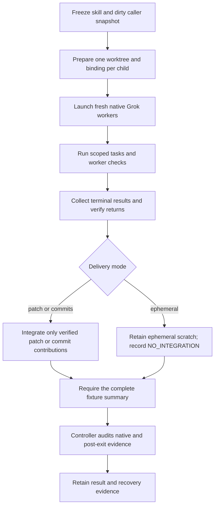

# Parallel Ask Agent worktree experiments

This test harness measures a real Grok parent delegating deterministic work to
three or five native agents. Each child receives a distinct helper-managed Git
worktree copied from the caller's dirty linked worktree. Patch and commit cases
import only verified worker contributions; ephemeral cases retain scoped
scratch changes in child worktrees and do not integrate them.



The external controller starts only the parent. Ask Agent and Grok's native
tools own child preparation, launch, and collection. This apparatus is not an
Ask Agent runtime implementation, scheduler, or integration plugin.

## Run offline checks

From the repository root:

```sh
python3 -B test/ask-agent-parallel.test.py
bash test/run-all.sh --group ask-agent
python3 -B test/experiments/ask_agent_parallel_worktrees/suite.py --list
```

Offline tests exercise real disposable Git repositories and synthetic native
events. They make no model calls. A synthetic pass is not live-host evidence.

## Run a live suite

Prerequisites: Git, Python 3.10 or newer, and an already authenticated Grok Build CLI with
native background subagents and prepared-cwd binding. The controller resolves
and hashes the installed executable. It does not install tools, modify global
configuration, or add integrations. Live runs use the existing Grok profile and
may incur model charges.

```sh
python3 -B test/experiments/ask_agent_parallel_worktrees/suite.py \
  --suite smoke --live --output /absolute/new/experiment-directory \
  --model grok-4.7 --effort medium
```

The output directory must be new. Use a persistent location outside the source
checkout and host automatic-cleanup directories. Live fixture actions are
automatically approved for the test process; the prompt confines them to the
disposable repositories and evidence directory. This is not an OS sandbox.

| Suite | Purpose |
| --- | --- |
| `harness` | Offline fixture, mutation, conflict, retention, and native-evidence checks |
| `smoke` | One three-worker parallel trial |
| `functional` | Controlled three-worker overlap and five-worker independent integration |
| `timing` | Repeated three-worker parallel/sequential and five-worker parallel cases |
| `optimization` | Counterbalanced baseline and batched-prompt trials at three and five workers |
| `scripted` | Repeated baseline versus scripted setup/integration at three and five workers, plus sequential controls |
| `packet` | Exact script-generated briefs with three/five workers, a sequential control, and a repeated three-worker case |
| `compact` | Production task-script prepare/start/finish/verify-return with three/five-worker trials, repeats, and a sequential control |
| `compact-comparison` | Two counterbalanced three-worker compact/baseline pairs, followed by one five-worker compact scale check |
| `delivery-qualification` | Dirty-parent commit delivery at three and five workers, followed by a three-worker findings-only ephemeral case |

Use `--case NAME` to select one case from a suite. `--skill-root PATH` freezes an
explicit candidate; otherwise preparation finds this repository's Ask Agent
source. `--grok-binary PATH`, `--model`, and `--effort` select the tested host.
The `packet` treatment generates complete native tool arguments and a deterministic parent oracle in Python. Treatment version 4 also scripts worker start/finish checks to shorten briefs and uses the frozen script contract for mechanical route details after reading the selected skill card. It explicitly tests this alternative to repeated appendix interpretation; it is not the unchanged prompt-only workflow.

The `compact` treatment retains full production prepare results and binding JSON on disk, then emits one bounded native assignment at a time. Each child invokes fixture wrappers that call the production `worker-start` and `worker-finish` commands once each with its retained binding; the native audit requires those calls in the child transcript and their successful raw command records. After collection, the parent runs production `verify-return` before the existing guarded integration operation. Compact fixtures seed a dirty `.gitignore`, ignored root `.claspignore`, and unrelated ignored input to check root-control preservation and unrelated-input omission. This measures the compact API plus fixture instrumentation, not production-only speed.

## Commit and ephemeral delivery qualification

Run the dedicated suite with a new retained output directory:

```sh
python3 -B test/experiments/ask_agent_parallel_worktrees/suite.py \
  --suite delivery-qualification --live \
  --output /absolute/new/experiment-directory \
  --model grok-4.7 --effort medium
```

The suite runs `commit3-a`, `commit5-a`, then `ephemeral3-a`. Each case uses
parallel workers, no deliberate hold, and the same dirty-parent and
ignored-control seed.
It stops on the first failed or incomplete case and leaves later cases `NOT_RUN`.
To rerun one case after diagnosing a failure, use `--case commit3-a` (or the
desired case name) and a different new output directory.

Commit cases test the production default: the compact task request omits
`delivery_mode`, while its returned binding must contain
`task.delivery_mode: "commits"`. The fixture's explicit commit-case selection
sets the expected route; it does not set that request field for the worker.
The worker commits only its assigned module after private snapshot `S`. Worker
3 first runs `python3 -B checks.py --worker 3` in its own terminal call, then
shows its commit proof as three separate native terminal calls between the
start and finish wrappers, using its emitted absolute worktree path:

```sh
git -C '/absolute/path/from-worker-3-assignment' add -- 'src/step_3.py'
git -C '/absolute/path/from-worker-3-assignment' commit -m 'Ask Agent fixture worker 3'
git -C '/absolute/path/from-worker-3-assignment' rev-parse HEAD
```

The calls are separate: do not chain them or add other shell output. The
worker reports the SHA printed by the final command in its handoff; it must
match worker 3's committed `S..C` contribution. These calls follow the required
worker task check and precede the finish wrapper. In both commit cases the parent
imports only verified contribution diffs into the dirty caller; worker commits
and private snapshot commits remain in the retained child worktrees. The
caller's original `HEAD`, index, and inherited dirty content stay preserved,
and the combined fixture checks still have to pass.

The ephemeral case permits scoped scratch changes in retained worker worktrees.
After worker verification the parent runs `finish-ephemeral`, which records
`NO_INTEGRATION`; do not run `integrate-batch` for this case. It does not import
worker files, create a patch, or cherry-pick commits. The fixture requires the
caller to remain unchanged.

After commit integration or ephemeral finalization, the parent runs this in a
separate native tool call:

```sh
python3 -B /absolute/run/operator/fixture.py verify \
  --run /absolute/run --summary
```

The output is a gate only when the command exits zero and stdout is one complete,
untruncated JSON object with schema
`ask-agent-fixture-verification-summary/v1`, a nonempty `run_id`,
`passed: true`, empty `errors`, positive `check_count`, and empty
`failed_checks`. Truncated, extra, or missing output is not a pass. The full
`operator/verification.json` remains available for diagnosis; the external
controller still performs the separate native and post-exit audits. This suite
defines the qualification procedure, not evidence that any case has passed.

The opt-in `compact-comparison` order is `compact3-a`, `baseline3-a`, `baseline3-b`, `compact3-b`, then `compact5-a`. Every case is parallel with zero hold and uses the same compact ignore-control seed, including baseline cases; the optional `--seed-feedback-backlog` flag applies uniformly and both seed values are recorded in `suite-result.json`. The repeated three-worker pairs provide an initial matched comparison, while the single five-worker compact case is a scale check. This small campaign does not establish a general speedup or an optimal workflow.

That comparison and earlier patch/current-edit trials remain separate evidence;
they do not qualify commit delivery or ephemeral findings-only behavior. Runs
without the required native and post-exit records remain incomplete under the
current acceptance rule. The delivery-qualification procedure above is not a
claim that its cases, or a new release or installation, have passed.

The `scripted` treatment bundles script-owned preparation, guarded patch integration, and compact prompt guidance. It is a workflow comparison, not a causal measurement of setup alone.

Every retry gets a new output directory; no failed attempt is overwritten.
The suite stops on its first unsuccessful case and retains the remainder as
not run.

The current local Grok profile contains an async-suite SessionEnd hook that can
create `tasks/in-progress/prompt-improvements-backlog.md` after model completion.
The first pilot detected that late mutation. For a matched experiment in such a
profile, `--seed-feedback-backlog` explicitly seeds the observed header as tracked
baseline content. This does not disable hooks or exempt that file from checks;
any subsequent mutation still fails. Record this fixture variant in comparisons.
Do not infer that another host has this hook. The normal unseeded case remains
available to expose ambient writes.

## Script contract and failures

Read [CONTRACT.md](CONTRACT.md) for command phases, schemas, evidence precedence,
portability, and recovery. The fixture and mechanical operations use Python's
standard library and Git; the native adapter is explicitly Grok-specific. Current
managed-helper dependencies make macOS/Linux the target platforms; Windows is
not qualified. No personal filesystem paths are embedded in the apparatus.

Operational errors emit `ask-agent-diagnostic/v1` JSON to stderr, with stable
codes, expected and observed values, rationale anchors, direct evidence paths,
and retry guidance. Verifier diagnostics cite exact JSON fields or native log
lines and hash bounded evidence files. Unknown evidence produces a warning and
blocks a strict pass. Usage mistakes exit 2; failed qualification exits nonzero.
Successful exit from one phase is never the whole-run verdict.

Setup and integration each reserve one attempt. A conflict retains immutable
patches and any prior applies; scripts do not retry, roll back, or overwrite a
failed attempt. A fresh run is the default after reconciliation. Native re-audits
preserve the previous report and record the auditor's exact implementation hash.

## What the fixture verifies

The caller is one commit ahead of `main`. It contains a file with separate
staged and unstaged edits, a staged addition, an unstaged deletion, and an
untracked input. The primary checkout stays unchanged. Every child must inherit
those layers and use a different real Git root and index.

Worker `i`, numbered from one, changes only `src/step_i.py` to implement
`transform(x) = (i+1)*x + i*i`. Separate oracles check each module on negative,
zero, positive, and large integer inputs. A pipeline applies all transforms in
ascending task order; completion order cannot change the expected result.

Each worker writes its unique value to the same relative ignored marker path.
Start and finish probes check that value and all non-owned source files. The
controlled-overlap case holds those writes long enough to measure intersecting
child intervals. Deliberate holds are instrumentation, excluded from throughput
comparisons.

Patch cases apply immutable baseline-relative patches without staging them;
commit cases import only verified contribution diffs from worker commits; and
ephemeral cases record `NO_INTEGRATION`. Verification checks the exact permitted
path changes, matches integrated bytes to worker outputs for edit delivery, and
preserves the caller's original Git layers. Distinct worktrees prevent
accidental shared-checkout writes; they do not prevent an agent deliberately
accessing other paths or shared Git references.

## Evidence and interpretation

Each run retains `manifest.json`, the frozen package, caller and child
worktrees, helper receipts and patches, probe records, original parent prompt,
raw streaming output, monotonic elapsed observations in current controllers, process exit, native trace,
usage, filesystem verification, and native verification. The controller checks after the parent process exits, including session-end effects. Suite results
require both verification layers before reporting a complete pass. The HTML report
also requires the controller integrity and post-exit gate records; historical
runs missing those records remain incomplete under the current acceptance rule.

Native evidence binds launches and terminal collection to the same root
session. Missing, mismatched, or unavailable native evidence is incomplete,
even when the resulting files are correct. File existence, a worker success
message, or process exit zero alone is insufficient.

The fixture is intentionally tiny: it measures orchestration overhead, not
realistic feature-development speedup. Report all trials, compare matched
repetitions, and retain model/effort, package, prompt, executable, and apparatus
identities. Native task lifetime overlap is different from CPU parallelism.
Offline conflict and missing-worker controls establish verifier/Git behavior;
they do not establish live-host cancellation, failure recovery, or restart
survival.

Worktrees are intentionally retained for audit. Do not remove unaccepted work.
When all native consumers have stopped and evidence is archived, use the
selected Ask Agent helper's documented acceptance and close workflow.

## Render retained trials

After a suite finishes, render a standalone report from explicit run directories:

```sh
python3 -B test/experiments/ask_agent_parallel_worktrees/report.py \
  --runs /absolute/campaign/packet3-a /absolute/campaign/packet5-a \
  --output /absolute/report.html
```

The report preserves failed, unknown and incomplete verdicts, links their raw
records, and separates before-dispatch, worker/collection, and post-collection
time. Generated HTML and JSON are analysis artifacts; neither substitutes for
the frozen native and filesystem evidence.
