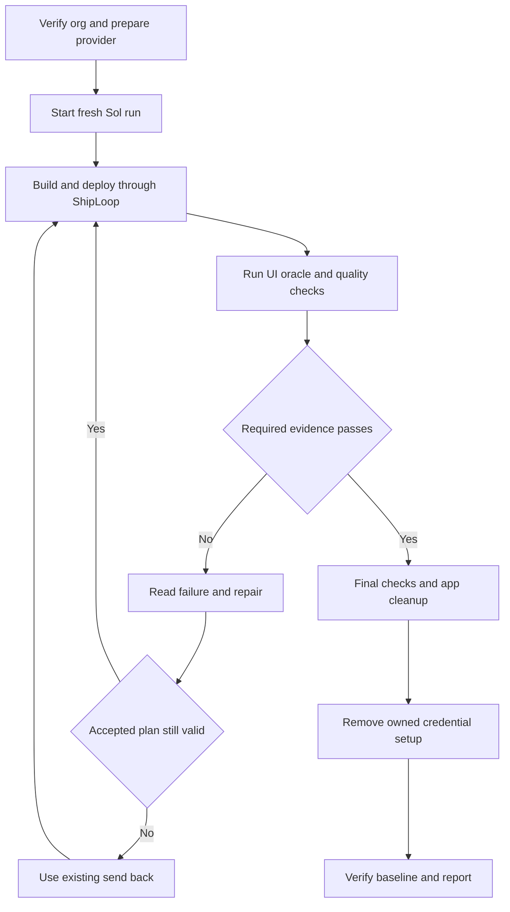

# Full Salesforce Grok chat acceptance

Use `grok-chat-salesforce-full` for a fresh build that must demonstrate authenticated UI access, live provider calls, real Salesforce tools and confirmed record changes. This is an opt-in extension of [the exploratory case](GROK_CHAT.md), which remains unchanged and still reports its behavioral acceptance gap. The authoritative prompt and commands are in [cases.json](cases.json); this repository supplies no chat application.

## Prepare the outer environment

The operator must have explicit authorization for org `de`, synthetic app records and credential setup. Check the actual org identity and inventory first. The `SLGrokChat` prefix must be free; preserve prior run evidence and resolve an earlier cleanup failure before reuse. Do not delete an unrelated app to make space.

Attempt the UI through discovered tools, preferring Chrome DevTools. Authenticate only when needed. The bounded `grok-chat-ui` helper uses the authorized Salesforce CLI session, passes its frontdoor URL to the browser through stdin, and returns closed evidence. It does not give the builder a raw authenticated browser endpoint or session secret. A supported Chrome and Playwright runtime must already be available.

Configure the existing provider key in the encrypted External Credential behind `Grok_Chat_Model`, with endpoint `https://api.x.ai`. Assign only the required principal and credential access to the test user through an operator-owned permission set outside `SLGrokChat`. Validate the supported `grok-4.7` model and an actual callout before launching. Save a credential-free resource ownership ledger. Never revoke an existing user key as test cleanup. Salesforce's [Named Credential guide](https://developer.salesforce.com/docs/platform/named-credentials/guide/get-started.html) describes this separation.

Do this before the harness snapshots the org. The subject still cannot read or change secrets, principal grants or credential metadata. Remove `XAI_API_KEY` from the subject environment and verify it stays absent in the isolated host. Do not paste a key into the case prompt, source, logs or screenshots.

## Run and attend the loop

Publish and verify the test apparatus before a marketplace run; record its revision separately from the installed ShipLoop version. Use fresh output and baseline paths:

```sh
env -u XAI_API_KEY python3 -u -B test/shiploop_e2e/run.py \
  --case grok-chat-salesforce-full --host codex \
  --model gpt-6.1-sol --effort high --source marketplace \
  --output /absolute/path/to/new-full-run \
  --baseline /absolute/path/to/full-case-baseline.jsonl
```

The same command with `--preflight-only` checks readiness without launching the subject. Do not pass `--prompt`: it replaces the named case and loses its platform hooks. Do not use `--keep-platform`; this case requires cleanup.



*Failures feed the existing Until Loop; setup, independent review and cleanup remain attended operator responsibilities.*

Before each full UI check, the builder successfully deploys the entire `force-app` directory through guarded `sf project deploy start --source-dir force-app --target-org de --wait 10 --json`. This case opts into before/after source hashes on that deploy's receipt; a later partial deploy, changed source, interrupted command or missing receipt cannot earn UI credit. Keep `.forceignore` absent or comment-only and nondeployable local test helpers outside `force-app`, so an exclusion cannot hide an undeployed LWC. This attests the submitted complete source around a successful command, not protection against a hostile process changing and restoring files during it.

The builder runs `grok-chat-oracle`, `grok-chat-ui --mode run` and `grok-chat-quality` along with its linters and tests. Ordinary repairs stay local to the accepted plan. Invalid plans, criteria or commands use ShipLoop's existing send-back mechanism. There is no new workflow stage or loop limit.

The operator monitors `platform/grok-chat-quality/*/request.json`. Review the exact source identified there independently of the builder, retain findings with file locations, and write the schema required by [the quality checker](checks/grok_chat_full_quality.py) to its sibling `review.json`, with hashed evidence files. Evaluate code, errors, comments, tombstones and tests. Useful invariant and failure-path explanations matter; a comment count does not. A tombstone is needed only for a relevant removed or rejected behavior whose rationale would otherwise be lost.

The reviewer cites source locations, app-authored test methods, decisive assertions and executed native results. Require field-only access denial when object access exists and expired-confirmation coverage separately. The operator also supplies independent server-side callout observations tied to the current app UI and deployment, including `testConnection` and `sendMessage`. An `ok` result, a local nonce read or a separate provider preflight cannot substitute. Keep only credential-free projections with method, request/log identity, time window, configured endpoint and HTTP outcome; exclude raw debug bodies and headers.

A failed review returns actionable findings to the builder. Source changes require a new review. A missing review remains UNKNOWN; it cannot be replaced by the builder's self-report. The helper waits within the existing 900-second hosted-check budget and retains the request for another invocation.

The receipt names the reviewer, independent execution and provenance, with hashed review evidence. These are operator attestations checked against the attended run; this trusted apparatus does not authenticate a hostile receipt writer. Source identity includes ignored files under the deployable tree because Git ignore rules do not prevent Salesforce deployment.

## Evidence required for acceptance

| Check | What it establishes |
|---|---|
| Project and deployed metadata | Allowed source/schema, deployed candidate identity and scoped permissions |
| Subject Apex suite | Builder-authored regression checks, recorded separately from independent tests |
| Independent Apex oracle | Public controller behavior, authorization, malformed tools, provider failures, stale/replay handling and failed writes |
| Live UI driver | Missing setup, Save plus org readback, real provider connection, nonce-backed reads, confirmed create/update, cancellation, stale/replay behavior, reload and rendered controls |
| Independent quality review | Source-bound findings for code, error handling, useful annotations, tombstones and test adequacy |
| Cleanup | Owned app and fixture removal, followed by separate operator credential removal and baseline verification |

The oracle's reserved `SLGrokChatOracleTest` class and `SLGrokChatItem__c.SLGrokChatOracleDmlFault` validation rule exist only in a check-only validation deployment. The rule rejects names beginning `E2E-OracleDmlFailure-` to exercise a real failed DML statement. Refuse a reserved-name collision and verify neither artifact persists afterward. Mocked provider responses are deterministic test evidence, not live xAI evidence.

The UI checker snapshots business records before opening the app and checks them again before the separate explicit seed action. Setup, connection testing and conversation creation must not silently seed records. Seeded demo Names begin `Grok Demo `, and the selected fixture must have been created by the test user.

The UI checker may reset only the case's config rows and alter only its synthetic fixture item for a nonce or stale-data challenge. The model must actually read the nonce from Salesforce; narrative claims or a prefilled answer are insufficient. Confirmed writes are checked against independent org values, and no-write paths are checked too.

Record observed outcomes, missing evidence and calibration results separately. The public checkers are builder-readable. A full-case pass is evidence for this scenario; it does not by itself measure a generic ShipLoop improvement or establish a hidden-test benchmark.

## Cleanup and retry

Let the harness finish its default app cleanup before removing operator-owned credential resources. Use resource identities and the ownership ledger, preserve unrelated configuration, and verify the org baseline again. If cleanup fails or a deployment is still running, retain the failure and resolve it before a fresh attempt. Use a new output directory; never overwrite a failed attempt or erase its measurements.

Before closing the run, scan retained source and logs for the known key without printing it, and retain only the match count and scanned scope. Report auth, provider, functional acceptance, quality, delivery and cleanup as separate claims.

