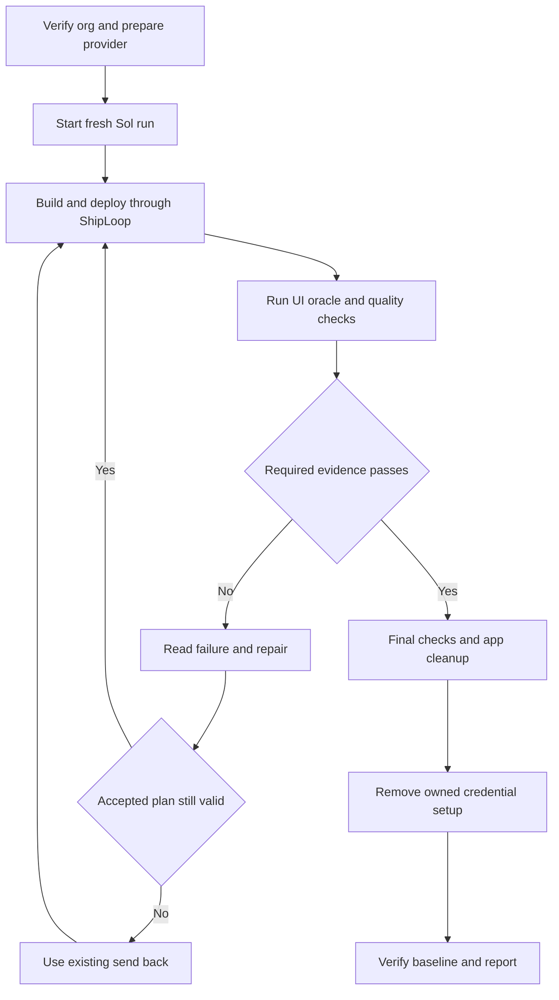

# Full Salesforce Grok chat acceptance

Use `grok-chat-salesforce-full` for a fresh build that must demonstrate authenticated UI access, live provider calls, real Salesforce tools and confirmed record changes. This is an opt-in extension of [the exploratory case](GROK_CHAT.md), which remains unchanged and still reports its behavioral acceptance gap. The authoritative prompt and commands are in [cases.json](cases.json); this repository supplies no chat application.

## Prepare the outer environment

The operator must have explicit authorization for org `de`, synthetic app records and credential setup. Check the actual org identity and inventory first. The `SLGrokChat` prefix must be free; preserve prior run evidence and resolve an earlier cleanup failure before reuse. Do not delete an unrelated app to make space.

Attempt the UI through discovered tools, preferring Chrome DevTools. Authenticate only when needed. The bounded `grok-chat-ui` helper uses the authorized Salesforce CLI session, passes its frontdoor URL to the browser through stdin, and returns closed evidence. It does not give the builder a raw authenticated browser endpoint or session secret. A supported Chrome and Playwright runtime must already be available.

Configure the existing provider key in the encrypted External Credential behind `Grok_Chat_Model`, with endpoint `https://api.x.ai`. Assign only the required principal and credential access to the test user through an operator-owned permission set outside `SLGrokChat`. Validate the supported `grok-4.7` model and an actual callout before launching. Save a credential-free resource ownership ledger. Never revoke an existing user key as test cleanup. Salesforce's [Named Credential guide](https://developer.salesforce.com/docs/platform/named-credentials/guide/get-started.html) describes this separation.

Do this before the harness snapshots the org. The subject still cannot read or change secrets, principal grants or credential metadata. Remove `XAI_API_KEY` from the subject environment and verify it stays absent in the isolated host. Do not paste a key into the case prompt, source, logs or screenshots.

## Run and attend the loop

Publish and verify the test apparatus before a marketplace run; record its revision separately from the installed ShipLoop version. Use fresh output and baseline paths:

```sh
env -u XAI_API_KEY python3 -u -B test/shiploop_e2e/run.py \
  --case grok-chat-salesforce-full --host codex \
  --model gpt-6.1-sol --effort medium --source marketplace \
  --output /absolute/path/to/new-full-run \
  --baseline /absolute/path/to/full-case-baseline.jsonl
```

The same command with `--preflight-only` checks readiness without launching the subject. Do not pass `--prompt`: it replaces the named case and loses its platform hooks. Do not use `--keep-platform`; this case requires cleanup.



*Failures feed the existing Until Loop; setup, independent review and cleanup remain attended operator responsibilities.*

Before each full UI check, the builder successfully deploys the entire `force-app` directory through guarded `sf project deploy start --source-dir force-app --target-org de --wait 10 --json`. This case opts into before/after source hashes on that deploy's receipt; a later partial deploy, changed source, interrupted command or missing receipt cannot earn UI credit. Keep `.forceignore` absent or comment-only and nondeployable local test helpers outside `force-app`, so an exclusion cannot hide an undeployed LWC. This attests the submitted complete source around a successful command, not protection against a hostile process changing and restoring files during it.

The builder runs `grok-chat-oracle`, `grok-chat-ui --mode run` and `grok-chat-quality` along with its linters and tests. Ordinary repairs stay local to the accepted plan. Invalid plans, criteria or commands use ShipLoop's existing send-back mechanism. There is no new workflow stage or loop limit.

The operator monitors `platform/grok-chat-quality/*/request.json`. Review the exact source identified there independently of the builder, retain findings with file locations, and write the schema required by [the quality checker](checks/grok_chat_full_quality.py) to its sibling `review.json`, with hashed evidence files. Evaluate code, errors, comments, tombstones and tests. Useful invariant and failure-path explanations matter; a comment count does not. A tombstone is needed only for a relevant removed or rejected behavior whose rationale would otherwise be lost.

The reviewer cites source locations, app-authored test methods, decisive assertions and executed native results. Require field-only access denial when object access exists and expired-confirmation coverage separately. Require six individual browser-to-native callout joins, one for the `testConnection` click and one for each of the five Send executions. Use the actual execution method, `sendMessage` or `executePendingMessage`, and match request and native log identities within the same verified org, user, trace window and exact deployment. `live_callout_methods` indexes the methods represented in the receipt. Use individual joins as proof. Retain the configured Responses endpoint and HTTP outcome in the closed evidence, and verify that a Named Credential alias in the native log resolves to that endpoint. An `ok` flag, nonce read, provider preflight or window-wide method count cannot supply a join. Exclude raw debug bodies and headers.

A failed review returns actionable findings to the builder. Source changes request a new review immediately, even while the new deployment or UI attempt is pending. A late callback for earlier source cannot complete that review. A missing review remains UNKNOWN; it cannot be replaced by the builder's self-report.

Source review is reusable only for the exact source hash. Attended acceptance has a separate callback at `platform/grok-chat-quality/<source_sha256>/live-acceptance/<identity_sha256>/request.json`. The checker chooses the latest UI attempt by its serialized start registration for the current phase, and the latest completed, non-overlapping guarded deployment. Completion time cannot reorder attempts. It requests six exact browser executions only after that UI receipt passes its independent validation. A missing or failed latest attempt cannot inherit an earlier pass.

Publish the operator's `receipt.json` atomically beside that live request, using `shiploop-grok-chat-live-acceptance-receipt/1`. Copy its `identity` verbatim; supply the same org/user trace window and all six individually matched native joins. Each join retains the actual method, browser and native request IDs, log ID and hash, request and log times, trace flag ID, HTTP outcome, and endpoint kind. Named Credential aliases need same-org endpoint readbacks before and after the request. The checker validates this closed schema and rechecks source, UI receipt and deployment identity before accepting it. Retain earlier requests and receipts. The helper uses the existing 900-second hosted-check budget; missing attended evidence remains UNKNOWN even when source review passes.

The receipt has exactly four top-level fields: `schema`, `identity`, `trace_window` and `joins`. Assemble it from the current request and the matching closed trace ledger:

| Receipt field | Evidence to copy |
|---|---|
| `schema` | `shiploop-grok-chat-live-acceptance-receipt/1` |
| `identity` | The current request's complete `identity` object, unchanged |
| `trace_window` | Exactly `trace_flag_id`, `org_id`, `user_id`, `baseline` and `expires`; use the created TraceFlag ID, verified window identity and ready-window timestamps |
| `joins` | One native match for each of the six `browser_requests`, using its exact method, request ID, `started_ms` and `completed_ms` |

Each join contains exactly `method`, `request_id`, `request_started_at`, `response_completed_at`, `log_id`, `native_request_id`, `body_sha256`, `outcome`, `endpoint`, `endpoint_kinds`, `log_started_at`, `trace_flag_id`, `org_id`, `user_id` and `window`. The native trace helper's match supplies these fields except **`log_started_at`**, copied from the matched log projection's `start`, and **`trace_flag_id`**, copied from the ledger's observed TraceFlag creation. Its `window` contains exactly `baseline` and `expires`. Retain numeric browser timestamps unchanged.

If any entry in `endpoint_kinds` is `NAMED_CREDENTIAL`, that join also contains `endpoint_resolution` with exactly `org_id`, `user_id`, `name`, `named_credential_id`, `endpoint`, `before_started_at`, `before_completed_at`, `after_started_at` and `after_completed_at`. Copy the verified, bracketing same-credential readbacks; the resolution endpoint is `https://api.x.ai` and the join endpoint is `https://api.x.ai/v1/responses`. A literal `HTTPS`-only join omits `endpoint_resolution`. Validate the assembled object with `validate_live_receipt(receipt, request)` before publication, then recheck that the request still represents the current source, UI and deployment. Missing or ambiguous native matches cannot be filled from another request.

The receipt names the reviewer, independent execution and provenance, with hashed review evidence. These are operator attestations checked against the attended run; this trusted apparatus does not authenticate a hostile receipt writer. Source identity includes ignored files under the deployable tree because Git ignore rules do not prevent Salesforce deployment.

## Evidence required for acceptance

| Check | What it establishes |
|---|---|
| Project and deployed metadata | Allowed source/schema, deployed candidate identity and scoped permissions |
| Subject Apex suite | Builder-authored regression checks, recorded separately from independent tests |
| Independent Apex oracle | Public controller behavior, authorization, malformed tools, provider failures, stale/replay handling and failed writes |
| Live UI driver | Missing setup, Save plus org readback, real provider connection, nonce-backed reads, confirmed create/update, cancellation, stale/replay behavior, reload and rendered controls |
| Independent quality review | Source-bound findings for code, error handling, useful annotations, tombstones and test adequacy |
| Cleanup | Owned app and fixture removal, followed by separate operator credential removal and baseline verification |

The oracle's reserved `SLGrokChatOracleTest` class and `SLGrokChatItem__c.SLGrokChatOracleDmlFault` validation rule exist only in a check-only validation deployment. The rule rejects names beginning `E2E-OracleDmlFailure-` to exercise a real failed DML statement. Refuse a reserved-name collision and verify neither artifact persists afterward. Mocked provider responses are deterministic test evidence, not live xAI evidence. Each oracle invocation appends its check ID to the phase's `attempts.log` before validation starts. Only the latest registered attempt can qualify: a missing, incomplete or failed newer receipt supersedes an earlier pass, and a later complete pass can qualify without changing source.

The UI checker snapshots business records before opening the app and checks them again before the separate explicit seed action. Setup, connection testing and conversation creation must not silently seed records. Seeded demo Names begin `Grok Demo `, and the selected fixture must have been created by the test user.

Each Send click uses either `sendMessage(conversationId, message)` or the optional `beginMessage(conversationId, message, clientRequestId)` followed by `executePendingMessage(conversationId, turnToken)`. Begin adds the exact user message to working history and issues `pending.token` for a fresh client request ID. Execute submits that exact token after the begin response. Both paths return completed, append-only history with a new assistant reply. The checker matches the returned messages to visible, ordered user and assistant entries in the Conversation region. An article, list item or accessible group with a role heading or label lets it distinguish message entries from tool output. Each `chat_turns` entry references the real methods by controller request sequence. Those rows retain matched Aura IDs, the bounded Salesforce response request ID, and browser request and completion times in Unix milliseconds. Reused execution request IDs cannot supply multiple turn proofs. The receipt uses digests for history and the capability. The pending token stays transient. The nine public RPCs and the independent mocked `sendMessage` oracle remain required.

The checker identifies update and stale proposals by the authoritative record ID or an unambiguous visible record name in a labelled target position, such as `Target`, `Record ID` or `Name`. An explicitly displayed record ID must agree with the authoritative ID. A create proposal identifies the new item through the new `Name` value. Each proposed field has its own labelled group with distinct old and new value positions. A create field has no prior value. The proposal and its status share a stable article, list item or accessible group. When the user confirms or cancels, the checker follows that same card through the terminal status even if its proposal controls disappear. Any exposed action ID must agree with the returned proposal and the RPC.

Before opening the app and taking the pre-setup snapshot, the trusted UI checker may delete only current-user-created `SLGrokChatItem__c` records whose Names start with `Grok Demo `. Selection is bounded to at most 500 records; a saturated 501-row selection or readback fails the reset. No foreign-user or unrelated records may be deleted. The reset receipt records the fixed scope, selected and successfully deleted counts and sorted-ID SHA-256 digests, and `not_run`, `incomplete` or `complete` status. Completion requires an unsaturated readback with no remaining scoped demo records; partial deletion and later browser failures retain reset evidence. The checker may also reset only the case's config rows and alter only its selected synthetic fixture item for a nonce or stale-data challenge. The model must actually read the nonce from Salesforce; narrative claims or a prefilled answer are insufficient. Confirmed writes are checked against independent org values, and no-write paths are checked too.

Record observed outcomes, missing evidence and calibration results separately. The public checkers are builder-readable. A full-case pass is evidence for this scenario; it does not by itself measure a generic ShipLoop improvement or establish a hidden-test benchmark.

The checker verifies that the declared `SLGrokChat_Chat` tab points to the exposed `slGrokChatApp` bundle with the `lightning__Tab` target. Shared button lookups require one visible app host and one exact visible control within it, so the Salesforce shell's Setup cannot satisfy either Setup activation. Keyboard evidence requires Enter on the app's Setup and real Tab focus on an enabled, visible, labelled native text input or textarea inside the app. CI retains Chrome and runtime versions and raw results for four local fixtures covering app ownership and keyboard focus, delayed setup, the Save boundary, and turn/action correlation. Any fixture failure fails the aggregate check. These synthetic pages exercise the evaluator without Salesforce authentication, provider credentials or model calls. Deployed acceptance still requires the live journey.

Applying this changed UI contract to an earlier candidate requires a separately registered warm-start trial with fresh observations and source identity. Preserve the earlier trial under its frozen criteria.

Rendered history proof compares the complete message body owned by its message card. Keep role headings separate; optional non-body metadata uses a dated `time` element or the accessible label `Message metadata`. Text used as proof must be visible or reachable by scrolling; a visible fragment cannot prove a clipped remainder. Hidden, nested-card or sibling text cannot supply a missing body. Show a proposal's operation in its own heading or labelled `Operation` position. Its operation, target and old/new field values must belong to that proposal rather than a nested action card.

After confirmation or cancellation, the checker reads authoritative conversation history before the next Send. It can use the app's own read, a visible Reload history control, or a page reload. The read must preserve earlier messages and immutable proposal fields; it may include bookkeeping from the validated action.

## Cleanup and retry

Let the harness finish its default app cleanup before removing operator-owned credential resources. Use resource identities and the ownership ledger, preserve unrelated configuration, and verify the org baseline again. If cleanup fails or a deployment is still running, retain the failure and resolve it before a fresh attempt. Use a new output directory; never overwrite a failed attempt or erase its measurements.

Before closing the run, scan retained source and logs for the known key without printing it, and retain only the match count and scanned scope. Report auth, provider, functional acceptance, quality, delivery and cleanup as separate claims.
