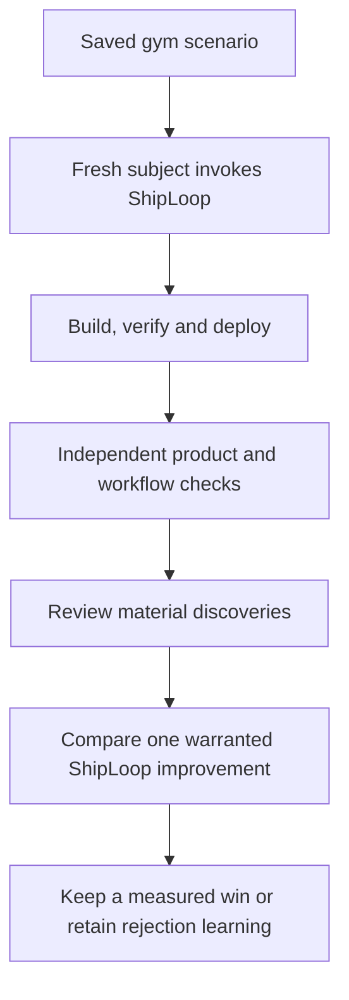

# Salesforce gym membership scenario

Run `gym-membership-salesforce` to test ShipLoop delivering an internal gym membership app in Salesforce. The executable request, API/UI contract and checks live in [cases.json](cases.json); this page explains its purpose and evidence limits.

The harness starts the selected, installed ShipLoop skill in a fresh subject context with an empty product checkout. The parent owns the scenario and checks; ShipLoop owns all app construction in the subject context. No app implementation is supplied.



The app is the development challenge; the learning target is the generic ShipLoop skill, scripts, returned prompts and handoffs.

## Reusable journeys

| Journey | Required behavior | Important counterexample |
|---|---|---|
| Member self-service | Enroll, edit profile/plan, freeze and resume; reload preserves saved state | A profile edit silently reactivates a frozen membership |
| Administrative management | Create and update a synthetic member's profile, plan and status | An ordinary member can call an administrative endpoint |
| Member 360 | Show the selected member's saved profile, membership and visit history | The screen hardcodes a correct-looking count |
| Coaching kiosk | Check in an active member and show coaching appropriate to the plan/goal | Frozen/cancelled check-in succeeds, or a repeated same-day check-in adds another visit |

Keep the product small: an internal Lightning app, membership/profile records and check-in history. Payments, public portals, scheduling and external integrations are outside this case.

## Run it

Use an authenticated, explicitly authorized `de` org and a browser runtime supported by the existing harness. The subject uses Terra 6.1 high; a later ShipLoop improver uses Sol 6.1 xhigh. Do not change campaign defaults or an earlier baseline to select those settings.

```sh
python3 -B test/shiploop_e2e/run.py \
  --case gym-membership-salesforce \
  --host codex --model gpt-6.1-terra --effort high \
  --source marketplace --output /absolute/path/to/a/new-run
```

The marketplace gate checks HEAD against remote main and verifies a fresh published installation. The scenario and checks come from the local harness; record that source separately from the installed ShipLoop plugin. A frozen case under development can therefore exercise published ShipLoop before the case is merged. Start a new output directory for every new attempt. Resume an interrupted attempt only through the existing recorded-run procedure.

This is a fresh-only shared-org case. Refuse a conflicting prefix; do not deploy over a kept app. Before and after each cycle, verify the adapter's snapshot and cleanup receipts under the existing org lease. Cleanup covers only newly created, tracked test-owned metadata and records on its owned objects. Other apps, arbitrary Apex writes outside that ownership, jobs and late deployments are outside the guarantee. A failed or unverified cleanup blocks reuse.

## What the evidence means

Real UI clicks must agree with successful responses from the declared Apex controller and independent persisted-record queries. Builder checks and independent final checks retain distinct receipts. A product pass cannot override unfinished ShipLoop work or a strict workflow-fidelity failure.

The declared browser checker is public and builder-readable. Repeating it independently verifies the delivered behavior; it does not establish performance against unseen assertions. This case declares no held-out acceptance measure.

The live browser uses the existing authenticated org user. Isolated Apex `System.runAs` checks exercise ordinary/admin authorization without permanent users; they do not prove a second authenticated browser identity. No public member portal or complete browser role matrix is claimed.

After a run, examine both expected results and surprises: unmet or unexpected expectations, useful optimizations and discoveries that could change the accepted approach. Review the skill's interaction with scripts, script behavior, prompt/templates and handoffs. Keep observations separate from accepted spec changes. Before editing or committing, read relevant full Git messages, including rejected learning. Only a qualified measured win is a generic ShipLoop improvement; a new case or stronger check is E2E apparatus coverage.

