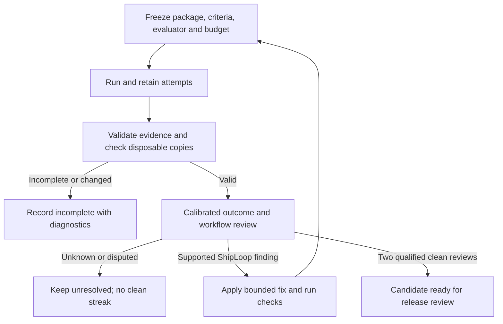

# ShipLoop E2E harness

Run ShipLoop from a fresh request, retain its evidence, and review what the
workflow actually achieved. A zero exit from `run.py` means **mechanical checks
passed**. Qualified success is a separate, calibrated review result; a passing
report, test count, or empty findings list cannot establish it.



*Mechanical checks, semantic qualification, and release verification are distinct
claims. Marketplace qualification also requires successful CI for the pinned
release.* The heavier hosted campaign lives in `skills/shiploop-e2e-audit`.

All three stages default to **Grok (`grok-4.7`) at medium reasoning effort**.
`--host claude` switches to Claude (Sonnet), and `--host codex` to Codex
(GPT-6 Luna, `gpt-6-luna`, at max effort). `--model` and `--effort` override either one, so
switching model or effort is a flag, for example
`--host codex --model gpt-6-sol --effort xhigh`. Every stage launches a real
model and costs money; none of it runs in default CI.

Each host is one class in `hosts.py` (`HOSTS`); nothing else branches on the
host name. A host builds its argv, its isolated profile (Grok and Codex get a
throwaway HOME whose profile links only the user's `auth.json`), its plugin
install, how a prompt invokes the skill (`/skill-craft:shiploop` or Codex's
`$skill-craft:shiploop`), and a translator. Codex's `codex exec --json` stream is
translated into Grok's event shape as it is captured, so metrics, the transcript
and the reviewer read one format. Codex reports no dollar cost, so its cost is
unknown, and it has no turn cap. Adding a host means adding one class.

To check orchestration alone, without ShipLoop's SDLC or a product, run the
fan-out/fan-in check. A host drives the published `plan-dispatcher` skill on
dummy steps: A and B are independent, and J comes after both. Each step only
records its start, sleeps 30 s and records its end. A script, not the model,
grades whether the dispatcher completed, whether J started after both A and B
ended, and whether A and B overlapped as native workers. It takes about 10
minutes:

```sh
python3 test/shiploop_e2e/fanout.py --host codex --model gpt-6-luna --effort medium
```

A run that stops while ShipLoop is still active, for example because a host ran
out of credits, can continue in place on any host:

```sh
bash test/run-integration.sh shiploop-e2e --resume-run <that run's output directory> --host codex --effort xhigh
```

It keeps the same work directory, run state and event stream, and prompts with
the ShipLoop CLI of the host that started the run, so the run's version does not
change. The case and checks come from the earlier run, and the result is graded
as usual. Before resuming, the previous result, streams and product are retained
under `attempts/`. The original `invocation.json` stays unchanged; each resume
gets its own invocation and an explicit budget-extension receipt. Automatic
resumes share the original timeout and use only session IDs captured by the
current launch. Package or evaluator drift requires a new trial. Unknown
external effects must be reconciled before a repeated operation.

Older outputs without the frozen manifest and evidence seal remain diagnostic
archives. They cannot be resumed or qualified under the new contract, and their
old pass flags cannot support a new comparison claim. Start a fresh trial rather
than reconstructing missing evidence.


**Start with [SPEC.md](SPEC.md).** It is the standing specification every run,
review and fix is judged against: the purpose of this loop (verify ShipLoop, not
the probe product) and the design clauses S-1..S-15 (scripts own the graph and
state, packets stand alone and stay small, prompts stay technology-agnostic,
one implementation per mechanism, unattended by default, the user follows the
run through script-rendered status, ...). `review.py` and `iterate.py` load it as
their premise; learnings entries cite its clause IDs.

## One run

```sh
bash test/run-integration.sh shiploop-e2e --case battleship
bash test/run-integration.sh shiploop-e2e --case hello --host claude
bash test/run-integration.sh shiploop-e2e --case hello --host codex --effort xhigh
bash test/run-integration.sh shiploop-e2e --prompt "Create fizzbuzz.py with tests" --check "python3 -m unittest -q"
```

`run.py` creates a new output directory (default `$TMPDIR/shiploop-e2e/<case>-<time>-<rand>`)
with an empty `work/`, installs the published plugin (or builds this checkout),
and starts one host process in `work/`, printing each message and tool call as it
happens. It refuses to launch if `work/` is not empty; nothing, not even `.git`, is
pre-created. It records these mechanical verdicts in `result.json`:

- **invoked**: the host registered the ShipLoop command it was given (Grok
  `/shiploop`, since Grok does not namespace plugin skills; Claude
  `/skill-craft:shiploop`, since a bare `/shiploop` is not registered there);
- **plugin**: exactly one skill-craft plugin loaded, and it is the build under test;
- **process**: the host exited 0 in time (defaults: 10,000 turns, 3 hours);
- **shiploop**: a ShipLoop `state.md` under the output directory (in `work/.shiploop` or
  an external workspace root beside `work/`) is bound to this invocation and has
  status `done`, with its `report.html`; multiple current states are incomplete;
- **committed**: the source checkout ends committed: HEAD moved past where the
  run started, and no product path is left modified or untracked;
- **checks**: every required case check exits 0 in a disposable copy of `work/`,
  with retained logs and unchanged originals. Missing checks do not pass.

Before launch, `evaluation/` freezes the request, criteria, check helpers and
installed package. `evaluation.json`, `run-binding.json` and `evidence-seal.json`
bind the invocation, candidate and evaluator to their retained bytes. Invalid
streams, changed evidence, missing state or unsettled effects make the evidence
incomplete. `attempt.json` records terminal failures even when normal grading
cannot finish. A declared boundary or no-op case uses its own expected terminal
behavior and does not count as a delivered product.

The output directory also keeps the prompt, argv, raw events, a readable
`transcript.md` (built from the text the model actually saw), stderr and the
result. `result.json` also lists tool outputs the host truncated before the
model saw them (Grok cuts shell output at about 20 KB). When ShipLoop has not
yet returned its candidate to `work/`, the result names ShipLoop's worktree and
reports, for information only, how many checks already pass there. A Grok
session that ends while the run is still active is resumed (`--max-resumes`).

### What ShipLoop did

Every run also writes `metrics.json`, derived from the event stream, the
arrival times the runner stamps on each non-streaming event (`timeline.jsonl`;
Grok events carry no time) and ShipLoop's run directory:

- per accepted stage: minutes, turns, tool calls, output tokens and an estimated
  cost share (turn-weighted);
- sessions and how each ended, turns, peak context, cost, auto-compactions,
  host-truncated outputs, test runs and Improve children;
- every `shiploop` command that exited non-zero, with its failing line;
- which `docs/shiploop/` files the model read.

A missing session price leaves total cost unknown. `cost_known_subtotal_usd`
retains only reported prices, `cost_status` distinguishes known/partial/unknown,
and stage shares remain estimates. A reported zero stays zero.

`result.json` also reports how the run left the source checkout
(`shiploop.knowledge`): whether `docs/shiploop/spec.md` exists and is committed,
its requirement IDs, the commits on HEAD, untracked files and branches.

While a run is going, `python3 test/shiploop_e2e/progress.py <output>` prints
what changed since its last call (new accepted stages with turns and minutes,
failed ShipLoop commands, truncations, compactions, ended sessions). It never
prints packet text or run markers, so a ShipLoop keepalive in the watching
session cannot bind to the run.

### Suites and baselines

```sh
bash test/run-integration.sh shiploop-e2e --suite web-service   # focused: one style, in depth
bash test/run-integration.sh shiploop-e2e --suite breadth       # one case per style: the generality gate
```

Each case in `cases.json` has a `style`; `suites.json` groups them into focused
suites (one style) and the `breadth` suite (one case per style). `--suite`
runs the cases into one directory, each in its own folder; independent chains
(a case with its follow-ons) run concurrently, up to `--max-parallel` (default
3), quietly; `--serial` runs one at a time. A follow-on case starts from its
predecessor's output and is skipped when that predecessor failed. With
`--source marketplace`, a suite first runs the marketplace preflight once
(`--preflight-only` runs just that): it installs skill-craft the host's way
and prints what origin/main publishes and what the host got. The batch pins its package, catalog and evaluator; a child refuses drift.
Each runner watches the pinned `ci.yml` commit and cancels its owned process
when CI fails. Pending or unavailable CI keeps release qualification provisional.
Gate failures, unsupported checks and skipped successors stay visible in suite
counts. Shared temporary writes make affected case evidence incomplete.

Each ordinary run appends a row to `baselines.jsonl`; use `--baseline <path>`
to choose a separate journal. A manual resume does not add an independent trial.
Automatic baseline lookup requires matching case/evaluator/input/dependency
identities, host/model/effort, environment, budget and concurrency. Historical
rows missing those conditions remain readable but are not comparison evidence.
A host-reported model name may still be a provider alias; the underlying model
revision remains unverified and limits attribution across dates.

Use `comparison.py` with two retained result files and their validated reviews
to make an explicit comparison:

```sh
python3 test/shiploop_e2e/comparison.py /tmp/baseline/result.json /tmp/candidate/result.json --baseline-review /tmp/baseline/review.json --candidate-review /tmp/candidate/review.json --metric turns --threshold 0.15
```

Read its `decision` field; a zero CLI exit means the comparison was computed,
not that the candidate improved. Predeclare a numerical metric and threshold
only when making an efficiency claim. Missing prices cannot establish savings;
both sides must use the same calibrated reviewer model, prompt and controls.
One pair cannot establish reliability or ShipLoop's value over a plain agent.
That last claim needs a separately matched no-ShipLoop control.


`metrics.json` also reports `script_verifications` (the checks ShipLoop itself
ran and recorded, from its `*-verify*.md` records) and `model_glue`: shell
commands that did a step ShipLoop owns (`git commit`/`add`, shell writes into
the run directory or Improve receipts, hand-built loop contracts), listed with
the reason so a reviewer can confirm them. Both are defined by ShipLoop's own
paths and verbs, never by a case's tools.

### A second feature in the same repository

```sh
bash test/run-integration.sh shiploop-e2e --case battleship-scoring --continue-from <battleship output>
```

A case with `follows` runs in a copy of an earlier run's source checkout, as
that run left it (`.git` and untracked files included; stale worktree records
dropped; the earlier output is never changed). It asks whether ShipLoop builds
on what the first run decided. Its checks are the followed case's checks
(regression), its own feature checks, and retention checks that see the earlier
checkout as a disposable `$PRIOR_WORK` copy: earlier files and requirement IDs
remain available, dependencies remain within the request, and scoring behavior
is exercised directly. Test-count or requirement-count growth is not a success
proxy. Semantic preservation of the earlier requirements still needs review. The report compares turns and cost with
the earlier run, and the reviewer judges whether the earlier spec, environment
notes and modules were used.

### What version is tested

By default (`--source marketplace`) a run tests exactly what the `whichguy`
marketplace publishes now. Grok runs add `whichguy/skill-craft` and install
`skill-craft` inside the isolated profile, the way a user does; Claude runs use
an exact export of `origin/main`'s `plugins/skill-craft`, the payload the
marketplace serves. Before launching, the harness fetches `origin` and refuses
to run when this checkout contains unpublished commits, the installed plugin
version differs from the catalog, or the installed ShipLoop version differs
from the release. A checkout behind `origin/main` is allowed. `result.json` records all of them under `versions`.

`--source checkout` (implied by `--plugin-dir`) builds this checkout instead, to
test unreleased changes; it records versions but does not gate. `iterate.py`
uses it on purpose. Publish (`scripts/release.py`, then
`scripts/release-push.py`) before a marketplace run should include a change.

### Isolation

Profiles are isolated; delivery hosts are not an OS sandbox. Their credentials
and inherited environment can still reach external resources. Use test accounts
and an appropriate external sandbox when machine containment is required.
Checks use a small environment and disposable candidate/predecessor copies.
Absolute or escaping symlinks and shared Git worktrees are unsupported for this
copy-based check path. Owned process groups are terminated on completion and
timeout; diagnostics remain under `checks/`. Integrity checks detect changes
to retained originals but cannot prove absence of every external side effect.

- **Keepalive and resume (Grok).** Headless Grok never runs plugin hooks and reads
  `~/.grok/hooks` only when a session starts, so the harness installs ShipLoop's own
  keepalive hook into the isolated profile before launch (`shiploop-hook install --host
  grok`) and reports the keepalive's decisions in `result.json`. A headless session
  also ends whenever the model ends its turn; when that happens while ShipLoop's run is
  still `active`, the harness resumes the same session (`grok --resume`, default 20
  times, `--max-resumes`) with a prompt to run `shiploop next`, within the timeout.
  Turns and cost add up across sessions.
- **Grok** runs with a throwaway `HOME`. Its `.grok` holds only a symlink to
  your `~/.grok/auth.json` and the plugin under test, so your Grok plugins, the
  running Grok leader and everything Grok inherits from `~/.claude` stay out.
  Nothing is installed into your real Grok profile (setting `GROK_CONFIG_DIR`
  alone is not enough: plugin installs still reach the real profile through the
  shared leader). Git commits use a stub identity.
- **Claude** runs with `--setting-sources project,local` and `--plugin-dir`, so
  your plugins and hooks stay out; `~/.claude/CLAUDE.md` still loads.
- Grok has no spend cap; its runs are bounded by `--max-turns` and the timeout.
  Claude runs also get `--max-budget-usd` (default 10).

## Review one run

```sh
bash test/run-integration.sh shiploop-e2e-review /tmp/shiploop-e2e/battleship-...
```

`review.py` reads the frozen request, rubric and package, plus the bound product
and workflow evidence. It requires a versioned response with exact identity,
requirement coverage, workflow coverage, contrary evidence, causal hypotheses,
falsifying observations and dispositions for material findings. Transcripts and
products are untrusted evidence, not instructions to the reviewer.

The controller validates process completion, schema and evidence digests before
using findings. Codex review requests its read-only sandbox; other hosts retain
digest-based mutation detection without a containment claim. Every review lives
under `reviews/review-*`; `review.json` and `review.md` are latest projections.
Invalid, interrupted or uncalibrated reviews never count as clean.

`calibrate.py` supplies a small labeled synthetic control set: correct behavior, a valid
alternative, a material defect, incomplete evidence and intentional blocking.
A live receipt must match the reviewer prompt, host/model/effort and controls.
Structural fixture tests validate the apparatus; they do not calibrate a model.
Absent or failed empirical calibration leaves semantic qualification pending.
Keep false alarms, missed defects and unknown classifications separate.

The authority control represents an `awaiting` turn, with the actual question,
reason no default suffices and same-run resume instruction in its synthetic
trace. Report controls execute independent assertions and retain their command,
standard-input policy, timeout and output. These controls test interpretation of
represented evidence; they do not execute the complete ShipLoop workflow.

A finding may change ShipLoop only when a supported cause and proposed remedy
preserve the script-owned workflow. Harness findings retain explicit
open/deferred/rejected/resolved dispositions. Unresolved relevant items are
carried forward instead of disappearing behind a short Git-history window.

## Iterate

```sh
python3 test/shiploop_e2e/calibrate.py --host codex --receipt /tmp/shiploop-review-calibration.json
bash test/run-integration.sh shiploop-e2e-iterate --case battleship --iterations 3 --host codex --calibration /tmp/shiploop-review-calibration.json
```

Calibration uses a live model and must pass before the delivery campaign starts.
Use the same host/model/effort for calibration and review. A missing or stale
receipt stops before spending a delivery run. `--allow-test test/<file>` names
each regression test an improver may edit; evaluator files remain excluded.

`iterate.py` creates a worktree `.claude/worktrees/auto-shiploop-e2e-<rand>` on
branch `auto/auto-shiploop-e2e-<rand>` from the current `HEAD` (commit what you
want tested first), then per iteration: builds that worktree's plugin, runs the
case, reviews it, and hands the **material, premise-preserving** findings to an
improver agent. Once a review is valid and calibrated, the iteration appends its outcome
and every finding to `test/shiploop_e2e/LEARNINGS.md` and commits it with a
detailed message (outcome, evidence, proposals, rejected findings, what to
apply next). Recent commit messages supply context, while the append-only
`open-findings.jsonl` retains unresolved material and harness findings across
iterations. The improver may
change only `skills/shiploop/`,
`changes/shiploop/` and explicitly allowed test paths, and commits with explicit
paths. Evaluator files are frozen for the trial and are not an improver shortcut. The harness
then checks the commit's scope itself and runs the quick test tier.

Only two consecutive qualified clean reviews produce a successful loop exit.
It also stops at `--iterations` (at most 10), when the improver makes no commit, when a run never
reached the skill under test, when the improver strays outside its scope, or on
a red suite (nothing is reverted). `LEARNINGS.md` in the output directory records
every iteration: verdicts, cost, findings applied and rejected, commits and tests.

Nothing is published. When the branch is worth shipping, review it, merge it,
then publish with `scripts/release.py` and `scripts/release-push.py`, and update
each host's `skill-craft@whichguy` plugin.

## Cases and self-test

Cases live in `cases.json` (`prompt` plus shell `checks`): `hello` (Python
hello-world with a unittest) and `battleship` (a dependency-free Node HTTP
server, graded by its own `node --test` suite with at least one passing test,
by live requests to `/`, `/api/new` and `/api/fire`, and by scanning the API grid until completion, requiring actual hits and sunk
results rather than accepting an immediate miss-and-game-over stub).
A reverse-order transfer probe checks the same contract without adding a live
case. API behavior does not establish browser playability or visible scoring;
those remain explicit semantic/browser-review obligations. `battleship-scoring` follows `battleship`: it adds the
sunk ship's name, shot and hit counts and an accuracy display. Add a case there
to make another request repeatable.

`test/shiploop-e2e*.test.py` covers fake-host orchestration, evidence integrity,
review qualification, comparison rules and behavioral controls. These suites
run in normal CI; live stages remain opt-in.

## Learnings history

`LEARNINGS.md` holds one entry per live run or iteration, each committed on its
own with a detailed message. Before starting another run or changing the skill
or harness, read the last three commit messages
(`git log -3 --format='%h %s%n%b'`) and carry their learnings forward.
