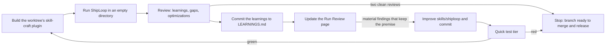

# ShipLoop E2E harness

The simplest end-to-end check of ShipLoop, and a loop that uses it to improve
the skill. A request goes into a brand-new empty directory, ShipLoop runs it
headlessly, the result is graded, a reviewer asks what the skill should learn,
and an improver applies what keeps the core premise. Then the edited skill is
rebuilt and run again. The heavier Grok campaign lives in
`skills/shiploop-e2e-audit`.



All three stages default to **Claude Sonnet 5.5 (`claude-sonnet-5-5`)**.
`--host grok` switches to Grok (`grok-4.7`, medium effort), and `--host codex` to Codex
(GPT-6 Luna, `gpt-6-luna`, at xhigh effort). `--model` and `--effort` override either one, so
switching model or effort is a flag, for example
`--host codex --model gpt-6-sol --effort max`. Every stage launches a real
model and costs money; none of it runs in default CI.

Each host is one class in `hosts.py` (`HOSTS`); nothing else branches on the
host name. A host builds its argv, its isolated profile (Grok and Codex get a
throwaway HOME whose profile links only the user's `auth.json`), its plugin
install, how a prompt invokes the skill (`/skill-craft:shiploop` or Codex's
`$skill-craft:shiploop`), and a translator. Codex's `codex exec --json` stream is
translated into Grok's event shape as it is captured, so metrics, the transcript
and the reviewer read one format. Codex reports no dollar cost, so its cost is
unknown, and it has no turn cap. Adding a host means adding one class.

To check orchestration alone, without ShipLoop's SDLC or a product, run the
fan-out/fan-in check. A host drives the published `plan-dispatcher` skill on
dummy steps: A and B are independent, and J comes after both. Each step only
records its start, sleeps 30 s and records its end. A script, not the model,
grades whether the dispatcher completed, whether J started after both A and B
ended, and whether A and B overlapped as native workers. It takes about 10
minutes:

```sh
python3 test/shiploop_e2e/fanout.py --host codex --model gpt-6-luna --effort medium
```

A run that stops while ShipLoop is still active, for example because a host ran
out of credits, can continue in place:

```sh
bash test/run-integration.sh shiploop-e2e --resume-run <that run's output directory>
```

With no `--host` it continues on the host, model and effort its last launch recorded (it prints that it did).
Naming another host is refused, with both hosts named, unless `--allow-host-change` says the change is deliberate
(`--host codex --effort xhigh --allow-host-change`); the run is then a mixed-host run, and `environment.hosts_used`
says so ("Records beside the verdicts", below). It keeps the same work directory, run state and event stream, and
prompts with the ShipLoop CLI of the host that started the run, so the run's version does not change. The case and checks come from the earlier run, and the result is graded
as usual. The original `invocation.json` is kept, and each resume is recorded
beside it as `invocation-resume-<host>-<time>.json`.

The prompt of a resume names the ShipLoop CLI of the plugin the run started on
(`<plugin dir>/skills/shiploop/scripts/shiploop`, whichever host or source built it)
as `python3 "<cli>" next --run-dir "<dir>"`. There is no bare-command form: a resume
whose CLI file is gone is refused before a host starts. The harness prints the exact
command that continues the run, harness flags included (`--timeout`, `--max-resumes`,
`--max-budget-usd`, `--permission-mode`, `--effort`, `--keep-platform` where given, and `--source checkout`
with `--plugin-dir` for a checkout build, so a line from a checkout run is complete even where the resume would
find the build by itself), when a run starts and again when it ends with ShipLoop still active, so a later
session that finds only the task log has it even if the harness was killed.
`invocation.json` keeps the host's argv and not those flags, so a resume without them
would run with none of the run's limits (there is no default `--timeout`). For that reason a regrade (`--grade-only`)
prints no command at its end, only a pointer to the one printed when the run started (its own
flags are the grader's), and a run that wrote no ShipLoop state prints the start line only
(`--resume-run` refuses it).


**Start with [SPEC.md](SPEC.md).** It is the standing specification every run,
review and fix is judged against: the purpose of this loop (verify ShipLoop, not
the probe product) and the design clauses S-1..S-15 (scripts own the graph and
state, packets stand alone and stay small, prompts stay technology-agnostic,
one implementation per mechanism, unattended by default, the user follows the
run through script-rendered status, ...). `review.py` and `iterate.py` load it as
their premise; learnings entries cite its clause IDs.

## One run

```sh
bash test/run-integration.sh shiploop-e2e --case battleship
bash test/run-integration.sh shiploop-e2e --case hello --host claude
bash test/run-integration.sh shiploop-e2e --case hello --host codex --effort xhigh
bash test/run-integration.sh shiploop-e2e --prompt "Create fizzbuzz.py with tests" --check "python3 -m unittest -q"
bash test/run-integration.sh shiploop-e2e --case battleship --planning-review none
```

`run.py` creates a new output directory (default `$TMPDIR/shiploop-e2e/<case>-<time>-<rand>`)
with an empty `work/`, installs the published plugin (or builds this checkout),
and starts one host process in `work/`, printing each message and tool call as it
happens. It refuses to launch if `work/` is not empty; nothing, not even `.git`, is
pre-created. It grades five verdicts into `result.json`:

- **invoked**: the host registered the ShipLoop command it was given (Grok
  `/shiploop`, since Grok does not namespace plugin skills; Claude
  `/skill-craft:shiploop`, since a bare `/shiploop` is not registered there);
- **plugin**: exactly one skill-craft plugin loaded, and it is the build under test (a
  resumed or regraded Grok or Codex run keeps the verdict made when it was launched,
  which `invocation.json` records and a regrade restates from the run's own
  `result.json`, because those streams cannot show what loaded; Claude's init event
  shows it on every launch, and an `invocation.json` written before the verdict was
  kept grades as it always did, with no evidence and so a fail);
- **process**: the host exited 0 in time (defaults: 10,000 turns, 3 hours);
- **shiploop**: the ShipLoop run this invocation created (in `work/.shiploop` or
  an external workspace root the agent chose beside `work/`) has status `done`, with
  its `report.html`. Which run that is, is recorded in `shiploop-run.json` (added
  2026-10-16): the runs already in the folder when it was created (a follow-on's copy can
  bring one) are never candidates, and the run itself is the one seeded by the harness,
  else the only new run, else the only new run the host's `--run-dir` commands named.
  A resume and a regrade grade that same run. Several runs that nothing tells apart are
  `ambiguous` (the result lists them) and fail; an unrelated finished run is never
  preferred;
- **committed**: the source checkout ends committed: HEAD moved past where the
  run started, holds at least one file (ShipLoop's own empty baseline commit is not
  product; any file counts, so this is a floor, not a check of what the product is),
  and no product path is left modified or untracked (`*.log` aside);
- **checks**: each case check command exits 0 in `work/`. A check of an HTTP
  product runs through `checks/serve.py` (added 2026-10-16): it starts the
  candidate on a free port, confirms with `lsof` that the candidate's own process
  group holds the listener, runs the check with `PORT` and `BASE` set, and ends
  only that group. A candidate that exits first fails with its exit code and
  stderr (an `EADDRINUSE` stays visible), a port answered by another process
  fails and names it, and a listener that cannot be identified fails.

The output directory keeps the prompt, argv, raw events, a readable
`transcript.md` (built from the text the model actually saw), stderr and the
result. `result.json` also lists tool outputs the host truncated before the
model saw them (Grok cuts shell output at about 20 KB). When ShipLoop has not
yet returned its candidate to `work/`, the result's `product_at_stop` names ShipLoop's worktree and
reports, for information only, how many checks already pass there, with the engine's position
("Records beside the verdicts", below). A Grok
session that ends while the run is still active is resumed (`--max-resumes`).

### What ShipLoop did

Every run also writes `metrics.json`, derived from the event stream, the
arrival times the runner stamps on each non-streaming event (`timeline.jsonl`;
Grok events carry no time) and ShipLoop's run directory:

- per accepted stage (`stages`): the stage, its outcome, seconds, host turns and tool
  calls. Stages come from ShipLoop's own records, never from
  file times: `state.md` history joined to the run's `timeline.json` by action id,
  so a stage is bounded by the engine's acceptance stamps. A stage the engine did
  not stamp, and the stage right after it, report `timing: "unavailable"` instead
  of a zero. A run that stopped before accepting its current stage gets a last
  `incomplete` row for it. No cost and no token count is split per stage; cost stays
  whole-run. "Reading per-stage figures" below says what these numbers can and
  cannot tell you;
- the planning window (`planning`, SPEC's S-10 carve-out of 2026-10-05: planning takes no more than 30
  minutes): intake to the first accepted `test-spec` with outcome done (a `revise` row does not close it), on two
  labelled clocks, the engine's (`window.seconds`, from `timeline.json` `started`) and the host's
  (`window.host_seconds`, from the runner's first event; `before_engine_seconds` is the difference, 92.8 s on the
  Grok `none` run of 1.22.0). `stages` lists each accepted visit in the window with its seconds and
  `improve_seconds`, which runs from the Improve child's bind file (`improve/<action>-bind.md`, so it needs the
  run directory's file times) to the accept stamp; 0.0 means the engine ran no child for that action, an action with
  a child but no readable bind file is null with its reason. `improve` totals the children and their seconds and
  `producer_seconds` is the window minus them, so the two add up to the window. The exporter's `improveMin` runs
  bind to receipt and the Run Review page's stage minutes stay the exporter's; this block is the harness's own
  figure for the owner's rule, and a regrade of a copied run directory reads wrong Improve seconds (file times).
  An open window reports `through` (the last stamped stage) and is never 0; a seeded run, a recreated
  `timeline.json` (one stamp for every action, or a window whose end does not move past the start, even with a
  single accepted row) and a timeline with no start are unmeasured as a whole. `tokens` is the
  window's output and reasoning tokens on the host clock where the host's per-call counts are exact: Grok's usage
  events, and Codex's rollout `token_usage_record`s (a compaction request counts, a repeated response id counts
  once, sub-agent output is `subagent_output` beside the main figure); Claude's are unmeasured. The reasons for
  anything missing sit inside the block, not in the top-level `unmeasured` map. A window that spans host kills
  (Luna xhigh: three resumes inside its 375-minute window, four in the 588-minute run) is wall clock and includes
  the gaps;
- sessions and how each ended (`sessions`: its stop, turns, cost and the host's own
  `usage`, kept as the host wrote it and never summed), turns, peak context (a call's
  input, cache reads and cache writes; null when no call reported its context), cost
  (unknown, null, unless every session that ended
  reported one), `unreported_sessions` (sessions that began and never reported an end,
  such as one killed with the task: any above 0 makes turns and cost a lower bound, and
  the printed cost says so; it is a field of `metrics.json` and `result.json`, not a
  baseline key. It is exact for Claude (one `system/init` per session) and for Codex
  (its translator names the thread). For a stream with Grok in it it is `null`, named in
  `unmeasured`. A stream has Grok in it when a launch record names Grok or the stream
  holds `usage` events (the test is the host, not a field of one event, so a Grok build
  that adds a field to `available_commands` changes nothing). Grok's events mark no
  session start: its `available_commands` event is announced again inside a session (314
  of them for 2 `end` events on r1-battleship-grok-none, 2 at the head of the first launch
  and 8 at the head of the resume), and the old reading, one start per announcement,
  printed "lower bound: 312 session(s) never reported" for a cost that equals the two end
  events' totals. A null count keeps the lower-bound marking. When `usage` events follow
  the last `end` event, or there is no `end` at all, at least one session never reported
  (`unreported_sessions_at_least` is 1: r2-battleship-grok-none, r3-battleship-grok-none
  and v1210-battleship-grok-medium hold 69, 230 and 328 Grok `usage` events and no Grok
  `end`) and the printed cost says "at least 1 session(s) never reported"; otherwise it says
  the events do not show whether one did (`metrics.lower_bound` is the one predicate:
  `--baseline-report` and the printed lines share it). The harness's own launch rows will
  count them: a launch whose lines hold no `end` event never reported), auto-compactions, host-truncated outputs, test runs and Improve
  children (the directories ShipLoop made, not their `-bind.md` receipts);
- the host CLI build the sessions ran on (`claude_code_version`, from Claude's init event; sessions on two
  builds name both, null where the host's events do not carry it; also in `result.json`'s `metrics`). Two runs of
  one prompt on different builds are not a controlled pair: the Sonnet runs of 2026-10-06 and 2026-10-07 ran on
  2.1.291 and 2.1.292, which no record named before;
- every `shiploop` command that exited non-zero, with its failing line;
- which `docs/shiploop/` files the model read;
- `fidelity` (SPEC, 2026-10-09), a record-only block of what the run's own records show about how ShipLoop was
  carried: "The fidelity block" below. It is in `metrics.json` only, never in `result.json` or a baseline row.

`result.json` also reports how the run left the source checkout
(`shiploop.knowledge`): whether `docs/shiploop/spec.md` exists and is committed,
its requirement IDs, the commits on HEAD, untracked files and branches.

`result.json` and each baseline row also carry `termination`: why the run is not
still going, recorded by the harness that owns the host process. It holds the
process status and return code, each session's own stop reason, why the driver
stopped resuming (`host is not resumable`, `ShipLoop run is <status>`, `no host
session id to resume`, `run deadline spent`, `resume budget spent (N)`), the
engine's status and the stage it never accepted. `unknown` is kept rather than a
guess, a ShipLoop refusal is never reported as the cause, and the printed report
has a `stopped` line. A harness killed together with its host writes none of
it (the observer is gone); only the engine's own state survives, and a later
`--resume-run` records what that resume observed. `--resume-run <output directory>
--grade-only` writes metrics.json, result.json and the Run Review export from what is
on disk, starting no host, for a run in any status that has a ShipLoop state (`process`
says `not observed` and `termination` says no host ran). Stop the host first, or confirm
none is alive: against a live host it records a mid-run snapshot and replaces result.json.
It never continues or answers a run (SPEC S-14), and it writes no baseline row.

To end a run on purpose, create the file `<output directory>/stop`. The harness kills the
host (its whole process group), never relaunches it, consumes the file, records
`process.status: stopped` with no process verdict (the host did not fail) and
`resume_stop: stopped by <output>/stop`, writes the records and the export, writes no baseline
row, and exits non-zero (a suite reads exit 0 as a pass). The run reads as stopped however the
file is found: killing a running session, or found as a session ended on its own or between two
sessions (the host exited 0, yet `process.status` is `stopped`; that session's own status stays in
`process.sessions`). A host that is never resumed (Claude) does not look for the file after its
only session ended; the next `--resume-run` removes it. A stale file is removed at the start of
every `--resume-run`, and a stop never answers a blocked or awaiting run. A stop that names a
stage (`--stop-at`) is deferred until planning probes are routine (the pending plan's RC2 and
RC3); an external watcher that creates the file when a stage's row appears covers it meanwhile (the
recipe is under "A fresh context (S-6)" below; recording a fresh context did not change this deferral).

A baseline row is written only for a run that starts from the beginning and ends with ShipLoop
no longer active. A resumed or seeded run, a run left active (a deadline, a stop, a spent
resume budget) and a run whose host the deadline or a stop killed before ShipLoop wrote any state
write none: their turns, cost and stages are a fragment. A host that ends on its own, even with no
ShipLoop state, still writes its row.

### Delivered quality (`quality`)

`result.json` carries an optional `quality` block, taken last and recorded beside the verdicts, never as one (SPEC,
"Delivered quality is recorded, never judged"). It is taken only from a delivery that is finished and returned (`shiploop`
and `committed` pass, the engine is not active, no stop was requested); otherwise it is `{"observed": false, "reason": ...}`.
result.json, metrics.json, the Run Review export and the baseline row are written first: the phase can add minutes, and
it updates result.json and nothing else. The baseline row has no `quality`; a reader takes it from result.json. A regrade
measures again, and keeps the earlier observed block (with `quality_regrade_skipped` beside it) when it cannot.

```
quality: {
  observed, reason,            # false + why when no delivered-product measure was taken (never 0, never a pass)
  declared: ["mutation", "acceptance"],        # what the case's `quality` entry in cases.json asked for
  hosts_used, mixed_host,      # runrecord.hosts_used / runrecord.mixed_host of the launch records, not --host; null + unmeasured when none
  mutation:   {observed, operator_id, command, source, baseline: {returncode, seconds, tests},
               sites, killed, timeout, port_refused, port_refusals, survived, invalid, unconfirmed, not_run, ratio, ceiling_hit,
               ceilings, refuse_ports, not_run_reasons,
               per_file: {<path>: {sites, lines, loaded_by_tests, killed, timeout, survived, invalid, unconfirmed, not_run}},
               uncovered: [{file, inline_script_lines}],              # page scripts no operator reaches
               kills: [{file, line, op, from, to, evidence, timeout, port_refusals}],   # evidence: first failing line
               survivors: [{file, line, op, from, to}],
               unconfirmed_mutants: [{file, line, op, from, to, first, second}], seconds}     # or {observed: false, reason}
  acceptance: {observed, source, ids, passed, checks: [{id, source, pass, note}]}   # or {observed: false, reason}
  held_out_seen,               # host event lines naming a held-out script; null (see `unmeasured`) when unreadable
  memory_writes,               # [{path, tool, line}] Claude Write/Edit/MultiEdit under ~/.claude/projects/*/memory, from events.jsonl
  notes: [...],                # caveats that depend on the run (a mixed-host run's memory list covers Claude only)
  unmeasured: {<key>: <reason>},   # the keys above that are null
  left_behind, delivered_files, seconds
}
```

* **mutation** copies the delivered files (`git ls-files --cached --others --exclude-standard`, without `.git`) to
  `<output>/quality/copy`, never touches `work/`, checks that the unmutated copy's test run exits 0, counts at least one
  test (the engine's `shiploop_test_counts` reads the count) and touches none of the case's declared fixed ports, then applies
  one text mutation at a time from the operator catalog `js-1` (`quality.JS_OPERATORS`: `===`/`!==`, `<`/`<=`/`>`/`>=`,
  `&&`/`||`, `true`/`false`, spaced `+`/`-`, and the literal after a comparison, in code only: comments and string and
  template bodies are masked) and runs the case's `quality.mutation.command`. A failing run is run once more; it counts as
  `killed` only if it fails again (`unconfirmed` otherwise: out of the ratio, both outcomes in `unconfirmed_mutants`), and a
  kill records the first failing line. `killed` includes `timeout` (a run past `RUN_CEILING_SECONDS`, which defines a hang)
  and `port_refused` (a kill whose run had a declared port refused); `invalid` (the file no longer parses, `node --check`)
  is out of the ratio, and a syntax check that does not finish is `not_run` (`not_run_reasons`). `ratio = killed / (killed +
  survived)`; `killed + survived + invalid + unconfirmed + not_run = sites`. Mutants are taken round-robin across files, so a
  ceiling hit (`PHASE_CEILING_SECONDS`, `ceiling_hit`, the rest `not_run`) leaves a sample of every file. **Compare a ratio
  only with one of the same `operator_id`**, and read it with the counts beside it: equivalent mutants that survive lower
  it; hangs, load-induced failures and port collisions counted as caught raise it, which is why those are separate counts.
  `loaded_by_tests` is true when Node's V8 coverage of the baseline run lists the file or a confirmed, non-timeout caught
  mutant of it exists (a sign, not a proof), false when neither is so (no sign of a load, so all its sites survive: a lower
  bound, because a server the tests stop with a signal writes no coverage; the saved r1 Checkers `server.js` is the case),
  null when no coverage was written and no mutant of the file was caught. The saved deliveries keep the page's JavaScript
  in an HTML file or a string of `server.js`, which no operator reaches: `uncovered` names the HTML files with inline scripts
  and their line counts, `per_file[*].lines` the JavaScript that was mutated. Python and other deliveries are `observed:
  false` (no operator catalog), listing the files by extension.
* **Fixed ports.** A product defaults to the port its prompt names (3000) and a mutant can make it listen there whatever
  `PORT` says. Every child of the phase runs under a Node preload (`test/shiploop_e2e/refuse_ports.cjs`, listed in the JS
  catalog) that refuses `listen` and `connect` on the ports in the case's `quality.refuse_ports` and counts the refusals. A
  delivery whose own unmutated tests touch one is `observed: false` ("its tests bind a fixed port; not run"); the three saved
  ones are v1230 (ST-3), r2-checkers (TC-1 (c), ST-3) and r2-battleship-grok-none (TC-port).
* **acceptance** (the `checkers` case only) runs held-out checks, hand-written from the case's prompt and never shown to the
  model, against the delivered `node server.js` on a free port. They are `test/shiploop_e2e/checks/checkers_accept.py`,
  imported by the harness and called in its own process, so no check text or id is on any command line. The path of
  `checks/` does appear in the harness's own command line and resume prompt, and `held_out_seen: 0` only says no event
  names it. Each check is calibrated against `test/fixtures/quality/reference_checkers.py`, a hermetic service with one
  defect switch per check (`AcceptanceCalibrationTest`). A server that never listens leaves the block unobserved, never failed.
* Every child process the phase starts (test runs, syntax checks, the server) runs in a group of its own that is registered
  with the harness's live groups, so a SIGTERM and the exit hook end it. When a child's leader exits the whole group is
  ended before the leader is reaped (a test run's leftovers share its group, and an unreaped leader pins the group id); a
  hung leader is ended the same way; a stop (a signal or `<output>/stop`) is checked before every run; listeners are stopped
  under `<output>/quality` only, also in a regrade, and recorded as `left_behind`. The phase runs under the case lock the
  harness already holds (a second acquire in one process fails), so a regrade while another harness holds the case records
  `observed: false`.
* A suite's parallel chains run their phases while sibling hosts work, and a loaded machine can make a mutant time out or
  fail once: read `timeout`, `unconfirmed` and `seconds`, and rerun a suspicious ratio alone (`--serial`).
* A case declares measures in `cases.json`: `quality.mutation` (`command`, `exclude` path prefixes that are not source,
  `source`), `quality.refuse_ports` and `quality.acceptance` (one block: `module` in `checks/`, `start`, `source` and `checks`
  with an `id` and the prompt sentence each reads). A follow-on case is measured by its followed case's declaration unless it
  names its own (`run.case_quality`). Battleship's acceptance set was dropped: it passed 5 of 5 deliveries and separated nothing.

While a run is going, `python3 test/shiploop_e2e/progress.py <output>` prints
what changed since its last call (new accepted stages with turns and minutes,
failed ShipLoop commands, truncations, compactions, ended sessions). It never
prints packet text or run markers, so a ShipLoop keepalive in the watching
session cannot bind to the run.

For the owner's illustrated status updates, `python3 test/shiploop_e2e/status_card.py MODEL.json` (or the model on
stdin) prints a card as an HTML fragment for an inline widget: a plan strip (done, running, waiting, pending, each with
an icon), a progress bar with an estimated end, and a grid of units by variants with one slot per sample or attempt
(passed, below target, running, pending, error). The JSON model is documented in its docstring; the caller builds it
from whatever it watches. It reads and writes nothing else.

### The fidelity block

`metrics.json` carries `fidelity` (built by `test/shiploop_e2e/fidelity.py` through `run._main`, so a regrade with
`--resume-run <dir> --grade-only` adds it to a run that has none). It reads what the run left: ShipLoop's ledger
(`state.md`, `tests/`, `lint/`, `quality/`, `backchain/`, `improve/`, `packets/`) and the tool calls of the event stream
that `metrics.ToolLog` already classifies for every host. It is a **record, never a verdict** (SPEC): it changes no
verdict, exit code, baseline row or run, the model never sees it, and it starts no process. At most five `fidelity` lines
print after the `metrics` lines; the block holds the rest. Every part fails open: an input it cannot read, a stage table or
packet layout of another ShipLoop, or an event stream with no tool call makes the part null with its reason in the block's
`unmeasured` map (a regrade of a run whose `events.jsonl` is gone reads the ledger parts and leaves `edits` and
`refusals` unmeasured), never 0 and never a pass; a figure nothing measured is null too (`accepted_ran`, `zero_ran`,
`repeated`). The paths in the block are relative to the run folder (`<run>`) and the home folder (`~`), so a block
names no machine. A builder that raised leaves an **error block** instead of the parts: `{"schema":
"shiploop-e2e-fidelity/v1", "error": "<ExceptionName>: <one line>"}` and one printed `fidelity  skipped: ...` line, so a
reader of `fidelity["evidence"]` must check for `error` first. The block does not name the host: `runrecord.hosts_used`
is the one reader of that.

- `evidence`: one row per accepted action (`stages`, keyed by `action`), with the class of evidence it rests on:
  `skipped` (the engine's own `Not applicable to this item` entry), `script` (a record ShipLoop's scripts wrote for the
  action: `tests/<action>-verify*.md`, the lint gate `lint/<action>.gate*.md` (an advisory lint pass is not evidence), `quality/<action>-terminal.json`,
  `backchain/<action>/check-*.json`), `loop` (an Improve child: `improve/<action>/receipt.md` or an `improve_results`
  entry), `file` (a cited file that is neither the stage's own packet, inbox or result nor a model note), `note` (only
  model-authored notes, by the harness's own `MODEL_INPUT`: `run/notes`, `run/evidence`, `run/scratch`, Improve reviews),
  `sentence` (nothing beyond its own packet, inbox or result file; a result of another action is a cited file),
  `unclassified` (a history entry with no accepted result). The first class that fits wins, so `records` lists
  every kind found: a carry-forward with a verify record and an Improve child reads `script` and shows `improve` in its
  records. `declared` is the check the stage table declares (`script-run`, `review loop`, `model judgement`), read from the
  run's own `shiploop_stage_spec.py` through the exporter's `stage_catalog` and `effective_exit_check` (so
  `planning_review none` needs no special case). `needs` is the record kinds the stage's declared runs write
  (`lint-gate` is a lint gate record, `test-base`, `test-loop` and `test-rerun` are verify records, `loop-terminal` is
  a loop receipt and `expectation-check` an expectation record; none for a run with the `lint` option `off`; amended
  2026-10-11 for the 8-stage inner loop, see `fidelity.RUN_KIND`) and `lacks` the ones the action has
  none of; `declared_script_run_without_record` lists the done stages with a `lacks`, so a stage that declares two scripts
  and has one record is listed (none in the eleven saved Claude and Grok runs); a declared run the harness has no record kind for
  (`unmapped_runs`) is not judged and is named in `unmeasured["declared.runs"]`. The class comes from the records that
  exist, never from `declared`: a lint-only `implement` row reads `script` because a lint gate record exists, and its
  `records` say lint only. `file` is satisfied by citing any file, so it is a reading aid and never a target;
- `validation`: the verify records read as JSON. `by_suite` counts `runs`, `counted` (counts.ran is a number),
  `counts_null` and `zero_ran` (null when the suite has no counted row) per suite; `tests_ran_unmeasured` is the focused and
  regression rows whose counts are null (the v1220 Sonnet run has 34 of 34, the Grok run 30 of 30), which does not show that
  a test ran and so is unmeasured (S-9), never a pass. A `check` row is judged by its exit code, so its null counts are by
  design. `red` counts the records in which a command ran red, `accepted_ran` the rows that carry a floor and the stages they
  belong to (null when no row carries the key: an engine that does not write it, as the v1220 test loop does not), and `release_verify` the last
  release-verify record (by `created_at`) with its `where`, `kind` and **its own `passed`**: the engine records what it
  observed before it decides, so `where` alone is not a pass. The older regex reader `metrics.verifications` stays what
  baselines use; the block compares the two on the live folder (`unmeasured["validation.readers"]` names both values when
  they differ) and a test pins that both agree on the saved runs. `gates_not_exercised` lists the test stage's base-run
  and mutation-check records (`tests/*-base*.md`, `tests/*-mutation*.md`) that say `skipped` (no item base, no focused
  command, no mutants): the gate wrote a record and did nothing, so the run is no evidence about it. ShipLoop files such a
  record as `disposition: skipped` with `passed: true` and the reason under `skipped` (before unit U14 it filed `passed`
  beside the same reason); `metrics.skipped_reason` reads either marker. The validation line names them (`gates not exercised (a record that says skipped): base W1 (...)`) only when there
  are some;
- `edits`: **heuristic, a list to confirm**, listed as facts with the `event` (the 0-based line index of `events.jsonl`) of each:
  `script_owned` (the model's edit of a file ShipLoop's scripts own, by an edit tool or by a shell `>`, `>>`, `tee`, `cp`,
  `mv`, `rm`, `sed -i` or `perl -i`; the owned set is anchored to the run directory (`.shiploop-runs/<id>/run`), the
  `.shiploop` and `.shiploop-improve` directories and the three workspace files by name, minus `MODEL_INPUT`, so a product
  file called `start.json` or `packet.json` is not listed; `metrics.SHIPLOOP_OWNED` is the frozen, unanchored set `model_glue`
  keeps), `name_kills` (`pkill`, `killall`, `kill $(pgrep ...)`, `pgrep | xargs kill`, `ps | grep | ... | xargs kill` and
  `... | while read p; do kill "$p"`: they match any run's server by its name) and `model_commits` (the calls that ran
  `git add` or `git commit`). The detectors unwrap a leading `sh|bash|zsh -c|-lc "<script>"`, which is how Codex prints its
  commands, and leave quoted text out of what they match. `model_glue` does neither, and its write reason is narrower than
  `script_owned` (it does not read `sed -i`, `perl -i` or the workspace names, and it reads `mkdir`), so the two counts are not
  comparable: a test pins that every glue write hit other than `mkdir` is also listed here. On the one recorded Codex run
  (ShipLoop 1.21.0, 1542 calls) unwrapping changes the glue answer on three calls (events 731, 776, 779), each removing a
  commit that was prose in a heredoc; the opposite error (a first-position command inside the wrapper that the frozen reader
  misses) is shown on a constructed string only;
- `refusals`: each ShipLoop refusal from the same list as `shiploop_failures` (`count` equals its length), with its
  `event`, `verb` (`unknown` behind a wrapper script), `stage` (from the same stage windows `per_stage` uses, whole seconds;
  null without a timeline) and `repeat_of`, the index of the refusal just before it when its whole first line (not the
  200-character cut) is the same in the same known stage. `repeated` is null, with `unmeasured["refusals.repeated"]`, when no
  refusal could be given a stage, and `unmeasured["refusals.stage"]` says how many have none when only some do. The same line twice is a pointer, neutral about cause: a remedy that misled or an honest
  second failed try; `limits` says what it cannot see;
- `end_state`: the engine's `status`, `stage`, the stage it never accepted, its `status_reason`, and for a run that ended on a
  blocked result the last accepted entry's `blocked_by` and `awaiting` (its `kind`, and whether `no_default` states why no
  default would do), read through `metrics.blocked_detail`, the one reader `termination`'s `engine_blocked_by` and
  `engine_awaiting_*` use too: only while the engine is blocked on its last history action, so a block that was answered (the
  engine active again) reads null; `unverified` is the latest accepted list's open items (`entries`, `owners`) and those whose due stage was accepted
  later without restating it (`not_restated`, `not_restated_due`), null when no result carries the key
  (a result without the key says nothing, it is not an empty list, which says every outcome was observed);

**What no script checks.** Whether one call carries one step (S-2), whether the cards agree with the scripts (S-3), packet
size (S-7), technology-agnostic wording (S-8), one implementation of each mechanism (S-12) and generality (S-13); and the
truth of a model's sentence, the strength of a test's oracle (a suite can pass beside surviving mutants), and whether a text
is clear. They stay with a reviewer. The block does not decide the S-1, S-4 or S-5 clauses either: a clean `edits` is not
proof of no glue.

**Known blind spots** (the first five are each pinned by a test). An edit of a script-owned file by interpreter code (a
`python3 - <<EOF ... open(p, "w")` heredoc rewrote `return-plan.md` at event 487 of the r1 Sonnet Battleship run; the
`sed -i` of the same file at event 493 is listed); a shell `apply_patch` or `git apply`; a kill by numeric pid (`kill 67975`),
which a model's own job and a sibling's process look alike in; a relative path after `cd` for any file but the three workspace
files, which are matched by their name (a product file of that name would be listed too); a ShipLoop verb a model's wrapper
script hides from the command (the refusal is still read from the result text, with the verb `unknown`). Not pinned: a kill
by port (`lsof -ti :P | xargs kill`, r3 Grok event 7711 does this after its `pkill`), `install`, `truncate`, `cp -t`,
`find -exec sed -i`, `xargs sed -i`, a redirect written without a space (`echo x>owned`), and quoted text that still reads
as a command in the edit list (a quoted `>` word is a redirect to the edit detector). The refs of a result are paths of the
machine that ran, so whether they still exist is not asked. The round-3 loop criterion (2) was author-based (who committed)
and is measurable only on Claude on a machine with no configured git identity, because ShipLoop's commits defer to a
configured identity and the Grok and Codex profiles give one (the r2 Grok log has three authors because Claude finished that
run), so the block does not read authors at all. The first call after a Grok compaction, the one script measure of the main
tenet in action, belongs to the clear-context group's `fresh_starts`, not here.

### A fresh context (S-6)

SPEC S-6 asks what a model does with a cleared context. The harness records it and scores nothing (SPEC "A fresh context
is recorded, not scored"). `<output>/sessions.jsonl` is the harness's own append-only record of every host launch: a `start`
row before the host runs (`kind` first, fresh or continued; `reason`; `events_line`, the number of the session's first event
in `events.jsonl`; `told`, the CLI and run directory the resume prompt named, as values; `engine`, the ledger as the session
inherits it) and an `end` row after it (status, last events line, `engine` at that moment). `metrics.json` `fresh_starts`
lists one block for every fresh session (`--resume-run`, the session after `--interrupt-at`) and every compaction (Grok's
`auto_compact_completed`; Codex's from its rollouts; Claude's are not detected), each over the events from that start to the
tool call that got the next accepted action accepted. That action is the first one the ledger accepted after the start, and the
call is the last `complete` that names it or its Improve stage (`improve_results[<action>].improve_action`; an older run's
`improve-complete`), did not fail and returned at or after the accept stamp (the
stamp is whole-second truncated, so the window ends at the call, not at the stamp, and the producer `complete` that parks the action at its
Improve stage, which returns long before the accept, is not the call): `tool_calls`, `seconds` (to the call) and `seconds_to_accept_stamp`,
`first_grounding` (the first call that goes to ShipLoop's scripts or reads a packet: `next`, `improve-next` (the Improve
runtime's own recovery command), `packet`, or `other` for another ShipLoop verb such as `complete` or `lint`) with
`calls_before_grounding`, `recovery` (was the first `next` as told: `cli` and `run_dir` are exact, equivalent after normpath and
realpath, different or unreadable; `revision_seen`), `failures` and `rewrote` (both lower bounds: `rewrote` sees file-edit tools
only, not a file a shell command wrote, and says `none seen by file-edit tools`), `asked_user`. A window the records cannot place
(the action was accepted by something that left no event, only a call that parked it was seen, the session ended before it, or
in a run with no `sessions.jsonl` another host session began or ended inside the window) is `measured: false` with its reason
and no count, never extended to a later action; it keeps `first_grounding` and `recovery`. A `continued` session (a Grok or
Codex resume of the same context) does not cut a window; the next fresh session does. A fresh start also has `after_kill` (the
engine revision in the killed session's end row, in this session's start row and in its first `next` result; `moved` is true when
they differ). `fresh_starts_unmeasured` says what the list lacks: `not recorded` where the run has no `sessions.jsonl` (before
2026-10-09; the list then holds compactions only), `partial` where the first recorded session is not the run's first, the host
whose compactions are not detected (Claude's, a Codex run without rollouts), or `failed`.

The probe tests the production recovery path (the resume prompt, which names the `next` command, plus the packet it prints),
not "a model holding only the next packet". The old session's servers are reaped, Claude's auto-memory and the user's global
`CLAUDE.md` load into both sessions, and the extracts of the 2026-10 runs that first measured it are not clean samples (SPEC).

The S-6 pair, a stage boundary and the inside of a stage, with no trigger in the harness: a watcher creates the stop file, then
`--resume-run` gives the fresh session. One run at a time (SPEC: runs compared on wall time run one after the other). The case
is hello, restated with `--prompt` and `--check` because `--case hello` cannot be combined with `--prompt`; `--planning-review
none` is a ShipLoop `init` flag that ShipLoop refuses without `--improve-skill <absolute path of the Improve SKILL.md>`, so the
prompt carries both. Under `none` the planning stages (intake to test-spec) have no Improve park, the longest context windows
of a default run, so a probe at one of them never sits inside one; the later Improve children still run (the saved v1220 `none`
run parked at system-test-author, release-plan and carry-forward), so a probe past planning can:

```sh
OUT=/Users/dadleet/e2e-runs/$(date +%Y%m%d)/s6-after-spec        # the prompt names a path under it; a new folder
python3 test/shiploop_e2e/run.py --source checkout --output "$OUT" --timeout 3000 --check "python3 -m unittest -q" \
  --check "test \"\$(python3 hello.py)\" = 'Hello, world!'" --prompt "Create hello.py that prints exactly \"Hello, world!\" \
when run, plus a unittest test in test_hello.py that verifies that output. Start ShipLoop with the run option \
--planning-review none and --improve-skill $OUT/build/plugins/skill-craft/skills/improve/SKILL.md." &
python3 stop-watcher.py "$OUT" after spec          # the watcher below; "inside spec" for the inside of a stage
wait                                               # run.py prints STOPPED and exits non-zero: the stop is the plan
python3 test/shiploop_e2e/run.py --resume-run "$OUT" --plugin-dir "$OUT/build/plugins/skill-craft" --timeout 3000
```

```python
# stop-watcher.py: run from the repository root as `python3 stop-watcher.py <output> after|inside <stage>`
import pathlib, sys, time
sys.path.insert(0, "test/shiploop_e2e")
import metrics
out, where, stage = pathlib.Path(sys.argv[1]), sys.argv[2], sys.argv[3]
while True:
    run = next(iter(out.glob(".shiploop-runs/*/run")), None)          # exists once ShipLoop has started the run
    state = metrics.engine_state(run) if run else {}
    history = state.get("history", [])
    waiting = [p.stem for p in (run / "inbox").glob("*.md") if p.stem not in {h.get("action") for h in history}] if run else []
    if (where == "after" and stage in [h.get("stage") for h in history]) or \
       (where == "inside" and metrics.current_stage(state) == stage and waiting):
        (out / "stop").write_text("")
        break
    time.sleep(0.5)
```

The example builds this checkout (`--source checkout`), which is why the Improve card's path is known before the run starts; with
`--source marketplace` it is `$OUT/marketplace/plugins/skill-craft/skills/improve/SKILL.md` for Claude and carries a hash or
version under `$OUT/home` for Grok and Codex, so a Grok probe uses a checkout build (the r3 run did). Pass the first launch's
`--host`, `--model` and `--effort` to both commands. The watcher polls every 0.5 s and the harness checks the stop file
every 2 s (`run.POLL_SECONDS`), so the host runs up to about 2.5 s past the boundary, and a `complete` already started in a
Claude Bash call (its own process group) can finish after the kill: the engine can move between the kill and the fresh session.
`after_kill` compares revisions and does not wait; `moved` means the engine moved between the kill and the fresh session's first
`next`, which a command of the killed session that was still running can do, and so can an orphan host or the fresh session's own
ShipLoop calls before that `next` (an `improve-bind` increments the revision): a difference is not a failed probe. The keepalive
owner binding a Grok host keeps under `home/.local/state/shiploop/keepalive` (stale after `OWNER_STALE_SECONDS`, 1800 s) survives the
stop, and a fresh Grok session started seconds after the kill is not the owner, which can inflate early session ends and `continued`
resumes in a probe; it is not recorded. The result file and `complete` are often one shell command, so the `inside` boundary can race the submission:
`fresh_starts[].stage_in_flight` says which stage the clear landed in. A probed run is a resumed run and writes no baseline row.
The watcher matches a stage by name, so it is for the stages that happen once (intake to step-plan): a stage that repeats per work item
matches its first row. Read `$OUT/metrics.json` `fresh_starts`: the block with `reason: resume-run`. Phase 2 (`--clear-at`, a trigger and kill in the
harness) is built only if these probes show the overshoot or the two-invocation procedure inadequate.

### Records beside the verdicts (2026-10-09): `environment`, `product_at_stop`, `outcome_class`

Three records that tell a reader what a verdict was about. None of them is a verdict (SPEC, "A record of the machine, of the
product at stop or of the ending is not a verdict"): they never change `pass`, the exit code, a baseline rule or the control flow,
each fails open (a part that cannot be made says so, with its reason, and the run goes on), and a value nothing measured is
`null` or `{"observed": false, "reason": ...}`, never 0, a pass or an empty list that reads as a measured none.

**`environment`** is in `result.json`, and each launch's own start is in that launch's record (`invocation.json`,
`invocation-resume-<host>-<seconds>.json`).

- `start` and `end`: the node, python3 and git versions on the harness's PATH (`tools`, the first line of `--version`, read
  once per harness process by `hosts.probe_version`, the one `--version` reader, which also reads the host CLIs' and the
  browser's: one 20 s ceiling, one set of reasons, `probe failed: not found | non-zero exit N | silent | hung`), `cpus`, `loadavg`, `display_hold` (whether the host ran under `caffeinate -d -i`; `keep_awake` is
  the one decider) and `unread` (why a value is null). `start` is the launch's, taken before the deadline is set, so it spends
  none of the run's time; `end` is read after the checks and has no `tools`. A regrade starts no host: its `start` restates the
  last launch's record and its `end` says it was not observed. The host CLI build is not read here: a launch record carries
  `host_build` where the harness captured it at launch, and the per-launch entry passes it through. It is null for every
  Claude launch (Claude's build is `metrics.claude_code_version`, from its init event) and for a launch recorded before the field
  existed; `identity_unmeasured.host_build` says which (the launch record's own key, read through `runrecord.host_build`, the one reader
  of a launch's build, with G3's reasons).
- `hosts_used`, `mixed_host`, `environments`: who launched the run, read through `runrecord.py` (the one reader). `environments`
  has one entry per launch, first launch first, with its host, model, effort, `host_build` (and `identity_unmeasured.host_build` where it is
  null) and the `environment` that launch recorded (null, with `environment_reason`, for a launch recorded before this record
  existed). `r2-battleship-grok-none` reads `["grok", "claude"]`: Grok started it and Claude Sonnet finished it, though its saved
  `result.json` says host grok (a regrade now restates the last launch's identity, so it would say claude). A regrade is not a
  launch. A launch record that cannot be read makes `hosts_used` and `mixed_host` unknown (`{"observed": false, "reason": ...}`,
  and the file names are in `launches_unreadable`), never a shorter list. A folder written before this record existed is
  regraded, not refused (the point of a regrade is old runs): its entries have `environment: null` and `host_build: null` with
  their reasons, and its `start` says why it was not recorded.
- `overlap`: which neighbouring runs had host events while this one did, read-only, at the end of the run, from the first and last
  `timeline.jsonl` stamp of this run and of each run folder under the runs root (`root` in the record:
  `$SHIPLOOP_E2E_RUNS_ROOT`, else the output's grandparent, else its parent where the grandparent is the home folder, the
  temporary folder or `/`; so `~/e2e-runs/<day>/<run>` reads every day's runs; a suite sets the variable for its cases to
  the suite folder's root, so `~/e2e-runs/<day>/<suite>/<case>` reads every day's runs too). The walk does not enter a run folder or a hidden
  folder, and a timeline last written before this run began is counted in `ended_before` and not read. Each entry has `folder`
  (its path under the root), `case`,
  `hosts` (null with `hosts_reason` where its launch records cannot be read), `overlapped_seconds` and
  `started_offset_seconds` (the neighbour's start minus this run's: negative when it was already running, positive when it
  began later). A count taken when a run starts would miss the second kind: of the nine round runs of 2026-10-08 all nine
  overlapped another run and three saw an overlap begin more than a second after their own start. Limits: `timeline.jsonl` holds
  host events only, so a span is first to last host event; it counts a pause between sessions, and it misses the setup before the
  first event and the case checks, the product-at-stop run and the reap after the last (34.6 s and 37.4 s on the r1 and r3 Grok
  runs, by the review's measurement), so the seconds are neither an upper nor a lower bound. A run outside the root, and a
  neighbour with no timeline yet, are not seen; a neighbour whose timeline cannot be read is named in `siblings_unreadable`.
  `runs: []` means the neighbours read had no host events in common with this run, not that nothing else ran. The baseline row
  carries `overlapped_runs` (the count of `runs`, null where the record was not observed), and no rule excludes on it. A run
  started beside live harness runs under its root prints a `concurrent` line naming them (never a refusal).
- `start.browser`: the browser capability record, present as a probe only where something declares the need: a case's
  `needs` in `cases.json` (the three browser cases do, each with its `needs_source`) or `--need browser`. **A custom prompt
  (`--prompt`) declares none by itself**, which is why the Grok runs that motivated the record, all case `custom`, would have
  had none: pass `--need browser` with a prompt that serves a page, and the harness prints a note when a custom run declares
  nothing. The probe runs on the harness side, before the host starts, against a page it serves itself (a `file:` page, then a
  loopback `http://127.0.0.1:<port>/` page from a server in the harness process that is closed afterwards), one after the other so
  each browser is measured beside no other probe browser, in a headless browser with a throwaway profile. For each of the two it
  records `title_seen` (the stand-in's title appeared in the
  browser's output: the evidence, not the exit code), `output_s`, `exited`, `lingered` (the title was seen and the browser
  was still running after the grace), `killed`, `returncode` and `group_empty`. Measured 2026-10-09 in the design audit:
  16 of 16 launches of Chrome 154.0.8037.99 printed the title in 0.36 to 0.47 s; 3 of the 16 exited before the audit's 12 to 20 s
  ceiling and the other 13 were still running there and were killed (their exit time is unknown), so waiting for the exit would
  call a healthy load a timeout. After the title and a one-second grace the browser's own process group is stopped (and only that
  group: the probe starts the browser in a session of its own, checks it leads its group, and signals nothing else; it also stops
  it at once when the harness is told to end, and a harness SIGTERM or the standalone command's SIGTERM ends it too; only a SIGKILL
  of the harness can leave it); a browser that prints nothing is waited for up to a 20-second ceiling, and the stopped group up to
  2 s to empty (`group_empty`). The 20 s and the 2 s are ceilings, not tuning values; the 1 s grace is a definition (`lingered` means
  still running after it); all three are recorded (`ceiling_seconds`, `grace_seconds`, `empty_seconds`). Two targets that never print
  cost about 43 s before the host starts. It is a record and no gate: it never refuses a launch, and nothing reads it. See it by hand, as
  the calibration the SPEC asks for before any use of it (10 launches from a Terminal tab and from a Desktop task):
  `python3 test/shiploop_e2e/environment.py --need browser`. `--browser-bin` names the browser (tests pass a fake one).

**`product_at_stop`** (replaces `shiploop.worktree_checks`, 2026-10-09) is in `result.json` for a run whose ShipLoop did not
reach `done`: the case checks run against ShipLoop's unreturned worktree, information only (`information_only: true`; checks
graded in the worktree stay dropped as a verdict, because a run that never delivered must not pass, SPEC S-11). It carries the
engine's `status` and `stage` (a partial product at `implement` is not a finished one), each check's `returncode` and
`timed_out` (a check that hit its 180 s ceiling is `timed_out`, not a product failure), `output` for a check that failed, and the
counts `passed`, `failed`, `timed_out`, `total`. `{"ran": false, "reason": ...}` says why nothing ran (no ShipLoop state, no
worktree, no checks). A run that passed has none. A regrade reaps nothing (the run it grades may have a live host), so a check that
times out in a regrade's worktree run can leave the server it started listening (say `node server.js`): stop it by pid.

**`outcome_class`** with `outcome_basis` is in `result.json` only: `PASS`, `FAILED`, `BLOCKED`, `STOPPED`, or
`null` (unknown, the basis says why), a pure function of `termination` and `pass`. `termination` now also carries what the engine
recorded when it blocked: `engine_blocked_by`, `engine_awaiting_kind` and `engine_awaiting_no_default` (null where there is no
accepted blocked result to read). BLOCKED means the engine accepted a blocked result (a paused engine, which awaits resume the same
way, is BLOCKED with no blocker named); it does not say the block was warranted, which is a model judgement S-9 excludes as
evidence. FAILED: the engine finished without passing, or halted (terminal and unfinished: the engine's `halt` takes a reason and,
in an unattended run, the model issues it; no recorded run has been halted, so this is a definition), or the host ended on its own
with the engine unfinished (`host is not resumable`, `no host session id to resume`). STOPPED: the harness ended the run (the
stop file, a signal, the deadline, a spent resume budget, or a host session that ended on the cap the harness gave it:
`--max-turns` or `--max-budget-usd`, read from the session's recorded stop). A regrade that observed no host and an engine still
active is `null`. Which baseline rows are comparable is the baseline code's rule, not this record's: no baseline rule reads
`outcome_class`, and the baseline row carries neither it nor the blocked detail: the row's `termination` leaves out
`engine_blocked_by`, `engine_awaiting_*` and the regrade's `*_at_regrade` readings other than `engine_status_at_regrade`
(`run.ROW_EXCLUDED_TERMINATION`; they stay in `result.json`).

### Resuming a run

`--resume-run <output directory>` continues the run on the host, model and effort its last launch record names (for a mixed-host
run, the last launch's), so omitting `--host` no longer means Claude. It prints that it took them from the record, and prints a
model or effort that differs from it. A `--host` that names another host is refused before any host starts, with both hosts
named; `--allow-host-change` says the change is deliberate (a run finished by a second host is then a mixed-host run, named so by
`environment.hosts_used`). The flag guards against a mistaken explicit `--host`, which no recorded run shows; r2's mistake was an
omitted `--host`, which the default from the record prevents by itself. An explicit `--model` or `--effort` wins, and the
recorded ones apply only while the host is unchanged. The needs a launch declared (`--need browser`) carry to the next launch.
A regrade restates the identity of the run's last launch whatever the flags say, so a regraded mixed-host run is named by its last
launch (the saved r2 result says grok); `resumed_run.from_host` and `from_model` now name the last launch's host and model (results
written before name the first launch's).

Shapes worth knowing: the browser record carries `version_unread` (the probe's reason) when its `--version` could not be read; a regrade of a result written
before 2026-10-09 has no `engine_blocked_by` or `engine_awaiting_*` keys in its `termination` (only the `*_at_regrade` ones, from
the regrade's own reading); and `environment.start` is a copy of the last launch's `environments[-1].environment`, so the browser
record appears twice in `result.json` by design (the copy in `start` is this invocation's, the entries are the whole run's).

### Suites and baselines

```sh
bash test/run-integration.sh shiploop-e2e --suite web-service   # focused: one style, in depth
bash test/run-integration.sh shiploop-e2e --suite breadth       # one case per named style: the generality gate
```

Each case in `cases.json` has a `style`; `suites.json` groups them into focused
suites (one style) and the `breadth` suite (one case of each style in its `styles`:
`web-service`, `cli-files` and `stateful-service`). Breadth names the styles it
leaves out in `not_covered`: `smoke` (hello covers it in the smoke suite and as the
batch gate), `parallel-graph` (no qualified passing baseline; its cases run only
with `--case`) and `hosted-platform` (its cases deploy to a real hosted org and need
the owner's go for each deploy). Every suite's `styles` must equal the styles of its cases, and SPEC
and this README must name the same styles; `SuiteTest` pins all three. `--suite`
runs the cases into one directory, each in its own folder; independent chains
(a case with its follow-ons) run concurrently, up to `--max-parallel` (default
3), quietly; `--serial` runs one at a time. A follow-on case starts from its
predecessor's output and is skipped when that predecessor failed. With
`--source marketplace`, a suite first runs the marketplace preflight once
(`--preflight-only` runs just that): it installs skill-craft the host's way
and prints what origin/main publishes and what the host got. Every run
(suite or `--case`) appends one summary row to `baselines.jsonl` (case, style,
suite, host, model, effort, source, plugin and ShipLoop versions, the run's
`planning_review` mode, verdicts, checks,
turns, cost, sessions, cancellations, model glue, ShipLoop failures, the per-stage
rows and the termination record) and prints the change against the previous row
for the same case, source, host, model and effort (SPEC: a baseline compares only
with rows from the same driver). Model and effort are recorded as passed, null when
the flag was not given, so a run without `--effort` compares only with other runs
without it. A row written before those fields existed names no host, model or
effort and is never compared: every row through the 1.19.0 hello rows of
2026-10-04 is in that state, so the first run per case, host, model and effort has
nothing to compare with and becomes that identity's first row. A resumed or seeded
run writes no row. When rows do compare, the stage lines show where a whole-run
difference landed; they gate nothing. Commit the new rows with the run's learnings
entry. See SPEC.md, "E2E suites" and "Parallel work".

Run the runs you compare one after the other. Concurrent runs share the CPU, the host's rate limit and the machine's loopback
ports, so two runs whose wall time or per-call cost are set side by side (a before/after pair, a host or model comparison)
are started the second after the first has ended: `--serial` for a suite, or launch the second once the first has ended.
The suite default of 3 parallel chains stays, because a suite is for finding failures and not for timing them. A baseline
row carries `overlapped_runs`, the count its run's own record saw. Two records say what overlapped, and neither excludes a run:
`result.json` carries `environment.overlap` for the run, which names the run folders under the runs root whose host events
overlapped (not the
checks or setup around them; neither an upper nor a lower bound); and a row carries `started` and `ended` (the first and last
stamp of the run's stream, epoch seconds), from which `--baseline-report` counts how many rows overlapped another recorded
run's span. That count is neither a floor nor a ceiling: it misses a run that wrote no row and a row written before the span
existed (`unknown`), and it can include a resumed run's pause (a span runs from the first to the last stamp;
r2-battleship-grok-none has a 32-minute gap). Both read spans with `metrics.span` (finite stamps only; a stream whose first
stamp is after its last has no span) and one interval rule, `metrics.spans_overlap`. So this is a discipline and not a
guarantee (SPEC, "Parallel work"). The two round-2 Sonnet runs were started within 0.1 s of each other.

What a row and `result.json` say about the run they record (SPEC, "A comparison names its sample"), each field null where it
is not known and never 0 or empty:

- `plugin_sha256` (also `versions.plugin_sha256`): one digest (12 hex) of the plugin tree the host loads, taken when the run is
  launched: each file's relative path and the sha256 of its bytes, leaving out `__pycache__` folders, `*.pyc` and symlinks. A
  version string does not identify a build (the Battleship Sonnet runs of 2026-10-06 and 2026-10-07 both say plugin 1.22.0
  with different scripts) and a git head over-splits (two heads built byte-identical trees). A regrade restates the recorded
  digest and never computes one.
- `prompt_sha256`: the case prompt (without the sentence `--planning-review none` appends: the mode is a key of its own, and the
  sentence names an absolute path) with the run's own output folder replaced by `<output>` (12 hex). The Grok `none` runs' prompt
  names `<run folder>/build/.../improve/SKILL.md`, so five runs of one prompt had five raw hashes and have one masked hash.
- `host_build`: the build of the run's first launch. Claude: its Code build from the init events (`metrics.claude_code_version`;
  sessions on two builds name both). Grok and Codex: the first stdout line of `<cli> --version` (`grok 1.0.50 (c58f321264ba)`,
  `codex-cli 0.162.0`), probed once when a launch starts and written on that launch's record (`invocation.json`,
  `invocation-resume-<host>-*.json`), `null` when the CLI does not answer. A later launch records its own probe on its own
  record and the run's result keeps the first launch's (a run resumed on another host has null in its result and the
  launch records say the rest). It is never probed again: a regrade restates what the run recorded, and a run whose first
  launch was made before this field existed stays null, because today's build stamped on it would be a made-up fact.
  Claude's launch record carries null (its build is read from the events after the run).
- `identity_unmeasured` (on the row, in `result.json` and on each launch record): for each identity field that is null, the
  reason in a few words: `host_build` "launch predates the field", "Claude: read from the init event after the run",
  "probe failed: not found | non-zero exit | silent | hung"; `plugin_sha256` "the plugin folder does not exist" or "unreadable
  file ..."; `started`/`ended` "no timeline.jsonl stamps"; `planning_seconds` the planning block's own reason or "window still
  open"; `local_head` "no head recorded". `{}` means every field was measured; a bare null is never all there is.
- `started`, `ended` (in `result.json`: `span`): the stream's first and last stamp. `planning_seconds` (in `result.json`'s
  metrics): the closed planning window on the engine's clock (`metrics.planning.window.seconds`), null while the window is
  open or unreadable. `local_head`: `versions.local_head` for a checkout run, `versions.released.local_head` for a marketplace
  run.

`--planning-review stage|none` gives a run its ShipLoop mode as an option of the harness (a named `--case` or a
`--prompt`). `none` appends `Start ShipLoop with the run option --planning-review none and --improve-skill <the plugin's
skills/improve/SKILL.md>` to the prompt, because the engine requires the card in that mode (SPEC S-10 carve-out of
2026-10-05); a plugin without the card is refused as soon as its directory is known, before any host CLI runs. `stage` is the
engine's default and appends nothing: a `stage` run has the prompt of a run without the option. The run keeps its case, so
its style and its baseline key are the case's, where a mode passed inside `--prompt` made it `custom` with style null (the
Grok `none` rows of 2026-10-06 and 2026-10-07 and rounds 2 and 3; a regrade cannot change that case, so those saved runs get
no mutation or acceptance block). `invocation.json` records `planning_review` and `improve_skill` (null when not given); a
resume names the run's own value or none; the option is refused with `--seed-at`, whose stages the harness records itself. A
suite passes it to every case. A custom `--prompt`/`--check` run still carries its check text in the harness's own command
line (the model of the r3 Checkers run printed it with `pgrep`), and an abbreviated option such as `--chec` is accepted by
argparse: the option protects a named case, not a custom one.

The row's `planning_review` is the run option ShipLoop 1.22.0 records in `state.md`
(`stage`: an Improve child after each of spec, test-strategy, plan, step-plan and
test-spec; `none`: after none of them), read as written from the run's own state, and
`not recorded` when the key is absent: a mode is never defaulted. Planning minutes,
Improve passes and turns are not the same quantity in the two modes, so a run is
compared with the last row of its own mode: the last row of the same case, source, host,
model and effort that stands for the run's mode, found past any rows of the other mode
(the report names that row by its date and ShipLoop version). When no earlier row of
that driver has the run's mode, the report prints `baseline  not compared across
planning_review modes (<this> vs <previous>); no earlier row of mode <this>` (<previous>
is the mode of the driver's last row) and compares no turns, cost or stage; a run whose
own mode is `not recorded` matches no row and the report says it records no mode. A row written before the field existed has no mode: it
stands for `stage` only when its recorded `plugin_version` is below 1.22.0 (the first
release with the option, so every planning stage of that run started an Improve child,
which is what `stage` does) and the report says so; a row with no usable
`plugin_version`, or with 1.22.0 or later and no field, reads `not recorded` and is
compared with no run.

One rule picks the rows a run is compared with (`run.row_matches`, behind `run.matching_rows`, `scan_baseline` and
`previous_row`, and shared by `--baseline-report`; SPEC, "A baseline row is a finished run's" and "A comparison names its
sample"). A row is a basis only if ShipLoop reached done in it: a row whose `verdicts.shiploop` is false, or whose
`termination.engine_status` is anything but done, is still written (a blocked run is a record) and is never the row another
run is compared with. A run that did not itself reach done prints `baseline  nothing compared: this run did not reach done
(engine blocked)` and compares no turns, cost or stage, because they stop at the block (r1 Grok printed `503 -> 301` for a
blocked run against a blocked row). A row with neither signal (written before the verdicts or the termination record
existed) is not refused: unknown is not excluded. The prompt key: for a case run with `--prompt` (case `custom`) a row
compares only when it and the run both carry a `prompt_sha256` and they are equal, so two prompts are two cells and one
prompt in two folders is one; for a named case the key applies only when both carry one, and a named case whose prompt is
edited starts a new cell. Of the 23 committed rows, 15 name no host, model or effort and were never a basis; 6
(v1200-hello-sonnet, v1220-battleship-sonnet, v1230-battleship-sonnet, r1-checkers-sonnet, r3-battleship-sonnet,
r3-checkers-sonnet) keep comparing with a new run of the same driver; the transitional break is the two Grok `none` rows
(v1220-battleship-grok-medium-none and the blocked v1230-battleship-grok-none, case `custom`): they carry no hash, so the
first new `custom` run of a prompt compares with nothing until a row with the hash exists. A cost or turns figure the harness
calls a lower bound is marked on the `baseline  vs` line too (`turns 503 (lower bound) -> 301 (lower bound)`), on the follow-on
line and in `progress.py`: every Grok figure is, and so is any whose row lists `unreported_sessions` as unmeasured. Under the
`baseline  vs` line, a `sample:` line states facts and no verdict: whether the plugin tree (`plugin_sha256`) is the one the
earlier row ran on, how `host_build` changed (`Claude Code build 2.1.292 -> 2.1.294`), and how many earlier rows the cell has on
how many recorded builds. A fact one side does not record is `unknown`, not guessed.

### The baseline report

```sh
python3 test/shiploop_e2e/run.py --baseline-report [--baseline FILE] [--runs DIR ...] [--json]
```

**After each release, before a long case:** `--baseline-report --release-gate` adds one line per case style: the last pass a
marketplace run recorded in the baseline file (case, date, skill-craft and ShipLoop versions, driver) and how many ShipLoop
releases origin/main made after it, read from the local origin/main ref (nothing is fetched; a ref that cannot be read is
named and the passes are still listed). With `--json` it is the `release_gate` key; without the flag the report is unchanged. A
record, not a gate. Basis: the 2026-10-24 runner review found that no case had passed from the marketplace for fifteen ShipLoop
releases (`docs/experiments/e2e-runner-review-20261024/d1-staleness.json`) and nothing printed it; the SPEC asks that a batch be
verified smallest first (the `batch` suite) before a costlier case.

Read-only: it starts no host, probes no CLI and writes nothing, and always exits 0 (an input that is missing, and a record
that cannot be read, are named in the report and never stop it). It unions the baseline file with the run folders by the
run's recorded `output`, so a run that a baseline file and a folder both describe is one record. A run folder is found at any
depth under each `--runs` directory and the walk stops at it: a folder with an `invocation.json` that names a case and a host,
or a `result.json` that names a case, a host and an output (the audit harness's `result.json` has neither, so its folders
are not run folders). The output does not depend on how `--runs` is spelled. The union matters because the baseline file is
appended in whichever worktree the run was started from and is not always committed: of the loop's 7 finished rows of
2026-10-08, the committed file holds 3. Where both describe a run, the row wins wherever it has a value; the folder fills only
what the row lacks (v1230-battleship-sonnet's row has no planning figure, its regraded `metrics.json` has a closed 388 s
window). `recomputed` lists the fields the folder supplied: for a run the baseline file also has, every cell or identity
field (`source`, `host`, `model`, `effort`, `planning_review`, `prompt_sha256`, `plugin_sha256`, `host_build`, `local_head`,
`started`, `ended`, `planning_seconds`) the row lacked; for a run only a folder has, the identity fields the report derived
from the folder's other files: `plugin_sha256` from the folder's plugin build (`plugin_dir` under the folder), `prompt_sha256`
from `prompt.txt`, `host_build` (Claude: `metrics.claude_code_version`, else the init event in `events.jsonl`; Grok and Codex:
only what the first launch record wrote, never a probe), `started` and `ended` from `timeline.jsonl`, `planning_seconds` from
`metrics.json`. A pre-1.22.0 run whose `state.md` has no `planning_review` reads `stage` by the same plugin-version rule as a row
(`row_planning_review`), not `not recorded`.

Each attempt has exactly one class, the first that applies: `unreadable record` (an exception text in `why`; one bad record never
stops the report), `no result.json` (a folder with launch records and no result: the harness died before writing its records,
or the run is still going), `seeded`, `mixed host` (`runrecord.mixed_host`: two hosts launched it, as Grok and then Claude did
r2-battleship-grok-none), `resumed` (a real resume: `earlier_terminations` not empty or more than one launch record), `ended by
the harness` (its host was killed by a deadline or a stop, or its engine is still active: the live path writes no row for it),
`process not observed` (`process.status` is `not observed`), `did not reach done` (`verdicts.shiploop` false or the engine not
done), `no driver recorded` (a row that names no host, model or effort) and `counted`. A regrade is not a resume:
`versions.regraded` runs started no host, and the finished ones (v1230-battleship-sonnet, r1-battleship-sonnet,
r1-checkers-sonnet, both v1190 hello runs) are counted; the rule "`resumed_run` is set" would have dropped them. A cell is the
key of the live comparison (case, source, host, model, effort, `planning_review` mode, prompt hash), decided by the same
`row_matches` predicate; the report differs on purpose in the two ways SPEC names (it takes the driver, mode and prompt from the
folder for a row that predates them, and a named case's row with no prompt hash sits in the driver's only cell, or in a cell of
its own when the driver has several prompts). Mixed-host, resumed, seeded, not-done and harness-ended attempts are listed under
the cell of the host their result names and are counted in no measure. Per cell the report prints the attempts (seen, counted,
passed, and the others by class), the builds (`plugin_sha256` counts and rows with none recorded), the host builds, the n, min,
median and max of `cost_usd`, `turns`, `minutes` (`ended - started`) and `planning_minutes` (the closed planning window), and
the overlap. Cost and turns carry `lower_bound_rows` (the rows whose figure is a lower bound: every Grok run, because its events
cannot show a session that never reported, and a row from the file alone that is a Grok row or lists `unreported_sessions` as
unmeasured) and `lower_bound_unknown_rows` (a row from the file alone that is neither). Overlap is `overlapped_by_span` of
`rows`: the rows whose span crossed another recorded span. It misses a run that left no record and can include a resumed run's
pause, so it is a count and not a bound; `not_seen_overlapping` counts the rows with a span that no recorded span crossed (the
most that can be called clean, since an unrecorded run may have crossed it) and `unknown` the rows with no span. The minutes line
says how many of its rows overlapped (`minutes   n=5 min 12.6 median 13.8 max 20.0 (4 of 5 overlapped)`), so a wall-time range
is read beside them and not pooled silently. The report places no run within or outside a range and sets no threshold (SPEC, "A
comparison names its sample"). Whether a run is a basis is this report's own rule (`row_reached_done` on the engine status the
row recorded; a regraded run keeps the original run's): group G4's `outcome_class` reads `engine_status_at_regrade`, so a run that
was active when recorded and done at the regrade is `did not reach done` here and PASS or FAILED there, and its class does not
replace this rule.

`--json` prints `{inputs, records, cells, notes}`. A record has `output`, `record` (`file`, `folder` or `file+folder`), the
cell key fields (`case`, `source`, `host`, `model`, `effort`, `planning_review`, `prompt_sha256`), `plugin_version`,
`plugin_sha256`, `host_build`, `local_head`, `started`, `ended`, `minutes`, `planning_seconds`, `planning_minutes`,
`cost_usd`, `turns`, `lower_bound` (true, false, or null where the run's own metrics are not there), `pass`,
`engine_status`, `process_status`, `hosts_used`, `class`, `why`, `recomputed`, `identity_unmeasured` (the reason for each null
identity field, merged from the row and the folder) and `overlaps` (the number of other recorded runs whose span crosses it,
null with no span). A cell has `cell`, `attempts`, `builds`, `host_builds`, `measures`, `overlap` and
`outputs`. The committed `docs/experiments/baseline-spread-20261009/runs.json` is this command's output over the baseline
file and the saved runs of 2026-10-03 to 2026-10-08 (`--baseline test/shiploop_e2e/baselines.jsonl --runs
/Users/dadleet/e2e-runs --json`): the tests pin that file, never the live `baselines.jsonl`, so committing the rows that
lived in other worktrees does not turn one red.

`metrics.json` also reports `script_verifications` (the checks ShipLoop itself
ran and recorded, from its `*-verify*.md` records) and `model_glue`: shell
commands that did a step ShipLoop owns (`git commit`/`add`, shell writes into
the run directory or Improve receipts, hand-built loop contracts), listed with
the reason so a reviewer can confirm them. Both are defined by ShipLoop's own
paths and verbs, never by a case's tools. `script_verifications` also counts
`could_not_run`: attempts where no command reached a verdict about the product (a
timeout, a command that could not be spawned, or, in runs before 2026-10-24, one skipped when the invocation's
budget ran out). They refuse their stage without counting as product failures. A
non-zero count means the run could not tell, because of an environment problem or a
product hang; it does not say the product is wrong. It also counts `red`: the records in
which a command ran red (a run whose own status is `red`). The test stage's base run (on
the 17-stage loop before 2026-10-11, a test-red record or the test-author probe) passes
because red is what it accepts, so `passed` includes it ("10/10 passed" on r1 Battleship
holds 2 such records, and the report says "2 ran red"). What ran is counted and not what
the record expected: a record that accepts red and ran green is a green pass.

### Reading per-stage figures

- Stage boundaries are the engine's acceptance stamps, which are whole seconds,
  truncated. The turn that submits a stage's result can land just after its own
  stamp and be counted in the next stage, so read stage turns as plus or minus one;
  two identical runs can differ by a turn in a stage.
- Seconds are wall clock between two stamps. A `--resume-run` gap, a credit stop or
  a pause inside a stage is counted as that stage's time.
- Turns count assistant content-block events, between 1.6 and 2 times the host's own
  turn count (`result.num_turns`) on recorded Claude runs. That definition stays: the
  baseline rows store it and are compared across runs. `model_calls` is the number of
  model calls: a Claude message counted once at its first event (unique `message.id`; an
  event with no id counts one) and a Grok `usage` event each (recorded Claude hello runs:
  149 calls for 254 turns, 113 for 194, 94 for 167, 84 for 143). `window_tokens` is the
  context window the result events' `modelUsage` report (Claude: 1,000,000). Both are in
  `metrics.json` and `result.json`'s metrics, and neither is a baseline key. A host that
  reports nothing leaves the field null and names it, with the reason, in `unmeasured`
  (Grok reports no window; a Codex run has no call count in its events).
- A host reports what it reports. A counter its events cannot show is null in
  `metrics.json`, `result.json` and the baseline row and is named, with the
  reason, in `unmeasured`, so a later run compares it as not measured and never as
  0 -> 0. Codex emits no per-call usage in its events, so per-stage turns are unmeasured
  for it; its calls, context window and compactions are read from its rollout files
  (next bullet). Neither Codex nor Claude writes Grok's truncation, permission-refusal
  or file-read events, so truncated outputs, cancelled tool calls and knowledge reads
  are unmeasured on both, and compactions are unmeasured on Claude and on a Codex run
  whose rollouts are gone (Codex prints "cancelled 0" in a failing `node --test` summary
  and its file changes are writes: the Grok-only detectors used to count those as
  refusals and reads). Whole-run turns are null when no call and
  no ended session reported a count (a Codex session killed before its end event), and
  a lower bound when a session never reported (`unreported_sessions`).
- Every host's tool calls go through one classifier (`metrics.ToolLog`): Grok's `tool_call`
  events, Codex's after the translator, and Claude's `tool_use` and `tool_result` blocks.
  It gives `shiploop_failures`, `model_glue`, `tmp_writes`, `asked_user` and each stage's
  `tool_calls` on all three. Until 2026-10-08 it read only Grok's shape, so Claude's four
  were unmeasured; a Claude baseline row from before then holds null and names them in
  `unmeasured`, so the next row prints "not measured -> N" and never "0 -> N". The counts
  are heuristic, not exact: read the listed commands. `shiploop_failures` can over-count a
  compound command (the exit of the whole command is the ShipLoop call's) and under-count a
  loop, a result the host saved to a file or a variable it could not expand; `model_glue` and
  the script run counts are lower bounds.
  - A ShipLoop failure is one tool result, counted once. Either its text has a line that
    begins `ShipLoop navigator: `, `ShipLoop blocked: ` or `ShipLoop workspace blocked: `
    (whatever exit the host showed: the model pipes the CLI through `head`, `grep` or `sed`,
    which hides it, so all 5 refusals of the round-1 Sonnet Battleship run had exit 0), or
    the host showed a nonzero exit and the command names a ShipLoop verb, directly or
    through a script the model wrote earlier in a heredoc whose body does. Claude shows an
    exit only as a leading `Exit code N`, so a refusal behind a pipe has `exit` null (printed
    "exit not shown"). The verb comes from the command, else it is `unknown` (a script's
    verb is not guessed). An `Exit code 127` of a bare `shiploop` (not on the PATH) counts as
    a failure of verb `next` with no line: a setup failure, not a refusal. The recorded `line` starts at the refusal's own line. A document
    line that begins with a prefix would count; the same words inside a line do not.
    The rule is the same on every host. Grok sends running updates with a placeholder exit 0
    and the output so far, so only its completed update is read. A failure is counted once
    per call: Codex numbers its calls again in each session (the recorded v1210 Luna run has
    1,542 `tool_call` events and 486 distinct ids), so a reused id is a new call. Before
    2026-10-08 Grok and Codex counted only the nonzero-exit arm on commands that named the CLI
    literally. On the four recorded Grok runs the two rules give the same list, except one more
    failure in v1220 (a compound command whose `$CLI workspace` verb shows once variables are
    expanded). On the recorded Codex runs they differ in two: v1161 Luna records the refusal
    line where it recorded the first line matching an error word in the model's output
    (`AssertionError`), and v1210 Luna gains one anchored refusal whose command names no
    verb (verb `unknown`, 10 failures against 9).
  - Shell variables are expanded per command first (`RUN=...; ... $RUN/scratch/x.sh`;
    Claude's tool calls did not share variables), so the glue and `/tmp` detectors see the
    paths. An assignment whose value is still unresolved (`R=$?` inside a quoted `sh -c`) is
    not recorded and cannot replace the real one. A `/segment/..` the expansion leaves is
    resolved (`$RUN/../worktree` is the product worktree beside the run directory, not a path
    inside it), and a path that goes out of the run directory and back in is the run directory.
  - `model_glue` counts commands (SPEC S-4, S-5). A script the model wrote that wraps the
    CLI hides the ShipLoop calls inside it from every count here: the verb, the glue write and
    often the failure's verb. 14 of the 15 recorded Claude runs wrote and ran one
    (`tool_use.scratch_scripts`, below, lists them). A glue of 0 on Claude is a lower bound.
  - `tool_use` is a record of what the model ran, Claude only (it is None on Grok and Codex and
    is not named in `unmeasured`: those hosts never had this block). `calls`, `by_tool` and
    `result_chars` count the tool_use blocks and what their results returned.
    `scratch_scripts` lists the scripts the model wrote with a heredoc (`cat > PATH <<'EOF'`)
    that live in the run's `scratch/` folder or call the ShipLoop CLI and were then run, each
    with its `bytes`, `wraps_shiploop` and `runs`: the number of tool calls that run it (two
    lines in one call are one run; a path used as an argument is none), a lower bound, since a
    `cd` into the folder, a loop or an indirect call is missed (r1 Checkers: sub.sh 29 runs by
    this rule against 30 by hand). `packets` says how the model met the packets: `on_disk`
    ({files, bytes} of the run's packets folder, None when it has none), `printed` (results
    that show a packet head, `ShipLoop navigator | stage |`, from calls that do not name a
    packet file: the model ran the CLI and its reply carried the packet), and `read`, with
    `read_tool` (each Read of a packet file: its name, `whole` when it had no offset or limit,
    and the characters returned) and `shell` (calls that name a packet file, and the characters
    they returned). r1 Battleship: 44 packet files, 1,707,162 bytes on disk; 44 printed
    replies, 37,367 characters; 4 packet Reads, 2 whole (28,595 and 21,636 characters); 23 shell
    commands on packets, 64,249 characters. `summary_lines` prints one line when it is present.
  - Only the main thread is read: a sub-agent's tool calls, if a run used one, are absent
    (none of the 15 recorded Claude runs did), and a result the host saved to a file shows
    only its preview.
- A Codex run's per-call context comes from `rollouts.py`, which streams the run-owned
  `home/.codex/sessions/**/rollout-*.jsonl` one line at a time (a half-written last line
  of a live run is skipped). A call is a `token_usage_record` that is not a compaction
  request: the record a `compacted` record's `compaction_response_id` names holds the whole
  context to summarise it, so it is neither a call nor the peak. A compaction is a
  `compacted` record whose request is in the same file (a sub-agent's file opens with a copy
  of its parent's last one, which is inherited history). The headline is the main thread's
  (thread_id equal to session_id; a resumed run is another root thread and adds up);
  sub-agent threads are summed once under `subagents` and belong to no stage. From it
  `metrics.collect` fills `model_calls`, `window_tokens` (a `token_count` record's
  `model_context_window`), `tokens.input_peak` (the heaviest call's `total_tokens`: its
  input plus its own output, so it reads higher than the input-side peak Claude reports,
  and 97.5% against 94.7% on the Luna run) and `compactions`, and gives each stage row a
  `context` {calls, peak, peakPct, compactions} over the stage's window (the one
  `stage_windows` also gives `per_stage`; a call after the last acceptance is in no stage).
  Without rollouts the figures are null and `unmeasured` names them with that reason.
  Recorded Luna 1.16.1 run (168 MB, read in 0.6 s): 2,565 main-thread calls, peak 251,867
  of 258,400, 34 compactions, and 314 sub-agent calls.
- A Claude run's stage rows carry `context` {calls, peak, peakPct} too, the shape the Codex
  rollouts give (without compactions, which Claude leaves unmeasured). `calls` are the
  messages (unique `message.id`) whose first event falls in the stage's window, `peak` is the
  largest input side (input, cache reads and cache writes) of any event in it, and `peakPct`
  is that as a percentage of the context window the result events report. `turns` still
  counts events, so the two differ (r1 Battleship: 120 calls, 206 stage turns). A call after
  the last accepted stage is in no row: the rows hold 119 of the 120 calls of r1 Battleship
  and 104 of the 105 of r1 Checkers. A stage the script recorded itself (validate-existing when every expectation matched, say)
  has 0 calls and no peak. It is a record; no verdict reads it.
- No output-token figure is built per stage, and none from Claude's events: a Claude
  message's output count is a streaming snapshot (it summed to about 1/17 of the session's own
  total on a recorded run), and Codex has none per call in its event stream. The planning window's
  tokens (above) are the exception for Grok and Codex, whose per-call counts equal the host's own
  totals (Grok: the usage events of a whole run equal the `end` events' sums; Codex: the per-call
  sums of the rollouts equal each thread's last cumulative total, compaction requests included).
  A session's tokens are the host's own `usage` in `sessions`. Cost and turns add up across the
  sessions that reported; a session killed before it reported is counted in
  `unreported_sessions`, not estimated.
- The Run Review page's stage minutes come from the exporter's own accept-to-accept
  computation (`skills/shiploop-run-review/scripts/export.py`), not from
  `metrics.json`. The first stage differs: the exporter starts at the engine's
  `started` stamp, the harness at the first host event.
- A recreated `timeline.json` (the engine stamps every historical action with the
  current time) looks like real stamps and gives zero-length stages.

The review of these limits and what was fixed is in
[docs/shiploop-graph-engineering-comparison-2026-10-04.md](../../docs/shiploop-graph-engineering-comparison-2026-10-04.md),
section 10.

### Packet and commit counters (`packets`, `commits`)

`metrics.json` carries four more keys (added 2026-10-10; `test/shiploop_e2e/counters.py`, built once in `run._main` beside the
fidelity block, so `--resume-run <dir> --grade-only` adds them to a run that has none): `packets`, `packets_unmeasured`,
`commits` and `commits_unmeasured`. They are **records, never verdicts**: no threshold, no baseline key, nothing in
`result.json`, nothing printed, and a builder that raises leaves both blocks null with `failed: <ExceptionName>: <one line>`.
Absent means unknown: a block that cannot be read is null with its reason once in the sibling map, never 0 and never a pass; an
empty list or a zero is a measured none. Their purpose is a baseline: a later change to what ShipLoop prints or commits is
shown to have changed it by these counts, never by cost or wall time (a same-build cell already ranges 1.75 times in cost).
`docs/experiments/commit-baseline-20261010/baseline.json` is the regrade of the saved runs; its journal is
`docs/shiploop-commit-baseline-journal-2026-10-10.md`.

- `packets`: a list, one entry per `*.md` file in the run's `packets/` folder, in run order (the revision of the file's
  `ShipLoop navigator |` line, then the name): `{action, stage, file_bytes, head_bytes}`.
  - `action` is the file name without `.md`, so it is the unique key. A stage that is visited again (a repeat, a revise, a
    replan) is a new action with its own file; the Improve stage is an action of its own, so its packet is its own file,
    `<improve stage id>` (and `<improve stage id>-bind` before a card is bound), whose stage is `improve`; `state.md`'s
    `improve_results[<reviewed action>].improve_action` joins it to the action it reviews. A run of the older layout has
    `<action>-improve` with the reviewed stage (strip the suffix to join to `state.md`'s history). `stage` is read from the first
    `ShipLoop navigator | <stage> | revision N` line anywhere in the file (it is line 1, 12 or 16, below the delegation preamble).
  - `file_bytes` is the size on disk. A recovery `next` rewrites the file, so it is the last write.
  - `head_bytes` is the bytes ShipLoop first printed for the packet, as the host recorded the reply. One reader for all three hosts
    (`metrics.ToolLog.replies`): Claude's `tool_result` block, Grok's final `output_for_prompt` (after its own `exit: N` line) and
    Codex's after the harness translator. A reply holds the whole head only when it runs from the head's `ShipLoop navigator |` line
    to its own closing line (the line `=== end ShipLoop print ===` from 2026-10-24, `=== end ShipLoop head ===` from 2026-10-16, read as a line from 2026-10-17 because the packet's second pointer line quotes it inside a sentence near the top of every print; before 2026-10-16 the status block's, or the narrative block's when one follows), carries the packet's `Full packet:`
    line (alone on its line before 2026-10-17, then followed by ` - ` and the sentence that says when to open the file) and has its callback and keepalive lines unshortened; what comes before it (a command's own output, Grok's exit line) and
    after it (the host's `Shell cwd was reset` note, output the model chained) is not the head. A call that names a packet file (the
    model reading it) is never a print. When a packet was printed more than once the first whole print counts.
  - `head_bytes` is **null** where no reply of the run shows the head whole: the model cut the reply (`| head`, `sed -n`, a script of
    its own) or the host did, the packet was printed as a pointer and a prefix (a long packet in a state that prints whole), or no
    call of the run printed it. Sonnet pipes `complete` through `head` and `sed` in most calls, so most Claude heads are null:
    in the 38 saved runs of 2026-10-03 to 10-10, 125 of 1,190 Claude packets have a measured head (the intake head of every Claude
    run does: 28 of 28), 90 of 159 Grok packets and 73 of 75 Codex packets
    (`docs/experiments/commit-baseline-20261010/baseline.json`). `packets_unmeasured` is `{"head_bytes": "<hosts>: N of M packets have no
    whole print ..."}` when any entry is null, `{}` when none is, and `{"packets": reason}` (the block null) when the run has no run
    directory or its run directory has no `packets/` folder. A host that trims a reply's last newline leaves a count one byte short;
    a reply cut by column (`cut -c`) is told only by its shortened callback or keepalive line.
- `commits`: `{improve: {n, with_lessons, cited, cited_earlier_run}, script: {n, with_lessons}, other: {n, with_lessons}, counted,
  start_head}`, the commits made during the run in the product repository (`<run folder>/work`; every ref, so commits on ShipLoop's
  unreturned `shiploop/run-*` branch count too). `start_head` is the head a `--continue-from` or `--seed-at` run started from (only
  commits after it count), or null for a fresh run, whose whole history is the run's. `counted` is the sum of the three classes.
  - **Who made a commit.** `improve`: the commit ShipLoop's own `improve-commit` reply names (`Committed this review's changes
    as <sha>`) in the host's tool results. The Improve card fixes no message shape, so a shape is not a discriminator: 63 of the 132
    distinct commits those replies name, in the 38 saved runs, carry none of the six `Review:`, `Plan:`, `Changes:`, `Validation:`,
    `Key learnings:`, `Remaining work:` lines, and a model's own `git commit` can carry all six. `script`: the work item's commit
    (ShipLoop's `ShipLoop committed W1's declared changes as <sha>` reply) and the commits whose subject only ShipLoop writes: the
    knowledge home's `docs(shiploop): record <feature> knowledge at|after <stage>`, `Empty baseline for the first ShipLoop run`, the
    leftovers commit `chore(shiploop): commit files written after the last work item, before the return` and a chain's `ShipLoop
    chain prepared ...` merge. `other`: everything else, which is the model's own commits (a commit that borrows a ShipLoop
    subject but not its exact shape is here). A commit made by an Improve child with a raw `git commit` is `other`: the counts of
    `improve` are the ones that went through the gate. `improve` is a lower bound a second way: it needs ShipLoop's reply in the
    host's events, so a reply the model's pipe cut is missing, and so would be the reply of a command a sub-agent ran if the host's
    stream does not carry a sub-agent's tool results (none of the 29 saved Claude runs holds a sub-agent, so that is not known). When
    plan v5 slice B moves `improve-commit` into the Improve child's contract, read `other` beside `improve` (the plan cut the
    `ShipLoop-Run/-Stage/-Action` trailers because no consumer read them; a classifier by trailer is the consumer that would reverse
    that, and the decision is the owner's). None of the 35 `other` commits of the 38 saved runs is ShipLoop's: in Claude runs ShipLoop
    commits as its workspace identity and the model's own `git commit` falls back to the machine's Git identity (32 commits), and in
    Grok and Codex runs, which configure one identity for both, git's own `[branch sha] subject` line is in the events (3 commits)
    (`docs/experiments/commit-baseline-20261010/tallies.json`).
  - `with_lessons` counts commits whose message has a lessons section as `shiploop_lessons.lessons` reads it, the one reader of the
    commit-message grammar, which ShipLoop's own `improve-commit` gate reads with, so the harness and the gate cannot disagree about
    what counts (S-12; `counters.py` imports it and has no reader of its own). The label is one of `Key learnings`, `Key learning`,
    `Lessons learned`, `Lessons`, `Learnings`, `Learning`, `Lesson` and `Learned` (the knowledge home's release-verify body), in any
    case; the section is a `## ` heading, `Label: text` or the label alone on its line, with an optional bullet or bold wrapper; and
    a `Label: text` or label-alone body runs to a blank line, a heading or a known label (the Improve card's, `Learned-from`,
    `Remote change`) or trailer, while a `## ` heading's body runs across blank lines to the next heading, known label or trailer. Presence
    only, the text is never judged: `Key learnings: none` is a section, as it is for the gate, and a section with no letter or digit
    is not. The reader's rules are in the docstring of `skills/shiploop/scripts/shiploop_lessons.py`. The counts before 2026-10-10 used
    a narrower reader of the harness's own (`Key learnings` and `Learned` only, case-sensitive, no heading form, any `Label:` line
    ended a section); `docs/shiploop-commit-baseline-journal-2026-10-10.md` section 11 has both numbers.
  - `cited` counts `improve` commits with a `Learned-from` line, as `shiploop_lessons.citations` reads it (a bullet or bold wrapper, a
    backtick, quote or bracket around the id, a trailing colon or comma, and `commit <id>` are tolerated), whose token is a commit ID
    as the gate defines one (7 to 64 hex digits: a branch, `HEAD` or `HEAD~1` is not) and resolves to a commit in the repository
    (a full or an abbreviated id; the harness asks Git and does not need the gate's reachable-from-HEAD rule). `cited_earlier_run`
    counts those whose cited commit is reachable from `start_head`, a lesson carried from an earlier run. No saved run holds a
    `Learned-from` line, so both are measured zeros on every one; a fresh run has no earlier commit, so its `cited_earlier_run` is a
    measured 0.
  - `commits` is **null**, with `{"commits": reason}`, when the run folder has no `work/` directory or it is not a Git repository,
    when `invocation.json` cannot be read, when a follow-on or seeded record names no starting head or one the repository does not
    hold, and when `events.jsonl` is missing or empty (the `improve` class is read from it). Git is read through plumbing only
    (`rev-list`, `cat-file`, `rev-parse`, `merge-base`): never `status`, never a command that writes the index.

`counters.head_or_why` is the one reader of a head (the head, or which of three reasons it is not whole) and `counters.history` the one
classification of a run's commits (a row per commit: id, kind, author, subject, message); the blocks, `regrade.py` and `tallies.py`
(the head replies by reason, and the `other` commits by author and by git's confirmation line, for the runs `baseline.json` regraded)
all read through them.

Tests: `test/shiploop-e2e-commit-counters.test.py` (fixtures cut by `test/fixtures/commit-counters/cut_fixtures.py` from saved
Claude, Grok and Codex runs; real git in temporary repositories, the ShipLoop-owned commits made by ShipLoop's own functions, the
work item subject through `shiploop_navigator._item_commit`).

### A second feature in the same repository

```sh
bash test/run-integration.sh shiploop-e2e --case battleship-scoring --continue-from <battleship output>
```

A case with `follows` runs in a copy of an earlier run's source checkout, as
that run left it (`.git` and untracked files included; stale worktree records
dropped; the earlier output is never changed). It asks whether ShipLoop builds
on what the first run decided. Its checks are the followed case's checks
(regression), its own feature checks, and retention checks that see the earlier
checkout as `$PRIOR_WORK`: every earlier file still exists, no dependency was
added, no fewer tests pass and the added test lines name the feature's new fields (not a count that must grow: assertions folded into existing tests are building on them), and the living spec keeps every earlier
requirement ID and adds at least one. The report compares turns and cost with
the earlier run, and the reviewer judges whether the earlier spec, environment
notes and modules were used.

### What version is tested

By default (`--source marketplace`) a run tests exactly what the `whichguy`
marketplace publishes now. Grok runs add `whichguy/skill-craft` and install
`skill-craft` inside the isolated profile, the way a user does; Claude runs use
an exact export of `origin/main`'s `plugins/skill-craft`, the payload the
marketplace serves. Before launching, the harness fetches `origin` and refuses
to run unless this checkout's `HEAD` is `origin/main`, the installed plugin
version equals the catalog's, and the installed ShipLoop version equals the
released one. `result.json` records all of them under `versions`.

`--source checkout` (implied by `--plugin-dir`) builds this checkout instead, to
test unreleased changes; it records versions but does not gate. `iterate.py`
uses it on purpose. Publish (`scripts/release.py`, then
`scripts/release-push.py`) before a marketplace run should include a change.

### Isolation

- **Keepalive and resume (Grok).** Headless Grok never runs plugin hooks and reads
  `~/.grok/hooks` only when a session starts, so the harness installs ShipLoop's own
  keepalive hook into the isolated profile before launch (`shiploop-hook install --host
  grok`) and reports the keepalive's decisions in `result.json`. A headless session
  also ends whenever the model ends its turn; when that happens while ShipLoop's run is
  still `active`, the harness resumes the same session (`grok --resume`) with a prompt to run
  `shiploop next`, with no limit on resumes unless `--max-resumes` sets one, and within the
  timeout if one was given. Three resumed sessions in a row that leave ShipLoop's revision where
  it was end the loop (`RESUME_STALL`), because resuming again would never end: "resumed host
  failed …" (FAILED) when every one of them failed (an expired auth, a broken binary), else
  "resumed host made no ShipLoop progress …" (STOPPED; the printed command continues the run).
  Turns and cost add up across the sessions that reported (`unreported_sessions`
  counts those that did not).
- **Grok** runs with a throwaway `HOME`. Its `.grok` holds only a symlink to
  your `~/.grok/auth.json` and the plugin under test, so your Grok plugins, the
  running Grok leader and everything Grok inherits from `~/.claude` stay out.
  Nothing is installed into your real Grok profile (setting `GROK_CONFIG_DIR`
  alone is not enough: plugin installs still reach the real profile through the
  shared leader). Git commits use a stub identity.
- **Claude** runs with `--setting-sources project,local`, `--strict-mcp-config` and
  `--plugin-dir`, so your plugins and hooks stay out and none of your account's
  claude.ai connectors load (a plain launch loaded 15 of them and 174 tools,
  some connected, into an unattended run); `~/.claude/CLAUDE.md` still loads.
- No run gets a turn, spend, time or resume limit by default (owner, 2026-10-24: "I do not want to have any
  limit on the number of turns"). Pass `--max-turns`, `--timeout`, `--max-resumes` or, on Claude,
  `--max-budget-usd` to set one; Grok has no spend cap of its own. `run.py`, `slice.py` and `iterate.py`
  share these defaults.

### Platform hooks (`platform`)

A case that works in a hosted platform (an org, an account, a cloud project) carries a `platform` object. The harness knows
nothing about any platform; it runs the shell commands the case names, in this order, with `$E2E_CHECKS` (the checks folder) and
`$E2E_PLATFORM_DIR` (`<output>/platform`) set:

| key | when | environment | on failure |
|---|---|---|---|
| `home_links` | before the preflight | names under the real `HOME`; for a host on a throwaway `HOME` (Grok, Codex) each name that exists becomes a symlink `<throwaway home>/<name>` to `~/<name>`. Only existence is checked, never contents. A name that is absent is skipped and recorded; Claude runs in the real `HOME` and needs nothing | recorded, never a failure |
| `model_bin` | before the preflight (and again on a resume) | an object `{command name: shell command}`. For each name the harness writes an executable `#!/bin/sh` script `<output>/platform/bin/<name>` that runs `env HOME=<real home> <command> "$@"` with `E2E_CHECKS`, `E2E_PLATFORM_DIR` and `E2E_MODEL_BIN_DIR` baked in as literals, and puts that folder first on the PATH of the host's launch (every host) and of the `preflight`. `before`, `cleanup` and the checks keep the harness's PATH, so they reach the real CLI. The command is the case's policy (the Salesforce case runs `checks/sf_guard.py`); the harness knows none. Recorded as `platform.model_bin` / `environment.platform_model_bin` ({name: wrapper path}). The wrapper must also be what the model's shells find: see "The wrapper is first in the model's shells" below | recorded, never a failure; a wrapper that does not work, or that a shell does not find first, fails the preflight |
| `preflight` | before any model call, also in `--preflight-only --case <name>` | the host's own (so a bad link shows here, and the `model_bin` wrappers are first on its PATH) | the run is refused with the command's scrubbed output; no model starts |
| `before` | once, on a fresh run (not `--resume-run`) | the harness's | the run is refused; no model starts |
| `cleanup` | after grading, always: in a `finally`, so a failed run, a crash, a Ctrl-C and a SystemExit still run it, except that `--keep-platform` keeps a finished delivery, and a working platform of an unfinished run (below). It first ends this case's own host and waits (at most 10 s) until it is gone, so a cleanup never overlaps a model that can still deploy; another case's host in a suite is left alone. A resume runs it again at its end; a regrade runs it only if the run's last cleanup record (`<output>/platform/cleanup-record.json`, which the cleanup itself writes and which wins over an older `result.json`; `result.json` where there is no such file) shows no successful cleanup or keep (an invocation of a case with a cleanup command writes a pending record there, `{"ran": false, "ok": false, "pending": true, ...}`, when its guard is armed and replaces it when it cleans or keeps, so a harness killed hard before that, in a first segment or a resumed one, leaves a record that shows none, whatever an earlier segment's said) **and** this invocation holds the case's `.harness-lock` (a regrade of a trial that is still running prints one line saying the cleanup was skipped, and does nothing to the platform). Two limits: the lock proves that no *harness* is running the case, not that no *model* is (a host runs in its own session and outlives a harness that was killed with SIGKILL, which also drops the lock), so stop the host of such a run before `--resume-run <output> --grade-only` cleans it; and ending the host's group cannot recall a deploy it already submitted to the platform. The Salesforce case's `sf` guard denies a deploy with `--async` or a `--wait` below 5 minutes, but a host's tool timeout kills the local `sf` and not the deploy running server side, and even a wait of 5 minutes can end before a large deploy does; the chess case's cleanup does **not** poll for deploys in flight. The backstop is the comparison of the org with the recorded baseline after the cleanup (it does not see a deploy that lands after it), and a look at Setup > Deployment Status in the org after any run that ended by timeout or stop | the harness's | a loud banner with the exact command to rerun by hand; the run fails |
| `resume_note` | on a resume (not a regrade) of a run whose earlier invocation's cleanup ran (`platform.cleanup.ran` in its `result.json`) | not a command: a string appended, after a space, to the resume prompt of the host launch, so the model is told the platform was reset and what it deployed is gone. A case without a note, and a resume after a cleanup that did not run, get the unchanged prompt | refused at load if it is not a non-empty string |
| `resume_note_kept` | on a resume (not a regrade) of a run whose earlier invocation KEPT an unfinished platform (`platform.cleanup.kept_unfinished`, below) | not a command: a string appended to the resume prompt in place of `resume_note`, which would be false (nothing was reset). The case's own `preflight` command is not run on such a resume (recorded `platform.preflight.skipped`): it refuses a platform that is not clean, and the platform holds this run's own work. A case without a kept note gets the unchanged prompt | refused at load if it is not a non-empty string |
| `keep_checks` | when `--keep-platform` decides at the end of a run | not a command: a list of words, each one whole word of exactly one of the case's own checks (the verb of a check command, for example `deployed`); refused before any model starts if a word names none or several of them. They are the checks that prove the platform works, see "Keeping what a run made" | refused at load if it is not a non-empty list of distinct one-word strings |
| `check_timeout` | when the case's own checks run (once the host has ended, and in a regrade that asks the platform again) | not a command: an integer number of seconds, 60 to 3600, the ceiling of each of the case's own checks in that case's run, in place of the default 180. For a check that asks the platform many times and cannot be run again once the cleanup has reset it (the Salesforce chess `rules` check makes about 19 sequential `sf apex run` calls, two of them whole games, so a timeout there loses the verdict for good). It applies to that case's checks only: a case without one keeps 180, and so does the product-at-stop run (information only; a check that runs out there is `timed_out`, never a product failure) | refused at load if it is not an integer from 60 to 3600 |
| `existing` | when `--platform-existing` names a mode other than the default `fresh` | not a command: a list of the extra modes the case's own preflight, before and cleanup commands support (only `update` is defined). The harness hands the chosen mode to the preflight and before commands as `$E2E_PLATFORM_EXISTING` (set only for a mode other than fresh) and refuses the flag, before anything starts, for a case that does not list the mode. The case's snapshot records the mode, and its cleanup reads the mode from the snapshot it compares with, so a cleanup run by hand follows the run it undoes. `update` means: prefixed items already in the platform are the baseline, not a refusal, and the cleanup removes only what the run adds beyond them (the Salesforce Battleship case, "The release slice") | refused at load if it is not a list of distinct known modes |
| `host_allow` | when the host is launched (the first session and every resume) | not a command: a list of permission rules the harness hands to the host as its own allow flags (Grok `--allow`, Claude `--allowedTools`; Codex runs with approval policy `never` and ignores them). For a case whose model must run an action the host's classifier would judge unrequested: Grok's auto mode blocked `sf project deploy start --target-org de` three times ("not requested by the user", "not authorized by the live continue-shiploop request") once a restart left it only the generic resume prompt, and the run ended blocked. The chess case allows `Bash(sf *)` (the guarded wrapper) and the `cd`, `tail`, `head`, `tee` and `grep` segments that chain with it; Grok approves a chained command only when every segment matches. A run can also be launched with `--permission-mode bypassPermissions` (Grok's always-approve) when the owner wants no restriction; the guard, the cleanup and the org-equals-baseline check stay. |

`result.json` gets a `platform` block (`spec`, `home_links`, `preflight`, `before`, `cleanup` as `{ran, ok, returncode, output}`,
`earlier_cleanups` after a resume, `keep_not_honoured` when `--keep-platform` was asked for and did not keep the platform, and with
`model_bin` also `shell_path_pinned`, `model_bin_resolution`, `guard_log_preflight_ranges` and `guard_coverage`, below),
`environment.platform_home_links` names what the model could reach, and `invocation.json` repeats the spec, the links and what the
preflight recorded (with `model_bin`, `shell_path_pinned` and `model_bin_resolution`) and says whether this invocation was given `--keep-platform` (`keep_platform`). The start of the run prints the manual cleanup command, and so does the failure banner. It reads
`env E2E_PLATFORM_DIR=<dir> E2E_CHECKS=<dir> sh -c '<the case's cleanup>'`: paste it into any shell, from any directory. (A plain
`VAR=x command "$VAR"` prefix would not do: the shell expands `$VAR` before the assignment is visible to that same command, so
`$E2E_CHECKS` in the case's text would be empty.) `<output>/platform/cleanup-record.json` is written by the cleanup itself. A
regrade of a run whose cleanup succeeded restates the checks made while the work was deployed (`platform.checks_restated`):
asking a cleaned platform again would find nothing and replace a pass with a fail. The stored checks are in `result.json`: a regrade of a run that
never wrote one (a crash between the cleanup and the result) cannot restate them, so after a cleanup they are asked of the cleaned platform and fail
(the chess case's `deployed` and `rules` checks find no `SLChess` classes), and the verdict of such a run is lost; the regrade recovers the platform's
state, not the delivery's outcome.

#### The wrapper is first in the model's shells

Putting the wrappers' folder first on the PATH the host is launched with is not enough. A login shell on macOS runs `path_helper`
(from `/etc/zprofile` and `/etc/profile`), which rebuilds PATH with `/etc/paths.d` first, Homebrew's `/opt/homebrew/bin` among
them, and keeps the launch PATH only behind it. Grok's shell tool starts login shells, so on the first live run (2026-10-16) `sf`
resolved to `/opt/homebrew/bin/sf` and no model call reached the wrapper (its log held only the harness's own preflight lines): `zsh -c`, `bash -c` and `sh -c` kept the wrapper first,
`zsh -lc`, `bash -lc` and `zsh -ilc` did not. With `model_bin` the preflight therefore does two more things, in the host's
environment and before the case's own preflight command:

- **Pin.** `pin_shell_path` appends a marked block (`PATH=<wrapper folder>":$PATH"` and `export PATH`) to `.zprofile`, `.zshrc`,
  `.bash_profile`, `.bashrc` and `.profile` of the throwaway `HOME`, which those shells read after `path_helper`. A file that
  exists keeps its content and gets the block once (a resume changes nothing). Nothing is written into the real `HOME`, and a
  startup file that is a symlink (a `home_links` name) is never written through. The files carrying the block are recorded as
  `platform.shell_path_pinned` (an empty list on a host that runs in the real `HOME`).
- **Check.** `shell_resolution_problems` starts `/bin/sh -c`, `/bin/sh -lc`, `/bin/bash -c`, `/bin/bash -lc`, `/bin/zsh -c`,
  `/bin/zsh -lc` and `/bin/zsh -ilc` (those installed here), and the host's own `$SHELL` with `-lc` and `-ilc` when the host's
  environment names an executable that is none of those (a host's shell tool normally starts `$SHELL -l`), with the host's environment, asks each `command -v <name>` for every wrapper name and
  requires the last line to be `<output>/platform/bin/<name>`. `command -v` prints the path and never runs the command, so the
  check cannot reach the real CLI. The result is `platform.model_bin_resolution` (`{ok, problems}`); one problem is one name in
  one shell, naming what it resolved to. Any problem makes the preflight fail (the command `model_bin shell resolution`, exit 1,
  the problems as its output), the case's own preflight command is not run, and a fresh run, a resume and `--preflight-only`
  all refuse before any model starts.

A host that runs in the real `HOME` (Claude) is not pinned, by design: the harness never writes the owner's startup files. The
check then tells whether the wrapper is first there, and where a login shell reorders the PATH (any macOS login shell does for a
name that is also in `/etc/paths.d`) the run is refused rather than started unguarded. Run such a case on Grok or Codex.

#### Did the guard see the model? (`guard_coverage`)

With `model_bin`, `<output>/platform/sf-calls.jsonl` (written by `checks/sf_guard.py`, the Salesforce case's wrapper policy) is
what went **through** the wrapper, not what the model did in the org: a model that reaches the real CLI some other way (an
absolute path, a login shell the pin missed, its own `HOME`) leaves no line in it. Its format: every call writes a decision line
`{"ts", "call", "org", "prefix", "argv", "decision": "allowed|denied", "reason"}` (`call` is a short random id; argv and
reasons are scrubbed and bounded), and an allowed call then writes an end line `{"ts", "call", "end": true, "exit", "stderr_head",
"interrupted"}` (never stdout). The number of calls is the number of lines without an `end` key. The case also puts deny-all stand-ins
for `sfdx` and for the host automation a model could drive the owner's browser or desktop with (`osascript`, `open`) on the model's
PATH; their lines carry `"name"` and are not sf calls. Every denial tells the model what the run allows (the org, the deploy scope,
the allowed commands), and so does `sf --help`; no message names the guard's file, so a model need not read its source.

So the harness checks the log against the transcript. `model_sf_commands` reads `events.jsonl` (the shapes differ per host: Grok and
Codex `rawInput.command`, Claude `tool_use` `input.command`), takes the values of keys named `command` or `cmd` (a list is an argv and
is quoted into one command line), and keeps the distinct ones that **start** `sf` or `sfdx`. A command is read the way a shell reads
it: quotes, here-documents, `$(...)` and backtick substitutions, comments, `VAR=x` prefixes, wrappers (`env`, `exec`, `time`,
`timeout 60`, `nohup`, `xargs`, `command`), reserved words (`if`, `do`, `then`), and the script of `bash -lc '...'` or `eval`. So
`sf org list`, `HOME=/x sf apex run`, `cd w && /opt/homebrew/bin/sf data query` and `for c in A B; do sf apex run ...; done` count,
and so does the list form of a program's own call, `subprocess.run(["sf", ...` (in a python heredoc or `python3 -c`). What only
*mentions* sf does not: the case prompt that ShipLoop's `workspace start` is given, a note written through a heredoc,
`command -v sf`, `echo "sf missing"`, a comment, a `git commit -m "... sf deploy"`. (On run 1 this took the 9 commands the old
word match found to the 5 that really ran sf.) The scan reads commands, not intent: sf run from a string a program hands to a
shell (`os.system`, `subprocess.run("sf ...", shell=True)`), from a script file written earlier, through a variable
(`"$SF" org list`), or from a here-document, here-string or pipe fed to a shell (`bash <<'EOF' ... EOF`, `sh -s <<EOF`, `bash <<< 'sf org list'`, `echo 'sf org list' | bash`:
the body of a here-document or here-string is read as data, and what is piped into a shell is not read as commands) is not seen. A run
whose every sf call takes one of these forms shows the transcript no sf command and the guard none, so `bypassed` stays false: the
check cannot tell it from a run that never used sf.

`guard_coverage` returns `{model_sf_commands, guard_calls, direct_sf_commands, bypassed}`: the commands in the transcript; the log's
calls outside the harness's own preflights; the commands that start sf by a path other than the wrapper folder
(`/opt/homebrew/bin/sf`, `~/.local/share/sf/client/bin/sf`, `./sf`: the real CLI, which no wrapper stands in front of); and
`bypassed`, true when commands were run and the guard saw none, **or** a command went around the wrapper by a path. Every
invocation's preflight calls the wrapper too (a resume's included), so the harness appends the range of log lines each preflight wrote,
`[from, to]`, as one line to `<output>/platform/preflight-ranges.jsonl` the moment that preflight ends, and the result carries all of
them as `platform.guard_log_preflight_ranges`; none of those lines is the model's. The range is the preflight's own file and not a field of
the invocation record, because a resume can be refused after its preflight and before its record is written (the version gate: a failed
CI or unreleased changes on origin/main), and its probe lines would then read as the model's calls at the next resume and hide a model
that never reached the guard. The block is computed when the platform has an `sf` or `sfdx` wrapper and the run recorded such a range
(a run with no range file is not judged).

A bypassed run fails (`pass` false, the mismatch names it) and prints one plain line per cause: the guard saw no model call although
the transcript shows N sf-looking commands, so the policy may not have governed this run; or the model started sf by a path outside
the wrapper. That is an **invalid trial**, not a ShipLoop verdict: its `outcome_class` is null with the basis `invalid trial: ...`,
and the run writes no baseline row, so it never enters a later same-cell comparison. The end-of-run platform line states the
observation (`guard saw M model calls (transcript shows N sf-looking commands)`), not only the configuration. The check catches a
model that never reached the wrapper and the direct forms above, and no more: a model that makes a guarded call and then reaches the
real CLI another way (its own `HOME`, a path held in a variable) is not seen.

Credentials: every command output the harness stores or prints goes through `run.scrub`, which replaces the value of a key named
`accessToken`, `refreshToken`, `clientSecret` or `sfdxAuthUrl` and any string shaped like a Salesforce session token
(`00D...!...`) with `[redacted]`. In a case with a platform the same scrub also covers the harness's own records
(`events.jsonl`, `transcript.md`, check outputs, the live view). A platform command must never print or write a credential
itself, and a case never types, stores or passes one: the only mechanism is the owner's existing login, reached either by `home_links` (a CLI whose login is a file under HOME) or by a `model_bin` wrapper (a CLI whose login lives in the macOS keychain, which a throwaway HOME hides: the wrapper runs the real CLI with the real HOME and applies the case's policy). The isolated HOME is hygiene, not a security boundary: the same OS user can read any absolute path, so the policy is in the wrapper, and a model that calls the CLI by absolute path or changes its own PATH goes around it; `guard_coverage` (above) tells a model that never reached the wrapper and a command that starts sf by a path outside it, not every other way round. A harness that is killed with SIGKILL
cannot clean up: run the cleanup command printed at the start, then resume (or, with its host stopped, `--resume-run <output> --grade-only`, which finds the pending record and cleans).

#### A run's own prefix (`--platform-prefix`)

A hosted-platform case names everything it creates with its catalog prefix (`SLBattle`, `SLChess`). Its preflight, guard,
checks and cleanup act only on that prefix. So a kept app blocks the next run of the same case: the preflight finds it,
and `--platform-existing update` would deploy over it.

`--platform-prefix P` gives one run its own prefix. `run.py` renames each spelling of the catalog's prefix everywhere the
case names it: in the prompt, the checks, the platform commands and the guard. Salesforce spells a prefix two ways:
classes, tabs, apps and permission sets use `SLBattle`, and a component uses `slBattle` (`chess_salesforce.lwc_prefix`).
The rules oracles rename the classes in their anonymous Apex the same way (`chess_salesforce.renamed`). An example:

```sh
python3 test/shiploop_e2e/run.py --case battleship-salesforce --platform-prefix SLBtlHk7f3a --keep-platform --output <dir> ...
```

That run deploys `SLBtlHk7f3aEngine`, `slBtlHk7f3aBoard`, `SLBtlHk7f3a_Board`, `SLBtlHk7f3a` and `SLBtlHk7f3a_Access`.
It leaves a kept `SLBattle` app alone.

The rules:
- P is a capital letter and then 3 to 19 letters or digits.
- P shares no beginning with any case's prefix, ignoring case, because the preflight, guard and cleanup match by a
  case-insensitive beginning. Add a random suffix to make it unique.
- `invocation.json` and `result.json` record `platform_prefix`, and a resume keeps it.
- It does not go with `--suite` or `--seed-at`.
- `boundary.case` is the digest of the renamed entry.

#### Keeping what a run made (`--keep-platform`)

The cleanup is the default and stays the default: a run leaves the platform as it found it. `--keep-platform` is the one option that
changes that, for a person who wants to use what the run built (the Salesforce chess case: open the tab and play) before removing it.
It is valid only for a case with a `platform` (a case without one, a custom `--prompt`, `--suite`, `--preflight-only` and
`--baseline-report` are refused before anything starts). A new run also needs `--output <a durable folder>` (refused otherwise, before any folder is made):
the snapshot the later cleanup compares with lives in `<output>/platform`, and the default output is under `$TMPDIR`, which macOS purges after days, so
the cleanup would then refuse to delete anything. A resume reuses its run's folder and needs no `--output`.

- **When it is honoured for a finished delivery.** The run ends normally: ShipLoop is `done` and wrote its report, the host
  ended by itself, every case check ran and passed, no stop was requested, no timeout hit, and the trial is valid (no bypass, above).
  Then the cleanup does not run. `platform.cleanup` and `<output>/platform/cleanup-record.json` hold
  `{"ran": false, "ok": true, "kept": true, "reason": "--keep-platform"}` (`ok` because nothing failed), `pass` ignores the cleanup
  (the platform deliberately differs from its snapshot), the platform line reads `platform KEPT (--keep-platform), no cleanup run`,
  and the last thing printed is a block that says what is still there (everything the run deployed to the platform; the snapshot
  taken before the run is in `<output>/platform`) and the exact command that removes it.
- **A run that did not finish is kept too when its platform works (owner 2026-10-17).** ShipLoop not done (active, blocked,
  halted or no state, whatever ended the host) or the host timed out, with every word of the case's `keep_checks` (the chess case: `deployed`,
  `tests`, `rules`; not `project`, which needs a commit) passing, a valid trial, and no stop. Then the cleanup does not run either,
  and the run is recorded as **not a pass**: `platform.cleanup` and `cleanup-record.json` hold `{"ran": false, "ok": true, "kept":
  true, "kept_unfinished": true, "reason": "--keep-platform (ShipLoop did not finish: NOT a pass)"}`, `platform.kept_unfinished`
  is true, `pass` is false whatever else passed (no baseline row, as for any unfinished run), the platform line reads `KEPT  platform
  KEPT (--keep-platform), ShipLoop did not finish: NOT a pass`, and the last block says so beside the removal command. Why: run 2
  of the chess case hit its session cap with a working app in the org (`deployed`, `tests` and `rules` had passed) and the
  contract, which kept only a finished delivery, removed it. It is **never** kept after a person's stop (the stop file or
  `process.status` stopped), a signal, an invalid trial, a failed keep check (or one that never ran) or, for a regrade, a failed earlier cleanup.
  A ShipLoop that is done with no timeout is judged as a finished delivery only (a failed check there is a failed delivery, cleaned),
  and a case that declares no `keep_checks` keeps only a finished delivery, as before.
- **Resuming a kept unfinished run.** `--resume-run <output> --keep-platform ...` (the `resume:` line carries the flag) continues in
  place with the app deployed: the case's own `preflight` command is not run (the Salesforce case's `chess_salesforce.py preflight`
  refuses any `SLChess*` item, including the run's own), the links, the wrappers and their per-shell proof are made as always, and
  the prompt gets `resume_note_kept` instead of `resume_note`. The next segment ends as any segment does: kept (finished or
  unfinished) with the flag, cleaned without it. A harness killed hard (no signal handler) in a later segment leaves the pending record,
  not a kept one, so the next resume's case preflight judges the platform and refuses a dirty one (paste the printed removal command).
- **Every other ending cleans exactly as before**: a crash, a Ctrl-C or a SystemExit before the decision, a stop file or
  signal or a person's stop, a failed keep check, a failed check of a finished delivery, an invalid trial. A half-built trial is never left in the
  platform. The run prints `--keep-platform NOT honoured (<why>), so the platform was cleaned as usual` and records the same text as
  `platform.keep_not_honoured`.
- **A crash after the decision keeps.** The decision is made once grading is done, before `result.json` is written. A crash, a Ctrl-C
  or a SystemExit after that point (building the result, the review export) leaves the platform kept, as decided: the harness's
  `finally` still prints the kept block, and `cleanup-record.json` holds the kept record, but there is no `result.json`. `--resume-run
  <output> --grade-only` then reads `cleanup-record.json` (the cleanup's own record, which wins over an older `result.json`), finds no
  cleanup pending and cleans nothing. The same record keeps a regrade from cleaning a second time after a crash that came after a
  normal cleanup, and a failed cleanup in it is cleaned again. After a cleanup that regrade cannot restate the checks (no `result.json` holds them), so their
  verdict is lost (above); after a keep the work is still deployed and the checks are asked of it.
- **Removing it.** Nothing removes a kept platform but the person: paste the printed command into any shell, from any directory (it is
  the `env E2E_PLATFORM_DIR=... E2E_CHECKS=... sh -c '<the case's cleanup>'` form above, and also printed at the start of the run). A
  later run of the same case may refuse to start while it is there: **a kept app makes the Salesforce case's preflight
  (`chess_salesforce.py preflight`, which refuses prefixed items already in the org) refuse the next run** until the printed removal
  command has run or another `--prefix` is used; the kept record in `result.json` is how a reader tells that a platform was left on purpose.
- **Records and resume.** `invocation.json` records `keep_platform` for each invocation. A resumed run keeps the platform only if its
  own command passes `--keep-platform` again: the `resume:` command the harness prints carries the flag when the run was started with
  it, and a resume without it cleans at its end as always. A regrade of a kept run neither cleans it nor asks it again (it restates
  the checks made while the work was deployed, as for a cleaned run). `--keep-platform` on a regrade whose platform is no longer
  pending a cleanup (already kept or already cleaned) prints `--keep-platform changes nothing here: no cleanup was pending`, cleans
  nothing and records nothing, so `result.json` never shows a kept platform next to a not-honoured keep. On a regrade of a run whose
  cleanup failed, the keep is refused (`an earlier cleanup of this run failed: run the printed command first`) and the regrade cleans, as
  any regrade of such a run does; a regrade with no cleanup record at all, or only the pending one (a harness killed after the delivery finished), can still keep.

### Launching long runs

Launch a run as a Claude Desktop background task (`run_in_background`) so it can be tracked. A task is killed at the
timeout it was given and the harness is signalled (see below; its host is a separate process group), so the limit is
whatever the launcher set and not a platform constant: the dated observations are 10 minutes (2026-10-03, the tool's 600000 ms maximum), a 30-minute
kill at 1798 s (2026-10-03) and 120.3 minutes (2026-10-05). The harness sets no timeout of its own, so a run launched
as a task needs one: pass `--timeout` (seconds) below the task's limit, with margin. The deadline counts active time
(`time.monotonic`), so a machine's sleep spends none of it. Margin matters because the
deadline starts after preflight and install, and when it is spent the harness still runs the product checks (180 s
each, again against an unreturned worktree) and the review export before it exits. A spent deadline is a clean
ending: the harness writes metrics.json, result.json and the export, writes no baseline row, and prints the command
that continues the run (once ShipLoop has written its state; a host killed before that cannot be resumed, so start the
case again). Run that command as the next task: `--resume-run <output directory>` continues the run in
place (the output directory is reused; `--output` is ignored on a resume). A resume refuses to start while
`origin/main`'s CI has failed, and a Codex resume across a release is refused, so do not run `scripts/release.py`
while a Codex run is live (Codex replaces the plugin at session start). A multi-hour host such as Codex at max effort
is the one case where a detached `nohup` launch is a deliberate, stated exception; watch it with a periodic status
snapshot of its output directory.

On macOS each host session runs under `caffeinate -d -i`, which keeps the display on and the machine from
idle-sleeping for the whole session; elsewhere nothing is wrapped. The display hold removes one variable from the
runs where a model-driven headless Chrome never loaded a page (see LEARNINGS, 2026-10-08).

A SIGTERM or SIGHUP to the harness ends every live host at once, and the harness then writes the records of any other
ending: `result.json`, `metrics.json` and the review export, `process.status` `stopped` with no process verdict, the reason
`terminated by SIGTERM` (or `SIGHUP`) in `termination.resume_stop`, no baseline row and no relaunch; the exit code is 1, and
a suite starts no further case. A second signal ends the harness at once. A SIGHUP that the launch ignored stays ignored,
so a detached `nohup` launch ignores the hangup and keeps its run. A Ctrl-C on a suite is handled as a SIGTERM (the hosts end at
once and the records are written; the chains finish their case checks first, and a second Ctrl-C is not handled specially),
while a Ctrl-C on a single case ends the hosts as the harness exits and writes no records. This covers
`run.py` started as a program, not `iterate.py`, which calls it in its own process (a Ctrl-C there still ends the hosts; a
SIGTERM does not), and not the review and fan-out agents (`hosts.run_agent`). Which signal a task runner sends at its time limit is not known, so this is proven for SIGTERM only.
Only a SIGKILL gives the harness no chance to run anything: nothing is written afterwards (no termination record, no
`result.json`, no baseline row) and the host can outlive the harness, because it starts in a session of its own (the Grok
host of a round-2 run went on writing for about 28 minutes after the harness died of `exit 241`, a SIGTERM, before this
handler). Stop any orphan host first (the lsof recipe below finds what still has its working directory under the output
directory; nothing looks for an orphan host yet), then give the run its records with
`--resume-run <output directory> --grade-only`.

The harness stops what a host leaves listening. A model's background server can outlive its run by far more than
the task limit: two (`python server.py` and `node server.js`) were found alive about 27 hours after their runs,
parent pid 1, listening on all interfaces, and were stopped by hand; on 2026-10-08 one such `node server.js` held port
3457 while two later runs chose the same port, and one of them committed a false lesson about it. Claude Code gives
each Bash call its own process group; the harness's kill is a group kill of the host's own session (on a
timeout or an interrupt), which does not reach those groups. Every group kill of the harness (a host session, the review and
fan-out agents, the browser probe, the quality phase's test runs through `quality.end_group`) is `listeners.end_group`: it signals a group only while its leader is this process's child
and not yet reaped, and a running leader only if it leads its group, so a number a reaped leader gave up is never signalled
(an exited, unreaped leader still pins its number, and what it left in the group is ended with it). So when a host session ends, and again after the case
checks, the harness stops every TCP listener of your user whose working directory or command line lies under the
case's output folder (SIGTERM, then SIGKILL after 3 s; a path that only shares a name prefix with the folder does not
count, and neither the harness nor what launched it is ever stopped). It records what it stopped, and what it could
not stop, as `left_behind` in `result.json` and prints one `left` line when there is something to say. Where `lsof`
or `ps` cannot be read the record says `observed: false` and why: unmeasured never reads as none. A leftover is a
record and not a verdict. A regrade (`--grade-only`) reaps nothing, because the run it grades may have a live host.
So do not serve a case folder by hand while its run ends (say with `python3 -m http.server` inside it): the harness
stops that too.

A launch is refused while a listener sits under another case's output folder and that case's harness is not running
(`--preflight-only` fails the same way, and a suite is refused once, before any case starts). A harness is running while it
holds an exclusive lock on `<output>/.harness-lock`; the kernel drops that lock on any death, SIGKILL included, so parallel
runs and pairs started by hand never refuse each other. The run's own folder is never refused (a resume stops its
leftovers first), and a regrade starts nothing so it is never refused. The refusal names the pid, the port and the case
folder and has no override: stop it by pid with `kill <pid>`. A finished case folder you serve by hand blocks later
launches the same way until you stop that process. A harness started before the lock existed holds none, so a launch refuses its
listeners as stale while it is still running: wait for it to end, or stop the server by pid. A `--resume-run` of a case whose
harness is running is refused too (nothing is started or stopped, and its stop request is left for that harness); a regrade is
not. Where `lsof` cannot be read the check is skipped with a printed note.

Not covered: a process that does not listen (a file watcher, `npm --watch`), a UDP or unix-socket server, a server
whose working directory and command line are both outside the folder, and anything left by a harness that was
killed without a chance to run (SIGKILL). For those, list what still has its working directory under the run's
output directory, check each one, and kill it by pid:

```sh
OUT=/Users/dadleet/e2e-runs/<day>/<suite>/<case>     # the run's output directory, no trailing slash
lsof -nP -a -d cwd -Fpn | awk -v out="$OUT" '/^p/ {pid = substr($0, 2)} /^n/ {p = substr($0, 2); if (p == out || index(p, out "/") == 1) print pid, p}'
ps -o pid,ppid,etime,command -p <pid>                # is it this run's server? ppid 1 and a long etime say a leftover
lsof -nP -a -p <pid> -iTCP -sTCP:LISTEN              # what it listens on
kill <pid>
```

Match on a path boundary (the directory itself, or a path under `$OUT/`), never on a bare prefix: sibling cases
share a suite directory, and `.../batch-sonnet/battleship` is also a prefix of `.../batch-sonnet/battleship-scoring`.

## Step slices: one work item's inner loop

A full run spends most of its time planning and releasing. A step slice exercises only one work item's inner loop:
step-plan, test-spec, validate-existing, implement, test, document, verify and carry-forward, with the Improve child
after each implement step and the last item's carry-forward Improve. It runs on a small fixture product, so you can see what ShipLoop sent at each stage and what each stage
cost, and repeat that after each skill edit.

There are three tiers, cheapest first.

```sh
# 1. No model, seconds: the inner-loop packets of a case, rendered from synthetic results on this checkout
python3 test/shiploop_e2e/packets.py --offline node-fix-bug

# 2. One live session, minutes: seed to step-plan, run the item, stop at the end of its inner loop, grade
python3 test/shiploop_e2e/slice.py --case node-fix-bug                  # Claude Sonnet 5.5, inline, this checkout's build

# 3. Script-only report of what was sent and what it cost, and a comparison with an earlier attempt
python3 test/shiploop_e2e/packets.py <output>
python3 test/shiploop_e2e/packets.py <output after an edit> --compare <output before>
```

**Fixed text and the render diff** (the offline tier for an edit to packet text or order, G-RENDER of the efficiency plan):

```sh
python3 test/shiploop_e2e/packets.py --offline node-fix-bug --text-dir <fresh dir> --run-dir-length 83 --cli-path-length 96
python3 test/shiploop_e2e/render_diff.py <dir before the edit> <dir after it> --unit U8
```

`--text-dir` writes each packet as `<NN>-<stage>.printed.txt` (what the host prints: a head when the packet passes
`PRINT_LIMIT`) and `.whole.txt` (the packet file) with a `manifest.json`. The text is fixed (ids from a counter, the run
directory and the CLI path at the stated lengths, the checkout root and the interpreter as strings of a normal install's
length), so two renders of one tree are byte-identical whatever the temporary directory and the checkout path; 83 is a normal install's run directory, 163 the live
run's, 96 the CLI path of a plugin-cache install. `render_diff.py` lists every added and removed line with its size and
exits 1 when an added line is not in the unit's entries of `packet_changes.json` (a line prefix and either the removed lines
that pay for it or the decision that approves it) or a printed text passes its value in `packet_head_table.json`; it
refuses two renders made with other options. `render_diff.py --emit-table <dir> --write` records a render's sizes as the new
table values: do it in the commit that journals them. `packet_anatomy.py <dir> --glob '*.printed.txt'` gives the bytes
per section of the same heads.

**The cases** are in `step_cases.json`: `node-add-function`, `node-fix-bug`, `node-add-route` and `node-rename`, and
three that plant a defect (below). Each is a generic operation a step produces, on one fixture, `fixtures/node-base/`: a
dependency-free Node project whose tests use `node --test`, with a deliberate `paginate()` bug. A case gives:
- the step's request;
- the work item the seed records as the plan's only item;
- the paths its commits must touch;
- the checks.

**The seed** (`run.seed_run` with `fixture`, `work_item` and `delegation`) copies the fixture into a new git
repository and commits it. It starts a run with that delegation (inline by default: one session, every packet in
the main context). It then records every stage before step-plan without doing it, on the plugin's own navigator.
So the gates the test stage and verify run on an item find what they read, the seed also records what the skipped
stages would have left (X-2, TD-5, SP-7a):
- **the item base.** When the plan's item enters its inner loop the seed writes `lint/items/<item>.md`, the snapshot
  `shiploop_lint.on_transition` takes on a real run, in the same transaction as the state. The base run, the mutation
  check, the change inventory and the item commit read it; without it each recorded `skipped: no item base was
  recorded` and did nothing, so every earlier slice baseline covers fewer gates than it claims. `seeded.item_bases`
  names the items recorded;
- **a neutral knowledge home**, committed into the seed repository before the baseline commit (so the worktree starts
  clean and the item base already holds it): `docs/shiploop/spec.md` with `R-1` = the request, and
  `docs/shiploop/environment.md` with `## Commands` = the case's checks. A test case's requirement must have an entry in
  the living spec, and the model otherwise writes one itself. A file the fixture already holds is kept. `seeded.home`
  names the files written;
- `--seed-without-home` (slice.py, and run.py with `--seed-at`) is the flagged variant that commits no home, to see which
  refusals a run with no spec hits. The item base is recorded either way.

`--seed-at release-plan` and `--seed-at system-test-author` (run.py) seed further: the whole inner loop is recorded too and the
case's built product is committed in the worktree, so a run starts at the release stages. See "The release slice", below.

**The stop.** `slice.py` polls every 2 s. Each poll archives every distinct packet ShipLoop has emitted, because
`run/packets/<action>.md` is rewritten on each `next`. The poll ends the host once the item's inner loop is over:
the run moved past item W1, left the inner loop, or stopped being active. A completed slice is never resumed.
Grok and Codex sessions that end before the slice is complete are resumed, with no limit unless `--max-resumes` sets
one; a session that fails (a non-zero exit) is not resumed.

**The verdicts**, written to `slice-result.json`:

| verdict | passes when |
|---|---|
| `process` | the slice stop ended the host (status `slice-complete`) |
| `inner_loop` | W1's carry-forward was accepted done |
| `no_overshoot` | no result was accepted for an outer stage or for another item |
| `assembled` | ShipLoop's product worktree changes every expected path against the seed, and changes product files, not only ShipLoop's own (`docs/shiploop/`, `.shiploop-improve/`) |
| `checks` | every case check exits 0 in a clean copy of that candidate: tracked and untracked, not ignored, without run evidence |

The candidate is graded against the seed commit, committed or not. Each item is assembled inside the execution
checkout; `verify` commits the files the step plan declares (with documentation and `docs/shiploop/`), and anything
else is committed only at the final return (`workspace plan-return`, at release), which a slice does not reach.
(Amended 2026-10-11 for the 8-stage inner loop: the first live slice, on the 17-stage loop, had its correct fix
uncommitted because the inner `integrate` stage did not commit.)

**The clear probe (S-6).** `--clear-at` ends the host at a position, continues in a fresh session (no `--resume`) and
grades the work that session redid (`clear.py`, verdict `no_redo`). The flag repeats; the positions fire in the order
given, one per session, and each is measured from its own stop, so a redo after the second clear fails that clear only:

```sh
python3 test/shiploop_e2e/slice.py --case node-fix-bug --clear-at step-plan --clear-at implement \
  --clear-at implement:inside --clear-at test --clear-at verify --clear-at carry-forward --clear-at improve \
  --resume-prompt withheld
```

- `<stage>`: the stage's packet has just printed. `<stage>:inside`: after the packet, a call that is not ShipLoop's has
  its result (Claude's stream only: on Grok or Codex an `:inside` position is accepted and recorded as requested, never
  fires, and is listed as unfired; run those hosts at boundaries). `improve` and `improve:inside`: an Improve stage,
  the first one after the previous clear, a position of its own (the stage it reviews is not at its boundary then).
- `--resume-prompt names-next` (default) continues with the resume prompt, which names `next` and the run directory.
  `withheld` says only "Continue the ShipLoop work for the repository in this directory." (condition R0): no command,
  path or stage. A Grok or Codex resume of a session that ended by itself keeps naming `next`.
- Records: `clear.json` is a list, one record per clear (`n`, `stage`, `inside`, `stopped`). `slice-result.json`
  holds `clear` (each with `redone` and `pass`), `clear_unfired` (positions asked for that never fired; a probe that
  stopped less often than asked is not a pass, so read it) and the verdict `no_redo` (every clear passes; absent when no
  clear fired). `invocation.json` holds `clear_at` and `resume_prompt`, and the `told` of each session in `sessions.jsonl`
  is null when nothing was named. A position that cannot fire (out of the run's order, a stage the slice never reaches)
  blocks the ones after it. An older run's single-record `clear.json` is refused, not read as empty.

Release, system tests and the report are not reached, by design. ShipLoop command failures, model glue and
`queue_growth` (items a carry-forward added) are recorded, not verdicts. Cost is unreported on Claude, because the
host is ended before it writes its `result` event; there is no spend cap unless `--max-budget-usd` sets one.

**The packet report** (`packets.py`) is built from the run's files only. It works on any E2E output directory. On a
full run, only the last copy of each packet is available.
- **Per packet:**
  - stage, kind (producer or Improve) and outcome;
  - characters, and an estimate of tokens (characters ÷ 4);
  - the largest sections;
  - skill references named and any missing;
  - distinct emissions observed, and the host's `next` calls for that action;
  - on Claude, from its tool blocks, what reached the model: the printed heads, the packet files opened with a read
    tool, and the packet text printed through the shell. "Characters written" counts the packet files, not the
    model's context.
  - the share of its lines already sent in an earlier packet. This share is reported, not flagged: restating how a
    stage operates is the main tenet, and the number shows what it costs.
- **Per stage:** `metrics.py`'s seconds, turns, tool calls and context peak.
- **Gates not exercised:** one line under the verdicts, from `fidelity.gates_not_exercised`: the test stage's base-run and
  mutation-check records that say `skipped` (the gate wrote a record and did nothing), `none` with the records read, or
  `not measured` when the run never reached the test stage.

**Isolation.** Everything a slice writes is under its output directory (default `$TMPDIR/shiploop-e2e/slice-<case>-…`):
- the product repository;
- the run directory and ShipLoop's product worktree;
- the plugin built from this checkout;
- the event stream, the packet archive and the reports.

No baseline row is written. The one exception is Claude's own session transcript, which lands in
`~/.claude/projects/`, since the Claude host keeps the user's HOME.

### The run flow: what ShipLoop sent and what the model did

Every slice and every full run writes `flow.json` and `flow.html` into its output directory (`flow.py`, called by
`slice.py` and by `run.py` after `result.json`; a failure is one printed line, never a verdict). Open `flow.html` to
see the run as a sequence: one row per action, with the packet ShipLoop wrote on the left and what the model did on
the right. Expand a row to see three views:
- **seen by the model (after any head pipe):** the printed head, exactly as the tool result showed it, which is only
  what survived the model's own `| head`, not what ShipLoop printed;
- **what the model did:** its text, every call, and every result;
- **the full packet:** split into its largest sections.

```sh
python3 test/shiploop_e2e/flow.py <output>                                    # rebuild one run's flow.json and flow.html
python3 test/shiploop_e2e/flow.py --bundle runs.html <output> <output> ...    # one page that browses several runs
```

The page (`flow_viewer.html`, the template) also opens more `flow.json` files by drag and drop. `--artifact` leaves
out the doctype, for publishing the bundle as an Artifact.

**How events are attributed.** On Claude, each event belongs to the action named by the last packet head the model
received. This is exact, because every `complete` prints the next head. On Grok and Codex, the stream gives tool
calls only, attributed by acceptance time.

**Flags, all found by script in the model's calls:**
- a script it wrote to drive ShipLoop (`defines-script`), and each run of that script (`runs-script`);
- a review file written by such a script (`scripted-review`): the review text was fixed before anything was
  checked;
- a self-reported trivial Until Loop pass (`trivial-pass`).

**What "reached the model" counts:** the printed head, plus the whole packet file when the model opened it whole.
A partial read (grep, sed) is shown but not counted.

The no-model checks are `test/shiploop-step-packets.test.py` and `test/shiploop-e2e-slice.test.py`. The second uses
a fake host that moves `state.md`, to prove the stop, the overrun report, the stop after queue growth, the
committed-product rule and the packet archive.

Text the host injects into the conversation (Claude writes an invoked skill's body as a `user` message) is an event of
its own kind, `injected`, tagged "host-injected" in the viewer, never shown as the model's words.

### The owner page: one run's Read first panel, sizes, comparison and decisions

The owner reads one page after a run to choose the next change. `owner_page.py` builds it from the run's files only;
`flow.py --read-first <output>` prints its first panel as JSON and writes nothing.

```sh
python3 test/shiploop_e2e/owner_page.py <output> --earlier <earlier output> --html page.html \
    [--control <control output> <control output>] [--decisions decisions.json] [--artifact]
```

- **Staleness banner:** "recorded <date> on <sha>, main <sha>, N packet-generator commits since" (commits under
  `skills/shiploop/scripts` after the recorded `local_head`).
- **Read first:** ShipLoop commands run, literal, variable-built (any variable, and by the run directory), piped, cut
  by a head pipe with the median N, status displays fired (Claude only); per producer stage the characters written and
  those seen after any pipe, and whether the packet file was opened (whole, slice, none); per stage seconds, turns,
  tool calls and context peak; gates run and skipped (`metrics.skipped_gates`); refusals by stage and cause; the item
  commit; skills invoked and the Improve stages that invoked the improve skill. Each figure links its file.
- **Sizes:** packet characters per stage before and now, both on disk from `packets.py` (seeded stages left out),
  then the comparison text exactly as `packets.py <output> --compare <earlier>` writes it.
- **Time and turns** are shown only with n and the A/A spread: `--control A B` names two runs of one arm, whose
  difference is the spread; without them the spread reads "not measured".
- **Decisions:** `--decisions` gives the starting rows (`id`, `title`, `status`, `note`). Published with the `db`
  capability the page keeps them in its `decisions` collection (`id`, `title`, `status`, `note`, `updatedAt`);
  without it the page offers a copy-prompt button.
- **What the run cannot show**, as a list the script derives (n=1, the host's stream, seeded stages).

The script never publishes; the session that owns the page publishes the HTML (`--artifact` leaves out the skeleton).
The check is `test/shiploop-e2e-owner-page.test.py`, on the saved Claude step slice under `test/fixtures/efficiency`.

### Efficiency measurement: the reading path, arms and planted defects

The ShipLoop efficiency plan (unit U5) added readers that take a finished run apart and one script that decides between two
builds from them. None starts a host or a model, and all but `arms.py` decide nothing. Unknown is `None` (or
`measured: false` with the reason), never 0.

| Tool | What it answers |
|---|---|
| `metrics.reading_path(OUT)`, or `python3 test/shiploop_e2e/metrics.py reading-path OUT [--limit-events N]` | Where the characters the model took in came from: ShipLoop prints, files by class (entry card, packet file, Improve card, ADAPTER, references, knowledge, scripts), an Improve child's handoff, the Until Loop runtime. Cold (the first 12 calls after a break: the start, a compaction, a fresh session) against warm. How each ShipLoop command was typed (`piped_shiploop_calls`, `variable_built_shiploop_calls`, what the status display could read), prints a pipe cut (`shiploop_print_cut`, with N), packet files opened (`packet_file_opens`: whole, slice or none per producer stage), symbolic pointers followed, gates a run skipped (`skipped_gates`, including "no mutants"), `warm_next_calls`, the Improve skill invoked per Improve stage (Claude only), quoted knowledge that reached the model by file. `--limit-events N` reads the first N lines of the stream, which is how a snapshot taken while a run was live is read again. |
| `metrics.stage_share(OUT)` | What a planning stage takes of the planning window: the stage's authoring time (accept to accept less its Improve child) and the span of its calls that name Backchain, as shares of the window on the engine clock. |
| `clear.orientation(events, clear_line)` | What a fresh session read before its first state-changing call, by class, and how long that took. The S-6 verdict still counts only redone state-changing calls. Claude's stream only. |
| `arms.py CONTROL CANDIDATE --aa A B` (or one folder holding `control/`, `candidate/`, `aa-1/`, `aa-2/`) | Hard gates first (redone work, refusals and warm `next` calls above control plus the A/A spread, a lost ledger obligation, a flipped SPEC clause, an Improve stage with no improve call on Claude, a lower seeded-defect catch), then the bytes the model took in and read to orient, each against the A/A spread, then time (never decides). Exit 0 with a decision, 2 inside the spread or when the byte metrics disagree, 3 with nothing to decide from: no common slice, a slice one arm lacks, or a hard-gate field not measured on both arms (since build step 2; a measured gate failure still rejects). |
| `seeded_defects.py verify` / `score OUT` | The three planted-defect cases (`node-seeded-*`): a request whose obvious implementation carries a defect the case's own checks do not exercise. `verify` proves each probe fails on the unreviewed tree and passes on the fixed one; `score` runs the probes on a slice's graded export (`OUT/export`). A record, never a verdict. |
| `obligations.py` with `packet_obligations.json` | The packet obligation ledger: what every packet must carry, in the printed head or the packet file, checked on the 33-packet dry-run walk and the offline step slice on both routes. `--arm-checks DIR` writes the rows a checkout loses to `DIR/arm-checks.json` for `arms.py`. Its suite is `test/shiploop-packet-obligations.test.py`. |
| `home_fixtures.py [long\|small\|empty]` | Generated, neutral knowledge homes (about 16/14/6 KB, and a few hundred characters) and the per-stage packet sizes over them, with `fingerprints` to show a change left a home's packets byte-identical. |
| `audit_probes.py [--repo ROOT] [--root-length]` | The audit's three size probes (delivery packets, bound Improve handoffs, entry card) on any checkout, with path lengths adjusted to the audit's, which reproduces its 375,278 / 276,270 / 79,647 characters at 2686b427 exactly. |

The two saved-run extracts the tests read are `test/fixtures/efficiency/` (`extract.py` there says how they were cut).

## The release slice: deployment tested from a built product

A full run of a hosted-platform case spends most of its time building the app; the question "does ShipLoop release it into my org
correctly" is answered only at the end. A release slice starts at the release stages with the product already built: the
harness records every stage before the seed point without doing it (as `--seed-at step-plan` does), commits the case's prebuilt
project in the run's worktree as the delivered candidate of its only work item, and the host then plans, checks, performs and
verifies the release with ShipLoop's own packets. It is `run.py --case battleship-salesforce --seed-at release-plan`.

```sh
# 0. Read-only, no model: is the org ready? (--existing update is what --platform-existing update tells the same command)
python3 test/shiploop_e2e/checks/battleship_salesforce.py preflight --org de --prefix SLBattle
python3 test/shiploop_e2e/checks/battleship_salesforce.py preflight --org de --prefix SLBattle --existing update

# 1. The org holds nothing SLBattle*: deploy it, grade the deployed result, keep the app to play (--keep-platform)
python3 test/shiploop_e2e/run.py --case battleship-salesforce --seed-at release-plan --host grok --model grok-4.7 \
  --effort medium --source marketplace --keep-platform --output ~/e2e-runs/<day>/bs-release-1 --timeout 1500

# 2. The org already holds a kept SLBattle* app (from step 1 or a full run): deploy over it
python3 test/shiploop_e2e/run.py --case battleship-salesforce --seed-at release-plan --platform-existing update --host grok \
  --model grok-4.7 --effort medium --source marketplace --keep-platform --output ~/e2e-runs/<day>/bs-release-2 --timeout 1500
```

`--source checkout` tests this checkout's build instead of the published one. Launch it as a Desktop background task like any long
run ("Launching long runs"); a release slice takes the time of the release stages, not of the build, and `--timeout` is a ceiling a
little above that. `--seed-at system-test-author` starts one stage earlier (the three system-test stages are then run and graded too).
The run is inline, as a real run of the case is. `--seed-without-home` leaves the case's knowledge home out as well. Nothing here changes the case's guard: the host's `sf` is the guarded wrapper, the
org is `de`, the scope is `SLBattle*`, and every call is in `<output>/platform/sf-calls.jsonl`.

**What the seed gives the run.** All of it comes from the case (`cases.json`: `seed_product`, `seed_home`, `seed_release`) and from
folders under `fixtures/`; `run.py` and `release_slice.py` hold no Salesforce word.

| piece | what | where it comes from |
|---|---|---|
| stages before the seed point | recorded done without doing them, each with the sentence "Synthetic: recorded by the E2E seed without doing it" | `SEED_SCRIPT`, on the plugin's own navigator |
| the item base | `lint/items/W1.md` is the baseline commit: the product was built after it | the seed records it when W1 enters its inner loop, before the product is committed |
| the product | the project's files, committed on the run branch in the worktree as `feat: W1 ...` (explicit paths); the source checkout holds only the baseline until the run's own return | `seed_product` (a folder), minus `seed_release.product_exclude` (the fixture's README documents the harness and is never committed), including its `.gitignore` (the CLI's `.sf/` and `.sfdx/` caches, which would otherwise be committed at the return and force a working-tree return) |
| the knowledge home | `docs/shiploop/spec.md` (R-1..R-12 from the request), `architecture.md` (AD-1..AD-4) and `environment.md` (`--target-org de`, the deploy, validate, assign and test commands, the access the request grants), committed in the baseline | `seed_home` |
| step-plan | criteria C1..C3, the two org test commands (focused) and a file check, `follows` (every R and AD entry), `paths` | `seed_home/records.json` |
| system-test-author | `system_commands` (the same two test commands, without a deploy: the deploy is the release stage's) and the open item A1 ("the org suite has not run: it runs after the deploy"), consumer release-plan, which release-plan's packet quotes | `seed_home/records.json` |
| system-test, product-acceptance | a done record that says nothing ran | `seed_home/records.json` |

The gates the release stages read are the real ones: `shiploop next` prints the release-plan packet with the system commands and
A1 quoted and the three knowledge files listed, and a model-shaped release-plan result passes `complete --check-only`
(`test/shiploop-e2e-release-slice.test.py`). No delivery contract is declared (an unmarked run, as the first live run was).

**The org, by mode** (`--platform-existing`, default `fresh`; the case lists `update` in `platform.existing`, and a case that does not
refuses the flag before anything starts). The harness hands the mode to the case's commands as `$E2E_PLATFORM_EXISTING`, and the
snapshot records it, so the cleanup (even run by hand) follows the snapshot it compares with.

| | `fresh` (default) | `update` |
|---|---|---|
| preflight | refuses when any `SLBattle*` / `slBattle*` item is in the org (a kept app from an earlier run) | accepts it and names the items |
| snapshot (`<output>/platform/before.json`) | the org as it is, with no prefixed item | the org with them: those items are the baseline, and the assignments of the baseline permission set |
| the run | deploys the product, assigns `SLBattle_Access` | deploys over the baseline (a class or bundle whose date changes is "deployed over in place") |
| cleanup, no `--keep-platform` | removes everything the run added (assignments first, then the permission set, then the rest) and verifies the org equals the snapshot | removes only what the run added beyond the baseline: new items, and the assignments the run added to a baseline permission set. A baseline item stays; one the run deployed over is reported and not restored (its earlier version is gone, replacing it was the run's job). A baseline item the run deleted, or any other difference, fails the cleanup |
| `--keep-platform` honoured (a finished delivery, or an unfinished one whose `keep_checks` pass) | nothing is removed; the by-hand command is printed | nothing is removed; the by-hand command is printed |
| `--keep-platform` not honoured (a failed check, a stop, an invalid trial) | cleaned as above | cleaned as above: only what the run added |

A resume keeps its run's mode (`--platform-existing` with the other value is refused); the `resume:` line carries the flag.

**The verdicts.** The five of every run (invoked, plugin, process, shiploop, committed), the platform's (cleanup ok, guard not
bypassed), the case's checks, and a new one, `release_slice` in `result.json`:

- `stages`: for each stage from the seed point on (`release-plan`, `release-check`, `release`, `release-verify`, `operations`,
  `handoff`; with `system-test-author` the first three too) whether ShipLoop accepted it, and when. `stopped` names the first one
  it did not accept, the engine's status and stage, and why (a blocked run's reason; otherwise "ShipLoop was active at <stage>").
- `operation`: every allowed `sf project deploy start` of the guard log, outside the harness's own preflight lines, must fall in
  the release stage's window, from the acceptance of `release-check` to the acceptance of `release` (whole seconds, both ends
  inside), and at least one of them must have exited 0 (the call's end line). One deploy before the window, or after it (a redeploy
  at release-verify), fails the verdict and is named; so does none, and so does a deploy that failed or was cut off: in update mode
  the kept app answers `deployed`, `tests` and `rules` by itself, so only the deploy's own exit says whether the run's deploy worked.
  A denied call changed nothing and does not count; `project deploy validate` is a different command and is the release-check's.
- `skipped_checks`: the checks that read the source checkout (`seed_release.source_checks`: `project`) run only once the product has
  been returned to it (any file of the product folder is there, committed or not: the return puts them all there at once). Before that there is nothing for them to read, so
  they are left out and named, and a run that never returned the product shows it in `committed` and in the stages, not as a
  second failure. The other checks (`deployed`, `tests`, `access`, `rules`) read the org and always run.
- No `chain` verdict: a release slice has no implementation chain, so the one a step-plan seed is graded on is not computed.

The run prints `release   PASS|FAIL  <n>/6 stages accepted ...` with the stop and deploy lines, and a failing verdict is listed in
`mismatch.md` as `release_slice`. A seeded run writes no baseline row.

**Known limits, all pre-existing.** (1) `committed` still passes only when the return moved the source checkout's HEAD and left no
product path uncommitted; a return that applies only the kept files to the working tree (the policy when a committed path is
excluded) fails it, as the first live Battleship run did. The product's `.gitignore` keeps the CLI's `.sf/` files from forcing that. (2) The
host stays open after ShipLoop is done (first live run, finding 3) until `--timeout` ends it. A host the harness ends by timeout is an
unfinished run: with `--keep-platform` and passing `keep_checks` the app is kept and the run is recorded NOT a pass; a host something
else kills (rc 143) is a failed process, and the keep is then not honoured. Set `--timeout` a little above the expected length,
and do not kill the host from outside. (3) The fake org (`fake_sf.py`) models the update mode; nothing here has run against the real org.

**By hand.** The cleanup command is printed at the start of the run, in the kept block, and in the failure banner:
`env E2E_PLATFORM_DIR=<output>/platform E2E_CHECKS=<repo>/test/shiploop_e2e/checks sh -c '<the case's cleanup>'`, from any
directory. It compares the org with that run's own `before.json`. So a fresh run's command removes the whole app it made; an
update run's command removes only what that run added and never the baseline. To take a kept app out of the org entirely, run the
command printed by the run that first deployed it (its snapshot is the org without the app). After any run that ended by timeout or
stop, look at Setup > Deployment Status in the org: a deploy the host started can outlive its command. Hermetic checks (no real
org): `bash test/run-all.sh --group quick`, the suites `shiploop-e2e-release-slice`, `-battleship-salesforce`, `-platform`.

## The scorecard: one card per run

```sh
python3 test/shiploop_e2e/scorecard.py RUN [RUN ...] [--json] [--out FILE]
```

This is the objective of the self-improving loop (`docs/shiploop-e2e-self-improving-loop-design-2026-10-25.md`; id
`scorecard/5` since 2026-10-26). It reads each run's own records, writes nothing into a run folder and calls no model. A
folder above run folders is walked to them. Two cards are compared only when their ids are equal.

**Floors.** Each is `pass`, `fail`, `unobserved` or `not_applicable`.
- **accuracy:** every verdict, plus the hidden acceptance when the case declares it. Requiredness belongs to the case
  (`cases.json`), so a declared acceptance that was not observed makes the floor `unobserved`, never a pass.
- **enterprise:** `not_applicable` until its rubric exists.
- **fidelity:** the engine ended done, with no open unverified entry and no skipped evidence. A deferred
  acceptance item whose due stage was accepted later without restating the list is unknown, and the floor is
  `unobserved`, never a pass (SPEC, 2026-10-26). An item still on the latest list is open, and the floor fails.

**The target** is `efficiency`: minutes, cost with its lower-bound flag, turns, refusals, Improve children, planning
minutes, re-orientation minutes.

**Validity** has three dimensions, each `{valid, why}`. `valid` is true, false or null, and null (not observed) is never
valid.
- **correctness** is false when the delivered `work/` changed after delivery (E4's deleted `page.html`). From build step 4 it
  reads the delivery snapshot in `result.json` (`delivery`: HEAD, tree and `git status` before and after the checks, and
  a git bundle in `<output>/delivery/work.bundle` that `delivery.restore` rebuilds). It is false when the checks changed
  the tree, or when a `work/` that still exists changed later, so a torn-down run is graded from its records. A run
  recorded before the snapshot keeps the live reading. It is null when:
  - the tree can't be read;
  - this run and a run overlapping it wrote the same `/tmp` name;
  - for a case with held-out acceptance, the run's events name a held-out file, the checks folder or the case catalog
    (`quality.held_out_seen` above 0), or that was not recorded.
- **attribution** is false when hosts or host builds were mixed.
- **timing** is false when the run overlapped other runs under its runs root, was resumed, wasn't attributable to one
  build, or left listeners alive.

So an overlapped run is still evidence of quality, never of speed.

**Boundary** (build step 3) records what graded the run and what was graded:
- `evaluator`, `oracle` and `case`: `result.json`'s `boundary`, which `run.py` records each time it grades, a regrade
  included. They are the digests of the harness's code, its `checks/` and the case's catalog entry (`boundary.py`).
- `candidate`: `versions.plugin_sha256`, the plugin tree the host loaded.

Runs graded before 2026-10-25 have no grading digests, and `unmeasured.boundary` says so.

Refusals, retired glossary terms and script-owned edits to confirm are reported beside the fidelity floor and decide
nothing. A value nothing measured is null, with its reason in `unmeasured`.

The tests are `ScorecardTest` in `test/shiploop-e2e-baseline.test.py`, over compact extracts of real runs in
`test/fixtures/scorecard` (`extract.py`). Those extracts hold no `work/` tree, so their correctness is null until build
step 4's delivery snapshot.

## The promotion contract: promote, drop or undecided

```sh
python3 test/shiploop_e2e/promotion.py --registration REG.json --control RUN_OR_CARDS ... --candidate RUN_OR_CARDS ... [--json]
```

This is the one scripted rule (SPEC "The promotion contract", contract `promotion/3` since build step 3) that decides whether
a candidate change to ShipLoop is promoted. It reads the two arms' `scorecard/5` cards: run folders, or card files from
`scorecard.py --out`.

**The registration, written before the runs,** names:
- the cases, each a `regression` (an established requirement) or a `capability` (being improved), optionally with the
  number of attempts each arm must bring (`{"role": "capability", "attempts": 2}`; fewer is UNDECIDED);
- the required floors (accuracy and fidelity by default);
- the efficiency metrics in order (`cost_usd`, `minutes`, `turns`; `tokens` arrives with build step 8);
- a quality tolerance, a relative efficiency tolerance, and any budget.

A run that began before `registered_at` makes the decision UNDECIDED. For card files the run start is unknown, so it is
not checked.

**The rule, in order:**
1. Any of these is UNDECIDED, never a pass:
   - fewer attempts than registered;
   - a case whose attempts were graded by different evaluator, oracle or case digests, or by unrecorded ones (a harness
     or oracle change is an experiment of its own);
   - quality unknown: a card whose correctness is not valid, or a required floor that is neither pass nor fail.
2. A regression case's success share falls: DROP.
3. Over the registered budget: DROP.
4. A capability case's share rises: PROMOTE, with its cost per success stated. A slower or dearer correctness fix still
   promotes.
5. A share falls with no gain: DROP.
6. At equal quality, each efficiency metric in turn, as all-attempt cost per successful case, compared within a case and
   only on cards whose timing and attribution are valid: no case dearer and one cheaper beyond the tolerance is
   PROMOTE; one dearer is DROP; otherwise the next metric is asked.
7. None decides: UNDECIDED, an inconclusive optimisation.

Every attempt counts, stops and resumes included. No model judgement enters. It decides promotion only, never a run's
`pass`, exit code or baseline row.

Exit codes: 0 PROMOTE, 3 DROP, 4 UNDECIDED, 1 for a registration that cannot be used. The tests are `PromotionContractTest`
in `test/shiploop-e2e-baseline.test.py`, including Astra's three decision examples and real gate cards. The 2.9.0 gate
runs record no grading digests, so they can't promote anything; they also overlapped, so they could never have promoted
an efficiency change.

## Review one run

```sh
bash test/run-integration.sh shiploop-e2e-review /tmp/shiploop-e2e/battleship-...
```

`review.py` gives the reviewer the run's transcript, result, product and
`.shiploop` state, the skill source and the last three commit messages of the
checkout (the learnings recorded so far), and asks:

1. What were the key learnings about the skill that we could improve?
2. Which considerations should the skill take into account but does not?
3. What could be optimized without removing key functionality?

Every finding states whether it preserves the core premise: **the script is the
orchestrator**. It keeps navigation state, walks the SDLC graph and returns
each step's prompt and callback; the model performs the step and never chooses
a successor. Findings that would move navigation, successor choice or prompt
selection into the model are recorded as rejected and never applied. The
review is written to `review.md` and `review.json` in the run directory.

The skill source is the one the run used (`skill_source` in `review.json`, added
2026-10-16): `<plugin_dir>/skills/shiploop` of each launch record the run kept
(`invocation.json`, then each resume). `iterate.py` passes its worktree with
`--skill-root`, which is taken as given. Where the records name no source that
still exists, the reviewer gets this checkout's `skills/shiploop` with a
"Source mismatch" line in place of "the source that ran", and `review.py`
prints `source mismatch: ...`.

A review counts only when it is valid (`validity` in `review.json`, added
2026-10-16): the reviewer process exited, and its JSON carries the review's
structure (`outcome`, the three finding lists and `harness`). Otherwise it is
`failed`, `timed_out` or `invalid`, with the reason; it has no actionable
findings, and `review.py` exits 1. A valid review with no findings is a clean
review.

## Iterate

```sh
bash test/run-integration.sh shiploop-e2e-iterate --case battleship --iterations 3
```

`iterate.py` creates a worktree `.claude/worktrees/auto-shiploop-e2e-<rand>` on
branch `auto/auto-shiploop-e2e-<rand>` from the current `HEAD` (commit what you
want tested first), then per iteration: builds that worktree's plugin, runs the
case, reviews it, and hands the **material, premise-preserving** findings to an
improver agent. Before the improver starts, the iteration appends its outcome
and every finding to `test/shiploop_e2e/LEARNINGS.md` and commits it with a
detailed message (outcome, evidence, proposals, rejected findings, what to
apply next). Reviewer and improver both read the last three commit messages, so
each iteration builds on the learnings of the ones before. The improver may
change only the candidate: `skills/shiploop/`, `changes/shiploop/` and
ShipLoop's own tests (`test/shiploop-*`, the `test/shiploop_*` helpers,
`test/fixtures/shiploop-*`, `test/experiments/shiploop_*`). It may not change the
E2E harness, its suites, the test runner or the suite catalog. It commits with
explicit paths. The harness then checks the commit's scope itself and runs the
quick test tier.

The evaluator boundary (SPEC "The promotion contract", build step 3; `boundary.py`):
- Each iteration's journal entry records the run's evaluator, oracle, case and candidate digests.
- While the improver works, the held-out files are withheld from its worktree, marked skip-worktree in that worktree's
  own index, and restored before the harness's quick tier. The held-out files are each case's acceptance module and its
  `calibration` files.
- The improver's tool calls are searched for the held-out files' names. Prose doesn't count, because the SPEC in its
  prompt names them.
- The checkout that grades the runs must have the same evaluator, oracle and case digests after the improver as before.

It stops at `--iterations` (at most 10), after two consecutive clean reviews of
passing runs (an unusable review is journaled with its outcome, resets the streak
and applies nothing), when the improver commits nothing twice in a row, when a run never
reached the skill under test, when the improver crosses the evaluator boundary
(what grades the runs changed, or its events name a held-out file or can't be
read), when it strays outside its scope, or on a red suite (nothing is reverted). `LEARNINGS.md` in the output directory records
every iteration: verdicts, cost, findings applied and rejected, commits and tests.

Nothing is published. When the branch is worth shipping, review it, merge it,
then publish with `scripts/release.py` and `scripts/release-push.py`, and update
each host's `skill-craft@whichguy` plugin.

## The Run Review page

Every run writes `review-export/` into its output directory: the run's documents
for the owner's Run Review page (stage minutes from ShipLoop's accept times,
phases, Improve, failures, planning-document sizes, Backchain loop ledgers) and
`facts.md`, plain numbers for the reviewer. An export problem is printed and
never changes a verdict. `iterate.py` commits the compact `review-export.json` as
`evidence/<run key>.json` with the learnings entry. After that commit, update the
page as the [shiploop-run-review skill](../../skills/shiploop-run-review/SKILL.md)
describes.

## Cases and self-test

Cases live in `cases.json` (`prompt` plus shell `checks`): `hello` (Python
hello-world with a unittest) and `battleship` (a dependency-free Node HTTP
server, graded by its own `node --test` suite with at least one passing test,
by live requests to `/`, `/api/new` and `/api/fire`, and by a full game played
through the API until `gameOver`, then a repeat shot that must still report
`gameOver: true`). `battleship-scoring` follows `battleship`: it adds the
sunk ship's name, shot and hit counts and an accuracy display. Add a case there
to make another request repeatable.

`test/shiploop-e2e.test.py` checks the harness with fake `grok` and `claude`
executables. It runs in normal CI; the live stages never do.

## Learnings history

`LEARNINGS.md` holds one entry per live run or iteration, each committed on its
own with a detailed message. Before starting another run or changing the skill
or harness, read the last three commit messages
(`git log -3 --format='%h %s%n%b'`) and carry their learnings forward.

## Template-field experiments

`experiment.py` runs one claim at a time as short step slices and decides between two arms from script scores, never a
model's judgement (experiments.json lists E1-E5; the plan is in docs/shiploop-template-experiments-journal.md):

```sh
python3 test/shiploop_e2e/experiment.py verify E1                       # the evaluator tells planted bad from good
python3 test/shiploop_e2e/experiment.py run E1 --arm A --samples 5 --host grok
python3 test/shiploop_e2e/experiment.py run E1 --arm T --samples 5 --host grok
python3 test/shiploop_e2e/experiment.py run E1 --arm B --samples 5 --host grok
python3 test/shiploop_e2e/experiment.py score E1
python3 test/shiploop_e2e/experiment.py decide E1 A T                   # and: decide E1 T B
```

An arm builds its plugin from a git ref in a temporary detached worktree (`slice.py --ref`), and may lay a prompt overlay
(`overlays/*.json`, `overlay.py`) over that build copy, never the source. `slice.py --seed-at test-strategy|test-spec`
records the earlier stages from the case (its `seed_records`), and `--stop-after <stage>` ends the host once that stage
is accepted. Samples land in `$SHIPLOOP_EXPERIMENTS_OUT` (default `~/e2e-runs/experiments`)/`<id>/<arm>/<n>/`.

E6-K1 to E6-K7 (plan sizing, docs/shiploop-plan-sizing-experiment-plan-2026-10-24.md) score whether an item's step plan
falls inside its case's `shape` band (`evaluators/e6_step_size.py`). Four of their cases replay a saved run at the point
its step plan started; `docs/experiments/shiploop-plan-sizing-20261024/build_fixtures.py` builds them and `--check`
proves the committed fixtures still match their sources. A case with `fake_sf` (`{"orgs": "de"}`) runs with `fake_sf.py`
first on PATH as `sf`, for the host and for the harness's own grading, so it never reaches a real org.

`progress_card.py --out DIR <experiment ids> [--arms T,B,C] [--plan PLAN.json] [--parallel N]` prints a status card for a
running round as an HTML fragment for an inline widget: a plan strip (done, running, waiting, pending), a progress bar
with an estimated end, and one slot per sample per arm (scored 1, below 1, running with its minutes, pending) with each
arm's mean and its latest decide verdict. It reads run folders only.
