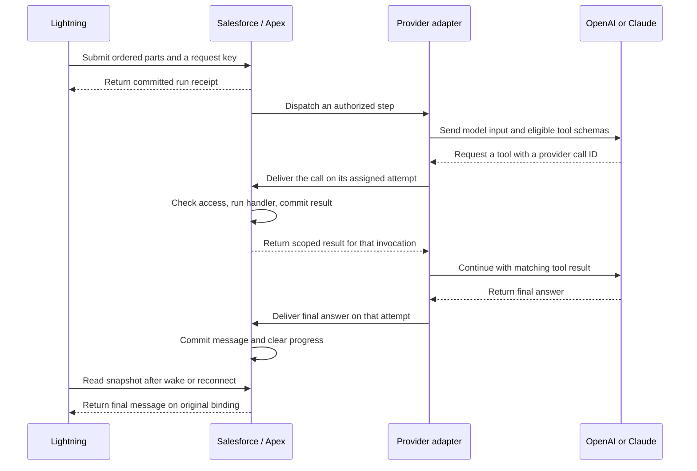

# Codybot prompt audit

Reviewed November 22, 2026 against the [original case at `8a94fff`](https://github.com/whichguy/skill-craft/tree/8a94fff0783557a30fe3423a5612addd620073cd/test/shiploop_e2e/manual/codybot). The subject was the Markdown committed into each new ShipLoop project. The review covered the entire brief, its launcher, both README entry points and repository references to the prompt filename. It also checked how the E2E catalog and CI select work. The case remains manual. All 22 original release scenarios are present in their original order, including the separately phased Poppy interoperability scenario. [Reviewed build prompt](Codybot-design-prompt.md) · [Manual case](README.md)

## Decisions

The scores rank how much each answer changes what an implementer or operator would do. Line references in the evidence links refer to the original case.

| Decision and information gain | Evidence in the original | Resolution |
|---|---|---|
| Can preparing two workspaces start two paid builds? **0.99** | [Launcher L75](https://github.com/whichguy/skill-craft/blob/8a94fff0783557a30fe3423a5612addd620073cd/test/shiploop_e2e/manual/codybot/run.py#L75) and [README L12](https://github.com/whichguy/skill-craft/blob/8a94fff0783557a30fe3423a5612addd620073cd/test/shiploop_e2e/manual/codybot/README.md?plain=1#L12) made a paid launch the default and demonstrated it twice. | Bare invocation and `--prepare-only` prepare separate projects locally. `--run` launches one new instance. The saved command launches the particular prepared instance. |
| Which checks need another real model call? **0.97** | [Adapter L472](https://github.com/whichguy/skill-craft/blob/8a94fff0783557a30fe3423a5612addd620073cd/test/shiploop_e2e/manual/codybot/Codybot-design-prompt.md?plain=1#L472), [journey L620](https://github.com/whichguy/skill-craft/blob/8a94fff0783557a30fe3423a5612addd620073cd/test/shiploop_e2e/manual/codybot/Codybot-design-prompt.md?plain=1#L620) and [matrix L636](https://github.com/whichguy/skill-craft/blob/8a94fff0783557a30fe3423a5612addd620073cd/test/shiploop_e2e/manual/codybot/Codybot-design-prompt.md?plain=1#L636) separately called for the same mixed-media evidence. | Map each live observation to the claims it demonstrates. Keep proof for each required provider, origin and specific pairing. Use controlled transport for reproducible failures and waits. Record missing live evidence and the smallest experiment that can supply it. [Release evidence map](Codybot-design-prompt.md#release-evidence-map) |
| Can a retry ask for a different output format? **0.94** | [Input identity L28](https://github.com/whichguy/skill-craft/blob/8a94fff0783557a30fe3423a5612addd620073cd/test/shiploop_e2e/manual/codybot/Codybot-design-prompt.md?plain=1#L28) omitted the reply preferences accepted at [L42](https://github.com/whichguy/skill-craft/blob/8a94fff0783557a30fe3423a5612addd620073cd/test/shiploop_e2e/manual/codybot/Codybot-design-prompt.md?plain=1#L42). | An equivalent retry returns the original receipt. A changed required format or a changed preference order conflicts before a model or renderer is dispatched. [Turn contract](Codybot-design-prompt.md#one-contract-in-both-directions) |
| Who can resume or learn that a lease expired? **0.92** | [Trace L99](https://github.com/whichguy/skill-craft/blob/8a94fff0783557a30fe3423a5612addd620073cd/test/shiploop_e2e/manual/codybot/Codybot-design-prompt.md?plain=1#L99) depicted a GET as resume. [Cutoff L367–369](https://github.com/whichguy/skill-craft/blob/8a94fff0783557a30fe3423a5612addd620073cd/test/shiploop_e2e/manual/codybot/Codybot-design-prompt.md?plain=1#L367) both blocked reads and promised an expiry response. | Explicit resume authenticates the bound participant and client and preserves the return route. A passive read cannot renew. After cutoff the previous holder can obtain a content-free receipt for the bounded replay window. Other integrations cannot use the handle to discover the session. [Session admission](Codybot-design-prompt.md#admission-isolation-and-replies) · [Lease cutoff](Codybot-design-prompt.md#pickup-keep-alive-and-expiry) |
| Which sources govern replay of a generated reply? **0.90** | The speaker chose the line on the quote. The [stored reply L146–162](https://github.com/whichguy/skill-craft/blob/8a94fff0783557a30fe3423a5612addd620073cd/test/shiploop_e2e/manual/codybot/Codybot-design-prompt.md?plain=1#L146) and its [REST view L520](https://github.com/whichguy/skill-craft/blob/8a94fff0783557a30fe3423a5612addd620073cd/test/shiploop_e2e/manual/codybot/Codybot-design-prompt.md?plain=1#L520) omitted that source. | Each media output in this fixture now records the photo, PDF and voice input. The protected index keeps the actual dependencies of each output for later authorization, including revealing descriptions. [Dialogue example](Codybot-design-prompt.md#the-dialogue-as-a-salesforce-json-file) |

## Learnings

A timeout and a model capability require different evidence. Salesforce documents a cumulative 120-second Apex callout ceiling for both synchronous and asynchronous transactions. A controlled provider can reproduce the missed wake and the long wait, while each provider’s own results establish its media behavior and actual latency. The Winter ’27 governor table lists 10 MB synchronous and 25 MB asynchronous heap. Record the target org’s settings and headroom at qualification. [Salesforce callout timeouts](https://developer.salesforce.com/docs/platform/apex-dev/references/apex-dev/apex-callouts-timeouts.html) · [Governor table](https://developer.salesforce.com/docs/platform/apex-dev/references/apex-dev/apex-gov-limits.html) · [Winter ’27 heap settings](https://developer.salesforce.com/blogs/2026/10/developers-guide-to-the-winter-27-release)

Poppy’s core and extensions have independent versions. The brief calls for a Company-side 1.0 design in v1. Its independent-client qualification belongs to the later implementation. The specification confirms how a client negotiates Operations v3 and Links v1. [Poppy 1.0 version negotiation](https://personalagentprotocol.org/docs/1.0/spec) · [Codybot follow-on](Codybot-design-prompt.md#interoperability-evidence)

## Remediation and verification

1. **Contained execution.** Changed the manual launcher and both README entry points. Each project receives the complete reviewed prompt. The offline launch checks use a fake executable. The original seed inherited the invoking shell’s Git repository selection. A local reproduction with `GIT_DIR` and `GIT_WORK_TREE` set failed to create the new project’s `.git` directory. Isolate the Git environment for preparation and launch, and suppress ambient hooks and clean filters during seeding. [Original seed command L33](https://github.com/whichguy/skill-craft/blob/8a94fff0783557a30fe3423a5612addd620073cd/test/shiploop_e2e/manual/codybot/run.py#L33)
2. **Corrected the build contract.** Applied the decisions above in the specification, worked traces, JSON examples and release rows. The example dates now use a fixture clock. A later build measures live deadlines from its own clock.
3. **Added repeatable offline checks.** From the repository root, run the following command. It checks the launch paths and reads the JSON examples directly out of the build prompt. Two disposable counterexamples confirmed the checks catch the original launch-on-prepare behavior and missing voice provenance even when both JSON examples make the same omission.

```sh
python3 -B -m unittest discover -s test/shiploop_e2e/manual/codybot -p 'test_*.py' -v
```

The existing ShipLoop workspace tests also cover two projects with identical prompts and the replay of a workspace start. The audit provides evidence about the prompt and its isolation. Product qualification still requires an installed subscriber package, tested provider and channel combinations, and an actual authorized MCP call. [Workspace checks](../../../shiploop-workspace.test.py) · [Required release scenarios](Codybot-design-prompt.md#required-release-scenarios)

## Follow-up research on tool definitions and provider interchange

The November 22 prompt described authorization, model-selected tools and durable UI recovery. It gave the implementer no complete example of turning a granted tool into either provider’s `tools` definition or turning a provider result back into a Salesforce message. The follow-up adds a self-contained exchange to the build prompt. Both branches use the same visible timer and return the same answer. [Original tool manifest, L303](https://github.com/whichguy/skill-craft/blob/4758480e40c646c0d09eaf394ec6b00feaaf82a1/test/shiploop_e2e/manual/codybot/Codybot-design-prompt.md?plain=1#L303) · [Original adapter table, L471](https://github.com/whichguy/skill-craft/blob/4758480e40c646c0d09eaf394ec6b00feaaf82a1/test/shiploop_e2e/manual/codybot/Codybot-design-prompt.md?plain=1#L471) · [Worked exchange](Codybot-design-prompt.md#model-tool-definitions-and-the-lightning-to-provider-exchange)



The adapter can be a bounded Apex job or the approved worker. A timeout can occur at any service boundary. Recover committed results by receipt and reconcile an uncertain submission before retrying a paid step. The diagram shows one tool call. [Original rendezvous, L85](https://github.com/whichguy/skill-craft/blob/4758480e40c646c0d09eaf394ec6b00feaaf82a1/test/shiploop_e2e/manual/codybot/Codybot-design-prompt.md?plain=1#L85) · [Salesforce async processing](https://architect.salesforce.com/docs/architect/decision-guides/guide/async-processing)

| Research question and information gain | Finding and design decision |
|---|---|
| What should the model see? **0.98** | Publish aliases, reviewed descriptions and typed arguments for the effective actor, bot, provider and destination. Keep handler and credential bindings in Salesforce. When eligibility exceeds the prompt budget, scoped discovery returns candidates and the next request includes the selected declarations. MCP `tools/list` supports authorization-specific results and pagination. The local manifest pins the accepted tool version for dispatch. [MCP tool specification](https://modelcontextprotocol.io/specification/2026-07-28/server/tools) · [OpenAI tool search](https://developers.openai.com/api/docs/guides/tools-tool-search) · [Claude tool changes](https://platform.claude.com/docs/en/build-with-claude/preserved-thinking/change-tools-or-instructions) |
| Can the same provider request and return envelope serve both models? **0.97** | OpenAI Responses uses a flat function declaration with `parameters`, string `arguments` and a `function_call_output` paired by `call_id`. Claude uses `input_schema`, an object `input` and `tool_result.tool_use_id` in the next user-role message. Replay the complete permitted provider continuation and pair every call. The synthetic user-role result has no authority to approve a Salesforce action. [OpenAI function calling](https://developers.openai.com/api/docs/guides/function-calling) · [OpenAI stateless reasoning](https://developers.openai.com/api/docs/guides/reasoning) · [Claude definitions](https://platform.claude.com/docs/en/agents-and-tools/tool-use/define-tools) · [Claude call/result ordering](https://platform.claude.com/docs/en/agents-and-tools/tool-use/handle-tool-calls) |
| What exactly crosses the UI boundary? **0.94** | The Lightning import receives a named JS object that matches the Apex parameter. A top-level DTO carries the ordered user parts and scoped handles. REST unwraps the equivalent command using its conversation path. The authenticated admission transaction commits before returning. The callback must prove its assigned step and attempt, and the Apex service must enforce the acting principal’s current access. [Lightning imperative Apex](https://developer.salesforce.com/docs/platform/lwc/guide/apex-call-imperative.html) · [Supported Apex types](https://developer.salesforce.com/docs/platform/lwc/guide/apex-expose-method.html) · [Apex security](https://developer.salesforce.com/docs/platform/lwc/guide/apex-security.html) |
| Can subscriber data safely be embedded in strict schemas? **0.88** | Keep record values out of exported definitions. Claude documents a compiled-schema cache of up to 24 hours from last use. OpenAI documents separate schema caching and Zero Data Retention limitations specifically for fine-tuned models. Use stable schemas with scoped lookup results for dynamic values and qualify the actual configuration. [Claude strict schema retention](https://platform.claude.com/docs/en/agents-and-tools/tool-use/strict-tool-use) · [OpenAI strict-mode limitations](https://developers.openai.com/api/docs/guides/function-calling) |

The case-local offline test reads the worked JSON from the prompt and checks the Lightning/REST inputs, both provider declarations, argument parsing, call/result IDs, the scoped receipt and the final displayed text. The test uses synthetic provider responses. Installed LWC binding, provider schema acceptance, actual tool selection, callback authority and latency require the corresponding release evidence. [Offline fixture checks](test_prompt.py) · [Release evidence map](Codybot-design-prompt.md#release-evidence-map)
