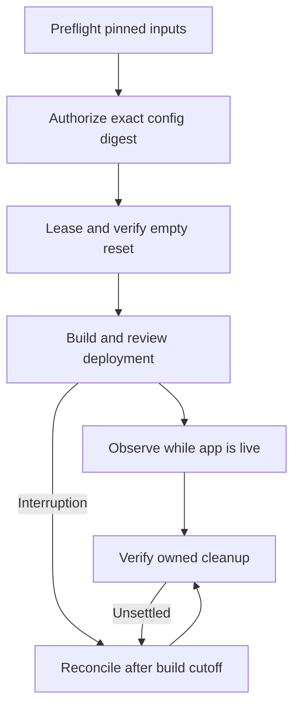

# Attended Grok Bot outcome discovery

Run one clean-create Salesforce attempt through the repository's [internal E2E harness](../../run.py) and [attended CLI](../../hosted_outcome/cli.py). The catalog pins the literal customer brief with one skill invocation and zero fixed checks. The hosted runner uses the installed marketplace ShipLoop. The packaged ShipLoop E2E audit is a separate entry point. This discovery can produce evidence about one delivery. The evaluator is **UNQUALIFIED**, strict `promotion/5` excludes the case, and discovery establishes zero generic ShipLoop gain. [Case catalog](../../cases.json)



A fresh create requires an empty reset under lease. Verified cleanup is the gate for reusing the target.

## Prepare an external attempt

1. From a clean checkout, copy [binding.example.json](binding.example.json) and [operator-config.example.json](operator-config.example.json) to canonical absolute paths outside the checkout and runner output. Reserve an unused external output directory with the bound work path ending in `/work`. Set up an existing external campaign directory and an external baseline ledger path. Pin the exact published `origin/main` commit for the installed build. Keep the same lease registry across attempts on this target. Its normal location is determined by the [resource lifecycle](../../lifecycle.py).
2. Bind the canonical Salesforce org and acting user IDs and username, the guarded command selector, the fresh metadata prefix, the complete retired-prefix scope, the synthetic label, and the nonsecret xAI reference, endpoint and model. Supply the canonical Salesforce executable path and tool directories. Confirm the current org/user, deployment and synthetic scope, existing work, operator Salesforce access, provider principal and browser route. Keep credential values with the operator. Callback commands use the canonical username even if the alias changes. [Binding validator](../../hosted_outcome/binding.py)
3. To make the three binding receipts, first fill every binding field except `receipts`, including the current prompt and source readiness SHA256s. Compute SHA256 over that object encoded with `json.dumps(obj, sort_keys=True, allow_nan=False).encode() + b"\n"`. In each receipt put `kind` (`authority`, `retirement` or `observer`), `identity_sha256` (that digest), `status: "VERIFIED"`, `checked_at` (Unix seconds), and the independently verified facts and evidence. Authority and observer verification expire after eight hours. Retirement binding verification expires after 24 hours. Pin the three receipt files in the binding after review.
4. Pin the actual one-time retirement plan and verification files in the config. The plan carries `org_id`, `initiating_user_id`, the retired `members` map of metadata kinds to `{name,id}` rows, and exact `assignment_ids`. The verification carries `verified: true`, `org: {Id,OrganizationType,IsSandbox}`, empty `remaining_owned_entities`, `remaining_app_assignments`, `active_async` and `active_deploy` arrays, the preserved `provider: [{Id,DeveloperName}]`, and `scheduled` rows with exact preserved CronTrigger `Id` values. For a clean target with no predecessor, attest the empty retired member and assignment inventory with current observations. Independently verify the configured Named and External Credential IDs and the entire preserved scheduled-job set. Retirement evidence is reused as evidence. Only a new leased no-op reset can admit a fresh build.
5. Archive the three official references linked in the customer brief. Pin a snapshot manifest with `pages` rows carrying `url`, `path`, `sha256`, `http_status: 200` and `bytes`. Save current official Codex catalog bytes in the external `{fetched_at, models}` snapshot format. Each model row records `slug`, `visibility`, and `supported_reasoning_levels` with `effort` entries. Use a catalog fetched in the past eight hours. Pin both CLI executables by digest. Set a fixed absolute Unix campaign deadline and positive observation and teardown reserves in seconds. The build cutoff is the deadline minus both reserves.

## Preflight, authorize and run

From the repository root, set `CONFIG` to the canonical external config path.

```sh
PYTHONPATH=test/shiploop_e2e python3.15 -B -m hosted_outcome.cli preflight --config "$CONFIG"
```

Preflight validates local inputs and prints the config digest, exact attempt state directory, output path and selected model. It performs no org, authentication, provider or builder calls. Independently review the scope and authorize that exact digest. Set `AUTHORIZED_SHA256` from the authorization record.

```sh
PYTHONPATH=test/shiploop_e2e python3.15 -B -m hosted_outcome.cli run \
  --config "$CONFIG" --expected-sha256 "$AUTHORIZED_SHA256"
```

The source [readiness](READINESS.json) stays **BLOCKED**. The reset receipt and active lease support an attempt-bound launch assertion. Inspect the effective environment and delivered opening in the runner artifacts. The builder receives the exact [brief](BUILDER_PROMPT.md) followed by the minimal nonsecret environment and authority binding. Keep this guide, operator paths, references archive and [outcome review](OUTCOME_REVIEW.md) on the operator side. Use the guarded launch environment and keep historical fixed checks out of builder inputs.

Fresh launches resolve the latest visible SOL family from the pinned official catalog and require medium for that release. The actual Codex launch supplies the explicit model, `model_reasoning_effort=medium`, and matching default subagent model and effort. Resolve latest Astra separately from the current official catalog for a fresh independent review, using explicit `-m <latest-astra>`, `-c model_reasoning_effort=high`, and matching `agents.default_subagent_model` and `agents.default_subagent_reasoning_effort` controls. Record the actual controls and catalog with each launch. The hosted CLI retains `operator-model-catalog.json` and `operator-model-route.json` beside `operator-config.json` in the state directory. It refuses unavailable or stale SOL routing. Runtime xAI inference is tied to the binding's provider. [Codex launch controls](../../hosts.py)

## Attend the build and observation

The operator publishes complete JSON receipts into the preflight `state_dir` using an atomic rename from the same filesystem. Keep review artifacts independently produced and outside the runner output. An evidence reference is `{path,sha256}` with a canonical absolute path and the full SHA256 of the exact file. Common bound receipt fields are `binding_sha256`, `target` (the entire binding target object), `phase`, and `verified: true`. Copy target and binding values from `start.json`.

- **Deployment.** Watch for `<key>.intent` during the build. The key is the SHA256 of the exact intent bytes. Review the specified DX source, full payload and metadata member map, all effects, and actual Apex, object and field grants. Publish `<key>.approved` with exactly `intent_sha256`, `approved: true`, `binding_sha256`, `force_app_sha256`, `project_sha256`, `members` (kind to list of exact names), and `review_evidence` (evidence reference). Copy the source and project digests from the intent after inspection. Approval is for that deployment. The human using the app must separately confirm **each exact business create or update**. [Guard](../../checks/sf_guard.py) · [Approval validator](../../hosted_outcome/binding.py)
- **App access.** The parent operator independently verifies the successful deployment, exact owned permission-set grant and initiating user before assigning any approved app access. Publish `app-access.json` with the common fields, `phase: "app-access"` and `assignment_ids: ["<exact PermissionSetAssignment ID>"]` for assignments created by the operator. Retain the reviewed source, grants and assignment creation evidence outside runner output. An assignment for a foreign user blocks removal.
- **Observations.** The independent producer waits for `observe-request.json` and submits `observations.json` before its cutoff while the deployed app exists. Supply common fields, `phase: "observe"`, a `checked_at` at or after the request, `status: "OBSERVED"` or `"UNKNOWN"`, and `deployments` ordered by intent digest. Each successful deployment row carries `intent_sha256`, `source_sha256` (the intent's `force_app_sha256`) and the canonical `deployment_id`. Supply exactly the `browser`, `provider`, `native` and `records` keys under `routes`. Each route is `{status: "OBSERVED", path, sha256}` or `{status: "UNKNOWN"}`. Use independently observed browser, live provider, native and record readback evidence according to the outcome review. Set `app_work_pending: true` when logical work still needs settlement. Cleanup then requires `app-work-cleared.json` with common fields, `phase: "cleanup"`, and an `evidence` reference to its independently verified settlement. A pending browser login or missing route leaves the corresponding product claim UNKNOWN. [Partial observation example](observations.example.json)
- **Synthetic cleanup.** For owned custom objects with records, inspect `cleanup-records.json`. Compare its `objects` map, keyed by object API name with `{count, ids}` entries, to independent evidence that all listed rows belong to the agreed synthetic scope. Submit `cleanup-synthetic.json` with common fields, `phase: "synthetic-records"`, exactly that `objects` map, and an `evidence` reference. An unmatched inventory blocks destructive cleanup.

## Reconcile and reuse

The usual attempt cleans up after observation, failure or interruption. Inspect `settled.json` and the phase receipts under `operator-reset-*`, `operator-observe-*` and `operator-cleanup-*`. A settlement attests local process clearance and cleanup of reconciled owned effects. Product acceptance stays UNKNOWN. [Attempt state and receipts](../../hosted_outcome/attempt.py) · [Salesforce callbacks](../../hosted_outcome/operator_lifecycle.py)

If an approved submission lacks a Salesforce ID, independently resolve it before cleanup. Publish `<key>.reconciled` with common fields, `phase: "reconciliation"`, `intent_sha256`, `evidence` and either `disposition: "REMOTE_ID"` with the exact `remote_id`, or `disposition: "NOT_SUBMITTED"` with `remote_id: null` and `basis: "INDEPENDENT_PRE_SUBMIT_FAILURE_EVIDENCE"`. For a missing destructive-submission ID, use `<sha256 of destructive-submitted receipt bytes>.destructive-reconciled` with common fields, `phase: "cleanup"`, `intent_sha256`, `remote_id` and `evidence`. Keep ambiguous scope blocked. A metadata prefix alone provides no ownership authority.

Reconcile the known `STATE` printed by preflight with the original pinned config and digest once the build phase is durably closed or its maximum planned cutoff has passed. Early recovery requires the original `build-closed.json` to match the attempt's `start.json`.

```sh
PYTHONPATH=test/shiploop_e2e python3.15 -B -m hosted_outcome.cli reconcile \
  --config "$CONFIG" --expected-sha256 "$AUTHORIZED_SHA256" --state "$STATE"
```

This path reacquires the same leases and only performs cleanup. It uses the original deadline unless separately authorized to settle with `--cleanup-deadline <absolute Unix seconds>`. Keep the original campaign launch cutoff fixed. Reconcile evidence is retained beside the original settlement. Leave prior evidence in place and wait for verified cleanup before reusing the org. A replay of the same identity while launch inputs are current returns retained settlement or reconciliation-required state without a new builder. For a new attempt prepare fresh external output, receipts, config authorization and a catalog snapshot. Preserve each prior campaign, build, binding and prompt identity.

After each accepted production ShipLoop iteration, merge the verified change to `main`, publish it and verify the installed revision before the next attempt. This attended CLI covers a single attempt. Campaign polling, grading, improvement and certification belong to the separate external ClosedLoop bridge.
