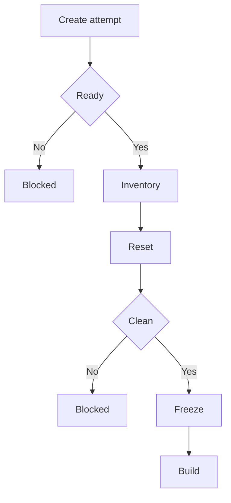
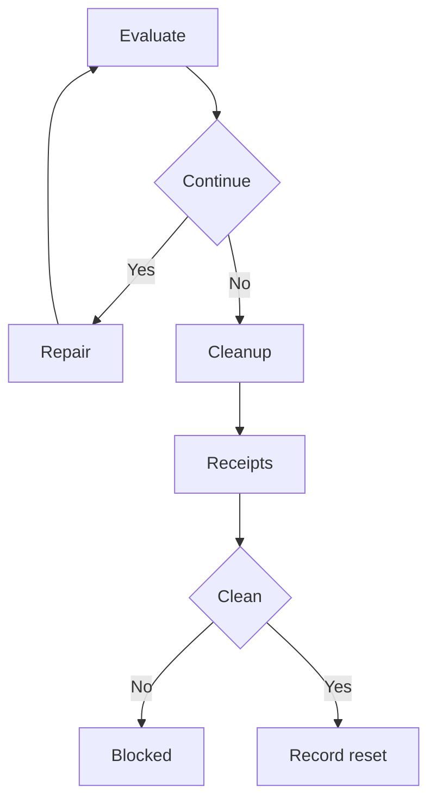

# Grokbot-like Apex harness: preparatory scenario

**Declared FROM-SCRATCH CREATE (`run_kind=create`); startup cleanup and independent verification are mandatory before every independent full-case builder attempt, including the first. Unregistered preparation only. Every live launch, including exploratory work, is BLOCKED until canonical target authority and job-aware containment/cleanup are established.** This directory is neither a selectable/full qualifying root case nor a packaged audit feature. It supplies no application, test implementation, evaluator, catalog entry or live launch command. Offline packet checks cover structure, links, source hygiene and document rendering only. [READINESS.json](READINESS.json) records preparation PREPARED, live launch BLOCKED, evaluator qualification UNQUALIFIED and acceptance NOT_RUN.

The product under test is a Salesforce-native agent harness. Apex owns orchestration and provider requests; xAI performs inference. ShipLoop builds the product from an empty repository. A successful chat facade or browser-driven continuation does not meet this scenario. [BUILDER_PROMPT.md](BUILDER_PROMPT.md) is the product request; [ACCEPTANCE.json](ACCEPTANCE.json) predeclares independent observations and falsifiers. [REFERENCE.md](REFERENCE.md) freezes the bounded reference interpretation.

## Preparation and future execution boundary

Mode is an **outer test intake** decision. This declared create needs no repeated mode question. For a future unspecified scenario, ask clean-create versus feature/additive before choosing destructive reset; finding an app alone never selects feature. Feature work preserves its explicitly verified predecessor and evidence; an explicitly declared synthetic fixture reset must preserve that baseline. Unknown mode or an unverified predecessor blocks the dependent action. The finished bot and individual chat interactions do not make this choice.

*Every independent create resets before its builder, including the first.* Prechecks cover authority, ownership, setup route, observation capability and job/deployment containment. Reset covers stop, invalidation, exact job/deployment accounting, quiescence and owned teardown. Failed, incomplete or unverified reset blocks launch/reuse. An independently observed empty clean target still requires an empty-inventory/no-op cleanup receipt before freeze; a fresh prefix does not replace reset.

*Repeated checks preserve the candidate; success, failure and interruption all require cleanup and retained evidence.* Only separately declared synthetic fixtures may reset within an attempt. Terminal cleanup includes exact owned jobs, late deployments, quiescence and independent covered absence/restoration verification, as detailed below; retain failed cleanup receipts too. A new independent full-case create rerun returns to startup reset even after verified terminal cleanup. This is a future operator sequence, not a self-running loop or new ShipLoop stage. Application repairs use current Until Loop packets or existing send-back; evaluator revisions require separate qualification and observation registration. The diagrams describe the operator sequence; they do not establish execution or application acceptance.

Before builder launch, the operator establishes these prerequisites; they do not require the new application to exist:

- Explicit deployment and synthetic-data authority for the canonical org ID and initiating user ID, plus an alias independently resolving to those identities. A fresh metadata/LWC prefix is not org isolation. Resolve shared-target ownership/lease and previous cleanup before reuse. Discover only prior declared TEST-OWNED resources from the canonical org/case/run inventory, including inventory-linked older prefixes even when the next prefix differs. A new folder, prefix or browser cannot substitute for reset. Complete and independently verify startup reset before the builder, including on the first attempt; a known empty clean target needs an observed empty-inventory/no-op cleanup receipt.
- A job-aware containment and cleanup procedure covering exact owned jobs/classes/runs and effective-user attribution (never User-account deletion), running transactions that can enqueue successors, late deployments and resource dependencies. Unknown ownership, active/conflicting jobs/work, in-flight or late deployments, and failed/unknown/incomplete cleanup block launch/reuse; never switch mode or prefix to evade the block. The current gym cleanup is insufficient for this asynchronous product.
- Current org/API/queue capabilities, trusted browser/auth route and a restricted second identity for permission observations. Attempt actual UI first, preferably available Chrome DevTools; authenticate only as needed. Existing sf does not bypass authority.
- An operator-owned approved encrypted credential-reference/setup route, nonsecret provider reference/endpoint/model and assigned principal/admin setup responsibilities, with grants completed as appropriate before the actions that require them and an exact ownership/baseline ledger. Never give keys to the builder. Distinguish preexisting/reused resources from resources created by this attempt; never revoke an existing key as routine teardown.
- Independent native correlation and secret-free request projections sufficient to join workers, transactions, callouts, real provider results and committed checkpoints. An application log is corroboration, not sole proof. Establish actual observation capability and freeze the post-build Save/readback/connection procedure and evidence contract; historical setup is not evidence of the new app.
- A complete frozen invocation and declared observation deadlines, with safe stop/recovery responsibilities. Bind the required operator credential-reference/setup route and responsibilities; complete grants/configuration as appropriate before the external action that needs them. Missing auth, key, principal, admin configuration or supported model blocks dependent external actions and remains named; it does not require a successful new-app connection before construction.

These pre-builder prerequisites apply even to an attended exploratory attempt. No live deployment may proceed without deployment authority, verified startup reset and containment/cleanup. Product-dependent setup is evaluated after construction under **SETUP-01**: observe the real app Save, independently read back its persisted configuration, and correlate an app-initiated actual connection with the real provider response. Save and connection are separate observations. Exercise missing-setup UI without provider success and then the dependent UI/provider journeys when their prerequisites are available. Missing or blocked provider observations remain UNKNOWN and cannot pass dependent acceptance; they are not a reason to demand a nonexistent product before builder launch. Qualified behavioral/lifecycle evaluators and calibrated adverse controls are additional requirements for qualifying acceptance. This packet cannot supply that qualification. Future execution follows the installed ShipLoop entry contract only after these prerequisites; no ready executable command, invented flags, named catalog case or new outer loop is offered here. Packaging/root catalog integration is separate work.

## Freeze each attempt

Freeze the entire literal builder invocation, including its binding block, rather than relying on this template's placeholders. Retain a hash and immutable copy of all five packet files, the relevant E2E SPEC, reference workflow snapshot, acceptance contract, evaluator revision and observation procedures. The operator appends the nonsecret resolved values requested in the builder prompt; an unbound value blocks external actions, not planning.

In the dated 2026-11-13 UTC preparation snapshot, the coordinator’s Git read observed canonical main at `7ceaecf441448c1c394340ec2c98f848cd685b27` (Skill Craft 2.36.6 / ShipLoop 1.33.10). This is observed preparation context, not a newly stated owner version preference or installed subject binding. This packet does not pull/merge or edit releases. Resolve and verify the current published selection at future launch; historical ShipLoop 1.33.9 is not a latest-version binding. This preparation is no frozen/live trial and makes no model comparison.

Record requested model/effort and actual launch controls separately from independently verified served identity. For future runs, apply actual model/effort launch controls: subject/builder, test author and routine execution use `gpt-6.1-sol` / `medium`; independent reviewer and judge each use a fresh `gpt-6-astra` / `high` session. Prompt prose is not a model switch. App inference remains Grok/xAI with its own separately configured provider model. Preserve requested-versus-served identity limits; do not claim verified served identity from launch controls alone. These requirements change no global default, installed package or historical identity. Record installed ShipLoop logical skill path, package/version/source identity and relevant bytes, evaluator identity and launch host/tool versions. A source checkout alone does not establish installed subject identity. Each independent judgment is a separate fresh session; retain its actual evidence separately from this packet.

Record canonical org/user, alias resolution, metadata/LWC prefixes, restricted-user fixtures, provider credential reference/endpoint and requested/verified provider model without secret material. Bind the actual product source HEAD plus full deployable-tree content/mode hashes, including ignored/untracked deployable files, to complete deployment IDs, Apex bodies/API versions/schema readback and UI route. A later partial/interrupted deployment invalidates old current-deployment credit. Whole-source, deployable-tree and oracle hashes have distinct scopes.

Append observation registration before fallible work. A newer incomplete/failed observation supersedes older credit; never fill gaps from an older pass. Retain earlier raw results unchanged. A later repair/qualified current assessment does not relabel the original failed trial. Freeze deadlines and retain queue state when they expire; service delay yields UNKNOWN unless actual evidence demonstrates a product defect.

## Independent evaluation

Predeclare positive and adverse evaluator controls from every matrix row before claiming qualification. The INTAKE rows in ACCEPTANCE.json are evaluator/operator controls, separate from Apex behavior: old owned app/job leftovers must block despite a new prefix; failed/unknown reset must block; a known empty target must produce an observed no-op receipt; unspecified mode requires the intake question and feature mode must preserve its verified predecessor. At minimum reject browser-only progress, reopen-triggered work, dummy Queueables, canned nonce answers, duplicate writes, stale/late workers, revoked/cross-user/field-only/sharing access, stale instructions and unowned resource cleanup. Keep deterministic native mocks separate from real provider/org/browser observations. Do not reuse the old full case's fixed six synchronous browser joins as proof of asynchronous work.

For browser-away proof, initiate once; close every app tab; stop builder and browser execution; independently observe read-only org state during the declared interval. No app browser, external agent or continuation caller may drive work; independent observers may only perform the declared read-only observations, never call a continuation endpoint. Establish at least two distinct native worker transactions advancing committed state before reopening, with full job/provider/tool/checkpoint lineage bound to the deployed source. Observe the actual selected structured Apex read result, including the unpredictable allowed-record challenge, in the next real-provider request; an app log alone is insufficient. Reopening displays progress already committed.

Evaluate business changes from independent snapshots, not assistant prose. Demonstrate no preapproval mutation, exact confirmed create/update, atomic proposal consumption/write, stale/expired/duplicate/concurrent refusals and both serialized cancellation outcomes. Review current authority at async execution and before provider disclosure, not only in the UI. Complete the roster, instructions, memory, overflow, steering, recovery, desktop/narrow/keyboard and state journeys in the matrix. Missing actual observations cannot pass.

Request independent source-bound review of code, error checks, useful comments, meaningful warranted tombstones and test adequacy. Require actual native results and decisive assertion mappings. No tombstone/comment/finding quota substitutes for engineering judgment. Workflow conformance uses the actual action packets and exact callbacks, independently of whether the app appears to work.

## Reset before create and clean after every attempt

The trusted operator performs this sequence before each independent create builder attempt, including the first, and after success, failure or interruption. Discover prior declared TEST-OWNED resources through canonical org/case/run inventory across inventory-linked prefixes, not only the new prefix. For an independently observed empty clean target, record a no-op cleanup receipt with covered inventory and verification; an existence check or an assumed empty target is insufficient. This preparation has not queried the org or cleaned anything.

Startup reset is not repeated before every native/UI test, step Proof or Until Loop repair/test cycle. Those checks must be safe to repeat and preserve the deployed candidate; only declared synthetic fixture resets are permitted inside the attempt. A future feature/additive run preserves its verified predecessor.

Cleanup/admin/deployment/auth commands belong to operator/builder setup, never runtime bot tools; saved memory or instructions cannot grant those powers. The deployed app never edits User accounts. Isolated rollback-only native test User fixtures are separately labelled native evidence. Stopping local processes alone does not stop Salesforce workers.

1. **Stop new work:** disable this attempt's new starts and continuations through its authorized containment route; prevent new deployments and retain all source/trace identities.
2. **Invalidate workers:** establish a durable generation/cancellation boundary rejecting outstanding workers and enqueueing. Account for transactions already in flight and preserve already committed writes truthfully.
3. **Account for exact owned jobs and late deployments:** reconcile job IDs, class/run lineage, canonical org/user, deployment IDs and ledger entries. Never select jobs solely by prefix/name or abort another run. Ambiguous ownership means incomplete cleanup and blocks reuse.
4. **Quiesce:** observe all owned work terminal, no outstanding mutation/enqueue capability and no late deployment capable of restoring deleted artifacts. A momentarily empty job query is insufficient while a transaction can enqueue.
5. **Teardown:** remove only proven owned data/app/schema/permission artifacts in dependency-safe order. Operator removes only owned temporary provider credentials/grants after app work is quiescent. Require separate ownership evidence for newly created temporary provider resources. Preserve preexisting referenced credentials/configuration, original owner keys, unrelated apps/business data, User accounts and other active work. Account for owned diagnostic resources/logs without broad deletion.
6. **Verify:** independently compare the declared baseline, covered records/schema/source/permissions, job/deployment state and provider resource/grant disposition. Record exclusions, failed checks and residuals explicitly, with independent absence or covered-restoration readback and retained cleanup receipts. Unobserved scope cannot be called restored. Missing/incomplete cleanup blocks the next same-target attempt.

Do not delete evidence as teardown. Keep failed/UNKNOWN attempts, original result files, ownership ledgers, late-deployment records and cleanup receipts. Full owned lifecycle coverage is an obligation, not a claim this packet has fulfilled.

## Repair and generic-improvement attribution

| Category | Required response |
|---|---|
| Application defect | Repair app/tests in the current ShipLoop Until Loop under frozen criteria. If an accepted plan is invalid, use existing send-back. Rebind changed source/deployment and repeat affected observations. |
| Evaluator defect | Demonstrate with a controlled falsifier; repair separately, give the evaluator a new revision, independently recalibrate, and register fresh observations. Preserve prior verdicts. |
| Environment blocker | Name the missing auth, principal, model, capacity, tooling or authority evidence and its owner. Keep dependent outcomes UNKNOWN; do not waive checks. |
| Generic ShipLoop prompt/handoff defect | Inspect actual action packets/callbacks and trace-supported causal alternatives. Propose a bounded generic hypothesis between trials; an app failure alone is insufficient. |

Generic changes should use minimal generic wording and, only where useful, brief setup or durable-work examples. Independently review and calibrate non-Salesforce controls before adoption; controls alone do not establish a causal gain. Each subsequent published-build trial gets a unique registration, fresh empty product/run and target baseline, installed-build proof, frozen prompts/criteria and preserved failed evidence. A case pass is scenario evidence, not measured generic ShipLoop improvement. Neither a repaired evaluator nor a changed model may be silently counted as a prompt gain.

Historical `grok-chat-salesforce` and `grok-chat-salesforce-full`, their no-background-jobs contract and existing packages remain unchanged. This preparatory packet does not extend their acceptance or cleanup guarantees.
