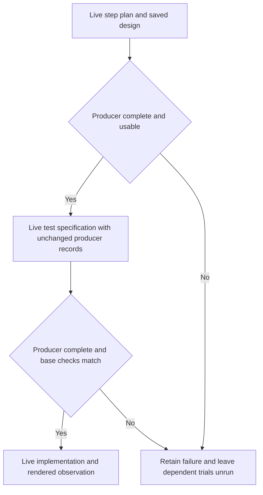

# UI decision packet tests

Select `+ui-contract` to test how ShipLoop creates, selects, follows and documents a product's design decisions. These scenarios exercise the existing packet contracts. They do not prescribe one palette, add a production schema or establish that an interface looks good.

```sh
python3 test/shiploop_e2e/stage_suite/stages.py verify +ui-contract
python3 test/shiploop_e2e/stage_suite/stages.py render +ui-contract
```

`verify` calibrates the evaluator with authored good and bad outputs. `render` checks the real packet produced from synthetic prerequisites. Where the packet intentionally links a knowledge record, checks verify both that reference and the record's content; they do not require every fact to be copied inline. Neither tier calls a model. See [the stage-suite command contract](README.md#the-three-tiers) for live execution and its environment requirements.

| Scenario | Observable behavior | Protected behavior |
| --- | --- | --- |
| `step-plan/ui-create-board` | A new board UI receives concrete, reusable design choices selected into criteria. | The functional starter is preserved. |
| `step-plan/ui-create-chat` | New chat design choices address messages, navigation and composition. | Scope stays local to the requested chat. |
| `step-plan/ui-complete-thin-ad` | A thin existing decision becomes specific enough to guide work. | Its stable ID and established identity survive. |
| `step-plan/ui-select-saved-design` | Criteria select the saved decision, section and applicable values. | Unrelated accepted decisions do not become new work. |
| `implement/ui-apply-saved-design` | The requested status relocation follows the selected saved design. | Existing board behavior remains usable. |
| `step-plan/ui-explicit-style` | The user's explicit visual direction takes precedence over the default. | The requested feature remains the scope. |
| `step-plan/ui-preserve-identity` | An existing product retains its identity when a feature is added. | Missing documentation does not authorize a rebrand. |
| `test-spec/ui-rendered-checks` | Test plans distinguish rendered observations from functional checks. | A planned or unavailable check is not reported as a visual pass. |
| `document/ui-verification-truth` | Records reflect the implementation and the actual verification status. | Accepted intent and open visual evidence remain visible. |
| `step-plan/ui-backend-control` | A backend repair plans the reported defect. | Presentation records and assets stay outside its scope. |

The first UI **step-plan** packet owns the concrete visual choices. Testing that duty at global `plan` would impose detail that its printed contract does not require. Explicit constraints and established identity are each tested against the default; these cases do not invent a precedence rule for a conflict between the two.

## Read results at the level they establish

Every planted condition and protected control has a bad reference that must fail. Alternative `good-*` references check that the evaluator accepts materially different valid outputs. Private `oracle/` helpers can compare a returned criterion with the actual architecture record through `STAGE_RESULT`; they are copied outside the candidate tree for evaluation, not supplied as product files.

The builder regression also submits positive planning, test-spec and document references to the real, non-counting `shiploop check` path. It checks requirement links and planned-file expectations as well as result shape. A successful check accepts no action and runs no Improve review. The document fixture changes documentation only and has no check-suite browser command. Implement references receive shape checks in the hermetic suite: the real implement check executes its browser proof, so runtime acceptance belongs to a browser-enabled run. Authored reference evidence is synthetic, including any example verification report.

Those checks are narrow proxies for specificity, traceability, scope and truthful reporting. A model can still write internally consistent choices that are awkward, inaccessible or visually poor. Inspect the decisions and the rendered result independently. For a board, observe cell geometry, narrow-screen overflow, selection and reset. For chat, observe message hierarchy, conversation switching and a reachable composer. Keep screenshots, viewport sizes, observed interactions and failures with the sample. A browser becoming available does not mean the subject used it.

The optional [board observer](../stage_suite/ui_browser_observer.cjs) uses an already available Playwright runtime (`PLAYWRIGHT_NODE_PATH` or `PLAYWRIGHT_MODULE_PATH`, otherwise normal Node module resolution) and, if needed, `BROWSER_EXECUTABLE_PATH`. It installs nothing. First run `node test/shiploop_e2e/stage_suite/ui_browser_observer.cjs --calibrate --out /absolute/new/calibration-directory`: the good board must pass, while uneven cells, mobile overflow, overlapping controls and a wrong grid shape must each fail their specific measurement. Then run it with `--root /absolute/sample/export --out /absolute/new/observation-directory`. Output must be new and outside the candidate tree. The observer retains four viewport/theme observations and screenshots. Its dark row changes the browser preference; inspect any explicit product theme control separately. Changed fixture selectors produce an **unsupported** result requiring inspection, not a passing UI verdict. Browser startup failures remain **incomplete**. It is intentionally outside the hermetic oracle list.

UI requests live inline in their `scenario.json` files beside the board/chat overlays they describe. They are not entries in the general slice catalog: that runner would use the base fixture without these overlays. The backend control reuses its existing catalog request.

Fixtures and reference answers are intentional test data under this harness. Runtime records, generated products, browser captures and live transcripts belong in a new external results directory. Product decisions belong in the generated product's `docs/shiploop/architecture.md`, not in the reusable ShipLoop skill.

## Test a generated-record handoff separately

An independent scenario with an authored AD tests consumption of that AD. It does not prove that an earlier model generated a useful one. A handoff diagnostic needs actual producer artifacts:



The handoff preserves the producer's JSON and AD bytes and hashes the spec and environment records as well. Record whether the producer stopped as accepted or parked before Improve. Compare the complete stored payloads, including omitted fields, ordered steps, criteria, proof commands, paths, test commands, expectations, follows and test cases. Seeding must not quietly replace a missing field with an authored default.

`validate-existing` must settle from a nonempty set of the producer's actual expectations rather than receive a synthetic success. Retain the check commands, base identity, exits, match results and output locations; an empty all-match record proves nothing. If carrying the generated AD changes an expectation's premise, retain that mismatch and stop the dependent trial. Other seeded prerequisites and skipped Improve reviews remain explicit limitations. A subsequent feature gets a separately identified new request/spec prerequisite while preserving the product and accepted design record. Grade a generated-record continuation against its actual request and AD, not the prepared AD-2 fixture's fixed values.

An `implement` packet covers only the current planned step. If the producer planned S1 and S2, one accepted implementation establishes S1 only; the normal workflow must pass through its test, document and commit stages before S2. Preserve that distinction instead of forcing one-step plans or claiming the entire product is complete. The `test-spec` packet returns test-case records and writes no test code; that code belongs to later stages.

The current seed replaces global-plan work items, so it cannot establish an unchanged global-plan handoff. Distinguish an observed AD file read, application of its selected choices, and dependence on information available only in that file; packet excerpts are allowed and do not establish or rule out a file read. Freeze the scenario, harness and subject settings before each diagnostic. Preserve failed samples, and regrade only a copy if the evaluator changes. A single live sample describes one observation; it is not a reliability rate or evidence of a prompt improvement.
